## **Рабочая область: Графики** { #workspace-graphs }

Рабочая область **Графики** (`Graphs`) полностью посвящена визуализации данных и разработана с особым акцентом на простоту, быстродействие и гибкость настройки.

  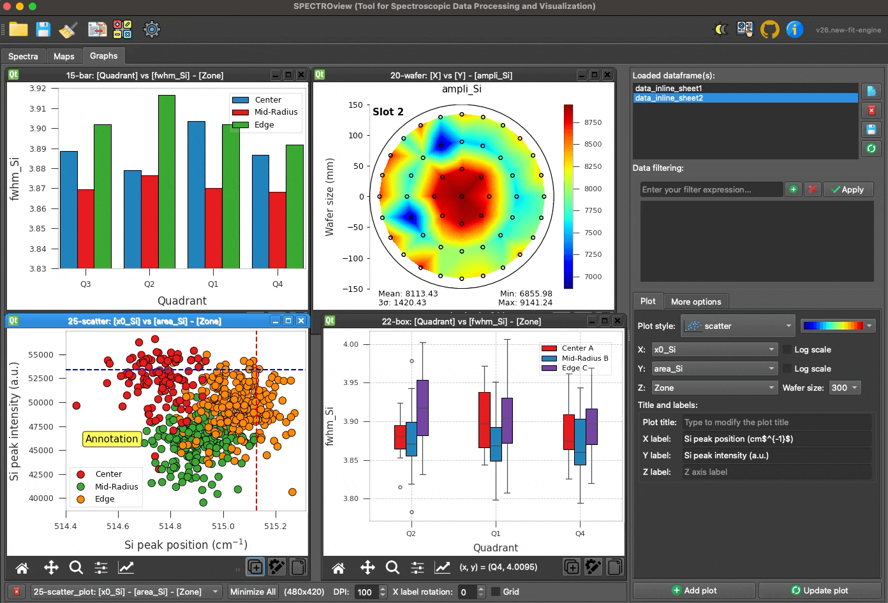 
  <i>Обзор интерфейса рабочей области «Графики».</i>

 

_______

### **1. Загрузка данных** { #1-loading-data }

Наборы данных можно передавать напрямую из рабочих областей **Спектры** (`Spectra`) и **Карты** (`Maps`) или импортировать из внешних файлов Excel/CSV. Все доступные наборы данных динамически отслеживаются и отображаются в виджете списка наборов данных.

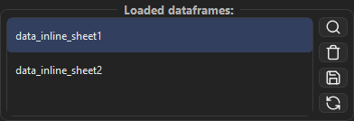 
Четыре доступные служебные кнопки позволяют:

- **View**: просмотреть таблицу данных во встроенном окне.
- **Удалить** (Delete): удалить набор данных из рабочей области.
- **Сохранить** (Save): экспортировать набор данных в формат Excel или CSV.
- **Refresh**: динамически перезагрузить файл CSV/Excel, если он был изменён извне.

________

### **2. Добавление или обновление графика** { #2-add-or-update-a-plot }

1. Выберите целевой набор данных в списке.
2. Укажите подходящие столбцы для осей X, Y и Z с помощью выпадающих списков.
3. Выберите нужный тип графика (доступные типы: **рассеяние** (`scatter`), **точки** (`point`), **столбцы** (`bar`), **ящик с усами** (`box`), **линия** (`line`), **линия тренда** (`trendline`), **гистограмма** (`histogram`), **2D-карта** (`2Dmap`), **пластина** (`wafer`)).
4. Задайте подписи графика, пределы осей и диаметр пластины (если применимо).
5. Нажмите **Добавить график** (Add plot), чтобы построить визуализацию.

  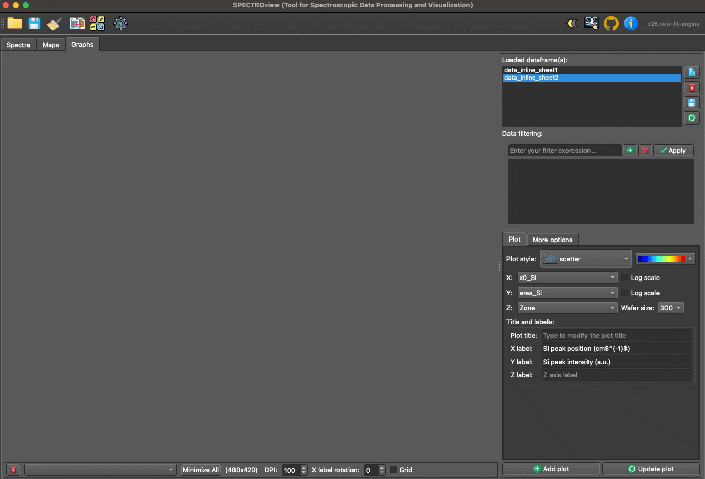 
  <i>Демонстрация добавления нового графика или обновления существующего.</i>

______

### **3. Общая панель инструментов графиков** { #3-the-shared-graph-toolbar }

На нижней панели рабочей области собраны все глобальные элементы управления и одна общая панель инструментов графика, которая всегда действует на текущее активное окно графика. Чтобы сделать график активным, нажмите на него или выберите его в выпадающем списке **Активный график** (Active plot) на боковой панели (сразу над кнопками **Добавить график** / **Обновить график** (Update plot)).

| Элемент управления | Описание |
|---|---|
| **Удалить все** (Delete all) | Удаляет все графики из рабочей области. |
| **Свернуть все** (Minimize all) | Сворачивает все окна графиков. |
| **Отменить** (Undo) / **Redo** | Перемещает назад/вперёд по истории изменений рабочей области (`Ctrl+Z` / `Ctrl+Shift+Z`). |
| **Compose Figure** | Объединяет несколько открытых графиков в один многопанельный рисунок для экспорта. |
| **Home / Pan / Zoom / Subplots** | Стандартная навигация Matplotlib: возврат к исходному виду, панорамирование, масштабирование прямоугольником или настройка полей подграфиков. |

> **Совет:** При изменении размера или перемещении окна графика перетаскиванием его границы или строки заголовка сначала отображается контур. График перерисовывается один раз — уже в новом размере — после отпускания кнопки мыши. Это обеспечивает плавность работы даже с крупными графиками. Аналогично, во время панорамирования поля вокруг осей остаются фиксированными и пересчитываются после отпускания кнопки мыши.

Вертикальный разделитель отделяет элементы управления самого активного графика — они всегда выровнены по правому краю окна:

| Элемент управления | Описание |
|---|---|
| **Replicate** | Создаёт дубликат активного графика. |
| **Customize** | Открывает диалоговое окно Customize Graph Dialog для активного графика (`Ctrl+E`, см. ниже). |
| **Копировать** (Copy) | Копирует рисунок активного графика в буфер обмена как изображение (`Ctrl+C`). |
| **Export** | Нажмите для экспорта активного графика в файл. **Удерживайте Ctrl + клик**, чтобы экспортировать сразу все открытые графики. |
| **Style menu (🎨)** | Сохранение и применение стиля, копирование и вставка стиля (`Ctrl+V` для вставки), сброс к исходному виду или назначение текущего стиля стилем по умолчанию для новых графиков. |

> **Примечание**: перечисленные выше сочетания клавиш `Ctrl+Z`, `Ctrl+Shift+Z`, `Ctrl+C`, `Ctrl+V` и `Ctrl+E` работают только тогда, когда активна вкладка **Графики** — они не мешают выполнению тех же комбинаций в других частях приложения (например, при вводе текста в полях).

______

### **4. Настройка графика** { #4-customizing-a-plot }

Вы можете быстро изменить **подписи** осей и **заголовок** графика через боковую панель (`Right Panel`). Нажмите кнопку **Обновить график**, чтобы мгновенно применить изменения:

  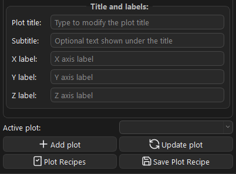 
  <i>Настройка выбранного графика через Right Panel. Нажмите кнопку Обновить график, чтобы применить изменения.</i>

 

Для расширенной настройки нажмите кнопку **Customize** (⚙), чтобы открыть диалоговое окно **Customize Graph Dialog** (`Ctrl + E`). Оно выполнено в современном двухпанельном интерфейсе по образцу «Настроек» и оснащено глобальным поиском по всем параметрам в реальном времени, адаптивной навигацией по категориям слева, а также подсветкой и автоматической прокруткой к найденному параметру внутри семи модульных категорий:

- **Общие и типографика** (General & Typography): тема рисунка (светлая/тёмная), линии сетки, поворот подписей оси X, размеры шрифта (заголовок, подпись оси, подписи делений, цветовая шкала) и интеллектуальная сортировка данных.
- **Оси и пределы** (Axes & Limits): пределы осей с интерактивными ползунками диапазона (вверху), масштабы основных осей X/Y/Z (линейный, логарифмический, Symlog, центрированный), числовой и категориальный типы данных, инверсия осей и диапазоны разрыва осей.
- **Ticks & Spines**: направление делений, предустановленные форматы подписей делений, дополнительные деления (сверху, снизу, слева, справа) и видимость линий рамки осей.
- **Legend & Series**: размещение блока легенды (внутри/снаружи), рамка, число столбцов, заголовок, размер шрифта, прозрачность альфа, положение, общий стиль маркеров и выровненная по левому краю таблица оформления по сериям.
- **Стиль графиков и аппроксимация** (Plot Style & Fitting): специализированные параметры типов графиков (соединение точек, разнесение совпадающих точек, статистика пластины), унифицированные настройки планок ошибок (отображение, тип статистики, ширина засечек), полиномиальная аппроксимация линии тренда с опорными точками и таблицами уравнений в реальном времени, а также интервалы гистограммы и кривые KDE.
- **Annotations**: визуальные аннотации на графике (вертикальные и горизонтальные линии, текст, стрелки, вертикальные и горизонтальные полосы, прямоугольники, выноски) с интерактивным перетаскиванием по холсту и модальным редактированием.
- **Вторые оси и врезка** (Secondary & Inset Axes): дополнительные спаренные оси (Y2, Y3, X2 с отдельными подписями, пределами, логарифмической шкалой, цветами и маркерами) и увеличенная врезка с соединительными линиями.

Все изменения на всех вкладках применяются одновременно единой кнопкой **Применить** (Apply) в нижней части диалогового окна или отменяются кнопкой **Отмена** (Cancel).

---

#### 4.1 «Оси и пределы», Ticks & Spines и «Вторые оси и врезка» { #41-axes-limits-ticks-spines-and-secondary-inset-axes }

  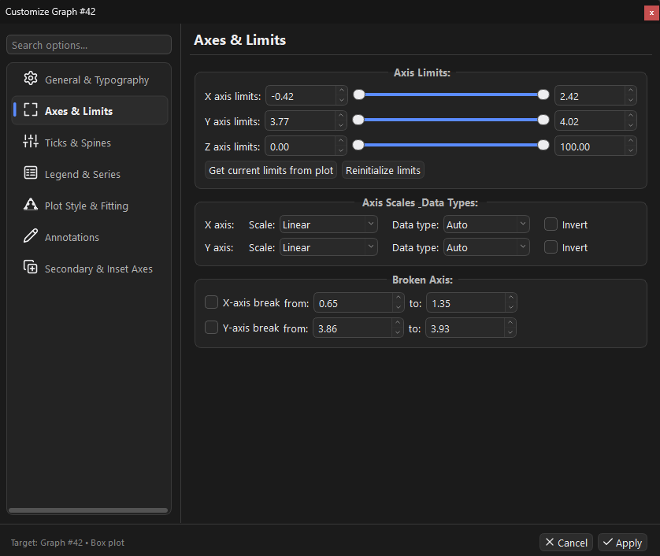 
  <i>Настройка осей в диалоговом окне Customize Graph Dialog.</i>

Категории **Оси и пределы**, **Ticks & Spines** и **Вторые оси и врезка** управляют масштабированием осей, типами данных, пределами, оформлением делений и рамки, разрывами осей, врезками (увеличенными областями) и дополнительными спаренными осями. Размеры шрифта для заголовков, подписей и делений находятся в категории **Общие и типографика**.

##### Свойства осей (Оси и пределы) { #axis-properties-axes-limits }

Настройте **масштаб** и **тип данных** для каждой оси независимо с помощью выпадающих меню:

| Параметр | Варианты | Описание |
|---|---|---|
| **X / Y axis Scale** | **Линейный** (`Linear`), **Логарифмическая** (`Logarithmic`), `Symlog` | Переключает ось между линейной, логарифмической и симметричной логарифмической шкалами. Логарифмическая шкала применяется только в том случае, если исходные данные являются числовыми. |
| **X / Y axis Data type** | **Авто** (`Auto`), **Категория** (`Category`), **Числовые** (`Numerical`) | Определяет интерпретацию значений по оси. **Авто** (по умолчанию): приложение автоматически определяет оптимальный тип — числовой, если 100 % данных составляют числа, иначе категориальный. **Категория**: принудительно использует категориальную индексацию. **Числовые**: принудительно задаёт непрерывную числовую шкалу. |
| **Z axis Scale** *(только для типов «пластина» / «2D-карта»)* | **Линейный**, **Логарифмическая**, **Центрированная** (`Centered`) | Задаёт нормализацию **цветовой шкалы** тепловой карты. **Логарифмическая** сжимает широкий диапазон значений (возвращается к линейной, если данные не строго положительны). **Центрированная** привязывает среднюю точку цветовой палитры к введённому значению **Центр** (Center value) — идеально подходит для расходящихся данных, например механических напряжений или деформаций вокруг 0. |

> **Примечание**: при использовании типа данных **Числовые** ось принимает истинную математическую шкалу, в которой интервалы отражают реальные значения данных. При использовании **Категория** каждое уникальное значение располагается равномерно независимо от его числовой величины.

##### Задание пределов осей (Оси и пределы) { #set-axis-limits-axes-limits }

Задайте видимый диапазон каждой оси (X, Y, Z) вручную, указав значения **min** и **max**:

| Элемент управления | Описание |
|---|---|
| **X / Y / Z axis limits** | Введите минимальное и максимальное значения, чтобы ограничить видимый диапазон. Оставьте поле счётчика незаполненным (в нём отображается текущее реальное значение графика серым цветом), чтобы сохранить автоматический расчёт этой границы. |
| **Считать пределы с графика** (Get current limits from plot) | Считывает текущие видимые пределы с графика и заполняет поля. Удобно использовать как отправную точку перед тонкой настройкой. |
| **Clear limits** | Сбрасывает все пределы осей обратно в автоматический режим (без ограничений). |

  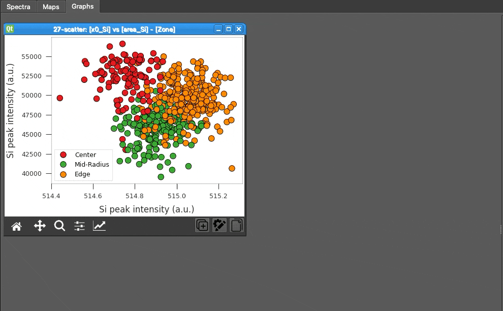 
  <i>Настройка пределов осей выбранного графика.</i>

##### Внешний вид осей (Ticks & Spines) { #axis-appearance-ticks-spines }

| Элемент управления | Описание |
|---|---|
| **Minor ticks** (X **Снизу** (Bottom)/**Сверху** (Top), Y **Слева** (Left)/**Справа** (Right)) | Независимо включает дополнительные деления на каждой из четырёх границ графика. По умолчанию дополнительные деления автоматически включены только для осей, представляющих числовые значения (например, X и Y для графиков **рассеяние**, **линия** и **гистограмма**, Y для **столбцы**, **ящик с усами** и **точки**), и скрыты на категориальных осях или картах. Пользователи могут включать или отключать их для любой оси отдельно. |
| **Show spines** (**Сверху**/**Справа**/**Снизу**/**Слева**) | Независимо переключает видимость каждой из четырёх линий рамки графика. |
| **Направление делений** (Tick direction) | **По умолчанию** (`Default`), **Внутрь** (`In`), **Наружу** (`Out`) или **Обе стороны** (`In & Out`). |
| **Формат подписей делений** (Tick label format) | **Авто**, `Integer`, `1-decimal`, `2-decimal` или `Scientific`. |

##### Разрыв оси (Оси и пределы — бета) { #broken-axis-axes-limits-beta }

Создаёт визуальный разрыв на оси, чтобы пропустить неинформативный интервал и сосредоточиться на значимых областях данных:

| Элемент управления | Описание |
|---|---|
| **Разрыв оси X** (X-axis break) | Включает разрыв и задаёт диапазон `from` / `to` для пропуска по оси X. |
| **Разрыв оси Y** (Y-axis break) | Включает разрыв и задаёт диапазон `from` / `to` для пропуска по оси Y. |

> **Примечание**: эта функция находится в стадии бета-тестирования. Разрывы осей лучше всего работают с линейными шкалами.

##### Оси врезки / увеличения (Вторые оси и врезка) { #inset-zoom-axes-secondary-inset-axes }

Отрисовывает небольшую увеличенную область графика внутри основного поля построения:

| Элемент управления | Описание |
|---|---|
| **Enable inset axes** | Включает или отключает отображение врезки. |
| **Position (x0, y0) / Size (w, h)** | Положение и размер рамки врезки в долях области построения (0–1). |
| **X / Y limits** | Диапазон данных, приближаемый во врезке. Оставьте серые значения по умолчанию для автоматического подбора границ. |
| **Show zoom indicator** | Рисует соединительные линии от рамки врезки к увеличенной области на основном графике. |

> **Примечание**: оси врезки и разрыв оси взаимоисключающие — включение одной функции отключает другую.

##### Вторые оси (Вторые оси и врезка) { #secondary-axes-secondary-inset-axes }

Позволяет построить дополнительные столбцы по оси Y (или второй столбец по оси X) с независимыми шкалами — по одной строке на ось (**Y2**, **Y3**, **X2**). Строка активируется, как только этой оси назначен столбец, и позволяет задать **Подпись** (Label), пределы **Мин/Макс** (Min/Max), переключатель **Лог. шкала** (Log scale), **Цвет** (Color) и **Маркер** (Marker).

---

#### 4.2 Legend & Series { #42-legend-series }

  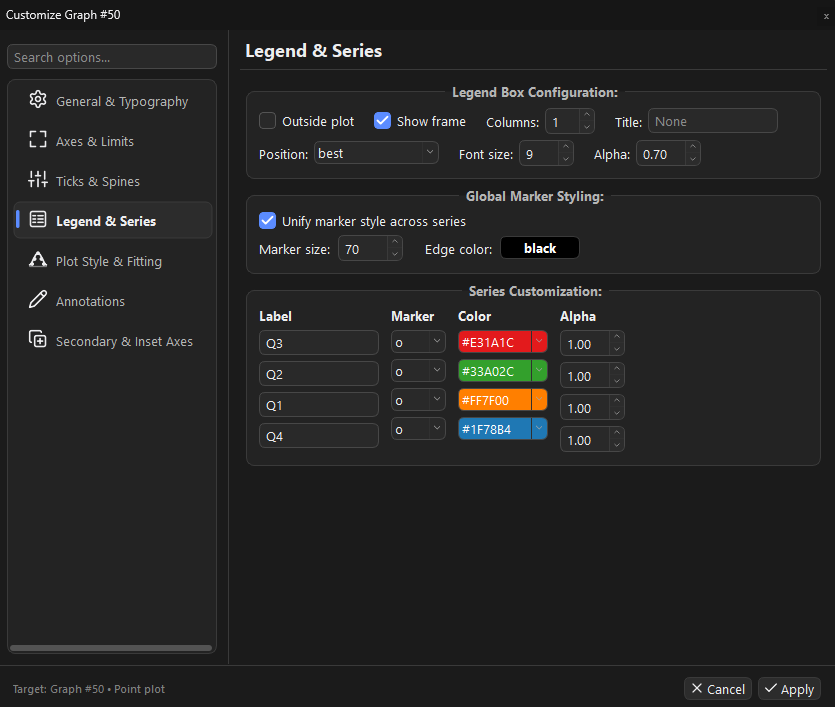 
  <i>Категория Legend & Series в диалоговом окне Customize Graph Dialog.</i>

Категория **Legend & Series** позволяет настроить внешний вид и расположение легенды графика, а также цвета, маркеры, прозрачность и толщину линий для каждой серии данных.

##### Блок легенды и оформление серий { #legend-box-series-styling }

| Элемент управления | Описание |
|---|---|
| **Put legend box outside** | Перемещает рамку легенды правее области построения, чтобы она не перекрывала данные. Снимите флажок, чтобы разместить легенду внутри графика. |
| **Unify marker size / edge color** | Включено по умолчанию: один элемент управления размером маркера и цветом контура в верхней части применяется ко всем сериям сразу. Снимите флажок, чтобы открыть столбцы индивидуального размера маркера и цвета контура в таблице ниже (для графиков **рассеяние**, **точки** и **линия тренда**), позволяя настроить каждую серию отдельно. |
| **Подпись** | Изменяет отображаемое имя каждой серии данных в легенде. |
| **Маркер** | Выбирает символ маркера для каждой серии (доступно для графиков **точки** и **рассеяние**). |
| **Цвет** | Выбирает цвет для каждой серии из предопределённой палитры. |
| **Прозрачность** (Alpha) / **Толщина** (Line width) | Непрозрачность для каждой серии и толщина линии для типов графиков, отображающих кривую (**линия**, **линия тренда** или **точки** с включённым соединением точек). |

> **Совет**: блок легенды можно **перетаскивать** мышью в любое место прямо на холсте графика.

  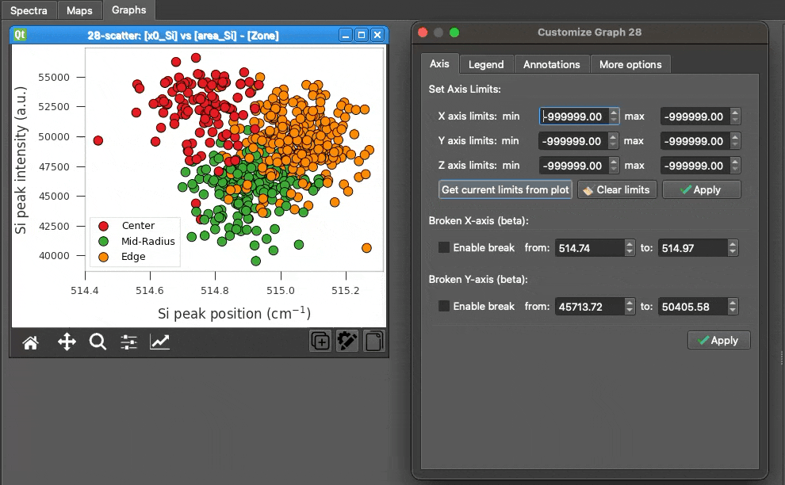 
  <i>Настройка легенды и цветов выбранного графика.</i>

##### Стиль легенды { #legend-style }

| Элемент управления | Описание |
|---|---|
| **Столбцы** (Columns) / **Frame** / **Заголовок** (Title) / **Размер шрифта** (Font size) / **Прозрачность** / **Позиция** (Position) | Компоновка и внешний вид самой рамки легенды. |

---

#### 4.3 Annotations { #43-annotations }

  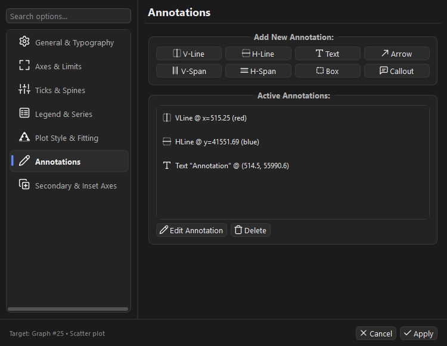 
  <i>Категория Annotations в диалоговом окне Customize Graph Dialog.</i>

Категория **Annotations** позволяет накладывать на график опорные линии, фигуры и текстовые подписи.

##### Добавление аннотаций { #adding-annotations }

Нажмите одну из кнопок в верхней части, чтобы добавить аннотацию в центр текущей области просмотра:

| Кнопка | Описание |
|---|---|
| **Верт. линия** (V-Line) / **Гориз. линия** (H-Line) | Добавляет вертикальную или горизонтальную опорную линию (по умолчанию: красная/синяя, штриховая). |
| **Текст** (Text) | Добавляет текстовую подпись со скруглённым фоновым блоком (по умолчанию: жёлтый фон). |
| **Стрелка** (Arrow) | Добавляет стрелку, соединяющую две точки. |
| **Верт. полоса** (V-Span) / **Гориз. полоса** (H-Span) | Добавляет закрашенную вертикальную или горизонтальную полосу между двумя значениями. |
| **Прямоугольник** (Box) | Добавляет закрашенный или контурный прямоугольник. |
| **Выноска** (Callout) | Добавляет текстовую подпись со стрелкой-указателем к конкретной точке данных. |

##### Управление аннотациями { #managing-annotations }

Все текущие аннотации перечислены в списке под кнопками. Выберите нужную аннотацию, чтобы нажать **Edit** или **Удалить**. Диалог редактирования каждого типа аннотации предоставляет соответствующие свойства: цвет, стиль и толщину линии/полосы/прямоугольника; текст, размер шрифта, цвет и фон; координаты концов стрелки и точку привязки выноски.

> **Совет**: аннотации можно **перетаскивать** мышью прямо на холсте графика. Их положение сохраняется при сохранении рабочей области. Двойной щелчок по аннотации на холсте также открывает окно её редактирования.

  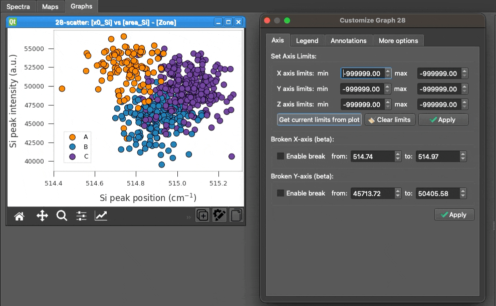 
  <i>Настройка положения и внешнего вида аннотаций на выбранном графике.</i>

---

#### 4.4 «Общие и типографика» и «Стиль графиков и аппроксимация» { #44-general-typography-and-plot-style-fitting }

  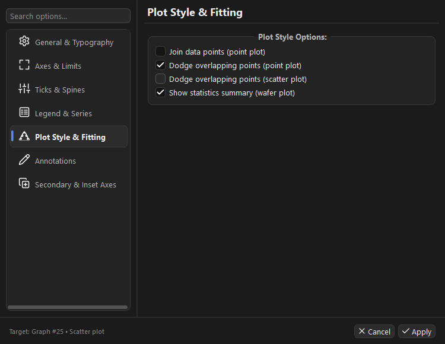 
  <i>Типографика, сортировка и параметры, специфичные для типа графика, в Customize Graph Dialog.</i>

Категории **Общие и типографика** и **Стиль графиков и аппроксимация** объединяют общие настройки типографики, темы и сортировки данных со специальными элементами управления для конкретных типов графиков (планки ошибок, линии тренда и гистограммы).

##### Параметры стиля графика и планки ошибок (Стиль графиков и аппроксимация) { #plot-style-options-error-bars-plot-style-fitting }

Эти элементы управления адаптируются к активному типу графика:

| Параметр | Применимый тип | Описание |
|---|---|---|
| **Join data points** | **точки** | Соединяет средние значения между категориями отрезками линий. |
| **Dodge overlapping points** | **точки** | Смещает перекрывающиеся цветовые группы по горизонтали во избежание наложения. |
| **Dodge overlapping points** | **рассеяние** | Смещает перекрывающиеся цветовые группы по горизонтали на диаграммах рассеяния. |
| **Show statistics summary** | **пластина** | Накладывает сводку статистики (среднее, СКО, мин., макс., однородность) на карту пластины. |
| **Show error bars** | **столбцы** | Отображает планки ошибок над каждым столбцом. |
| **Error bar type** | **точки**, **линия**, **столбцы** | **СКО** (`Std. Dev.`), **Ст. ошибка** (`Std. Error`), **95% ДИ** (`95% CI`) или **Нет** (`None`) (набор вариантов зависит от типа графика). |
| **Ширина засечек** (Cap size) | **точки**, **линия**, **столбцы** | Ширина горизонтальных засечек на концах планок ошибок. |

##### Отображение, сетка и размеры шрифта (Общие и типографика) { #display-grid-font-sizes-general-typography }

| Параметр | Применимый тип | Описание |
|---|---|---|
| **Тема рисунка** (Figure theme) | все типы | Цветовая схема рисунка: **Светлая** (`Light`) или **Тёмная** (`Dark`). |
| **Поворот подписей X** (X label rotation) | все типы | Поворачивает подписи делений оси X (0–90°). |
| **Линии сетки** (Show grid lines) | все типы | Включает или отключает фоновые линии сетки на графике. |

Задайте размер шрифта в пунктах независимо для параметров **Заголовок**, **Подпись оси** (Axis label), **Деления** (Tick label) и **Цветовая шкала** (Colorbar) (по умолчанию: 12/12/9/10). Параметр **Цветовая шкала** управляет размером текста делений на цветовых шкалах графиков **пластина** и **2D-карта**. Для подзаголовка отдельной настройки размера нет — он всегда отображается на 2 pt меньше заголовка; его *текст* редактируется на боковой панели, а не здесь.

##### Сортировка данных (Общие и типографика) { #data-sorting-general-typography }

Управляет порядком отображения категорий и элементов легенды:

| Параметр | Описание |
|---|---|
| **Включить интеллектуальную сортировку данных** (Enable intelligent data sorting) | Если флажок установлен, исходный набор данных детерминированно сортируется перед построением графика (рекомендуется). Если флажок снят, график строго сохраняет исходный порядок строк набора данных. |
| **Сортировать по** (Sort by) | Когда сортировка включена, выберите целевую ось сортировки: - **Z (цветовые значения)** (Z (hue values)): сортирует категории в первую очередь по группе легенды (по умолчанию). - **Значения X** (X values): сортирует категории по оси X. - **Значения Y** (Y values): сортирует данные по возрастанию метрики Y. |

> **Примечание**: отключение интеллектуальной сортировки полезно, если ваш набор данных уже предварительно отсортирован и вы хотите явно сохранить эту последовательность. При изменении настроек сортировки цвета легенды автоматически сбрасываются к последовательности палитры по умолчанию для сохранения согласованной цветовой схемы.

##### Параметры линии тренда (Стиль графиков и аппроксимация) { #trendline-settings-plot-style-fitting }

Отображаются только при выборе типа графика **линия тренда**:

| Параметр | Описание |
|---|---|
| **Порядок полинома** (Polynomial order) | Задаёт степень аппроксимирующего полинома (1 = линейная, 2 = квадратичная, …, до 10). |
| **Опорная точка** (Anchor point) | Фиксирует прохождение аппроксимирующей кривой через заданную точку. Выберите **Origin (0, 0)** или введите **custom (X₀, Y₀)**. |
| **Уравнения** (Fit equation(s)) | Отображает вычисленное уравнение и значение R² для каждой цветовой группы в таблице. Нажмите **Копировать**, чтобы экспортировать таблицу в формате с разделителями-табуляциями (удобно вставлять прямо в Excel). |

##### Параметры гистограммы (Стиль графиков и аппроксимация) { #histogram-settings-plot-style-fitting }

Отображаются только при выборе типа графика **гистограмма**:

| Параметр | Описание |
|---|---|
| **Bins** | Число интервалов гистограммы (2–500, по умолчанию: 20). |
| **Overlay KDE curve** | Налагает сглаженную кривую ядерной оценки плотности (KDE) поверх гистограммы. |
| **Стиль заливки** (Fill style) | Выберите **Сплошная** (Filled) для закрашенных столбцов (по умолчанию) или **Step** (только контур). |

> **Шкала цветовой палитры (пластина / 2D-карта)**: нормализация цветовой шкалы (**Линейный** / **Логарифмическая** / **Центрированная**) находится в категории **Оси и пределы** под названием **Z axis Scale**.

 

_____

### **5. Фильтрация данных** { #5-data-filtering }

Вы можете динамически фильтровать отображаемые данные, применяя булевы логические выражения в поле **Filter** в формате: `(column_name) (operator) (value)`.
> **Примечание**: строковые значения должны быть заключены в двойные кавычки (`"text"`). Названия столбцов, содержащие пробелы, необходимо заключать в обратные кавычки (`` `column name` ``).

  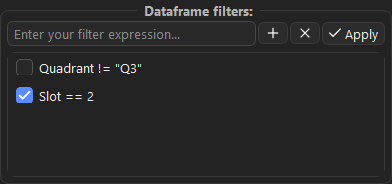 
  <i>Пример динамического применения фильтров к набору данных.</i>

 

| Выражение фильтра | Результат |
|-------------------|---------|
| `Confocal != "high"` | Исключает все точки данных, где значение столбца «Confocal» равно «high». |
| `Thickness == "1ML" or Thickness == "3ML"` | Оставляет только те точки данных, где значение столбца «Thickness» в точности равно «1ML» или «3ML». |
| `` `Laser Power` <= 5 `` | Оставляет точки данных, для которых значение столбца «Laser Power» меньше или равно 5. |

_____

### **6. Статистические расчёты и детали аппроксимации** { #6-statistical-calculations-fitting-details }

Для статистических типов графиков (**точки**, **столбцы**, **ящик с усами** и **линия тренда**) SPECTROview автоматически вычисляет ключевые метрики и визуализирует распределение ваших данных.

#### 6.1 **Точечные и столбчатые графики** { #61-point-and-bar-plots }

- **Центральное значение (среднее):** основная точка данных (круглый маркер на графике **точки** или верхний край столбца на графике **столбцы**) представляет собой **среднее арифметическое** всех значений Y для заданной категории X.
- **Планки ошибок (95% ДИ):** планки ошибок, отходящие от среднего значения, представляют **95%-й доверительный интервал** среднего. Он вычисляется через стандартную ошибку среднего (SEM):
  `Error Bar = ± (1.96 × SEM)`
  где `SEM = Standard Deviation / sqrt(N)`.

#### 6.2 **Ящик с усами** { #62-box-plot }

График типа **ящик с усами** наглядно отображает статистическое распределение набора данных на основе стандартной пятичисловой сводки:

- **Границы ящика (от Q1 до Q3):** основное тело прямоугольника охватывает диапазон от первого квартиля (25-й процентиль) до третьего квартиля (75-й процентиль), известный как межквартильный размах (IQR).
- **Линия медианы:** горизонтальная линия внутри ящика отмечает **медиану** (50-й процентиль).
- **Усы:** «усы» простираются до самых удалённых точек данных, которые всё ещё находятся в пределах `1.5 × IQR` от границ ящика.
- **Выбросы (Fliers):** любые точки данных, выходящие за пределы усов, отображаются отдельно как индивидуальные выбросы.

#### 6.3 **Оценка линии тренда** { #63-trendline-estimation }

- **Стандартная аппроксимация (без опорной точки):** линия тренда рассчитывается методом линейной регрессии обычных наименьших квадратов (OLS) для полинома заданной степени:
  `y = p₀·xᵈ + p₁·xᵈ⁻¹ + ... + p_d`
  где `d` — порядок полинома.

- **Аппроксимация с опорной точкой (принудительно через точку (x₀, y₀)):** система координат сдвигается так, чтобы опорная точка стала началом координат (`x' = x - x₀`, `y' = y - y₀`). Затем к сдвинутым переменным подбирается полином без свободного члена (с нулевым пересечением):
  - **Для линейного порядка (1):** наклон `m` вычисляется напрямую по формуле:
    `m = sum(x'_i * y'_i) / sum((x'_i)²)`
  - **Для более высоких порядков (>1):** сдвинутые данные аппроксимируются полиномом без свободного члена с помощью линейного решателя метода наименьших квадратов.
  После этого аппроксимированная кривая переносится обратно в исходное координатное пространство.

#### 6.4 **Доверительные интервалы линии тренда** { #64-trendline-confidence-intervals }

- **Доверительный уровень:** затенённая полоса вокруг стандартных линий тренда представляет собой **95%-й доверительный интервал** для аппроксимированного среднего отклика.
- **Метод оценки:** интервал вычисляется **аналитически** по невязкам регрессии: стандартная ошибка оценки `SE = sqrt(Σ(yᵢ − ŷᵢ)² / (N − 2))` комбинируется со стандартной формулой среднего отклика `± 1.96 · SE · sqrt(1/N + (x − x̄)² / Σ(xᵢ − x̄)²)`, поэтому полоса расширяется при удалении от центра данных. (Это заменяет прежнюю бутстреп-оценку на основе Seaborn; рабочая область «Графики» больше не использует Seaborn.)
- **Аппроксимации с опорной точкой:** доверительные интервалы вычисляются и отображаются только для стандартных аппроксимаций без ограничений. Если задана опорная точка, полоса доверительного интервала не строится.
