## **工作区：图表** { #workspace-graphs }

**图表** (Graphs) 工作区专注于数据可视化，在设计上尤为注重简洁性、响应速度与高度可定制性。

  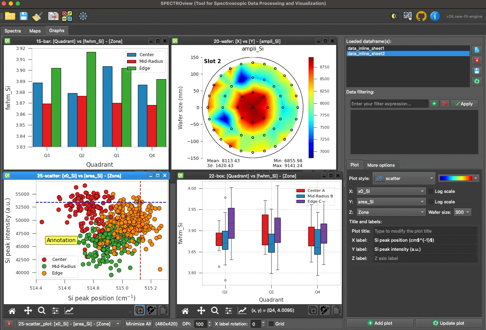 
  <i>图表工作区界面概览。</i>

 

_______

### **1. 加载数据** { #1-loading-data }

数据集可从 **光谱** (Spectra) 和 **二维图谱** (Maps) 工作区无缝传递而来，也可直接从外部 Excel/CSV 文件导入。所有可用数据集都会被动态追踪，并显示在数据集列表控件中。

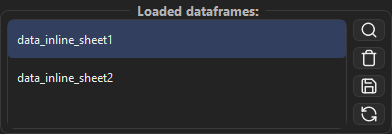 
四个可用的功能按钮可帮助您执行以下操作：

- **View**：原生查看数据表内容。
- **删除** (Delete)：从工作区中移除该数据集。
- **保存** (Save)：将数据集导出为 Excel 或 CSV 文件。
- **Refresh**：当 CSV/Excel 文件在外部被修改时，动态重新加载该文件。

________

### **2. 添加或更新图表** { #2-add-or-update-a-plot }

1. 从列表中选择目标数据集。
2. 使用提供的下拉菜单为 X、Y 和 Z 轴选择合适的数据列。
3. 选择所需的图表类型（可选样式：**散点图** (scatter)、**点图** (point)、**柱状图** (bar)、**箱线图** (box)、**折线图** (line)、**趋势线** (trendline)、**直方图** (histogram)、**二维图谱** (2Dmap)、**晶圆图** (wafer)）。
4. 设置图表标签、坐标轴范围以及晶圆直径尺寸（如适用）。
5. 点击 **添加图表** (Add plot) 生成可视化图表。

  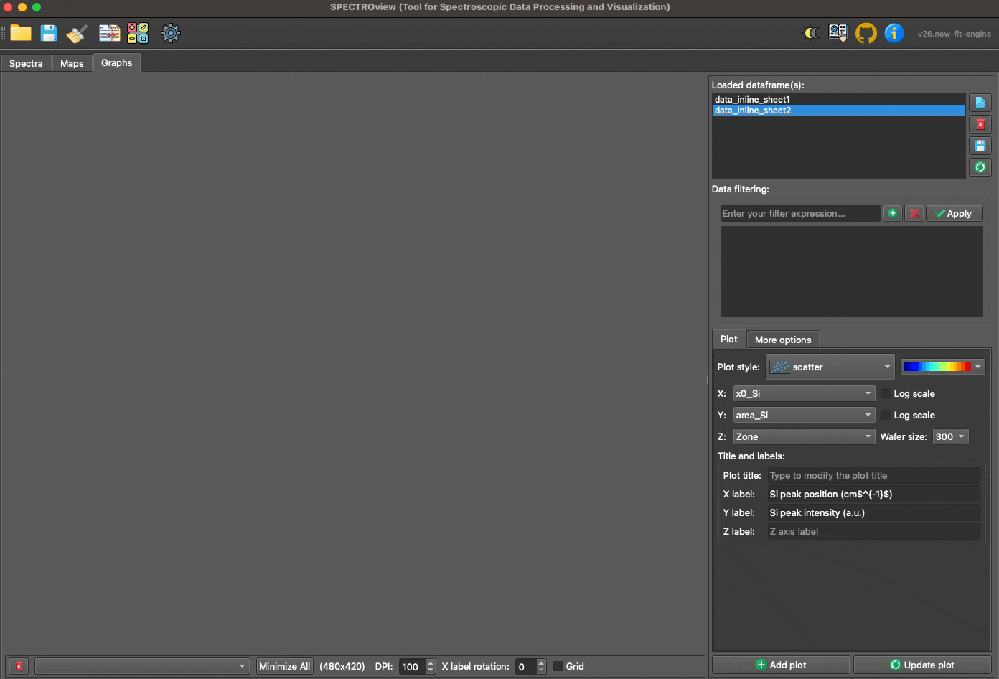 
  <i>添加新图表或更新现有图表的操作演示。</i>

______

### **3. 共享图表工具栏** { #3-the-shared-graph-toolbar }

工作区底部栏集成了所有全局控制按钮以及一个共享图表工具栏，该工具栏始终作用于当前处于活动状态的图表窗口。如需激活某个图表，只需直接点击该窗口，或在侧边面板的 **Active plot** 下拉菜单中选择（位于 **添加图表** / **更新图表** (Update plot) 按钮上方）。

| 控件 | 说明 |
|---|---|
| **Delete all** | 从工作区中删除所有图表。 |
| **Minimize all** | 最小化所有图表窗口。 |
| **撤销** (Undo) / **Redo** | 在工作区的编辑历史中向后撤销或向前重做（`Ctrl+Z` / `Ctrl+Shift+Z`）。 |
| **Compose Figure** | 将多个已打开的图表组合导出为单个多子图图像。 |
| **Home / Pan / Zoom / Subplots** | 标准 Matplotlib 导航工具：重置视图、平移、框选放大，或调整子图边距。 |

> **提示**：当通过拖拽图表窗口边缘或标题栏来调整大小或移动窗口时，界面会先显示轮廓框。松开鼠标后，图表才会按新尺寸一次性重绘，从而确保即使面对大型图表也能流畅调整窗口大小。同理，在平移视图期间，坐标轴周围的边距保持固定，待松开鼠标后再重新计算。

一条垂直分隔线标志着当前图表专属控制按钮的起始位置——这些按钮始终对齐窗口右边缘：

| 控件 | 说明 |
|---|---|
| **Replicate** | 创建当前活动图表的副本。 |
| **Customize** | 为当前活动图表打开 **Customize Graph Dialog**（`Ctrl+E`，详见下文）。 |
| **复制** (Copy) | 将当前活动图表的图像复制到剪贴板（`Ctrl+C`）。 |
| **Export** | 点击可将当前活动图表导出为文件。**按住 Ctrl 并点击** 可改为一次性导出所有已打开的图表。 |
| **Style menu (🎨)** | 保存/应用样式、复制/粘贴样式（`Ctrl+V` 粘贴）、恢复默认样式，或将当前样式设为新建图表的默认样式。 |

> **注意**：上述 `Ctrl+Z`、`Ctrl+Shift+Z`、`Ctrl+C`、`Ctrl+V` 和 `Ctrl+E` 快捷键仅在 **图表** 标签页处于活动状态时生效，不会干扰应用程序其他位置（例如在文本框中输入内容时）的相同快捷键操作。

______

### **4. 自定义图表** { #4-customizing-a-plot }

您可以通过右侧面板（`Right Panel`）快速修改坐标轴**标签**及图表**标题**。点击 **更新图表** 按钮即可立即应用更改：

  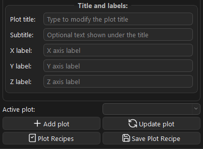 
  <i>通过右侧面板自定义所选图表。点击“更新图表”按钮即可应用更改。</i>

 

如需高级自定义，请点击 **Customize** 按钮（⚙）打开 **Customize Graph Dialog**（`Ctrl + E`）。该对话框采用类似现代化“设置”界面的双栏布局，支持跨所有选项的实时全局搜索、响应式的左侧类别导航，以及在七个模块化类别内对匹配选项自动高亮并滚动定位：

- **常规与字体排版** (General & Typography)：图像主题（浅色/深色）、网格线、X 轴标签旋转、字号大小（标题、轴标签、刻度标签、色标）以及智能数据排序。
- **坐标轴与范围** (Axes & Limits)：带交互式范围滑块（位于顶部）的坐标轴范围、X/Y/Z 主刻度（线性、对数、对称对数、居中）、数值/分类数据类型、坐标轴反转以及断轴区间。
- **Ticks & Spines**：刻度线方向、刻度标签格式预设、次刻度线（顶部、底部、左侧、右侧）以及坐标轴边框线（spines）的可见性。
- **Legend & Series**：图例框放置位置（图内/图外）、边框、列数、标题、字号、透明度（alpha）、方位、全局标记样式，以及左对齐的逐系列样式配置表。
- **图表样式与拟合** (Plot Style & Fitting)：特定图表类型选项（连接数据点、错开重叠点、晶圆统计摘要）、统一的误差棒控制（显示开关、统计类型、端帽宽度）、带锚点与实时方程表的趋势线多项式拟合，以及直方图分箱与 KDE 密度曲线设置。
- **Annotations**：图表可视化标注（垂直线、水平线、文本、箭头、垂直区域、水平区域、矩形框、引线标注），支持在画布上直接拖拽移动及弹窗编辑。
- **副坐标轴与放大插图** (Secondary & Inset Axes)：双坐标副轴（Y2、Y3、X2，支持独立标签、范围、对数刻度、颜色及标记）以及带引导连接线的局部放大插图子坐标轴。

所有选项卡中的修改均通过对话框底部的统一 **应用** (Apply) 按钮一并生效，或点击 **取消** (Cancel) 放弃更改。

---

#### 4.1 “坐标轴与范围”、Ticks & Spines 及“副坐标轴与放大插图” { #41-axes-limits-ticks-spines-and-secondary-inset-axes }

  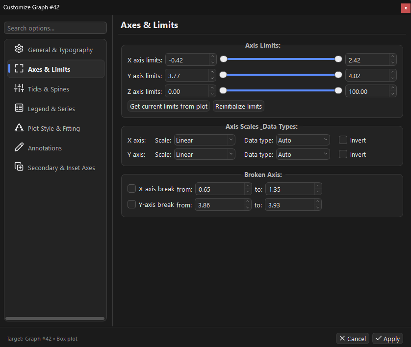 
  <i>Customize Graph Dialog 中的坐标轴配置。</i>

**坐标轴与范围**、**Ticks & Spines** 和 **副坐标轴与放大插图** 类别用于控制坐标轴刻度缩放、数据类型、范围限制、刻度与边框外观、断轴、局部放大插图以及双坐标副轴。标题、轴标签与刻度的字号设置位于 **常规与字体排版** 类别中。

##### 坐标轴属性（坐标轴与范围） { #axis-properties-axes-limits }

使用下拉菜单为每个坐标轴独立配置**刻度**和**数据类型**：

| 设置 | 选项 | 说明 |
|---|---|---|
| **X / Y axis Scale** | **线性** (Linear)、**对数** (Logarithmic)、**对称对数 (Symlog)** | 在线性、对数和对称对数刻度之间切换坐标轴。仅当底层数据为数值型时，才会应用对数刻度。 |
| **X / Y axis Data type** | **自动** (Auto)、**分类** (Category)、**数值** (Numerical) | 控制如何解析坐标轴数值。**自动**（默认）：应用程序自动检测最佳类型——若 100% 的数据均为数值则设为数值型，否则设为分类型。**分类**：强制按离散分类索引。**数值**：强制采用连续数值刻度。 |
| **Z axis Scale** *(仅适用于 **晶圆图** / **二维图谱**)* | **线性**、**对数**、**居中** (Centered) | 设置热图的**色标**归一化方式。**对数**可压缩跨度较大的数值范围（若数据并非严格为正，则回退至线性刻度）。**居中**可将色图中点固定在您输入的 **Center value** 上——非常适合以 0 为中心的发散型数据（如应力/应变）。 |

> **注意**：使用 **数值** 数据类型时，坐标轴采用真实的数学刻度，间距直接反映实际数值大小。使用 **分类** 时，无论数值大小如何，每个唯一值均呈等间距排列。

##### 设置坐标轴范围（坐标轴与范围） { #set-axis-limits-axes-limits }

通过指定 **min** 和 **max** 值，手动限定各坐标轴（X、Y、Z）的可见范围：

| 控件 | 说明 |
|---|---|
| **X / Y / Z axis limits** | 输入最小值（min）和最大值（max）以限制可见范围。将微调框留空不设（此时会以灰色显示当前图表的实际边界值），即可保持该侧自动缩放。 |
| **从当前图表获取范围** (Get current limits from plot) | 捕获当前图表的实际可见范围并填入微调框，适合作为精细调整前的起始基准。 |
| **Clear limits** | 将所有坐标轴范围重置为自动模式（不受限制）。 |

  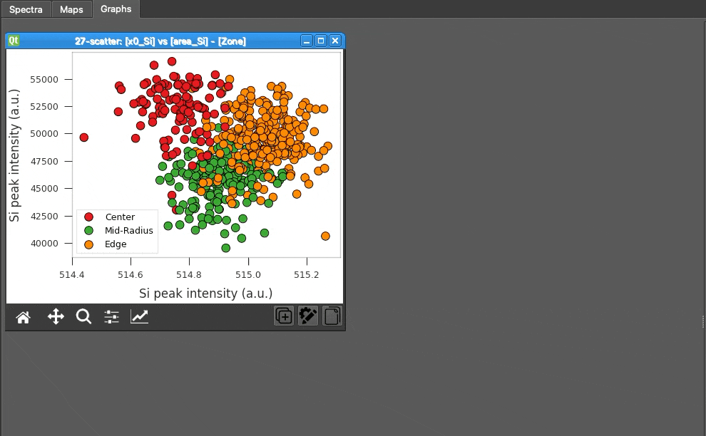 
  <i>调整所选图表的坐标轴范围。</i>

##### 坐标轴外观（`Ticks & Spines`） { #axis-appearance-ticks-spines }

| 控件 | 说明 |
|---|---|
| **Minor ticks** (X **底部** (Bottom)/**顶部** (Top)、Y **左侧** (Left)/**右侧** (Right)) | 独立启用图表各边缘的次刻度线。默认情况下，仅在表示数值的坐标轴上自动启用次刻度线（例如 **散点图**/**折线图**/**直方图** 的 X 轴和 Y 轴，以及 **柱状图**/**箱线图**/**点图** 的 Y 轴），而在分类轴或图谱上隐藏次刻度线。用户可为任意坐标轴单独开启或关闭次刻度线。 |
| **Show spines** (**顶部**/**右侧**/**底部**/**左侧**) | 独立切换图表四条外边框线的显示或隐藏。 |
| **Tick direction** | **默认** (Default)、**向内** (In)、**向外** (Out) 或 **双向** (In & Out)。 |
| **Tick label format** | **自动**、`Integer`、`1-decimal`、`2-decimal` 或 `Scientific`。 |

##### 断轴（坐标轴与范围 — Beta） { #broken-axis-axes-limits-beta }

在坐标轴上创建视觉断点，省略不关注的数值区间，从而聚焦关键数据区域：

| 控件 | 说明 |
|---|---|
| **X 轴断轴** (X-axis break) | 启用并指定要在 X 轴上断开的 `from` / `to` 区间。 |
| **Y 轴断轴** (Y-axis break) | 启用并指定要在 Y 轴上断开的 `from` / `to` 区间。 |

> **注意**：该功能目前处于 Beta 测试阶段。断轴在线性刻度下效果最佳。

##### 局部放大插图坐标轴（副坐标轴与放大插图） { #inset-zoom-axes-secondary-inset-axes }

在主绘图区域内部绘制某一局部区域的放大子图：

| 控件 | 说明 |
|---|---|
| **Enable inset axes** | 开启或关闭局部放大插图视图。 |
| **Position (x0, y0) / Size (w, h)** | 插图框的位置与尺寸，以占绘图区域的比例（0–1）表示。 |
| **X / Y limits** | 插图所放大的数据范围。保留默认的灰色状态即可自动适配。 |
| **Show zoom indicator** | 从插图框向主图中被放大的对应区域绘制引导连接线。 |

> **注意**：局部放大插图与断轴互斥——启用其中一项会自动禁用另一项。

##### 副坐标轴（副坐标轴与放大插图） { #secondary-axes-secondary-inset-axes }

在独立坐标刻度上绘制额外的 Y 数据列（或第二列 X 数据），每个坐标轴对应一行（**Y2**、**Y3**、**X2**）。一旦为该坐标轴分配了数据列，对应行即会被激活，您可为其设置 **标签** (Label)、**Min/Max** 范围、**对数刻度** (Log scale) 开关、**颜色** (Color) 和 **标记** (Marker)。

---

#### 4.2 Legend & Series { #42-legend-series }

  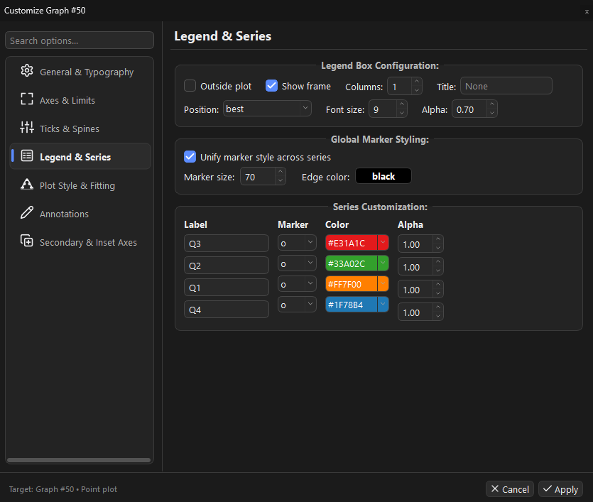 
  <i>Customize Graph Dialog 中的 Legend & Series 类别。</i>

**Legend & Series** 类别用于自定义图表图例的外观与位置，以及各个数据系列的**颜色**、**标记**、透明度（alpha）和线宽。

##### 图例框与系列样式 { #legend-box-series-styling }

| 控件 | 说明 |
|---|---|
| **Put legend box outside** | 将图例框移至绘图区域右侧，避免遮挡数据。取消勾选则将其放置于图内。 |
| **Unify marker size / edge color** | 默认勾选：顶部统一的标记大小与边框颜色控件将应用于所有系列。取消勾选后，下方表格会展开逐系列的标记大小与边框颜色列（适用于 **散点图**/**点图**/**趋势线** 样式），便于对每个系列单独设置大小与边框。 |
| **标签** | 编辑每个数据系列在图例中的显示名称。 |
| **标记** | 为每个系列选择标记符号（适用于 **点图**/**散点图**）。 |
| **颜色** | 从预设调色板中为每个系列选择颜色。 |
| **透明度** (Alpha) / **线宽** (Line width) | 逐系列的透明度设置，以及带连线样式（**折线图**、**趋势线**，或启用了 Join 的 **点图**）的线条宽度。 |

> **提示**：您可以使用鼠标直接在绘图画布上将图例框**拖拽**至任意位置。

  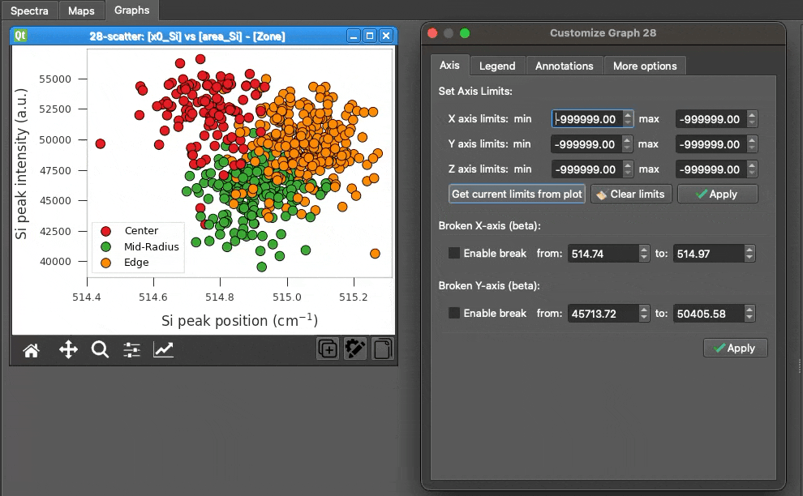 
  <i>调整所选图表的图例与颜色。</i>

##### 图例样式 { #legend-style }

| 控件 | 说明 |
|---|---|
| **Columns / Frame / Title / Font size / 透明度 / 位置 (Position)** | 图例框本身的布局与外观设置。 |

---

#### 4.3 Annotations { #43-annotations }

  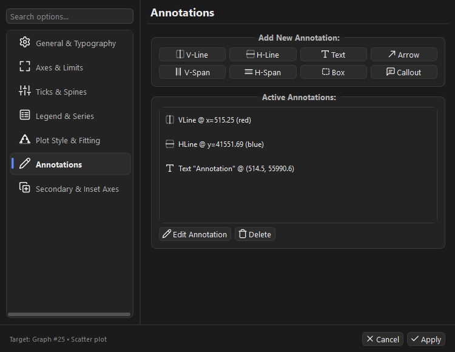 
  <i>Customize Graph Dialog 中的 Annotations 类别。</i>

**Annotations** 类别支持在图表上方叠加参考线、形状及文本标注。

##### 添加标注 { #adding-annotations }

点击顶部的任意按钮，即可在当前图表视图的中心位置添加对应标注：

| 按钮 | 说明 |
|---|---|
| **垂直线** (V-Line) / **水平线** (H-Line) | 添加垂直/水平参考线（默认：红色/蓝色，虚线）。 |
| **文本** (Text) | 添加带圆角背景框的文本标签（默认：黄色背景）。 |
| **箭头** (Arrow) | 添加连接两点的指示箭头。 |
| **垂直区域** (V-Span) / **水平区域** (H-Span) | 在两个数值之间添加带阴影的垂直/水平条带区域。 |
| **矩形框** (Box) | 添加实心填充或仅描边的矩形框。 |
| **引线标注** (Callout) | 添加带有指向特定数据点箭头的文本标签。 |

##### 管理标注 { #managing-annotations }

当前所有标注均会列于按钮下方。选中某项标注即可点击 **Edit** 进行编辑或点击 **删除** 将其移除。每种标注类型的编辑对话框都会公开其相关属性——线/区域/矩形框的颜色、线型与线宽；文本内容、字号、颜色与背景色；箭头/引线标注的端点与指向位置。

> **提示**：标注可直接在绘图画布上**拖拽移动**。保存工作区时，标注位置将被持久化保留。在画布上双击某项标注同样可打开其编辑对话框。

  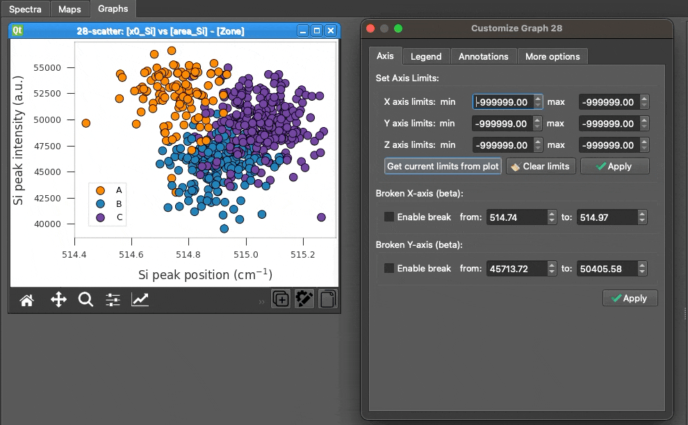 
  <i>调整所选图表上标注的位置与外观。</i>

---

#### 4.4 “常规与字体排版”及“图表样式与拟合” { #44-general-typography-and-plot-style-fitting }

  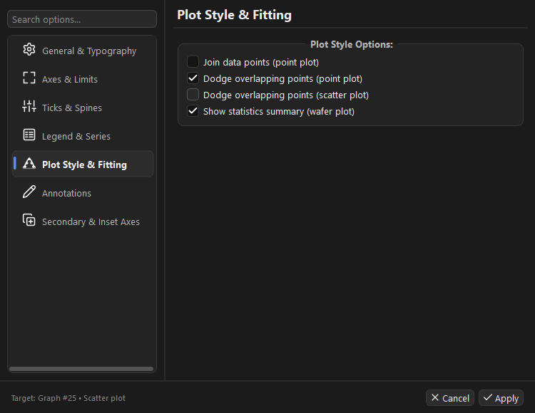 
  <i>Customize Graph Dialog 中的字体排版、排序及特定样式选项。</i>

**常规与字体排版** 与 **图表样式与拟合** 类别汇总了全局字体排版、主题和排序设置，以及特定图表样式的专属控制项（误差棒、趋势线和直方图）。

##### 图表样式选项与误差棒（图表样式与拟合） { #plot-style-options-error-bars-plot-style-fitting }

这些控件会根据当前激活的图表类型自动调整：

| 选项 | 适用类型 | 说明 |
|---|---|---|
| **Join data points** | **点图** | 用线段连接不同类别间的均值点。 |
| **Dodge overlapping points** | **点图** | 水平错开重叠的颜色分组，避免数据点相互遮挡。 |
| **Dodge overlapping points** | **散点图** | 在散点图中水平错开重叠的颜色分组。 |
| **Show statistics summary** | **晶圆图** | 在晶圆图上叠加显示统计摘要（均值、标准差、最小值、最大值、均匀性）。 |
| **Show error bars** | **柱状图** | 在每根柱子顶部显示误差棒。 |
| **Error bar type** | **点图**、**折线图**、**柱状图** | **标准差** (Std. Dev.)、**标准误** (Std. Error)、**95% 置信区间** (95% CI) 或 **无** (None)（具体可用选项取决于图表类型）。 |
| **Cap size** | **点图**、**折线图**、**柱状图** | 误差棒末端水平端帽的宽度。 |

##### 显示、网格与字号（常规与字体排版） { #display-grid-font-sizes-general-typography }

| 选项 | 适用类型 | 说明 |
|---|---|---|
| **Figure theme** | 所有类型 | 图像配色方案：**浅色** (Light) 或 **深色** (Dark)。 |
| **X label rotation** | 所有类型 | 旋转 X 轴刻度标签（0–90°）。 |
| **显示网格线** (Show grid lines) | 所有类型 | 切换图表背景网格线的显示状态。 |

可独立设置 **Title**、**Axis label**、**Tick label** 和 **Colorbar** 的磅值字号（默认值：12/12/9/10）。其中 **Colorbar** 大小控制 **晶圆图**/**二维图谱** 色标上的刻度标签文本字号。副标题没有单独的字号控件——它始终比主标题小 2 pt；其*文本内容*需在侧边面板中编辑，而非在此处设置。

##### 数据排序（常规与字体排版） { #data-sorting-general-typography }

控制分类与图例条目的排列顺序：

| 选项 | 说明 |
|---|---|
| **启用智能数据排序** (Enable intelligent data sorting) | 若勾选，将在绘图前对底层数据集进行确定性排序（推荐）。若取消勾选，图表将严格保留数据集原始的行顺序。 |
| **Sort by** | 启用排序时，选择用于排序的目标轴： - **Z（颜色分组值）** (Z (hue values))：优先按图例分组对类别排序（默认）。 - **X 数值** (X values)：按 X 轴类别排序。 - **Y 数值** (Y values)：依据 Y 指标对数据进行升序排列。 |

> **注意**：如果您的数据集已经预先排序且希望明确保持原有序列，禁用智能数据排序会非常实用。当更改排序设置时，图例颜色会自动重置为默认调色板序列，以确保形成清晰的按位置对应配色方案。

##### 趋势线设置（图表样式与拟合） { #trendline-settings-plot-style-fitting }

仅当图表类型为 **趋势线** 时可见：

| 选项 | 说明 |
|---|---|
| **多项式阶数** (Polynomial order) | 设置多项式拟合的阶数（1 = 线性，2 = 二次，…，最高 10 阶）。 |
| **锚点** (Anchor point) | 约束拟合曲线强制通过指定定点。可选择 **Origin (0, 0)**，或输入 **custom (X₀, Y₀)**。 |
| **Fit equation(s)** | 在表格中显示每个颜色分组的拟合方程及 R² 值。点击 **复制** 可导出为制表符分隔的文本（可直接粘贴至 Excel）。 |

##### 直方图设置（图表样式与拟合） { #histogram-settings-plot-style-fitting }

仅当图表类型为 **直方图** 时可见：

| 选项 | 说明 |
|---|---|
| **Bins** | 直方图分箱数量（2–500，默认：20）。 |
| **Overlay KDE curve** | 在直方图上叠加一条平滑的核密度估计（KDE）曲线。 |
| **Fill style** | 选择 **实心填充** (Filled) 柱状（默认）或 **Step**（仅轮廓阶梯线）。 |

> **色标刻度（晶圆图 / 二维图谱）**：色标归一化方式（**线性** / **对数** / **居中**）位于 **坐标轴与范围** 中，对应选项为 **Z axis Scale**。

 

_____

### **5. 数据筛选** { #5-data-filtering }

您可以通过在 **Filter** 字段中输入格式为 `(column_name) (operator) (value)` 的布尔逻辑表达式，动态筛选参与绘图的数据。

> **注意**：字符串值必须使用双引号括起（`"text"`）。包含空格的列标题必须使用反引号括起（`` `column name` ``）。

  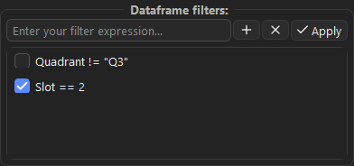 
  <i>演示如何对数据集动态应用筛选条件的示例。</i>

 

| 筛选表达式 | 效果说明 |
|---|---|
| `Confocal != "high"` | 排除“Confocal”列等于“high”的所有数据点。 |
| `Thickness == "1ML" or Thickness == "3ML"` | 仅包含“Thickness”列严格等于“1ML”或“3ML”的数据点。 |
| `` `Laser Power` <= 5 `` | 包含“Laser Power”列小于或等于 5 的数据点。 |

_____

### **6. 统计计算与拟合详情** { #6-statistical-calculations-fitting-details }

对于统计类图表样式（**点图**、**柱状图**、**箱线图** 和 **趋势线**），SPECTROview 会自动计算核心统计指标并可视化展示您的数据分布。

#### 6.1 **点图与柱状图** { #61-point-and-bar-plots }

- **中心值（均值）：**主数据点（**点图** 中的圆形标记或 **柱状图** 中的柱顶）表示给定 X 分类下所有 Y 值的**算术平均值**。
- **误差棒（95% 置信区间）：**从均值延伸出的误差棒代表均值的 **95% 置信区间**，通过均值标准误（SEM）计算得出：
  `Error Bar = ± (1.96 × SEM)`
  其中 `SEM = Standard Deviation / sqrt(N)`。

#### 6.2 **箱线图** { #62-box-plot }

**箱线图** 基于标准的五数概括法原生展示数据集的统计分布：

- **箱体边界（Q1 至 Q3）：**箱体主体从第一四分位数（第 25 百分位数）延伸至第三四分位数（第 75 百分位数），即四分位距（IQR）。
- **中位数线：**箱体内部的水平线标记**中位数**（第 50 百分位数）。
- **须线：**须线延伸至仍位于箱体边缘 `1.5 × IQR` 范围内的最远数据点。
- **异常值（Fliers）：**落在须线之外的所有数据点都会作为独立离群点明确绘制出来。

#### 6.3 **趋势线估计** { #63-trendline-estimation }

- **标准拟合（无锚点）：**趋势线采用普通最小二乘法（OLS）线性回归对指定阶数的多项式进行拟合：
  `y = p₀·xᵈ + p₁·xᵈ⁻¹ + ... + p_d`
  其中 `d` 为多项式阶数。

- **锚定拟合（强制通过点 (x₀, y₀)）：**将坐标系平移，使锚点成为坐标原点（`x' = x - x₀`，`y' = y - y₀`）。随后对平移后的变量拟合不含常数项（零截距）的多项式：
  - **对于线性阶数 (1)：**斜率 `m` 直接通过以下公式计算：
    `m = sum(x'_i * y'_i) / sum((x'_i)²)`
  - **对于更高阶数 (>1)：**使用线性最小二乘求解器对平移后的数据执行零截距拟合。
  随后将拟合曲线平移回原始坐标空间。

#### 6.4 **趋势线置信区间** { #64-trendline-confidence-intervals }

- **置信水平：**标准趋势线周围的阴影带代表拟合平均响应的 **95% 置信区间**。
- **估计方法：**该区间根据回归残差**解析计算**得出：将估计标准误 `SE = sqrt(Σ(yᵢ − ŷᵢ)² / (N − 2))` 与标准平均响应公式 `± 1.96 · SE · sqrt(1/N + (x − x̄)² / Σ(xᵢ − x̄)²)` 相结合，因此阴影带会在远离数据中心时逐渐变宽。（该方法取代了早期基于 Seaborn 的自助法 Bootstrap 估计；**图表** 工作区已不再使用 Seaborn。）
- **锚定拟合：**置信区间仅针对标准的无约束拟合进行计算和显示。若启用了锚点约束，则会省略置信区间带。
