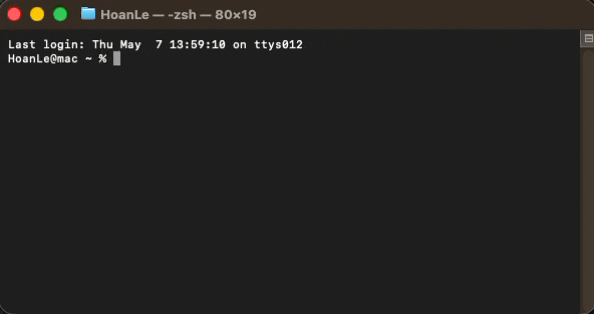

## **Installation** { #installation }

Wählen Sie die **Desktop-App** (empfohlen — keine Python-Installation oder Code-Einrichtung erforderlich) oder die Installation als **Python-Paket (`pip`)**.

Alle Installationsprogramme werden auf der offiziellen Seite [**GitHub Releases**](https://github.com/CEA-MetroCarac/SPECTROview/releases) veröffentlicht. Ihre Einstellungen, Fit-Modelle und Vorlagen werden getrennt vom Anwendungsordner gespeichert, sodass bei einer Aktualisierung all Ihre Arbeiten erhalten bleiben.

---

### **1. SPECTROview installieren** { #1-install-spectroview }

Wählen Sie unten Ihre gewünschte Installationsmethode oder Ihr Betriebssystem:

=== ":material-language-python: Python (pip)"

    Wenn Sie bereits Python verwenden (**Python &ge; 3.12**), installieren Sie **SPECTROview** direkt über [PyPI](https://pypi.org/project/spectroview/):

    ```bash
    pip install spectroview
    ```

    Starten Sie **SPECTROview** über Ihr Terminal oder die Anaconda Prompt:

    ```bash
    spectroview
    ```

    <div align="center">
      <br>
      <i>Installation von SPECTROview über pip.</i>
    </div>

    ??? tip "Weitere Python-Befehle (Upgrade, spezifische Version, Entwicklungsversion)"

        - **Mehrere Python-Versionen installiert?** Verwenden Sie `pip3 install spectroview` oder `python -m pip install spectroview`.
        - **Auf die neueste Version aktualisieren:** `pip install --upgrade spectroview`
        - **Eine bestimmte Version installieren:** `pip install spectroview==26.46.1`
        - **Den neuesten Entwicklungsstand von GitHub installieren:** `pip install git+https://github.com/CEA-MetroCarac/SPECTROview.git`
        - **Installierte Version prüfen:** `pip show spectroview`
        - **Optionales Sprachdiktat (nur Python):** `pip install SpeechRecognition pyaudio`

=== ":material-microsoft-windows: Windows"

    Öffnen Sie [**GitHub Releases**](https://github.com/CEA-MetroCarac/SPECTROview/releases), klappen Sie bei der neuesten Version **Assets** auf und wählen Sie einen der beiden Windows-Downloads:

    **Option A — Standard-Installer (`...Windows_x64_Setup.exe`) *(Empfohlen)***

    1. Doppelklicken Sie auf die heruntergeladene `.exe`-Datei, um die Installation zu starten (kein Administratorpasswort erforderlich).
    2. Öffnen Sie **SPECTROview** über das **Startmenü** oder die Verknüpfung auf dem **Desktop**.
    3. Zukünftige Updates können direkt in der App mit einem Klick automatisch installiert werden (**Aktualisieren und neu starten** (Update and Restart)).

    **Option B — Portable Version (`...Windows_x64_Portable.zip`) *(Ohne Installation)***

    1. Klicken Sie mit der rechten Maustaste auf die `.zip`-Datei, wählen Sie **Alle extrahieren...** und entpacken Sie das Archiv in einen beliebigen Ordner (auch auf einen USB-Stick oder in einen persönlichen Ordner).
    2. Öffnen Sie den entpackten Ordner und doppelklicken Sie auf **`SPECTROview.exe`**.

=== ":material-apple: macOS"

    Öffnen Sie [**GitHub Releases**](https://github.com/CEA-MetroCarac/SPECTROview/releases), klappen Sie bei der neuesten Version **Assets** auf und laden Sie die Datei **`...macOS_arm64.dmg`** herunter (**Macs mit Apple Silicon — M1 oder neuer**).

    !!! info "Nur Apple Silicon"
        Vorgefertigte `.dmg`-Installationspakete für macOS unterstützen **nur Macs mit Apple Silicon** (M1, M2, M3, M4 oder neuer; prüfen Sie dies unter **Apple-Menü () → Über diesen Mac → Chip: Apple ...**). Ältere Intel-Macs werden vom Desktop-Installer nicht unterstützt.

    **Installationsschritte:**

    1. Doppelklicken Sie auf die heruntergeladene `.dmg`-Datei.
    2. Ziehen Sie **`SPECTROview`** auf das Ordnersymbol **`Applications`** (Programme).
    3. **Nur beim ersten Öffnen:** Klicken Sie mit der rechten Maustaste (oder per **Control-Klick**) auf **SPECTROview** im Ordner **Programme** → klicken Sie auf **Öffnen** (Open) → klicken Sie im Bestätigungsdialog erneut auf **Öffnen**.

    !!! note "Warum zeigt macOS beim ersten Start eine Warnung an?"
        SPECTROview ist eine kostenlose Open-Source-App und verwendet derzeit keine kostenpflichtige Apple-Developer-Signatur. Falls macOS meldet, dass der Entwickler nicht verifiziert werden kann, öffnen Sie **Systemeinstellungen → Datenschutz & Sicherheit** und klicken Sie auf **Dennoch öffnen**. Dieser Schritt ist nur einmal pro Version nötig.

=== ":material-linux: Linux"

    Öffnen Sie [**GitHub Releases**](https://github.com/CEA-MetroCarac/SPECTROview/releases), klappen Sie bei der neuesten Version **Assets** auf und wählen Sie Ihr bevorzugtes Format:

    **Option A — Ubuntu-/Debian-Installer (`...Linux_amd64.deb`) *(Empfohlen)***

    Doppelklicken Sie auf die heruntergeladene `.deb`-Datei, um sie über das Software-Center zu installieren, oder installieren Sie sie über ein Terminal:

    ```bash
    sudo apt update
    sudo apt install ./SPECTROview_*_Linux_amd64.deb
    ```

    Starten Sie **SPECTROview** anschließend über das Anwendungsmenü oder durch Eingabe von `spectroview`. Ihre Einstellungen bleiben in Ihrem Home-Ordner sicher erhalten, falls Sie später ein Upgrade durchführen oder die Anwendung deinstallieren.

    **Option B — Portables AppImage (`...Linux_x86_64.AppImage`) *(Ohne Installation)***

    1. Klicken Sie mit der rechten Maustaste auf die Datei → **Eigenschaften → Zugriffsrechte** → aktivieren Sie **Datei als Programm ausführen** *(oder führen Sie `chmod +x SPECTROview_*.AppImage` aus)*.
    2. Doppelklicken Sie auf die Datei, um **SPECTROview** zu starten.

    !!! tip "Unter Ubuntu 24.04 oder neuer"
        Falls ein Doppelklick auf das AppImage keine Wirkung zeigt, installieren Sie einmalig FUSE (`sudo apt install libfuse2t64`) oder starten Sie es mit `./SPECTROview_*.AppImage --appimage-extract-and-run`.

---

### **2. Den integrierten KI-Chat-Agenten verwenden** { #2-using-the-built-in-ai-chat-agent }

Der **KI-Chat-Agent** ist bereits enthalten — innerhalb von **SPECTROview** ist keine zusätzliche Installation erforderlich:

- **Cloud-KI** *(OpenAI, Gemini, DeepSeek, Anthropic usw.)*: Geben Sie Ihren API-Schlüssel unter **Einstellungen** (Settings) → **KI-Einstellungen** (AI Settings) ein.
- **Private lokale KI** *(läuft offline auf Ihrem eigenen Computer)*: Installieren Sie [Ollama](https://ollama.com) und starten Sie den Dienst, bevor Sie **SPECTROview** öffnen.

---

### **3. Automatische Updates** { #3-automatic-updates }

**SPECTROview** prüft kurz nach dem Start automatisch im Hintergrund auf neue Versionen (oder jederzeit, wenn Sie in der oberen Symbolleiste auf **Nach Updates suchen** (Check for updates) klicken). Sobald ein Update verfügbar ist, erscheint oben im Fenster eine Leiste:

<div align="center">
  <br>
  <i>Update-Banner, das angezeigt wird, sobald eine neuere Version verfügbar ist.</i>
</div>

- Klicken Sie auf **Aktualisieren und neu starten** / **Update herunterladen** (Download Update), um die neueste Version zu installieren oder herunterzuladen.
- Klicken Sie auf **Versionshinweise anzeigen** (Show changelog), um die Änderungen nachzulesen, auf **Später** (Update later), um den Hinweis für heute auszublenden, oder auf **Version überspringen** (Skip this version), um bis zu einer künftigen Veröffentlichung bei Ihrer aktuellen Version zu bleiben.

| Ihre Version | Ablauf beim Aktualisieren |
|---|---|
| **Windows-Installer** & **Python (`pip`)** | Lädt die Datei herunter, prüft sie automatisch, aktualisiert **SPECTROview** und startet die Anwendung anschließend neu. |
| **Linux-AppImage** *(in einem beschreibbaren Ordner)* | Ersetzt sich sicher selbst und startet **SPECTROview** neu. |
| **Windows Portable** & **macOS (`.dmg`)** | Lädt die neue, verifizierte Datei herunter und öffnet einen einfachen Hinweisdialog, sodass Sie das Archiv entpacken oder die App in **Programme** ziehen können. |
| **Ubuntu / Debian (`.deb`)** | Lädt die verifizierte `.deb`-Datei herunter und ermöglicht das Kopieren des Installationsbefehls mit einem Klick. |

!!! note "Offline-freundlich & datenschutzkonform"
    Es werden niemals Nutzungsdaten oder persönliche Dateien hochgeladen. Wenn Ihr Computer offline ist, bleibt die Update-Prüfung beim Start still im Hintergrund, sodass **SPECTROview** normal startet.

??? info "Details zu Sicherheit & Unternehmensnetzwerken (für IT-Teams)"

    - **Dateiintegrität:** Jedes heruntergeladene Installationsprogramm oder Paket wird vor der Ausführung gegen die offizielle Prüfsumme in `SHA256SUMS.txt` verifiziert.
    - **Vertrauenswürdige HTTPS-Verbindungen (`GHSA-6q48-6c7w-9gw2`):** Netzwerkverbindungen verwenden vorrangig den nativen Zertifikatsspeicher Ihres Betriebssystems (inklusive Unterstützung für institutionelle/unternehmensinterne CAs sowie benutzerdefinierte `SSL_CERT_FILE`- / `REQUESTS_CA_BUNDLE`-Variablen) und setzen ein gepatchtes `certifi`-Bundle (`>= 2026.10.23`) voraus, wobei kompromittierte eMudhra-/emSign-Stammzertifikate zurückgewiesen werden.
    - **Vorabversionen testen:** Optionale Benachrichtigungen über Release-Candidates lassen sich unter **Einstellungen** → **Allgemein** (General) → **Anwendungs-Updates** (Application Updates) ein- und ausschalten.

---

### **4. Häufige Fragen & Fehlerbehebung** { #4-common-questions-troubleshooting }

??? question "macOS meldet, dass „SPECTROview“ nicht geöffnet werden kann (Entwickler kann nicht verifiziert werden)"

    1. Öffnen Sie Ihren Ordner **Programme** im **Finder**.
    2. Klicken Sie mit gedrückter **Control**-Taste (oder per Rechtsklick) auf **`SPECTROview`** und wählen Sie **Öffnen**.
    3. Klicken Sie im eingeblendeten Dialogfeld erneut auf **Öffnen**.

    *(Alternativ: Öffnen Sie **Systemeinstellungen → Datenschutz & Sicherheit**, scrollen Sie nach unten und klicken Sie auf **Dennoch öffnen**.)*

??? question "Windows: Sollte ich Setup.exe oder Portable.zip herunterladen?"

    Wählen Sie **`Setup.exe`**, wenn Sie Verknüpfungen im Startmenü und automatische Ein-Klick-Updates möchten. Wählen Sie **`Portable.zip`**, wenn Sie auf eine Installation verzichten möchten (oder das Programm von einem USB-Laufwerk starten wollen) — achten Sie darauf, das Archiv vor dem Doppelklick auf `SPECTROview.exe` über **Alle extrahieren...** zu entpacken.

??? question "Das AppImage öffnet sich unter Ubuntu / Debian nicht"

    Minimalen Ubuntu-Installationen fehlen mitunter FUSE 2 oder Qt-X11-Bibliotheken. Führen Sie diese Befehle einmalig im Terminal aus:

    ```bash
    sudo apt update
    sudo apt install libfuse2t64 libxcb-cursor0 libxkbcommon-x11-0 libegl1 libgl1
    ```

    Alternativ starten Sie das AppImage ohne FUSE: `./SPECTROview_*.AppImage --appimage-extract-and-run`.

??? question "Leeres Fenster oder Grafikabsturz beim Start"

    Versuchen Sie, **SPECTROview** mit aktiviertem Software-Grafik-Rendering zu starten:

    - **Windows (PowerShell):** `$env:QT_QUICK_BACKEND="software"; spectroview`
    - **macOS / Linux:** `export QT_QUICK_BACKEND=software; spectroview`

??? question "Python-Fehler (`pip: command not found`, Berechtigungsfehler oder `spectroview: command not found`)"

    - Falls `pip` nicht erkannt wird, führen Sie `python -m pip install spectroview` (oder `python3 -m pip install spectroview`) aus.
    - Falls `spectroview` nach der Installation nicht erkannt wird, starten Sie das Programm mit `python -m spectroview.main`.
    - Vermeiden Sie Systemberechtigungsfehler, indem Sie zuerst eine virtuelle Umgebung erstellen:

      ```bash
      python -m venv spectroview_env
      source spectroview_env/bin/activate    # macOS / Linux
      spectroview_env\Scripts\activate       # Windows
      pip install spectroview
      ```
