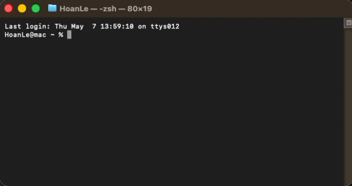

## **Installation**

Choisissez l'**application de bureau** (recommandé — aucune installation Python ni configuration technique requise) ou l'installation sous forme de **paquet Python (`pip`)**.

Tous les installateurs sont publiés sur la page officielle [**GitHub Releases**](https://github.com/CEA-MetroCarac/SPECTROview/releases). Vos préférences, modèles d'ajustement et modèles de graphiques sont stockés séparément du dossier de l'application ; toute mise à jour conserve donc l'intégralité de votre travail.

---

### **1. Installer SPECTROview**

Sélectionnez votre méthode d'installation ou votre système d'exploitation ci-dessous :

=== ":material-language-python: Python (pip)"

    Si vous utilisez déjà Python (**Python &ge; 3.12**), installez **SPECTROview** directement depuis [PyPI](https://pypi.org/project/spectroview/) :

    ```bash
    pip install spectroview
    ```

    Lancez **SPECTROview** depuis votre terminal ou Anaconda Prompt :

    ```bash
    spectroview
    ```

    <div align="center">
      <br>
      <i>Installation de SPECTROview via pip.</i>
    </div>

    ??? tip "Autres commandes Python (mise à jour, version spécifique, version de développement)"

        - **Plusieurs versions de Python installées ?** Utilisez `pip3 install spectroview` ou `python -m pip install spectroview`.
        - **Mettre à jour vers la dernière version :** `pip install --upgrade spectroview`
        - **Installer une version spécifique :** `pip install spectroview==26.46.1`
        - **Installer la dernière version de développement depuis GitHub :** `pip install git+https://github.com/CEA-MetroCarac/SPECTROview.git`
        - **Vérifier la version installée :** `pip show spectroview`
        - **Dictée vocale optionnelle (Python uniquement) :** `pip install SpeechRecognition pyaudio`

=== ":material-microsoft-windows: Windows"

    Rendez-vous sur [**GitHub Releases**](https://github.com/CEA-MetroCarac/SPECTROview/releases), dépliez la section **Assets** de la dernière version et choisissez l'un des deux téléchargements pour Windows :

    **Option A — Installateur standard (`...Windows_x64_Setup.exe`) *(Recommandé)***

    1. Double-cliquez sur le fichier `.exe` téléchargé pour lancer l'installation (aucun mot de passe administrateur requis).
    2. Ouvrez **SPECTROview** depuis le **Menu Démarrer** ou le raccourci sur le **Bureau**.
    3. Les futures mises à jour peuvent être installées automatiquement depuis l'application en un clic (**Update and Restart**).

    **Option B — Version portable (`...Windows_x64_Portable.zip`) *(Sans installation)***

    1. Faites un clic droit sur le fichier `.zip` et choisissez **Extraire tout...** vers le dossier de votre choix (y compris une clé USB ou un dossier personnel).
    2. Ouvrez le dossier extrait et double-cliquez sur **`SPECTROview.exe`**.

=== ":material-apple: macOS"

    Rendez-vous sur [**GitHub Releases**](https://github.com/CEA-MetroCarac/SPECTROview/releases), dépliez la section **Assets** de la dernière version et téléchargez le fichier **`...macOS_arm64.dmg`** (**Mac Apple Silicon — M1 ou plus récent**).

    !!! info "Apple Silicon uniquement"
        Les installateurs `.dmg` précompilés pour macOS prennent uniquement en charge les **Mac Apple Silicon** (M1, M2, M3, M4 ou plus récents ; vérifiez via **Menu Pomme () → À propos de ce Mac → Puce : Apple ...**). Les anciens Mac Intel ne sont pas pris en charge par l'installateur de bureau.

    **Étapes d'installation :**

    1. Double-cliquez sur le fichier `.dmg` téléchargé.
    2. Faites glisser **`SPECTROview`** vers l'icône du dossier **`Applications`**.
    3. **Lors de la première ouverture uniquement :** Faites un clic droit (ou **Contrôle-clic**) sur **SPECTROview** dans **Applications** → cliquez sur **Ouvrir** → cliquez sur **Ouvrir** dans la fenêtre de confirmation.

    !!! note "Pourquoi macOS affiche-t-il un avertissement au premier lancement ?"
        SPECTROview est un logiciel libre gratuit et n'utilise pas actuellement de signature payante Apple Developer. Si macOS indique que le développeur ne peut pas être vérifié, ouvrez **Réglages Système → Confidentialité et sécurité** et cliquez sur **Ouvrir quand même**. Cette opération n'est nécessaire qu'une seule fois par version.

=== ":material-linux: Linux"

    Rendez-vous sur [**GitHub Releases**](https://github.com/CEA-MetroCarac/SPECTROview/releases), dépliez la section **Assets** de la dernière version et choisissez votre format préféré :

    **Option A — Paquet Ubuntu / Debian (`...Linux_amd64.deb`) *(Recommandé)***

    Double-cliquez sur le fichier `.deb` téléchargé pour l'installer via votre logithèque, ou installez-le depuis un terminal :

    ```bash
    sudo apt update
    sudo apt install ./SPECTROview_*_Linux_amd64.deb
    ```

    Lancez ensuite **SPECTROview** depuis votre menu d'applications ou en tapant `spectroview`. Vos paramètres restent conservés dans votre dossier personnel lors d'une mise à jour ou d'une désinstallation ultérieure.

    **Option B — AppImage portable (`...Linux_x86_64.AppImage`) *(Sans installation)***

    1. Faites un clic droit sur le fichier → **Propriétés → Permissions** → activez **Autoriser l'exécution du fichier comme programme** *(ou exécutez `chmod +x SPECTROview_*.AppImage`)*.
    2. Double-cliquez sur le fichier pour démarrer **SPECTROview**.

    !!! tip "Sous Ubuntu 24.04 ou version ultérieure"
        Si un double-clic sur l'AppImage ne produit aucun effet, installez FUSE une seule fois (`sudo apt install libfuse2t64`) ou exécutez `./SPECTROview_*.AppImage --appimage-extract-and-run`.

---

### **2. Utiliser l'agent conversationnel IA intégré**

L'**agent conversationnel IA** est déjà inclus — aucune installation supplémentaire n'est requise dans **SPECTROview** :

- **IA dans le cloud** *(OpenAI, Gemini, DeepSeek, Anthropic, etc.)* : saisissez votre clé API dans **Settings → AI Settings**.
- **IA locale privée** *(fonctionne hors ligne sur votre propre ordinateur)* : installez [Ollama](https://ollama.com) et démarrez-le avant d'ouvrir **SPECTROview**.

---

### **3. Mises à jour automatiques**

**SPECTROview** recherche automatiquement de nouvelles versions en arrière-plan peu après l'ouverture (ou à tout moment lorsque vous cliquez sur **Check for updates** dans la barre d'outils supérieure). Lorsqu'une mise à jour est disponible, une bannière apparaît en haut de la fenêtre :

<div align="center">
  <br>
  <i>Bannière affichée lorsqu'une version plus récente est disponible.</i>
</div>

- Cliquez sur **Update and Restart** / **Download Update** pour installer ou récupérer la dernière version.
- Cliquez sur **Show changelog** pour consulter les nouveautés, **Update later** pour masquer l'alerte jusqu'au lendemain, ou **Skip this version** pour rester sur votre version actuelle jusqu'à une prochaine sortie.

| Votre installation | Comportement lors de la mise à jour |
|---|---|
| **Installateur Windows** & **Python (`pip`)** | Télécharge, vérifie automatiquement le fichier, met à jour **SPECTROview** et le redémarre pour vous. |
| **AppImage Linux** *(dans un dossier accessible en écriture)* | Se remplace automatiquement en toute sécurité et redémarre **SPECTROview**. |
| **Windows Portable** & **macOS (`.dmg`)** | Télécharge le nouveau fichier vérifié et ouvre une fenêtre guidée pour l'extraire ou le glisser dans **Applications**. |
| **Ubuntu / Debian (`.deb`)** | Télécharge le fichier `.deb` vérifié et permet de copier la commande d'installation en un clic. |

!!! note "Adapté au mode hors ligne et respectueux de la confidentialité"
    Aucune donnée d'utilisation ni aucun fichier personnel n'est jamais envoyé. Si votre ordinateur est hors ligne, la vérification au démarrage reste silencieuse afin que **SPECTROview** démarre normalement.

??? info "Sécurité et réseaux d'entreprise (pour les équipes IT)"

    - **Intégrité des fichiers :** Chaque installateur ou paquet téléchargé est vérifié à l'aide du fichier officiel de sommes de contrôle `SHA256SUMS.txt` avant toute exécution.
    - **Connexions HTTPS sécurisées (`GHSA-6q48-6c7w-9gw2`) :** Les connexions réseau utilisent en priorité le magasin de certificats natif du système d'exploitation (prenant en charge les autorités de certification institutionnelles ou d'entreprise ainsi que les variables `SSL_CERT_FILE` / `REQUESTS_CA_BUNDLE`) et exigent un jeu de certificats `certifi` corrigé (`>= 2026.10.23`), en refusant les autorités racines compromises eMudhra / emSign.
    - **Test des préversions :** Les notifications de versions candidates (préversions) peuvent être activées ou désactivées dans **Settings → General → Application Updates**.

---

### **4. Questions fréquentes et dépannage**

??? question "macOS indique que « SPECTROview » ne peut pas être ouvert (le développeur ne peut pas être vérifié)"

    1. Ouvrez votre dossier **Applications** dans le **Finder**.
    2. Maintenez la touche **Contrôle** enfoncée (ou faites un clic droit) sur **`SPECTROview`** et choisissez **Ouvrir**.
    3. Cliquez de nouveau sur **Ouvrir** dans la boîte de dialogue qui s'affiche.

    *(Autre méthode : ouvrez **Réglages Système → Confidentialité et sécurité**, faites défiler vers le bas et cliquez sur **Ouvrir quand même**.)*

??? question "Windows : Dois-je télécharger Setup.exe ou Portable.zip ?"

    Choisissez **`Setup.exe`** si vous souhaitez disposer de raccourcis dans le Menu Démarrer et des mises à jour automatiques en un clic. Choisissez **`Portable.zip`** si vous préférez une version sans installation (ou exécutable depuis une clé USB) — veillez à bien utiliser **Extraire tout...** avant de double-cliquer sur `SPECTROview.exe`.

??? question "L'AppImage ne s'ouvre pas sous Ubuntu / Debian"

    Les installations Ubuntu minimales ne disposent parfois pas de FUSE 2 ou des bibliothèques Qt X11. Exécutez ces commandes une fois dans un terminal :

    ```bash
    sudo apt update
    sudo apt install libfuse2t64 libxcb-cursor0 libxkbcommon-x11-0 libegl1 libgl1
    ```

    Ou démarrez l'AppImage sans FUSE : `./SPECTROview_*.AppImage --appimage-extract-and-run`.

??? question "Fenêtre blanche ou plantage graphique au lancement"

    Essayez de lancer l'application avec le rendu graphique logiciel avant d'ouvrir **SPECTROview** :

    - **Windows (PowerShell) :** `$env:QT_QUICK_BACKEND="software"; spectroview`
    - **macOS / Linux :** `export QT_QUICK_BACKEND=software; spectroview`

??? question "Erreurs Python (`pip: command not found`, erreur de permission ou `spectroview: command not found`)"

    - Si `pip` n'est pas reconnu, exécutez `python -m pip install spectroview` (ou `python3 -m pip install spectroview`).
    - Si `spectroview` n'est pas reconnu après l'installation, lancez l'application avec `python -m spectroview.main`.
    - Évitez les erreurs de permission système en créant d'abord un environnement virtuel :

      ```bash
      python -m venv spectroview_env
      source spectroview_env/bin/activate    # macOS / Linux
      spectroview_env\Scripts\activate       # Windows
      pip install spectroview
      ```
