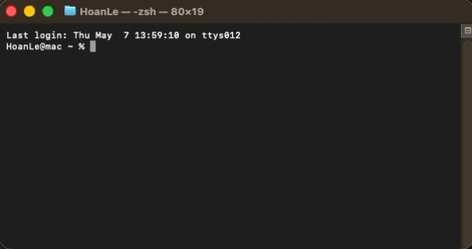

## **Installation**

**SPECTROview** runs on **Windows**, **macOS**, and **Linux** and can be installed either as a **standalone native application** (no Python installation required) or as a **Python package** via `pip` (requires **Python &ge; 3.12**, tested on Python 3.12, 3.13, and 3.14).

---

### **1. Standalone Installers (Recommended for Desktop Users — No Python Required)**

Download the matching release asset from the [GitHub Releases](https://github.com/CEA-MetroCarac/SPECTROview/releases) page (every file is verified in `SHA256SUMS.txt`).

#### **Windows (`x64`)**

- **Installer (`SPECTROview_<VERSION>_Windows_x64_Setup.exe`)**
  - Installs per-user cleanly without administrator privileges and registers Start Menu shortcuts, optional Desktop shortcut, and a standard Windows uninstaller.
  - Supports installation and working directories containing spaces or non-ASCII characters.
  - Supports **automatic delta and full updates** via Velopack (`Update and Restart`) while preserving all user preferences and Working Folders across upgrades.

- **Portable ZIP (`SPECTROview_<VERSION>_Windows_x64_Portable.zip`)**
  - Extract anywhere and launch `SPECTROview.exe` directly — no installer, no administrator rights, and no Python installation required.
  - Keeps user settings outside the extracted application folder so upgrading via a fresh extraction preserves preferences and your Working Folder.
  - In-app updates verify and download the newest Portable ZIP and let you **Extract to Folder...** directly.

#### **macOS (`arm64` Apple Silicon & `x64` Intel)**

- Download **`SPECTROview_<VERSION>_macOS_arm64.dmg`** (Apple Silicon M-series) or **`SPECTROview_<VERSION>_macOS_x64.dmg`** (Intel Mac).
- Open the `.dmg` and drag **`SPECTROview.app`** into the **`Applications`** folder.
- Application settings persist outside the `.app` bundle (`~/Library/Preferences`), so dragging a new version over `/Applications/SPECTROview.app` keeps your settings intact.

> **Important (Unsigned Build Gatekeeper Notice)**: Releases are currently distributed unsigned/unnotarized. On first launch (or after replacing with a newer version), macOS Gatekeeper may warn that the developer cannot be verified. To open **SPECTROview**:
>
> 1. **Control-click** (or right-click) `SPECTROview.app` in `/Applications` → select **Open** → confirm **Open**, **or**
> 2. Go to **System Settings → Privacy & Security** and click **Open Anyway**.
>
> *(Note: Because unsigned macOS apps cannot safely overwrite `/Applications` silently in the background, clicking **Download Update** in the banner fetches the verified `.dmg` and opens these instructions.)*

#### **Linux (`x86_64` / `amd64`)**

- **Debian / Ubuntu package (`SPECTROview_<VERSION>_Linux_amd64.deb`)**
  - Installs to `/opt/spectroview`, registers the desktop application launcher and `spectroview` CLI command, and declares all required Qt6 / XCB / OpenGL system libraries automatically:

    ```bash
    sudo apt update
    sudo apt install ./SPECTROview_<VERSION>_Linux_amd64.deb
    ```

  - User configuration (`~/.config/CEA-Leti/`) and Working Folders remain untouched during package upgrades or removal.

- **AppImage (`SPECTROview_<VERSION>_Linux_x86_64.AppImage`)**
  - Run directly without root privileges or installation:

    ```bash
    chmod +x SPECTROview_<VERSION>_Linux_x86_64.AppImage
    ./SPECTROview_<VERSION>_Linux_x86_64.AppImage
    ```

  - On minimal Linux desktops without `libfuse2`, extract and run cleanly with `--appimage-extract-and-run` (or `sudo apt install libfuse2t64` / `libfuse2`).
  - Supports **in-place automatic updates** (`Update and Restart`) whenever the `.AppImage` file is writable by the current user; otherwise falls back to guided verified download.

---

### **2. Install from PyPI (Python Environments)**

If you already use Python (`>= 3.12`), install **SPECTROview** from [PyPI](https://pypi.org/project/spectroview/):

```bash
pip install spectroview
```

<div align="center">
  <br>
  <i>Successfully installing SPECTROview via pip.</i>
</div>

> **Note:** On systems with multiple Python installations, use `python -m pip` or `pip3`:
>
> ```bash
> pip3 install spectroview
> ```

#### **Install Latest Development Version from GitHub**

```bash
pip install git+https://github.com/CEA-MetroCarac/SPECTROview.git
```

> This installs the latest commits from `main`, which may include changes not yet released on PyPI.

#### **Launch Python Installation**

```bash
spectroview
```

---

### **3. AI Chat Agent & Optional Voice Dictation**

SPECTROview includes a built-in **AI Chat Agent** (`ollama`, `openai`, `anthropic`, `mcp`, `truststore`) in both standalone installers and PyPI distributions — no extra installation step is required.

- **For local AI (Ollama):** install [Ollama](https://ollama.com) on your system and start the service.
- **For Cloud AI (OpenAI, DeepSeek, Gemini, Anthropic, or Custom endpoint):** configure your API key in **Settings → AI Settings**.
- **For Voice Dictation (optional, Python installs):** `pip install SpeechRecognition pyaudio`.

---

### **4. Python Version & Upgrade Commands**

To upgrade an existing Python installation:

```bash
pip install --upgrade spectroview
```

To install a specific version (e.g., `26.46.1`):

```bash
pip install spectroview==26.46.1
```

To inspect your installed package version:

```bash
pip show spectroview
```

---

### **5. Unified Automatic Version Checking & Updating**

**SPECTROview** automatically detects how it was installed (`pip`, Windows Velopack Installer, Windows Portable ZIP, macOS `.app`, Linux AppImage, or Linux `.deb`) and adapts the in-app updater accordingly.

#### **How it works**

- **On startup** (2 seconds after the UI renders, or anytime via **Check for updates** in the menu bar / **Settings → About**), a background worker queries GitHub Releases (using HTTP `ETag` caching to stay polite on API rate limits).
- You can optionally opt in to release candidates (`rc` / `beta`) under **Settings → General → Application Updates → Include pre-release / release candidate builds**.
- When a newer version is available, a slim banner appears at the top of the window:

<div align="center">
  <br>
  <i>Notification banner showing version transition and platform-appropriate update action.</i>
</div>

> **Privacy Guarantee**: Update checks send anonymous read-only HTTPS requests to GitHub Releases. **No telemetry, personal data, or usage tracking is collected.**
>
> **Security & TLS Verification (`GHSA-6q48-6c7w-9gw2`)**: Network requests prioritise institutional `SSL_CERT_FILE` / `REQUESTS_CA_BUNDLE`, then the host operating system's native certificate trust store (`truststore`), and finally a verified `certifi >= 2026.10.23` CA bundle (refusing compromised eMudhra / emSign roots). Every downloaded update is also verified against GitHub's published `SHA256SUMS.txt` digest before installation.

#### **Update Behaviour by Distribution Type**

| Distribution Format | Banner Action | Behaviour After Download & SHA-256 Verification |
|---|---|---|
| **Python (`pip` wheel)** | **Update and Restart** | Closes app, runs hardened `pip install --upgrade` against verified `.whl`, and relaunches. |
| **Windows Installer (`Setup.exe` / Velopack)** | **Update and Restart** | Stages verified delta/full `.nupkg` packages via Velopack and applies updates automatically on restart (preserving settings & Working Folder). |
| **Windows Portable (`.zip`)** | **Download Update** | Saves verified `.zip` and offers **Extract to Folder...** or **Open Folder** without modifying the running binary folder. |
| **macOS Application (`.dmg`)** | **Download Update** | Saves verified `arm64` / `x64` `.dmg`, opens **Open Installer** / **Open Folder**, and reminds you of Gatekeeper's Control-click → Open flow. |
| **Linux AppImage** | **Update and Restart** *(if writable)* / **Download Update** | Atomically replaces writable `$APPIMAGE` and relaunches, or saves verified `.AppImage` cleanly if read-only. |
| **Linux Debian (`.deb`)** | **Download Update** | Saves verified `.deb` and gives a one-click **Copy Command** button (`sudo apt install ...`). |
| **Local Git / Source Checkout** | Notification only | Detects dev checkout safely so source files are never overwritten accidentally. |

#### **Banner Buttons**

| Button | Behaviour |
|---|---|
| **⬇ Update and Restart / Download Update** | Executes the verified download and platform-specific install or guided flow shown above. |
| **🔍 Show changelog** | Opens the GitHub release notes in your web browser. |
| **Update later** | Hides the banner for the current session only. |
| **Skip this version** | Remembers this release tag and stays silent until a newer release is published. |

> **Offline environments**: Startup checks fail quietly when offline so **SPECTROview** launches and runs normally without error popups. Manual checks explain any network or rate-limit failure clearly.

---

### **6. Troubleshooting**

??? question "**`pip: command not found` (Python installs)**"

    Use `python -m pip install spectroview` or `python3 -m pip install spectroview`.

??? question "**`Permission denied` during `pip install`**"

    Install inside a virtual environment (recommended) or pass `--user`:

    ```bash
    python -m venv spectroview_env
    source spectroview_env/bin/activate    # macOS/Linux
    spectroview_env\Scripts\activate       # Windows
    pip install spectroview
    ```

??? question "**`qt.qpa.plugin: Could not load the Qt platform plugin "xcb"` on Linux**"

    Standalone `.deb` installs declare these libraries automatically. For AppImage or `pip` installs on minimal Ubuntu/Debian distributions, ensure Qt6 X11/XCB/EGL runtime libraries are present:

    ```bash
    sudo apt update
    sudo apt install libxcb-cursor0 libxcb-xinerama0 libxkbcommon-x11-0 libegl1 libgl1 libfontconfig1
    ```

??? question "**macOS shows `"SPECTROview.app" cannot be opened because the developer cannot be verified`**"

    Current macOS DMGs are unsigned. In `/Applications`, **Control-click** `SPECTROview.app` → **Open**, or allow it under **System Settings → Privacy & Security → Open Anyway**.

??? question "**AppImage fails with `dlopen(): error loading libfuse.so.2` on Ubuntu 24.04+**"

    Either run once with `--appimage-extract-and-run`, or install FUSE 2 (`sudo apt install libfuse2t64`).

??? question "**`spectroview` command not found after `pip install`**"

    Launch directly via module invocation:

    ```bash
    python -m spectroview.main
    ```

??? question "**Blank window or GPU driver crash on startup**"

    Switch Qt Quick / rendering to software mode before launching:

    - **Windows (PowerShell)**: `$env:QT_QUICK_BACKEND="software"; spectroview`
    - **macOS/Linux**: `export QT_QUICK_BACKEND=software; spectroview`
