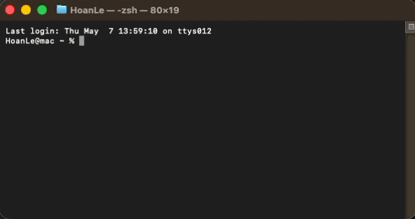

## **Установка** { #installation }

Выберите **настольное приложение** (рекомендуется — не требует установки Python или настройки окружения) или установку в виде **пакета Python (`pip`)**.

Все установщики публикуются на официальной странице [**GitHub Releases**](https://github.com/CEA-MetroCarac/SPECTROview/releases). Ваши настройки, модели аппроксимации и шаблоны хранятся отдельно от папки приложения, поэтому при обновлении вся ваша работа остаётся в сохранности.

---

### **1. Установка SPECTROview** { #1-install-spectroview }

Выберите способ установки или вашу операционную систему ниже:

=== ":material-language-python: Python (pip)"

    Если вы уже используете Python (**Python &ge; 3.12**), установите **SPECTROview** напрямую из [PyPI](https://pypi.org/project/spectroview/):

    ```bash
    pip install spectroview
    ```

    Запустите **SPECTROview** из терминала или Anaconda Prompt:

    ```bash
    spectroview
    ```

    <div align="center">
      <br>
      <i>Установка SPECTROview через pip.</i>
    </div>

    ??? tip "Дополнительные команды Python (обновление, конкретная версия, версия в разработке)"

        - **Установлено несколько версий Python?** Используйте `pip3 install spectroview` или `python -m pip install spectroview`.
        - **Обновить до последней версии:** `pip install --upgrade spectroview`
        - **Установить конкретную версию:** `pip install spectroview==26.46.1`
        - **Установить актуальную версию в разработке с GitHub:** `pip install git+https://github.com/CEA-MetroCarac/SPECTROview.git`
        - **Проверить установленную версию:** `pip show spectroview`
        - **Голосовой ввод (опционально, только для Python):** `pip install SpeechRecognition pyaudio`

=== ":material-microsoft-windows: Windows"

    Перейдите на страницу [**GitHub Releases**](https://github.com/CEA-MetroCarac/SPECTROview/releases), раскройте раздел **Assets** последнего релиза и выберите один из двух вариантов загрузки для Windows:

    **Вариант A — Стандартный установщик (`...Windows_x64_Setup.exe`) *(Рекомендуется)***

    1. Дважды щёлкните скачанный файл `.exe`, чтобы выполнить установку (пароль администратора не требуется).
    2. Откройте **SPECTROview** через меню **Пуск** или ярлык на **Рабочем столе**.
    3. Последующие обновления можно устанавливать автоматически прямо из приложения в один клик (**Обновить и перезапустить** (Update and Restart)).

    **Вариант B — Портативная версия (`...Windows_x64_Portable.zip`) *(Без установки)***

    1. Щёлкните правой кнопкой мыши по файлу `.zip` и выберите **Извлечь все...**, указав любую папку (в том числе на USB-накопителе или в личном каталоге).
    2. Откройте распакованную папку и дважды щёлкните **`SPECTROview.exe`**.

=== ":material-apple: macOS"

    Перейдите на страницу [**GitHub Releases**](https://github.com/CEA-MetroCarac/SPECTROview/releases), раскройте раздел **Assets** последнего релиза и скачайте файл **`...macOS_arm64.dmg`** (**компьютеры Mac с Apple Silicon — M1 или новее**).

    !!! info "Только Apple Silicon"
        Готовые установщики `.dmg` для macOS поддерживают **только компьютеры Mac с Apple Silicon** (M1, M2, M3, M4 или новее; проверить можно через **меню Apple () → Об этом Mac → Чип: Apple ...**). Более старые компьютеры Mac на базе Intel установщиком для настольных систем не поддерживаются.

    **Порядок установки:**

    1. Дважды щёлкните скачанный файл `.dmg`.
    2. Перетащите **`SPECTROview`** на значок папки **`Applications`** («Программы»).
    3. **Только при первом запуске:** щёлкните правой кнопкой мыши (или выполните **Control-клик**) по **SPECTROview** в папке **Программы** (`Applications`) → нажмите **Открыть** (Open) → нажмите **Открыть** в диалоговом окне подтверждения.

    !!! note "Почему macOS показывает предупреждение при первом запуске?"
        SPECTROview — бесплатное приложение с открытым исходным кодом и на данный момент не использует платную цифровую подпись Apple Developer. Если macOS сообщает, что не удаётся проверить разработчика, откройте **Системные настройки → Конфиденциальность и безопасность** и нажмите **Всё равно открыть**. Это требуется сделать только один раз для каждой версии.

=== ":material-linux: Linux"

    Перейдите на страницу [**GitHub Releases**](https://github.com/CEA-MetroCarac/SPECTROview/releases), раскройте раздел **Assets** последнего релиза и выберите удобный для вас формат:

    **Вариант A — Установочный пакет для Ubuntu / Debian (`...Linux_amd64.deb`) *(Рекомендуется)***

    Дважды щёлкните скачанный файл `.deb`, чтобы установить его через центр приложений, или выполните установку из терминала:

    ```bash
    sudo apt update
    sudo apt install ./SPECTROview_*_Linux_amd64.deb
    ```

    После этого запустите **SPECTROview** из меню приложений или введя `spectroview`. Ваши настройки сохранятся в домашнем каталоге при последующем обновлении или удалении программы.

    **Вариант B — Портативный AppImage (`...Linux_x86_64.AppImage`) *(Без установки)***

    1. Щёлкните файл правой кнопкой мыши → **Свойства → Права** → включите **Разрешить выполнение файла как программы** *(или выполните `chmod +x SPECTROview_*.AppImage`)*.
    2. Дважды щёлкните файл, чтобы запустить **SPECTROview**.

    !!! tip "Для Ubuntu 24.04 и новее"
        Если двойной щелчок по AppImage ничего не даёт, один раз установите FUSE (`sudo apt install libfuse2t64`) или запустите приложение командой `./SPECTROview_*.AppImage --appimage-extract-and-run`.

---

### **2. Использование встроенного ИИ-чат-агента** { #2-using-the-built-in-ai-chat-agent }

**ИИ-чат-агент** уже встроен в программу — дополнительная установка внутри **SPECTROview** не требуется:

- **Облачный ИИ** *(OpenAI, Gemini, DeepSeek, Anthropic и др.)*: введите свой API-ключ в разделе **Настройки** (Settings) → **Настройки ИИ** (AI Settings).
- **Приватный локальный ИИ** *(работает автономно на вашем компьютере)*: установите [Ollama](https://ollama.com) и запустите службу перед открытием **SPECTROview**.

---

### **3. Автоматические обновления** { #3-automatic-updates }

**SPECTROview** проверяет наличие новых версий в фоновом режиме вскоре после запуска (а также в любой момент при нажатии кнопки **Проверить обновления** (Check for updates) на верхней панели инструментов). Когда обновление готово к загрузке, в верхней части окна появляется панель уведомления:

<div align="center">
  <br>
  <i>Баннер обновления, отображаемый при выходе более новой версии.</i>
</div>

- Нажмите **Обновить и перезапустить** / **Скачать обновление** (Download Update), чтобы установить или загрузить новейший выпуск.
- Нажмите **Список изменений** (Show changelog), чтобы ознакомиться с нововведениями, **Позже** (Update later), чтобы скрыть уведомление на сегодня, или **Пропустить версию** (Skip this version), чтобы остаться на текущей версии до следующего релиза.

| Ваша версия | Что происходит при обновлении |
|---|---|
| **Установщик Windows** и **Python (`pip`)** | Скачивает файл, автоматически проверяет его целостность, обновляет **SPECTROview** и перезапускает программу. |
| **Linux AppImage** *(в папке с правом записи)* | Безопасно заменяет сам себя и перезапускает **SPECTROview**. |
| **Портативная версия Windows** и **macOS (`.dmg`)** | Скачивает новый проверенный файл и открывает простое окно с подсказкой, чтобы вы могли распаковать архив или перетащить приложение в **Программы** (`Applications`). |
| **Ubuntu / Debian (`.deb`)** | Скачивает проверенный файл `.deb` и позволяет скопировать команду установки в один клик. |

!!! note "Автономная работа и конфиденциальность"
    Данные об использовании программы и личные файлы никогда никуда не отправляются. Если компьютер не подключён к сети, проверка обновлений при запуске проходит незаметно, и **SPECTROview** открывается в обычном режиме.

??? info "Сведения о безопасности и корпоративных сетях (для ИТ-отделов)"

    - **Целостность файлов:** каждый скачанный установщик или пакет перед запуском сверяется с официальной контрольной суммой в файле `SHA256SUMS.txt`.
    - **Доверенные HTTPS-соединения (`GHSA-6q48-6c7w-9gw2`):** сетевые подключения в первую очередь используют системное хранилище сертификатов вашей ОС (с поддержкой корпоративных и ведомственных центров сертификации, а также пользовательских переменных `SSL_CERT_FILE` / `REQUESTS_CA_BUNDLE`) и требуют обновлённого пакета сертификатов `certifi` (`>= 2026.10.23`), отклоняя скомпрометированные корневые сертификаты eMudhra / emSign.
    - **Тестирование предварительных сборок:** опциональные уведомления о релиз-кандидатах можно включить или отключить в меню **Настройки** → **Общие** (General) → **Обновления программы** (Application Updates).

---

### **4. Частые вопросы и устранение неполадок** { #4-common-questions-troubleshooting }

??? question "macOS сообщает, что не удаётся открыть «SPECTROview» (не удаётся проверить разработчика)"

    1. Откройте папку **Программы** (`Applications`) в **Finder**.
    2. Щёлкните **`SPECTROview`** с зажатой клавишей **Control** (или правой кнопкой мыши) и выберите **Открыть**.
    3. Снова нажмите **Открыть** в появившемся диалоговом окне.

    *(Альтернативный способ: откройте **Системные настройки → Конфиденциальность и безопасность**, прокрутите вниз и нажмите **Всё равно открыть**.)*

??? question "Windows: что выбрать — Setup.exe или Portable.zip?"

    Выберите **`Setup.exe`**, если вам нужны ярлыки в меню «Пуск» и автоматические обновления в один клик. Выберите **`Portable.zip`**, если предпочитаете работу без установки (или запуск с USB-накопителя) — обязательно выполните **Извлечь все...** перед тем, как дважды щёлкнуть `SPECTROview.exe`.

??? question "AppImage не открывается в Ubuntu / Debian"

    В минимальных конфигурациях Ubuntu иногда отсутствуют FUSE 2 или библиотеки Qt X11. Выполните в терминале один раз следующие команды:

    ```bash
    sudo apt update
    sudo apt install libfuse2t64 libxcb-cursor0 libxkbcommon-x11-0 libegl1 libgl1
    ```

    Либо запустите AppImage без использования FUSE: `./SPECTROview_*.AppImage --appimage-extract-and-run`.

??? question "Пустое окно или сбой графики при запуске"

    Попробуйте запустить **SPECTROview** с программной отрисовкой графики:

    - **Windows (PowerShell):** `$env:QT_QUICK_BACKEND="software"; spectroview`
    - **macOS / Linux:** `export QT_QUICK_BACKEND=software; spectroview`

??? question "Ошибки Python (`pip: command not found`, ошибка доступа или `spectroview: command not found`)"

    - Если команда `pip` не распознаётся, выполните `python -m pip install spectroview` (или `python3 -m pip install spectroview`).
    - Если после установки команда `spectroview` не найдена, запускайте приложение через `python -m spectroview.main`.
    - Чтобы избежать ошибок системных прав доступа, предварительно создайте виртуальное окружение:

      ```bash
      python -m venv spectroview_env
      source spectroview_env/bin/activate    # macOS / Linux
      spectroview_env\Scripts\activate       # Windows
      pip install spectroview
      ```
