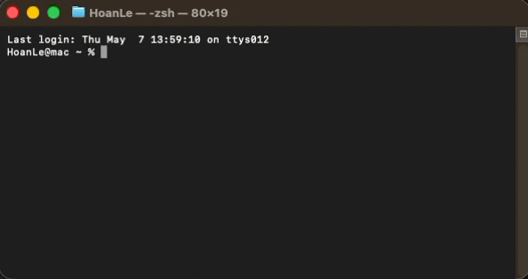

## **安装** { #installation }

您可以选择**桌面应用**（推荐——无需配置 Python 或编写代码），也可以通过 **Python 软件包 (`pip`)** 进行安装。

所有安装程序均发布在官方 [**GitHub Releases**](https://github.com/CEA-MetroCarac/SPECTROview/releases) 页面。您的偏好设置、拟合模型和模板均与应用程序文件夹分开存储，因此升级版本时您的所有工作成果都会安全保留。

---

### **1. 安装 SPECTROview** { #1-install-spectroview }

请在下方选择您的安装方式或操作系统：

=== ":material-language-python: Python (pip)"

    如果您已经使用 Python（**Python &ge; 3.12**），可直接从 [PyPI](https://pypi.org/project/spectroview/) 安装 **SPECTROview**：

    ```bash
    pip install spectroview
    ```

    在终端或 Anaconda Prompt 中启动 **SPECTROview**：

    ```bash
    spectroview
    ```

    <div align="center">
      <br>
      <i>通过 pip 安装 SPECTROview。</i>
    </div>

    ??? tip "更多 Python 命令（升级、指定版本、开发版）"

        - **系统安装了多个 Python 版本？** 请使用 `pip3 install spectroview` 或 `python -m pip install spectroview`。
        - **升级到最新版本：** `pip install --upgrade spectroview`
        - **安装指定版本：** `pip install spectroview==26.46.1`
        - **从 GitHub 安装最新开发版代码：** `pip install git+https://github.com/CEA-MetroCarac/SPECTROview.git`
        - **查看已安装版本：** `pip show spectroview`
        - **可选语音输入（仅限 Python 版）：** `pip install SpeechRecognition pyaudio`

=== ":material-microsoft-windows: Windows"

    前往 [**GitHub Releases**](https://github.com/CEA-MetroCarac/SPECTROview/releases)，展开最新版本的 **Assets** 栏，然后选择以下两个 Windows 安装文件之一：

    **方案 A — 标准安装程序 (`...Windows_x64_Setup.exe`)** *（推荐）*

    1. 双击下载的 `.exe` 文件进行安装（无需管理员密码）。
    2. 通过 **开始菜单** 或 **桌面** 快捷方式打开 **SPECTROview**。
    3. 今后的版本更新可在应用内一键自动安装（**更新并重启** (Update and Restart)）。

    **方案 B — 便携版 (`...Windows_x64_Portable.zip`)** *（免安装）*

    1. 右键点击 `.zip` 文件并选择 **全部解压缩...**，将其解压到任意文件夹（包括 U 盘或个人文件夹）。
    2. 打开解压后的文件夹并双击 **`SPECTROview.exe`**。

=== ":material-apple: macOS"

    前往 [**GitHub Releases**](https://github.com/CEA-MetroCarac/SPECTROview/releases)，展开最新版本的 **Assets** 栏，下载 **`...macOS_arm64.dmg`** 文件（**Apple 芯片 Mac — M1 或更新型号**）。

    !!! info "仅支持 Apple 芯片"
        预构建的 macOS `.dmg` 安装包**仅支持 Apple 芯片 (Apple Silicon) 的 Mac**（M1、M2、M3、M4 或更新型号；可通过 **苹果菜单 () → 关于本机 → 芯片：Apple ...** 查看）。桌面安装程序不支持较早的 Intel 芯片 Mac。

    **安装步骤：**

    1. 双击下载的 `.dmg` 文件。
    2. 将 **`SPECTROview`** 拖放到 **`Applications`**（“应用程序”）文件夹图标上。
    3. **仅限首次打开时：** 右键点击（或按住 **Control** 键点击）**应用程序** (`Applications`) 中的 **SPECTROview** → 点击 **打开** (Open) → 在确认弹窗中再次点击 **打开**。

    !!! note "为什么 macOS 在首次启动时会显示警告？"
        SPECTROview 是一款免费开源应用，目前未使用付费的 Apple Developer 签名。如果 macOS 提示无法验证开发者，请打开 **系统设置 → 隐私与安全性**，然后点击 **仍要打开**。每个版本仅需执行此操作一次。

=== ":material-linux: Linux"

    前往 [**GitHub Releases**](https://github.com/CEA-MetroCarac/SPECTROview/releases)，展开最新版本的 **Assets** 栏，然后选择您偏好的安装包格式：

    **方案 A — Ubuntu / Debian 安装包 (`...Linux_amd64.deb`)** *（推荐）*

    双击下载的 `.deb` 文件通过软件中心进行安装，或在终端中安装：

    ```bash
    sudo apt update
    sudo apt install ./SPECTROview_*_Linux_amd64.deb
    ```

    随后即可从应用程序菜单或输入 `spectroview` 启动 **SPECTROview**。如果您日后升级或卸载程序，您的设置仍会安全保存在主目录中。

    **方案 B — 便携版 AppImage (`...Linux_x86_64.AppImage`)** *（免安装）*

    1. 右键点击该文件 → **属性 → 权限** → 勾选 **允许作为程序执行文件** *（或运行 `chmod +x SPECTROview_*.AppImage`）*。
    2. 双击该文件即可启动 **SPECTROview**。

    !!! tip "在 Ubuntu 24.04 及更高版本上"
        如果双击 AppImage 没有任何反应，请安装一次 FUSE（`sudo apt install libfuse2t64`）或运行 `./SPECTROview_*.AppImage --appimage-extract-and-run`。

---

### **2. 使用内置 AI 对话助手** { #2-using-the-built-in-ai-chat-agent }

**AI 对话助手**已直接内置于软件中——无需在 **SPECTROview** 内进行额外安装：

- **云端 AI** *（OpenAI、Gemini、DeepSeek、Anthropic 等）*：请在 **设置** (Settings) → **AI 设置** (AI Settings) 中输入您的 API 密钥。
- **私有本地 AI** *（在您自己的计算机上离线运行）*：请安装 [Ollama](https://ollama.com) 并在打开 **SPECTROview** 前将其启动。

---

### **3. 自动更新** { #3-automatic-updates }

**SPECTROview** 会在打开后不久于后台自动检查新版本（您也可以随时点击顶部工具栏中的 **检查更新** (Check for updates)）。当有更新可用时，窗口顶部会出现一条通知栏：

<div align="center">
  <br>
  <i>当有更新版本可用时显示的更新横幅。</i>
</div>

- 点击 **更新并重启** / **下载更新** (Download Update) 以安装或获取最新版本。
- 点击 **查看更新日志** (Show changelog) 查看更新内容，点击 **稍后更新** (Update later) 当天不再提示，或点击 **跳过此版本** (Skip this version) 保持当前版本直至未来发布新版本。

| 您的安装版本 | 更新时的执行流程 |
|---|---|
| **Windows 安装程序** 与 **Python (`pip`)** | 自动下载并校验文件、更新 **SPECTROview** 并为您自动重启。 |
| **Linux AppImage** *（位于可写文件夹中）* | 安全替换自身文件并重启 **SPECTROview**。 |
| **Windows 便携版** 与 **macOS (`.dmg`)** | 下载已校验的新文件并打开简洁指引弹窗，方便您解压或拖入 **应用程序** (`Applications`)。 |
| **Ubuntu / Debian (`.deb`)** | 下载已校验的 `.deb` 文件，并支持一键复制安装命令。 |

!!! note "离线友好与隐私保护"
    软件绝不会上传任何使用数据或个人文件。如果您的计算机处于离线状态，启动时的更新检查会静默跳过，**SPECTROview** 将照常启动。

??? info "安全性与企业网络详情（供 IT 团队参考）"

    - **文件完整性：** 所有下载的安装包或软件包在运行前都会对照官方 `SHA256SUMS.txt` 校验和文件进行完整性校验。
    - **受信任的 HTTPS 连接 (`GHSA-6q48-6c7w-9gw2`)：** 网络连接优先使用操作系统的原生证书存储区（支持机构/企业内部 CA 以及自定义的 `SSL_CERT_FILE` / `REQUESTS_CA_BUNDLE` 环境变量），并要求使用已修复安全漏洞的 `certifi` 证书包（`>= 2026.10.23`），拒绝存在风险的 eMudhra / emSign 根证书。
    - **预发布版本测试：** 可在 **设置** → **常规** (General) → **应用程序更新** (Application Updates) 中开启或关闭候选发布版 (RC) 的可选更新通知。

---

### **4. 常见问题与故障排除** { #4-common-questions-troubleshooting }

??? question "macOS 提示无法打开“SPECTROview”（无法验证开发者）"

    1. 在 **访达** (Finder) 中打开 **应用程序** (`Applications`) 文件夹。
    2. 按住 **Control** 键点击（或右键点击）**`SPECTROview`**，然后选择 **打开**。
    3. 在弹出的对话框中再次点击 **打开**。

    *（替代方法：打开 **系统设置 → 隐私与安全性**，向下滚动并点击 **仍要打开**。）*

??? question "Windows：应该下载 Setup.exe 还是 Portable.zip？"

    如果您需要开始菜单快捷方式和一键自动更新，请选择 **`Setup.exe`**。如果您希望免安装运行（或从 U 盘运行），请选择 **`Portable.zip`**——双击 `SPECTROview.exe` 之前请务必先执行 **全部解压缩...**。

??? question "AppImage 在 Ubuntu / Debian 上无法打开"

    精简版 Ubuntu 系统有时缺少 FUSE 2 或 Qt X11 库。请在终端中运行一次以下命令：

    ```bash
    sudo apt update
    sudo apt install libfuse2t64 libxcb-cursor0 libxkbcommon-x11-0 libegl1 libgl1
    ```

    或者不使用 FUSE 直接启动 AppImage：`./SPECTROview_*.AppImage --appimage-extract-and-run`。

??? question "启动时出现空白窗口或图形渲染崩溃"

    请尝试在打开 **SPECTROview** 前启用软件图形渲染来启动：

    - **Windows (PowerShell)：** `$env:QT_QUICK_BACKEND="software"; spectroview`
    - **macOS / Linux：** `export QT_QUICK_BACKEND=software; spectroview`

??? question "Python 报错（`pip: command not found`、权限错误或 `spectroview: command not found`）"

    - 如果系统无法识别 `pip`，请运行 `python -m pip install spectroview`（或 `python3 -m pip install spectroview`）。
    - 如果安装后无法识别 `spectroview`，请使用 `python -m spectroview.main` 启动。
    - 为避免系统权限错误，请先创建一个虚拟环境：

      ```bash
      python -m venv spectroview_env
      source spectroview_env/bin/activate    # macOS / Linux
      spectroview_env\Scripts\activate       # Windows
      pip install spectroview
      ```
