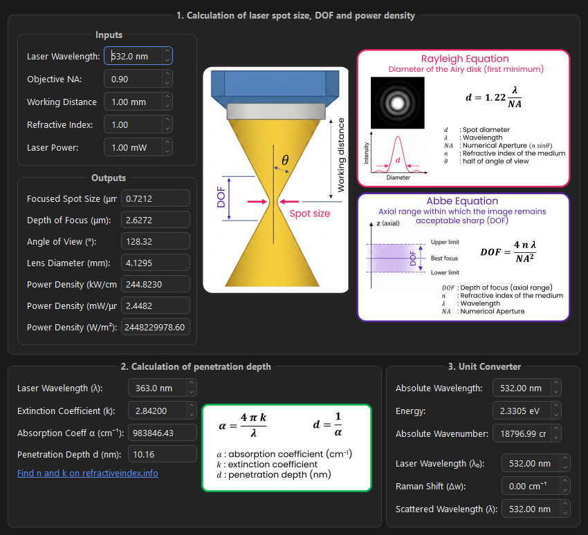

## **Menüleiste** { #menu-bar }

### **1. Schaltflächen der Menüleiste** { #1-menu-bar-buttons }

Eine horizontale Symbolleiste am oberen Rand der Anwendung bietet schnellen Zugriff auf die wichtigsten Funktionen:

| Schaltfläche | Funktion |
|--------------|----------|
|  | **Öffnen** (Open): Lädt jeden unterstützten Datentyp. Die Anwendung erkennt das Dateiformat automatisch und wechselt in den passenden Arbeitsbereich. |
|  | **Speichern** (Save): Speichert den aktiven Arbeitsbereich in einer eigenen Datei (`.maps`, `.spectra` oder `.graphs`), sodass Sie Ihre Arbeit mühelos unterbrechen und später fortsetzen können. |
|  | **Clear**: Leert den aktuell aktiven Arbeitsbereich und setzt geladene Daten, Viewer, angepasste Peak-Modelle, Fit-Ergebnisse sowie den Status der multivariaten Analyse zurück, um eine neue Sitzung zu beginnen. |
|  | **Calculators**: Öffnet das Werkzeug `Quick Calculators` (`Ctrl + Shift + C`, Details siehe unten). |
|  | **SPECTROview KI-Assistent** (SPECTROview AI Agent): Öffnet das Panel des KI-Chat-Agenten (`Ctrl + Shift + A`), um Ihre Daten in natürlicher Sprache abzufragen, zu filtern und zu plotten. Siehe Abschnitt „KI-Chat-Agent“. |
|  | **Einstellungen** (Settings): Öffnet das `Settings Panel` (`Ctrl + Shift + S`, Details siehe unten). |
|  | **Nach Updates suchen** (Check for updates): Prüft manuell auf der GitHub-Releases-Seite, ob eine neuere Version verfügbar ist. |
|  | **Theme**: Öffnet ein Auswahlmenü für das Oberflächen-Design — **Modern Dunkel** (Modern Dark), **Modern Grau** (Modern Gray), **Modern Hell** (Modern Light), **Klassisch Dunkel** (Classic Dark) oder **Klassisch Hell** (Classic Light). |
|  | **User Manual**: Öffnet das Online-Benutzerhandbuch in Ihrem Browser (`Ctrl + Shift + M`). |
|  | **GitHub**: Öffnet das GitHub-Repository von SPECTROview in Ihrem Browser. |
|  | **Über** (About): Zeigt Versionsinformationen, Lizenzhinweise und Details zur Anwendung **SPECTROview** an. |

> Rechts außen in der Symbolleiste befindet sich eine ausgegraute **Versionsanzeige** (z. B. `v26.29.0`) — klicken Sie darauf, um die neuesten Versionshinweise anzuzeigen.

### **2. Einstellungsbereich** { #2-settings-panel }

Klicken Sie auf das Symbol **Einstellungen**, um das `Settings Panel` zu öffnen. Weitere Details finden Sie im Abschnitt „Einstellungen“.

   
   <i>Die Benutzeroberfläche des Einstellungsbereichs.</i>

### **3. Werkzeug für Schnellberechnungen** { #3-quick-calculation-tool }

Klicken Sie auf das Symbol **Calculator**, um eine Sammlung praktischer Rechner zu öffnen. Weitere Details finden Sie im Abschnitt „Schnellrechner“.

   
   <i>Die Benutzeroberfläche der Schnellrechner.</i>

### **4. Tastenkürzel** { #4-keyboard-shortcuts }

Mit den folgenden Tastenkürzeln können Sie von überall in der Anwendung schnell auf diese Werkzeuge zugreifen:

- `Ctrl + Shift + A`: KI-Chat-Agenten öffnen
- `Ctrl + Shift + S`: Einstellungsbereich öffnen
- `Ctrl + Shift + M`: Benutzerhandbuch öffnen
- `Ctrl + Shift + C`: Schnellrechner öffnen
