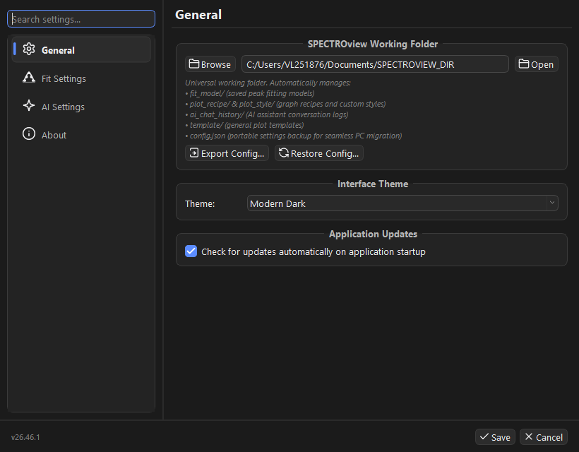

## **Настройки и параметры** { #settings-preferences }

Открыть меню **Настройки** (Settings) можно с помощью значка шестерёнки на главной панели инструментов (или нажав `Ctrl + Shift + S`). Также можно нажать **О программе SPECTROview** (About SPECTROview) в верхней строке меню, чтобы сразу перейти в раздел **О программе** (About).

   

 

Панель `Settings Panel` имеет современный двухпанельный интерфейс с фильтрацией по поисковому запросу в реальном времени:

- **Левая боковая панель**:
  - **Строка поиска**: введите любое ключевое слово (например, `working folder`, `theme`, `language`, `tolerance`, `loss`, `mcp`, `python`, `citation`), чтобы мгновенно отфильтровать список разделов и подсветить подходящие параметры прямо на странице с автоматической прокруткой к ним.
  - **Вкладки навигации**:
    1. **Общие** (General) — рабочая папка SPECTROview, тема оформления, язык интерфейса, переносимое резервное копирование и восстановление конфигурации, а также параметры обновлений.
    2. **Настройки фитинга** (Fit Settings) — параметры сходимости оптимизатора, робастная функция потерь, полярность пиков и глобальные ограничения пиков (со специальным значком аппроксимации кривых).
    3. **Настройки ИИ** (AI Settings) — учётные данные провайдеров LLM, проверка подключения и локальный MCP-сервер.
    4. **О программе** — версия приложения, номер сборки, среда Python, версии зависимостей времени выполнения, документация и сведения для цитирования.
- **Правая область содержимого**: отображает все параметры выбранной вкладки. Весь информационный текст, сведения об окружении и библиографическую ссылку можно выделить мышью для удобного копирования.
- **Нижняя панель**: отображает версию приложения и стандартные кнопки **Сохранить** (Save) и **Отмена** (Cancel).

> **Синхронизация темы**: выбрать параметр **Тема оформления** (Interface Theme) можно как на вкладке **Общие** (`Modern Dark`, `Modern Gray`, `Modern Light`, `Classic Dark` или `Classic Light`), так и непосредственно с помощью кнопки **Theme** в верхней строке меню. Оба переключателя полностью синхронизируются в реальном времени.

---

### **1. Рабочая папка SPECTROview и общие параметры** *(вкладка Общие)* { #1-spectroview-working-folder-preferences-general-tab }

Укажите единую универсальную корневую папку для всех шаблонов, рецептов, стилей, истории диалогов с ИИ и резервного копирования конфигурации SPECTROview. После выбора папки внутри неё автоматически создаются пять подпапок и файл переносимой конфигурации:

| Подпапка / Файл | Содержимое |
|------------------|------------|
| `fit_model/` | Пользовательские модели аппроксимации (JSON). Инструмент **Модель аппроксимации** (`Fit Model Builder`) сканирует эту папку и отображает все находящиеся здесь модели для повторного использования в один клик. |
| `plot_recipe/` | **Рецепты графиков** (Plot Recipes) — сохранённые наборы полных конфигураций графиков (привязки данных + стиль) для рабочей области **Графики** (`Graphs`). |
| `plot_style/` | **Шаблоны стилей** (Style Templates) — сохранённые стили оформления без привязки к данным, которые можно применить к любому существующему графику. |
| `ai_chat_history/` | Журналы диалогов с ИИ-ассистентом (JSON). Диалоги сохраняются сюда автоматически. |
| `template/` | Общие шаблоны графиков и рабочих областей. |
| `config.json` | Переносимая резервная копия конфигурации. Неконфиденциальные настройки приложения дублируются в этот JSON-файл. |

- Нажмите **Обзор** (Browse), чтобы выбрать папку, или введите путь вручную.
- Нажмите **Открыть** (Open), чтобы в один клик открыть настроенную папку непосредственно в **Проводнике Windows** или **Finder macOS**.

> **Безопасность учётных данных**: API-ключи провайдеров ИИ, введённые в разделе **Настройки**, хранятся в приватной пользовательской конфигурации вашей ОС (`QSettings` во внутреннем обфусцированном пространстве имён) в Windows, macOS и Linux и строго исключаются из резервных копий `config.json`. Это позволяет избежать навязчивых запросов системных хранилищ Keychain / KWallet и одновременно предотвращает утечку конфиденциальных ключей при передаче рабочей папки или добавлении её в систему контроля версий.
>
> **Резервное копирование и перенос на другой ПК**: при переходе на новый компьютер или для создания резервной копии достаточно просто скопировать эту единую рабочую папку на новый ПК. В панели **Настройки** SPECTROview на новом компьютере укажите её в поле **Рабочая папка SPECTROview** (SPECTROview Working Folder): все модели аппроксимации, рецепты графиков, шаблоны стилей, история диалогов с ИИ и конфигурация (`config.json`) будут восстановлены автоматически!
>
> Вы также можете в любой момент воспользоваться кнопками **Экспорт настроек...** (Export Config...) и **Восстановить настройки...** (Restore Config...) для экспорта параметров в отдельный JSON-файл или восстановления из него.

#### **Тема оформления** { #interface-theme }

- **Тема** (Theme): выберите один из вариантов — **Современная тёмная** (Modern Dark), **Современная серая** (Modern Gray; по умолчанию), **Современная светлая** (Modern Light), **Классическая тёмная** (Classic Dark) или **Классическая светлая** (Classic Light). Выбор немедленно обновляет активную тему и остаётся полностью синхронизированным с кнопкой выбора темы в верхней строке меню. Тема области построения графиков не зависит от темы интерфейса и по умолчанию использует **Светлый режим** (Light Mode); переключиться на **Тёмный режим** (Dark Mode) можно в любой момент с помощью переключателя **Тема графика** (Plot theme) на панели `View Options` под областью спектра (выбор сохраняется между сеансами).

#### **Язык интерфейса** { #interface-language }

- **Язык** (Language): выберите **English** (по умолчанию), **Français** (французский), **简体中文** (упрощённый китайский), **Deutsch** (немецкий) или **Русский**. Изменения применяются **мгновенно во всём приложении** — в меню, рабочих областях, окнах просмотра, диалоговых окнах, подписях научных графиков и на панели ИИ-чата — без перезапуска. Нажатие кнопки **Отмена** возвращает любой предпросмотренный язык к ранее сохранённому значению. Выбранный язык сохраняется между сеансами через `QSettings` и `config.json`, а нажатие кнопки **Открыть руководство** (Open User Manual) открывает соответствующую языковую версию документации (`/user_manual/` для английского, `/fr/user_manual/` для французского, `/de/user_manual/` для немецкого, `/ru/user_manual/` для русского и `/zh/user_manual/` для упрощённого китайского).

#### **Обновления программы** { #application-updates }

- **Автоматически проверять обновления при запуске** (Check for updates automatically on application startup): если флажок установлен (по умолчанию), SPECTROview периодически проверяет GitHub Releases в фоновом режиме при запуске (с кэшированием HTTP `ETag`) и учитывает ваш способ установки (`pip`, установщик Windows, портативный ZIP-архив, macOS DMG, Linux AppImage или `.deb`).
- **Включать предварительные сборки (Beta / RC)** (Include pre-release / release candidate builds): если флажок установлен, при проверке обновлений также учитываются предварительные теги (например, `-rc.1` или `-beta`). По умолчанию отключено, чтобы большинство пользователей получало только стабильные выпуски.

---

### **2. Параметры сходимости аппроксимации** *(вкладка Настройки фитинга)* { #2-fit-convergence-parameters-fit-settings-tab }

Эти параметры управляют работой **векторизованного движка пакетной аппроксимации (`VBF`)** — математического оптимизатора, выполняющего подгонку кривых для ваших спектров. Изменение этих значений напрямую влияет на скорость, точность и сходимость аппроксимации.

- **Сбросить по умолчанию** (Reset to Default): нажмите кнопку **Сбросить настройки аппроксимации** (Reset all fit settings to default) в верхней части вкладки, чтобы мгновенно восстановить заводские значения всех параметров сходимости и глобальных ограничений пиков.

| Параметр | Настройка | По умолчанию | Диапазон | Описание и поведение |
|----------|-----------|--------------|----------|----------------------|
| **Максимальное число итераций** | `max_ite` | 200 | 10 – 10 000 | Максимальное число итераций Левенберга — Марквардта на один спектр.  • **Меньше (50–100)**: более быстрая аппроксимация для предварительного просмотра. • **Больше (200+)**: лучшая сходимость для сложных спектров. |
| **Допуск по x** | `xtol` | 1×10⁻⁴ | 1×10⁻¹⁰ – 1.0 | Относительный допуск для величины шага по параметрам. Для сходимости требуется:   mean(\|&delta;<i>p</i>\| / \|<i>p</i>\|) &lt; `xtol` |
| **Допуск по f** | `ftol` | 1×10⁻⁴ | 1×10⁻¹⁰ – 1.0 | Относительный допуск для целевой функции. Для сходимости требуется:   \|costn - costn-1\| / \|costn\| &lt; `ftol` |
| **Коэффициент порога шума** | `coef_noise` | 0.0 | 0.0 – 10.0 | Множитель для автоматически оцениваемого уровня шума (`coef_noise` × оценённая амплитуда шума). Маскирует зашумлённые данные и подавляет ложные («фантомные») пики. • **0.0**: отключено (по умолчанию) • **0.5–1.0**: консервативный • **1.0–2.0**: умеренный • **3.0+**: агрессивный  *Примечание: вы можете ориентироваться на уровень шума, отображаемый на панели инструментов, или установить флажок **Уровень шума** (Show noise level) в панели `View Options` окна `SpectraViewer`, чтобы видеть порог шума непосредственно на графике спектров.* |
| **Функция потерь** | `loss` | `linear` | `linear`, `soft_l1`, `huber` | Робастная функция потерь для устойчивости к выбросам (например, космическим пикам или резким артефактам).  • **linear**: стандартный метод наименьших квадратов (по умолчанию). • **soft_l1**: гладкая L1-аппроксимация $\rho(z) = 2(\sqrt{1+z}-1)$, устойчивая к сильным выбросам без ручного маскирования. • **huber**: функция потерь Хьюбера — квадратичная для основных точек и линейная для невязок, превышающих `f_scale`. |
| **Масштаб потерь** | `f_scale` | 1.0 | 0.01 – 100.0 | Масштаб границы между основными точками и выбросами для робастных функций потерь. Невязки масштабируются как $(r / f\_scale)$ перед вычислением $\rho'(z)$. |
| **Учитывать отрицательные значения** | `fit_negative` | Снято | - | Если флажок установлен, отрицательные значения интенсивности (пики поглощения или инвертированные пики) включаются в аппроксимацию. Если снят — им присваивается нулевой вес. |

> **Примечание**: спектр считается сошедшимся только тогда, когда критерии `xtol` и `ftol` выполняются **одновременно**.
>
> **Порядок применения весов**: сначала оцениваются жёсткие исключения (`fit_negative` и маскирование по уровню шума `coef_noise`), присваивающие исключённым точкам нулевой вес. Затем к активным точкам применяется робастное взвешивание (`soft_l1` или `huber`), плавно снижающее вес выбросов с помощью метода итеративно перевзвешенных наименьших квадратов (IRLS).

---

### **3. Глобальные ограничения пиков** *(вкладка Настройки фитинга)* { #3-global-peak-limits-fit-settings-tab }

Эти параметры задают **абсолютные граничные условия**, которые применяются глобально ко всем пикам во всём приложении. При добавлении нового пика в модель аппроксимации эти ограничения используются для автоматической установки начальных границ параметров.

> **Примечание**: вы можете установить флажок **Пределы** (Limits) под таблицей `PeakTable`, чтобы отобразить фактические границы каждого пика.

| Ограничение | По умолчанию | Диапазон | Описание и условие |
|-------------|--------------|----------|--------------------|
| **Макс. сдвиг пика** | 20 | 0 – 100 | Максимально допустимое смещение центра пика (`x0`) относительно его исходного значения.  <i>x</i>0 - maxshift &le; <i>x</i>0fitted &le; <i>x</i>0 + maxshift |
| **Мин. FWHM пика** | 0.1 | 0.01 – 500 | Минимально допустимая ширина на полувысоте (`FWHM`). Предотвращает вырождение пиков в артефакты типа дельта-функции. |
| **Макс. FWHM пика** | 200 | 1 – 1 000 | Максимально допустимая ширина `FWHM`. Предотвращает чрезмерное уширение пиков и их слияние с плоской базовой линией. |

---

### **4. Настройки ИИ** *(вкладка Настройки ИИ)* { #4-ai-settings-ai-settings-tab }

Вкладка **Настройки ИИ** служит для настройки [ИИ-чат-агента](ai_agent.md). Заполнение параметров на этой вкладке не требуется для работы с остальными функциями SPECTROview.

#### **API-ключи** { #api-keys }

По умолчанию отображаются поля для конечной точки **Пользовательский** (Custom; OpenAI-совместимой):

| Поле | Описание |
|------|----------|
| **Пользовательский API-ключ** (Custom API Key) | API-ключ для вашей пользовательской или внутренней конечной точки. |
| **Базовый URL** (Base URL) | Корневой OpenAI-совместимый URL конечной точки (например, `https://host/v1`). |
| **Название модели** (Model Name) | Список названий моделей через запятую (например, `model-a, model-b`). Эти значения заполняют выпадающий список моделей на панели чата — удобно для серверов, не предоставляющих API для получения списка моделей. |
| **Отображаемое имя** (Display Label) | Подпись, отображаемая в поле ввода ИИ-чата для данной пользовательской конечной точки. |

Ключи для встроенных облачных провайдеров скрыты в сворачиваемом разделе **▸ Другие облачные провайдеры** (Other cloud providers) (нажмите, чтобы развернуть): **OpenAI**, **Anthropic**, **Gemini**, **DeepSeek** и **Mistral**. Все ключи хранятся в замаскированном виде и запоминаются между сеансами.

- **Проверить подключение** (Test Connection): выберите любого провайдера из выпадающего списка и нажмите **Проверить подключение**, чтобы проверить доступность конечной точки API, учётные данные и сетевое подключение без сохранения настроек.

> **Где хранятся ваши ключи**: API-ключи сохраняются в пользовательском хранилище
> настроек вашей операционной системы (в обфусцированном виде в разделе `_credentials/`) — в реестре
> (`HKEY_CURRENT_USER\Software\CEA-Leti\SPECTROview`) в Windows,
> `~/Library/Preferences` в macOS или `~/.config/CEA-Leti/SPECTROview.conf` в Linux.
> Они **никогда** не записываются в файлы внутри папки проекта SPECTROview,
> не включаются в экспортированные рабочие области или резервные копии настроек и не могут быть
> случайно добавлены в репозиторий Git.

#### **Локальный MCP-сервер** { #local-mcp-server }

Включайте этот параметр только тогда, когда доверенному MCP-клиенту на том же компьютере требуется доступ
к текущей запущенной сессии SPECTROview. Конечная точка по умолчанию —
`http://127.0.0.1:8765/mcp`; сервер запускается сразу после нажатия **Сохранить**.

| Поле | По умолчанию | Описание |
|------|--------------|----------|
| **Включить локальную конечную точку MCP (Model Context Protocol)** (Enable local MCP endpoint) | Выкл. | Запускает или останавливает встроенный MCP-сервер. |
| **Порт** (Port) | 8765 | Локальный порт Streamable HTTP (1024–65535). Укажите другой, если этот порт занят. |

Адрес привязки жёстко ограничен локальным хостом (`127.0.0.1`); сервер не доступен ни по локальной сети,
ни из интернета. Не закрывайте SPECTROview, пока клиент подключён.

---

### **5. О программе и среда выполнения** *(вкладка О программе)* { #5-about-environment-about-tab }

Вкладка **О программе** содержит подробную справочную информацию и сведения о среде выполнения:

- **Сведения о приложении**: официальный логотип SPECTROview, название, номер версии (`Version {VERSION}`) и номер сборки (`Build: {BUILD_NUMBER}`).
- **Среда и зависимости** (Environment & Dependencies): автоматически определяет режим запуска и сборки (`Python Package (.whl / local)`, `Windows Installer (Velopack)`, `Windows Portable`, `macOS Application (.app)`, `Linux AppImage` или `Linux Debian Package (.deb)`) и отображает версии зависимостей:

  - **Автономные сборки**: отображают зафиксированный при сборке снимок версий зависимостей, а также сведения о встроенной среде Python и ОС хоста/сборки.
  - **Установленный пакет (`.whl` / `pip` / Dev)**: динамически считывает актуальные версии пакетов, установленных в локальной среде Python.
  - Содержит список `PySide6` (с версией среды выполнения Qt), стека TLS и безопасности (`certifi`, `truststore`), научного стека (`numpy`, `scipy`, `matplotlib`, `pandas`, `pybaselines`), модулей экспорта (`openpyxl`, `pyarrow`), расширений интерфейса (`superqt`) и SDK для ИИ-чата.
- **Проверить обновления** (Check for Updates): кнопка для мгновенной проверки новых версий на GitHub Releases.
- **Цитирование статьи**: каноническая библиографическая ссылка на рецензируемую статью в журнале *SoftwareX* с DOI, а также кнопка **Копировать** (Copy) для быстрого копирования ссылки в буфер обмена.
