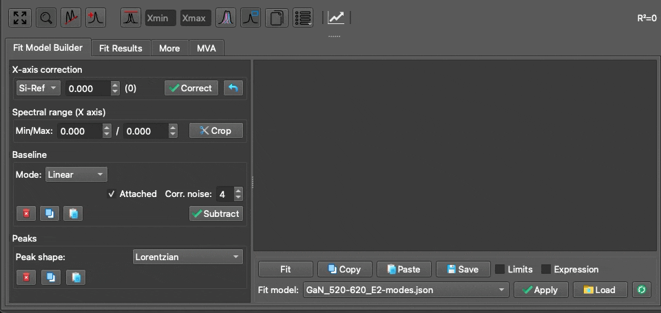
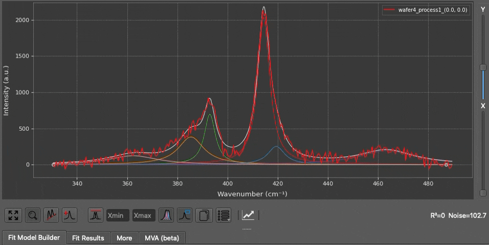
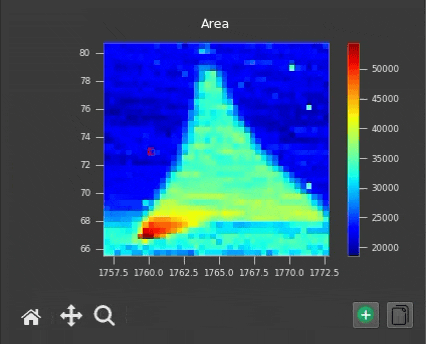
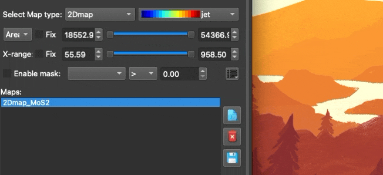

## **Tastenkürzel & Tipps** { #keyboard-shortcuts-tips }

### **1. Tooltips überall** { #1-tooltips-everywhere }

Wenn Sie sich einmal unsicher sind, was eine bestimmte Schaltfläche oder ein Parameter bewirkt, bewegen Sie den Mauszeiger einfach kurz über das jeweilige Bedienelement der Benutzeroberfläche, um einen beschreibenden Tooltip anzuzeigen.

   

 

________

### **2. Tipps zu `SpectraViewer`** { #2-tips-with-spectraviewer }

Im `SpectraViewer` können Sie mit der Maus direkt mit dem Spektrendiagramm **interagieren**:

  

 

- Verwenden Sie das Tastenkürzel `Ctrl + R` (oder `Cmd + R` unter macOS), um das Spektrendiagramm neu auf die sichtbaren Daten zu skalieren.
- Sie können außerdem das Mausrad nutzen, um den Zoom der Y-Achse anzupassen.

- Passen Sie die vertikalen Schieberegler für X und Y auf der rechten Seite des Diagramms an, um die Spektren für eine bessere Übersichtlichkeit entlang der X- oder Y-Achse zu verschieben.
- Sie können den Mittelpunkt oder die Breite jedes Peaks direkt im `SpectraViewer` anklicken und ziehen, um dessen Parameter dynamisch anzupassen. Dies ist eine deutlich schnellere Methode, um die Startparameter für Ihren Fit festzulegen.
- Bewegen Sie den Mauszeiger über einen Peak, um dessen Parameter (Position, Breite, Amplitude) anzuzeigen.
- Bewegen Sie den Mauszeiger über einen Peak und klicken Sie mit der rechten Maustaste, um ihn zu entfernen.

- Wenn Sie eine **Basislinie** (baseline) im Modus **Linear** oder **Polynom** (Polynomial) definieren, können Sie nach dem Hinzufügen von Basislinien-Ankerpunkten den Mauszeiger über einen Ankerpunkt bewegen und ihn per Rechtsklick sofort entfernen.

  

 

- Unabhängig vom aktuell eingestellten globalen Design (dunkel oder hell) können Sie das Design des Spektrendiagramms im Menü `View Options` ändern. Ebenso können Sie beim Kopieren der Abbildung in die Zwischenablage festlegen, welches Design (dunkel oder hell) die kopierte Abbildung verwenden soll.
- Sie können die Fit-Kurven oder das Legendenfeld jederzeit ein- oder ausblenden, indem Sie auf die entsprechenden Schaltflächen in der Symbolleiste von `SpectraViewer` klicken.
- Wenn das Legendenfeld angezeigt wird, doppelklicken Sie auf eine beliebige Stelle darin, um den Editor zur Stapelbearbeitung der Legende zu öffnen. In einem einzigen Dialogfeld können Sie die Farbpalette, die maximale Anzahl an Legendeneinträgen sowie die Beschriftungen und Farben von bis zu 100 ausgewählten Spektren ändern. **Automatisch** (Automatic) zugewiesene Farben folgen der aktiven Palette; manuell festgelegte Farben bleiben fest. Wählen Sie **OK**, um alle Änderungen zu übernehmen, oder **Abbrechen** (Cancel), um sie zu verwerfen.

- Unter jeder Zeichenfläche befindet sich die Schaltfläche **Kopieren** (Copy). Klicken Sie einfach darauf, um das Diagramm als PNG-Bild zu kopieren. Halten Sie `Ctrl` (oder `Cmd` unter macOS) gedrückt und klicken Sie auf die Schaltfläche **Kopieren**, um statt eines Bildes den numerischen Rohdatensatz des aktuellen Diagramms direkt in die Zwischenablage Ihres Systems zu kopieren.

________

### **3. Tipps zu `MapViewer`** { #3-tips-with-mapviewer }

**Profil aus 2D-Kartenplot extrahieren**: Sobald zwei unterschiedliche Punkte auf der 2D-Karte ausgewählt sind, wird das Intensitätsprofil zwischen diesen beiden Koordinaten automatisch berechnet und direkt auf der Heatmap dargestellt:

   
  <i>Das Profil wird auf der Karte angezeigt, sobald zwei Punkte ausgewählt sind, und verschwindet automatisch, wenn mehr als zwei Punkte ausgewählt werden.</i>

   
  <i>Sie können im Menü <code>View Options</code> einen Profilnamen festlegen und anschließend auf <b>Extract</b> klicken, um es zur Darstellung direkt an den Arbeitsbereich <b>Diagramme</b> (Graphs) zu senden.</i>

 

________

**Schneller Re-Fit (Warmstart)**: Falls ein Fit nicht perfekt konvergiert, können Sie die Peak-Grenzen manuell anpassen und einfach erneut auf die Schaltfläche **Anpassen** (Fit) klicken. Die Engine führt einen „Warmstart“ auf Basis der Ergebnisse der vorherigen Optimierung durch, wodurch nachfolgende Fits erheblich schneller ablaufen.

 

________

**Umgang mit komplexen Spaltennamen**: Wenn Sie die Funktionen `Data Filter` oder `Computed Columns` verwenden und Ihr Zielspaltenname Leerzeichen oder Sonderzeichen enthält, müssen Sie den Spaltennamen in Backticks (`` ` ``) einschließen (z. B. `` `Laser Power` <= 5 ``).

 

________

**Räumliche Profilextraktion**: Wenn Sie im Arbeitsbereich **Karten** (Maps) genau zwei unterschiedliche räumliche Punkte auf der Heatmap des `MapViewer` auswählen, extrahiert und zeichnet **SPECTROview** automatisch ein interpoliertes Intensitätsprofil zwischen diesen beiden Koordinaten.

________

### **4. Tastenkürzel im Arbeitsbereich Diagramme** { #4-keyboard-shortcuts-in-the-graphs-workspace }

Wenn ein Diagrammfenster im Arbeitsbereich **Diagramme** aktiv ist, stehen folgende Tastenkürzel zur Verfügung (verwenden Sie unter macOS `Cmd` anstelle von `Ctrl`):

| Tastenkürzel | Aktion |
|--------------|--------|
| `Ctrl + Z` | Letzte Änderung am aktiven Diagramm rückgängig machen |
| `Ctrl + Shift + Z` | Letzte rückgängig gemachte Änderung wiederherstellen |
| `Ctrl + C` | Abbildung des aktiven Diagramms (als Bild) in die Zwischenablage kopieren |
| `Ctrl + V` | Zuvor kopierten Stil in das aktive Diagramm einfügen |
| `Ctrl + E` | Dialog **Customize Graph** für das aktive Diagramm öffnen |
| `Ctrl + R` | Aktives Diagramm neu auf seine Daten skalieren |
