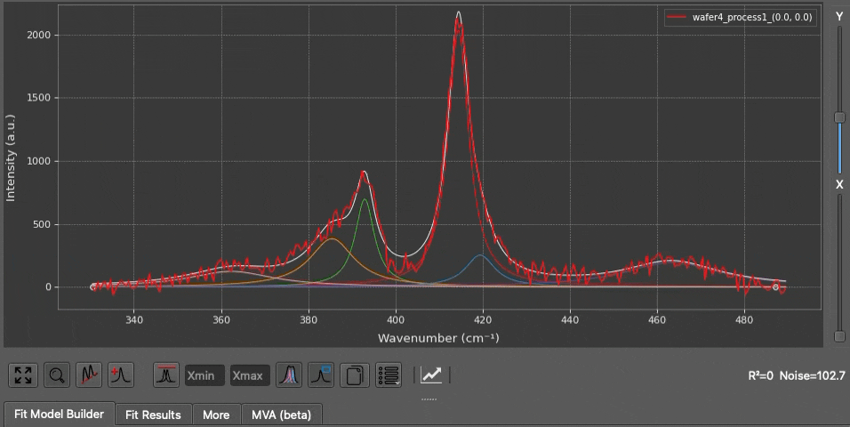
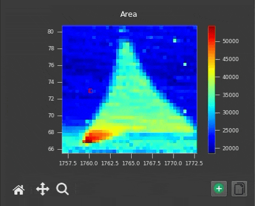
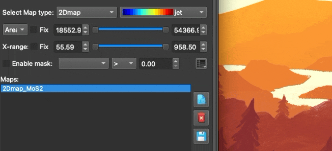

## **Raccourcis clavier et astuces**

### **1. Des infobulles partout**

Si vous avez un doute sur le rôle d'un bouton ou d'un paramètre, survolez simplement l'élément d'interface avec le curseur pendant un bref instant pour afficher une infobulle descriptive.

   

 

________

### **2. Astuces avec `SpectraViewer`**

Dans `SpectraViewer`, vous pouvez **interagir** directement avec le tracé des spectres à la souris :

  

 

- Utilisez le raccourci `Ctrl + R` (ou `Cmd + R` sous macOS) pour recadrer le graphique sur les données visibles.
- Vous pouvez également utiliser la molette de la souris pour ajuster le zoom sur l'axe Y.

- Réglez les curseurs verticaux X et Y situés à droite du tracé pour décaler les spectres selon X ou Y et gagner en lisibilité.
- Vous pouvez cliquer et faire glisser directement le point central ou la largeur d'un pic dans `SpectraViewer` afin de régler ses paramètres dynamiquement. C'est la méthode la plus rapide pour préparer les valeurs initiales de votre ajustement.
- Survolez un pic avec la souris pour afficher ses paramètres (position, largeur, amplitude).
- Survolez un pic et faites un clic droit pour le supprimer.

- Lors de la définition d'une ligne de base (`Linear` ou `Polynomial`), une fois les points d'ancrage ajoutés, survolez un point d'ancrage et faites un clic droit pour le supprimer instantanément.

  

 

- Quel que soit le thème global actif (sombre ou clair), vous pouvez changer le thème du graphique spectral dans le menu `View Options`. De même, lorsque vous copiez la figure dans le presse-papiers, vous pouvez choisir le thème (clair ou sombre) de l'image copiée.
- Vous pouvez afficher ou masquer à tout moment les courbes d'ajustement optimal ou la boîte de légende à l'aide des boutons correspondants de la barre d'outils de `SpectraViewer`.
- Lorsque la légende est affichée, double-cliquez n'importe où à l'intérieur pour ouvrir l'éditeur de légende par lots. Dans une seule fenêtre, vous pouvez modifier la palette, le nombre maximal d'entrées ainsi que les libellés et couleurs d'un lot allant jusqu'à 100 spectres sélectionnés. Les couleurs **Automatic** suivent la palette active ; les couleurs choisies manuellement restent figées. Cliquez sur **OK** pour tout appliquer ou sur **Cancel** pour annuler.

- Sous chaque canevas graphique se trouve un bouton **Copy**. Un clic simple copie le graphique sous forme d'image PNG. Maintenez `Ctrl` (ou `Cmd` sous macOS) en cliquant sur **Copy** pour copier directement dans le presse-papiers les données numériques brutes du graphique affiché (au lieu d'une image).

________

### **3. Astuces avec `MapViewer`**

**Extraire un profil depuis une carte 2D** : Dès que deux points distincts sont sélectionnés sur la carte 2D, le profil d'intensité entre ces deux coordonnées est automatiquement calculé et tracé directement sur la carte thermique :

   
  <i>Le profil s'affiche sur la carte lorsque deux points sont sélectionnés, et disparaît automatiquement dès que plus de deux points sont sélectionnés.</i>

   
  <i>Vous pouvez définir un nom de profil dans le menu <code>View Options</code>, puis cliquer sur <b>Extract</b> pour l'envoyer directement vers l'espace <code>Graphs</code> pour le tracer.</i>

 

________

**Réajustement rapide (*Warm Starting*)** : Si un ajustement ne converge pas parfaitement, ajustez manuellement les bornes des pics puis cliquez simplement de nouveau sur **Fit**. Le moteur repart des résultats de l'optimisation précédente (« warm-start »), rendant les ajustements suivants nettement plus rapides.

 

________

**Gérer les noms de colonnes complexes** : Lorsque vous utilisez les fonctionnalités `Data Filter` ou `Computed Columns` et que le nom d'une colonne cible contient des espaces ou des caractères spéciaux, encadrez-le par des accents graves (`` ` ``) (par exemple `` `Laser Power` <= 5 ``).

 

________

**Extraction de profil spatial** : Dans l'espace `Maps`, si vous sélectionnez exactement deux points spatiaux distincts sur la carte thermique `MapViewer`, **SPECTROview** extrait et trace automatiquement un profil d'intensité interpolé entre ces deux coordonnées.

________

### **4. Raccourcis clavier dans l'espace `Graphs`**

Lorsqu'une fenêtre graphique est active dans l'espace `Graphs`, les raccourcis clavier suivants sont disponibles (sous macOS, utilisez `Cmd` à la place de `Ctrl`) :

| Raccourci | Action |
|-----------|--------|
| `Ctrl + Z` | Annuler la dernière modification apportée au graphique actif |
| `Ctrl + Shift + Z` | Rétablir la dernière modification annulée |
| `Ctrl + C` | Copier la figure du graphique actif dans le presse-papiers (en tant qu'image) |
| `Ctrl + V` | Coller un style précédemment copié sur le graphique actif |
| `Ctrl + E` | Ouvrir la fenêtre **Customize Graph** pour le graphique actif |
| `Ctrl + R` | Recadrer le graphique actif sur l'étendue de ses données |
