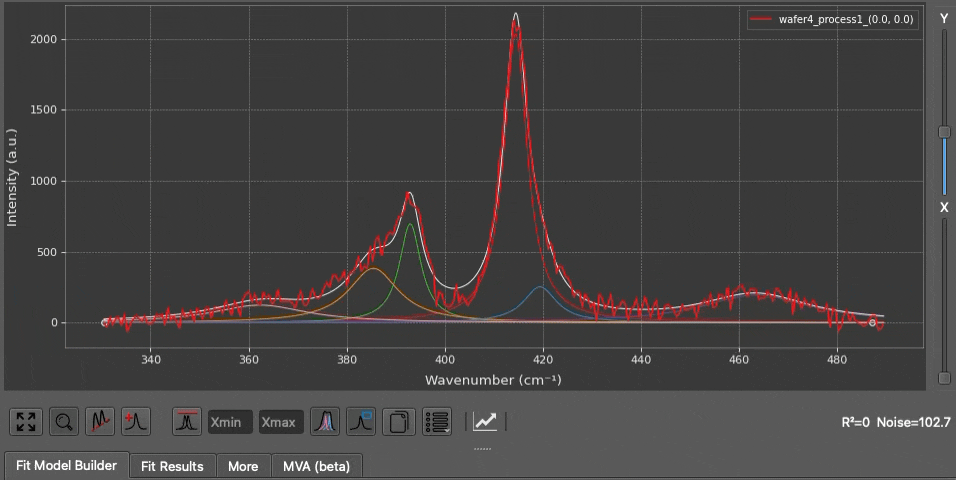
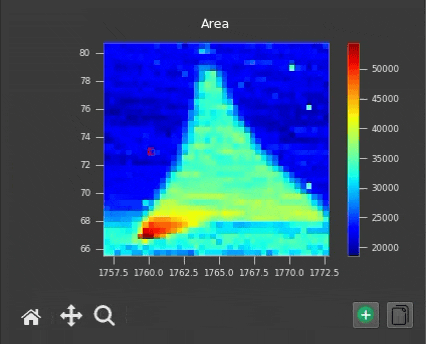
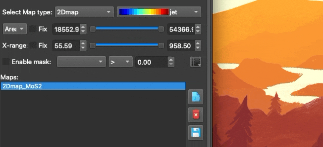

## **Горячие клавиши и советы** { #keyboard-shortcuts-tips }

### **1. Всплывающие подсказки повсюду** { #1-tooltips-everywhere }

Если вы не уверены, за что отвечает конкретная кнопка или параметр, просто ненадолго наведите курсор мыши на элемент интерфейса — появится всплывающая подсказка с описанием.

   

 

________

### **2. Советы по работе со `SpectraViewer`** { #2-tips-with-spectraviewer }

В `SpectraViewer` вы можете **взаимодействовать** с графиком спектров с помощью мыши:

  

 

- Используйте сочетание клавиш `Ctrl + R` (или `Cmd + R` на macOS), чтобы подогнать масштаб графика спектров под видимые данные.
- Вы также можете использовать колесо прокрутки мыши для регулировки масштаба по оси Y.

- Регулируйте вертикальные ползунки X и Y в правой части графика, чтобы сдвигать спектры вдоль оси X или Y для лучшей наглядности.
- Вы можете нажать и перетащить центральную точку или ширину любого пика прямо в `SpectraViewer`, чтобы динамически скорректировать его параметры. Это гораздо более быстрый способ задать начальные параметры для аппроксимации.
- Наведите курсор мыши на пик, чтобы отобразить его параметры (положение, ширину, амплитуду).
- Наведите курсор мыши на пик и щёлкните правой кнопкой мыши, чтобы удалить его.

- Когда вы задаёте **базовую линию** (baseline) в режиме **Линейный** (Linear) или **Полином** (Polynomial), после добавления опорных точек вы можете навести курсор на опорную точку и мгновенно удалить её щелчком правой кнопки мыши.

  

 

- Независимо от текущей глобальной темы интерфейса (тёмной или светлой), вы можете изменить тему графика спектров в меню `View Options`. Аналогично, при копировании рисунка в буфер обмена вы можете выбрать тему (тёмную или светлую) для копируемого изображения.
- Вы можете в любой момент отобразить или скрыть кривые аппроксимации и блок легенды, нажав соответствующие кнопки на панели инструментов `SpectraViewer`.
- Когда блок легенды отображается, дважды щёлкните в любом месте внутри него, чтобы открыть пакетный редактор легенды. В одном диалоговом окне можно изменить палитру, максимальное число записей в легенде, а также подписи и цвета для группы до 100 выбранных спектров. Цвета со значением **Автоматически** (Automatic) следуют активной палитре, а заданные вручную цвета остаются фиксированными. Нажмите **OK**, чтобы применить все изменения, или **Отмена** (Cancel), чтобы сбросить их.

- Под областью каждого графика расположена кнопка **Копировать** (Copy). Нажмите её, чтобы скопировать график как изображение PNG. Удерживайте `Ctrl` (или `Cmd` на macOS) и нажмите кнопку **Копировать**, чтобы скопировать исходный числовой набор данных текущего графика прямо в системный буфер обмена (вместо изображения).

________

### **3. Советы по работе с `MapViewer`** { #3-tips-with-mapviewer }

**Извлечение профиля с графика 2D-карты**: как только на 2D-карте выбраны две различные точки, профиль интенсивности между этими двумя координатами автоматически вычисляется и строится непосредственно на тепловой карте:

   
  <i>Профиль отображается на карте, когда выбраны две точки, и автоматически исчезает, если выбрано более двух точек.</i>

   
  <i>Вы можете задать имя профиля в меню <code>View Options</code>, затем нажать <b>Extract</b>, чтобы отправить его напрямую в рабочую область <b>Графики</b> (Graphs) для построения.</i>

 

________

**Быстрая повторная аппроксимация («тёплый старт»)**: если аппроксимация сходится неидеально, вы можете вручную скорректировать границы пиков и просто снова нажать кнопку **Подгонка** (Fit). Движок выполнит «тёплый старт» (warm-start) с использованием результатов предыдущей оптимизации, что значительно ускорит последующую аппроксимацию.

 

________

**Работа со сложными названиями столбцов**: если вы используете функции `Data Filter` или `Computed Columns`, а имя целевого столбца содержит пробелы или специальные символы, заключите имя столбца в обратные кавычки (`` ` ``) (например, `` `Laser Power` <= 5 ``).

 

________

**Извлечение пространственного профиля**: если в рабочей области **Карты** (Maps) выбрать ровно две различные пространственные точки на тепловой карте `MapViewer`, **SPECTROview** автоматически извлечёт и построит интерполированный профиль интенсивности между этими двумя координатами.

________

### **4. Горячие клавиши в рабочей области «Графики»** { #4-keyboard-shortcuts-in-the-graphs-workspace }

Когда в рабочей области **Графики** активно окно графика, доступны следующие горячие клавиши (на macOS используйте `Cmd` вместо `Ctrl`):

| Горячая клавиша | Действие |
|-----------------|----------|
| `Ctrl + Z` | Отменить последнее изменение активного графика |
| `Ctrl + Shift + Z` | Повторить последнее отменённое изменение |
| `Ctrl + C` | Скопировать рисунок активного графика в буфер обмена (как изображение) |
| `Ctrl + V` | Вставить ранее скопированный стиль в активный график |
| `Ctrl + E` | Открыть диалоговое окно **Customize Graph** для активного графика |
| `Ctrl + R` | Подогнать масштаб активного графика по его данным |
