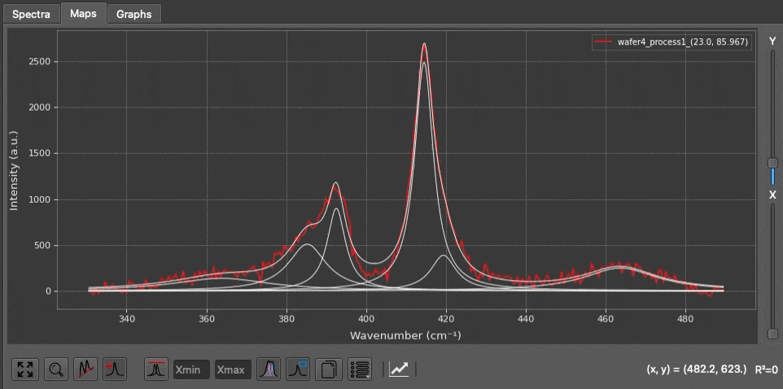
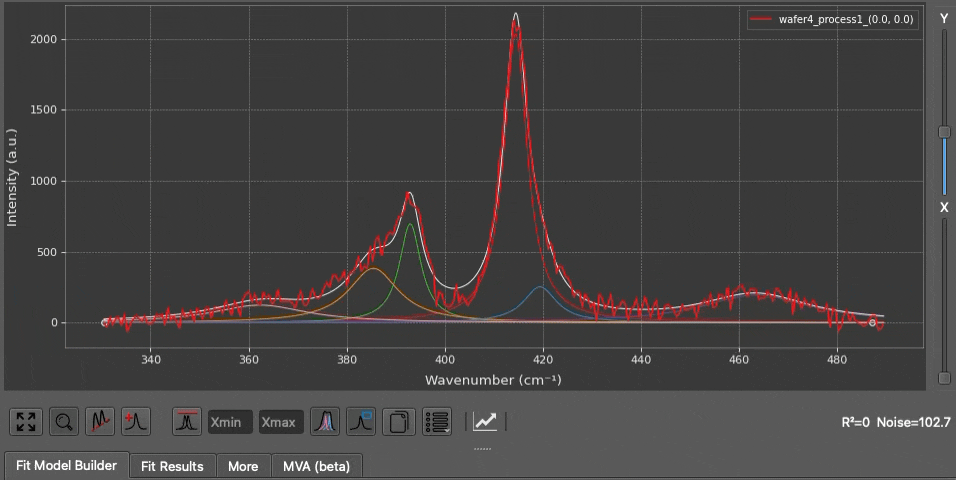
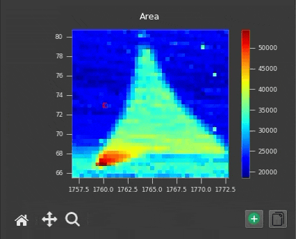
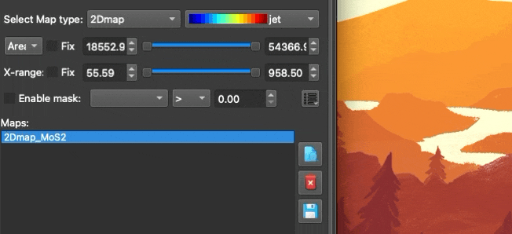

## **键盘快捷键与技巧** { #keyboard-shortcuts-tips }

### **1. 随处可见的工具提示** { #1-tooltips-everywhere }

如果您不确定某个按钮或参数的具体作用，只需将鼠标指针在该图形界面元素上悬停片刻，即可显示说明性的工具提示。

   

 

________

### **2. `SpectraViewer` 使用技巧** { #2-tips-with-spectraviewer }

在 `SpectraViewer` 中，您可以直接使用鼠标与光谱图进行**交互**：

  

 

- 使用快捷键 `Ctrl + R`（macOS 上为 `Cmd + R`）将光谱图重新缩放以适配当前可见数据。
- 您也可以使用鼠标滚轮调节 Y 轴缩放比例。

- 调节图表右侧的垂直 X、Y 滑块，可沿 X 轴或 Y 轴平移光谱，使图像显示更加清晰。
- 您可以在 `SpectraViewer` 中直接点击并拖动任意峰的中心点或峰宽，动态调整其参数。这是设置拟合初始参数更快捷的方法。
- 将鼠标悬停在峰上，即可显示该峰的参数（位置、宽度、振幅）。
- 将鼠标悬停在峰上并右键点击，即可将其删除。

- 在定义**线性** (Linear) 或**多项式** (Polynomial) **基线** (baseline) 时，添加基线锚点后，只需将鼠标悬停在某个锚点上并右键点击，即可立即将其移除。

  

 

- 无论当前全局界面主题是深色还是浅色，您都可以在 `View Options` 菜单中更改光谱图的主题。同样，将图像复制到剪贴板时，也可以指定所复制图像的主题（深色或浅色）。
- 您可以随时点击 `SpectraViewer` 工具栏中的对应按钮，显示或隐藏最佳拟合曲线和图例框。
- 当图例框处于显示状态时，双击图例框内的任意位置即可打开批量图例编辑器。在同一个对话框中，您可以更改调色板、图例最大条目数，以及最多 100 条所选光谱的标签与颜色。设为**自动** (Automatic) 的颜色会跟随当前调色板；手动选择的颜色则保持固定。点击 **OK** 应用所有更改，或点击 **取消** (Cancel) 放弃更改。

- 每个图表画布下方均设有**复制** (Copy) 按钮。直接点击即可将图表复制为 PNG 图像；按住 `Ctrl`（macOS 上为 `Cmd`）并点击**复制**按钮，则可将当前图表的原始数值数据集（而非图像）直接复制到系统剪贴板。

________

### **3. `MapViewer` 使用技巧** { #3-tips-with-mapviewer }

**从二维图谱提取剖面**：当在二维图谱上选中两个不同的点时，系统会自动计算这两处坐标之间的强度剖面，并直接绘制在热图上：

   
  <i>选中两个点时会在图谱上显示剖面；当选中的点数超过两个时，剖面会自动消失。</i>

   
  <i>您可以在 <code>View Options</code> 菜单中设置剖面名称，然后点击 <b>Extract</b>，即可将其直接发送至<b>图表</b> (Graphs) 工作区进行绘制。</i>

 

________

**快速重新拟合（热启动）**：如果某次拟合未能完全收敛，您可以手动调整峰边界，然后再次点击**拟合** (Fit) 按钮即可。引擎将利用上一次优化的结果进行“热启动”（warm-start），使后续拟合速度大幅提升。

 

________

**处理复杂列名**：如果在使用 `Data Filter` 或 `Computed Columns` 功能时，目标列名包含空格或特殊字符，必须用反引号（`` ` ``）将列名括起来（例如 `` `Laser Power` <= 5 ``）。

 

________

**空间剖面提取**：在**二维图谱** (Maps) 工作区中，如果您在 `MapViewer` 热图上准确选中两个不同的空间点，**SPECTROview** 会自动提取并绘制这两处坐标之间的插值强度剖面。

________

### **4. 图表工作区中的键盘快捷键** { #4-keyboard-shortcuts-in-the-graphs-workspace }

当**图表**工作区中有活动的图表窗口时，可使用以下键盘快捷键（在 macOS 上请用 `Cmd` 代替 `Ctrl`）：

| 快捷键 | 操作 |
|--------|------|
| `Ctrl + Z` | 撤销对当前活动图表的上一步更改 |
| `Ctrl + Shift + Z` | 重做上一步已撤销的更改 |
| `Ctrl + C` | 将当前活动图表的图像复制到剪贴板（作为图片） |
| `Ctrl + V` | 将先前复制的样式粘贴到当前活动图表 |
| `Ctrl + E` | 打开当前活动图表的 **Customize Graph** 对话框 |
| `Ctrl + R` | 重新缩放当前活动图表以适配其数据 |
