## **Arbeitsbereich: Spektren und Karten** { #workspace-spectra-and-maps }

Die Arbeitsbereiche `Maps` und `Spectra` basieren auf einem einheitlichen Bedienkonzept und teilen zahlreiche Kernfunktionen. Der Arbeitsbereich `Maps` stellt jedoch zusätzlich spezialisierte Werkzeuge für die Auswertung umfangreicher hyperspektraler Datensätze bereit.

  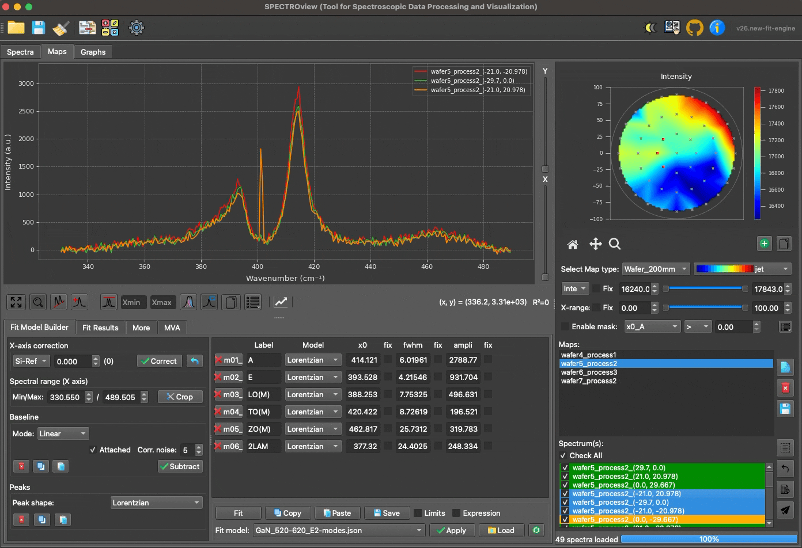 
  <i>Übersicht über die Benutzeroberfläche der Arbeitsbereiche <code>Spectra</code> und <code>Maps</code>. Beide Ansichten gliedern sich in drei Hauptbereiche: oben links (<code>SpectraViewer</code>), unten links (<code>FitModelBuilder</code>) und rechts (<code>SpectraList</code> / <code>MapList</code>).</i>

_______

### **1. `MapList` und `MapViewer`** { #1-maplist-and-mapviewer }

`MapList` und `MapViewer` sind spezialisierte Bedienelemente für die effiziente Navigation und Verwaltung Ihrer hyperspektralen Datensätze. In `MapList` werden alle geladenen Kartendateien angezeigt, einschließlich Wafer-Karten und regulärer 2D-Karten.

Über die Aktionsschaltflächen neben `MapList` können Sie: (1) die Daten der ausgewählten Karte anzeigen, (2) die ausgewählte(n) Karte(n) aus dem Arbeitsbereich entfernen oder (3) alle ausgewählten Karten als CSV-Dateien in einem gewählten Zielordner speichern.

Sie können über `MapList` bequem zwischen geladenen 2D-Karten wechseln, mit `Ctrl+Click` oder `Shift+Click` mehrere Karten gleichzeitig markieren und eine oder mehrere ausgewählte Karten per **Drag-and-Drop** innerhalb der Liste neu anordnen (wodurch sich die Vergleichsreihenfolge in den Live-Karten aktualisiert, während Ihre aktive Hauptkarte unverändert bleibt). Die als Hauptkarte ausgewählte Karte wird im `MapViewer` dargestellt. Beim Öffnen oder Auswählen einer Karte wird **automatisch das erste Spektrum der Karte ausgewählt** und auf dem Heatmap-Plot hervorgehoben; gleichzeitig erscheint seine Kurve sofort im `SpectraViewer`, und Basislinie, Peak-Tabelle sowie Metadaten werden synchronisiert. Standardmäßig zeigt der `MapViewer` eine Heatmap des Signals **Intensität** (Intensity) oder **Fläche** (Area). Wurde die Karte bereits gefittet, lässt sich die Heatmap jedes beliebigen Fit-Parameters auswählen und visualisieren.

  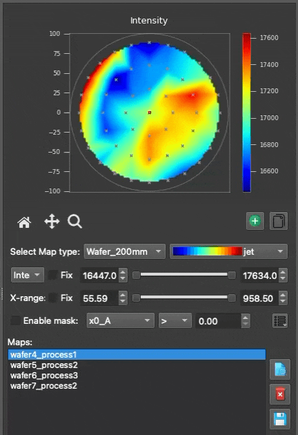 

- Zwei Schieberegler ermöglichen die schnelle Anpassung des Spektralbereichs sowie des Wertebereichs der Heatmap-Darstellung.
- Über die Navigationsschaltflächen der Symbolleiste (**Home / Rescale**, **Pan / Drag** und **Zoom**) können Sie mit einheitlichen SPECTROview-Vektorsymbolen interaktiv durch Kartenbereiche navigieren, diese verschieben und vergrößern.
- Es lassen sich mehrere `MapViewer`-Instanzen parallel öffnen, um verschiedene angepasste Parameter direkt miteinander zu vergleichen.
- Das Optionsmenü (`…`) enthält ein Auswahlfeld **Farbskala** (Color scale), mit dem sich die Heatmap-Normierung zwischen **Linear** und **Log** umschalten lässt. Eine logarithmische Skalierung empfiehlt sich, wenn die Werte mehrere Größenordnungen umspannen; liegen nicht ausschließlich positive Werte vor, schaltet die Anzeige automatisch auf eine lineare Skala zurück.

  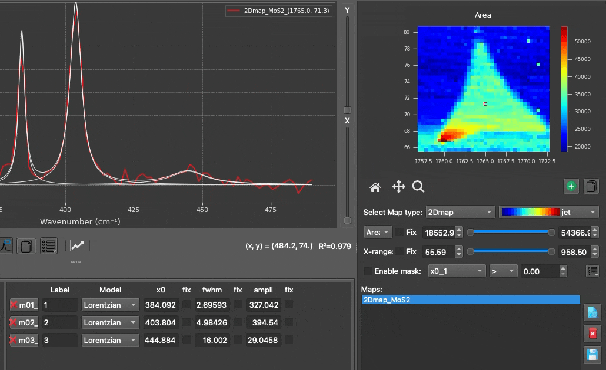 

**Maskierungsfunktion**: Grenzen Sie gezielt Teilbereiche der Heatmap ein, indem Sie benutzerdefinierte, parameterbasierte numerische Filter definieren.

  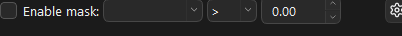

  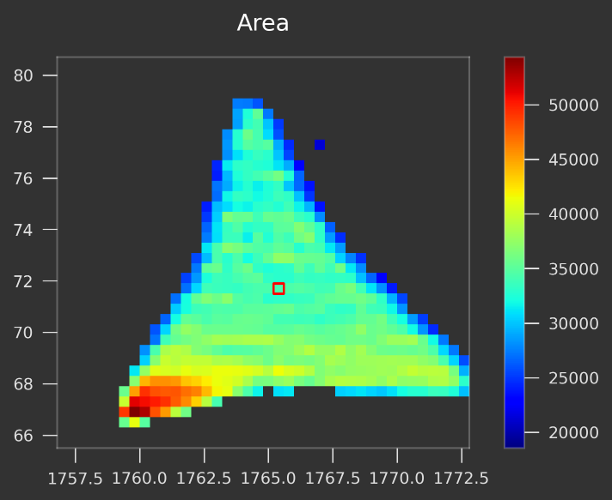 
  <i>Beispiel für die Maskierungsfunktion bei 2D-Karten: Eine MoS2-Flocke wird durch Anwenden einer Maske (Intensität des Peaks A1g &gt; 40 a.u.) isoliert, um das umliegende Substrat auszublenden.</i>

_________

### **2. `SpectraList`** { #2-spectralist }

`SpectraList` zeigt alle geladenen Einzelspektren (im Arbeitsbereich `Spectra`) bzw. alle Spektren der aktuell ausgewählten Karte (im Arbeitsbereich `Maps`) an (siehe Abbildung unten).

Sie können ein einzelnes oder mehrere Spektren gleichzeitig auswählen; die markierten Spektren werden unmittelbar im `SpectraViewer` dargestellt. Dedizierte Schaltflächen erlauben es, alle Spektren auszuwählen, Spektren auf ihren Ausgangszustand zurückzusetzen, ausgewählte Daten als TXT-Datei zu speichern oder die aktuell ausgewählten Spektren für eine isolierte Analyse an den Arbeitsbereich `Spectra` zu senden.

  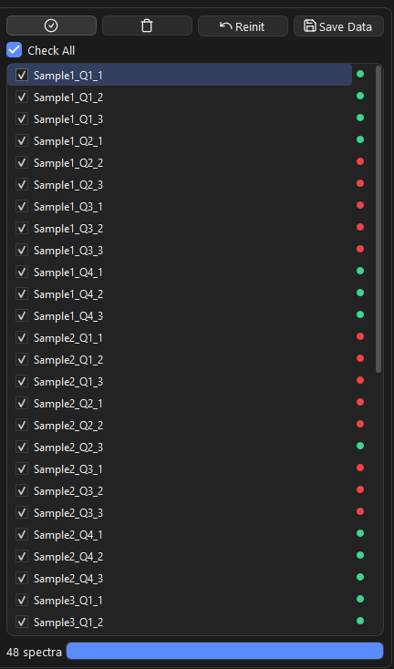 
  <i>Die <code>SpectraList</code> zusammen mit dem Fortschrittsbalken im Arbeitsbereich <code>Maps</code>.</i>

**Statusanzeigen für die Verarbeitung**: Ein kleiner kreisförmiger Statuspunkt auf der rechten Seite jedes Eintrags zeigt auf einen Blick dessen aktuellen Bearbeitungszustand an (grün für einen konvergierten Fit, rot für einen nicht konvergierten Fit, blau für eine subtrahierte Basislinie, grau für ein zugeschnittenes Spektrum und transparent bzw. ohne Punkt für unveränderte Spektren).

Der **Fortschrittsbalken** unterhalb der `SpectraList` zeigt in Echtzeit den Fit-Fortschritt (%), die Anzahl der konvergierten Spektren sowie die verstrichene Zeit (s). Über die Schaltfläche **Stopp** (Stop) lässt sich ein laufender Fit-Vorgang jederzeit sicher abbrechen.

#### **2.1. Transfer zwischen Arbeitsbereichen** { #21-cross-workspace-transfer }

Beim Übertragen ausgewählter Spektren aus dem Arbeitsbereich `Maps` in den Arbeitsbereich `Spectra` verwendet das System tief kopierte (*deep-copied*) Datenstrukturen. Dadurch ist gewährleistet, dass:

- die ursprünglichen Intensitäts- und Koordinatenarrays vollständig erhalten bleiben,
- die `baseline_config` (einschließlich aller Ankerpunkte und Berechnungsmodi) exakt wie konfiguriert übernommen wird,
- Ihr vollständiges `fit_model` (samt allen Peak-Grenzen, Ausdrücken und Startwerten) erhalten bleibt und
- die aktiven Grenzen des spektralen Zuschnitts sowie der Status der Basislinien-Subtraktion unverändert bleiben.

So behalten übertragene Spektren ihren vollständigen interaktiven und analytischen Zustand im neuen Arbeitsbereichs-Tab, ohne die Ausgangskarte zu beeinflussen.

_______

### **3. `SpectraViewer`** { #3-spectraviewer }

Der `SpectraViewer` ist das zentrale Diagramm-Widget, in dem alle über `SpectraList` ausgewählten Spektren (zusammen mit ihren angepassten Fit-Kurven) visualisiert werden.

#### **3.1. `SpectraViewer` mit interaktiver Maussteuerung** { #31-spectraviewer-with-interactive-mouse-controls }

  

- **Peak-Parameter anzeigen**: Fahren Sie mit dem Mauszeiger über einen gefitteten Peak, um einen Tooltip mit seinen genauen Parametern einzublenden.
- **Peaks hinzufügen / entfernen**: Ist die Schaltfläche **Peak** in der Symbolleiste aktiviert, setzen Sie per Linksklick eine neue Peak-Startschätzung oder entfernen per Rechtsklick in der Nähe eines vorhandenen Peaks diesen wieder.
- **Peak-Startwerte anpassen**: Klicken und ziehen Sie das Zentrum oder die Breite einer Peak-Startschätzung direkt mit der Maus, um sie vor dem Fit manuell anzupassen.
- **Schnelle Y-Achsen-Skalierung**: Nutzen Sie das Mausrad, um die Y-Achse rasch zu dehnen oder zu stauchen.

#### **3.2. Schaltflächen der Symbolleiste und Ansichtsoptionen** { #32-toolbar-buttons-and-view-options }

| Schaltfläche | Funktion |
|---|---|
|  | **Rescale**: Skaliert die Diagrammachsen automatisch passend zu den aktuellen Daten. Tastenkürzel: `Ctrl + R`. |
|  | **Zoom**: Aktiviert das Aufziehen eines rechteckigen Zoom-Rahmens durch Klicken und Ziehen mit der linken Maustaste. |
|  | **Basislinie** (Baseline): Ermöglicht im aktivierten Zustand das manuelle Setzen von Ankerpunkten (`baseline`) durch direktes Klicken auf die Spektren. |
| 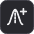 | **Peaks**: Ermöglicht im aktivierten Zustand das manuelle Hinzufügen von Peak-Startschätzungen durch direktes Klicken auf die Spektren. |
| 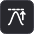 | **Normalization**: Stellt die ausgewählten Spektren normiert auf ihre maximale Peak-Intensität dar. Tragen Sie Werte in die Felder „min“ und „max“ ein, um gezielt auf einen bestimmten Spektralbereich zu normieren. 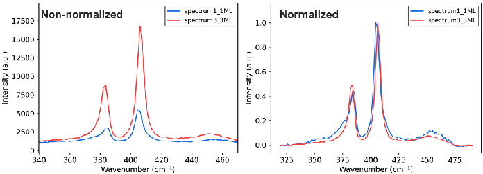 *Rohspektren (links) im Vergleich zu normierten Spektren (rechts) — besonders hilfreich zum Erkennen feiner Peak-Verschiebungen.* |
|  | **Show Bestfit**: Schaltet die Anzeige der berechneten Fit-Kurve(n) ein oder aus. |
|  | **Legend**: Blendet das Legendenfeld ein oder aus (bzw. die Farbskala, wenn **Farbskala statt Legende anzeigen** (Show colorbar instead of legend) aktiviert ist). Bei Anzeige innerhalb der Zeichenfläche wird die Legende oben rechts (`upper right`) verankert, um Spektren geringerer Intensität nicht zu verdecken (oder sie kann über **Legende außerhalb platzieren** (Move legend box outside) in More Options außerhalb neben der Zeichenfläche platziert werden). Ein Doppelklick an beliebiger Stelle in der Legende öffnet einen gemeinsamen Dialog zur Anpassung von Farbpalette, maximaler Eintragszahl sowie Farben und Beschriftungen der Spektren. Änderungen werden mit **OK** übernommen oder mit **Abbrechen** (Cancel) verworfen. Um eine flüssige Bedienung sicherzustellen, werden Auswahlen in den Arbeitsbereichen Spektren und Karten in Paketen von bis zu 100 Spektren bearbeitet; grenzen Sie die Auswahl ein, um Spektren außerhalb des aktuellen Pakets zu bearbeiten. |
|  | **Plot Heatmap**: Befindet sich rechts in der Symbolleiste unmittelbar links neben **More Options** und **Kopieren** (Copy) und schaltet für mehrere ausgewählte Spektren in den 2D-Intensitäts-Heatmap-Modus um. Stellt den kontinuierlichen Intensitätsverlauf mit eigener Y-Achsen-Auswahl, benutzerdefinierter Beschriftung und Auflösungssteuerung direkt in der Symbolleiste dar. |
|  | **3D View**: Befindet sich zwischen **Plot Heatmap** und **More Options** auf der rechten Seite der Symbolleiste und schaltet in die interaktive 3D-Visualisierung der ausgewählten Spektren um. Durch Ziehen mit der linken Maustaste drehen Sie die Perspektive, mit der mittleren Maustaste verschieben Sie die Ansicht, mit der rechten Maustaste oder dem Mausrad zoomen Sie und ein Klick auf **Rescale** (`Ctrl + R`) setzt Kamerawinkel und Achsengrenzen zurück. |
|  | **More Options**: Befindet sich rechts in der Symbolleiste (vor **Kopieren**) und öffnet ein kompaktes zweispaltiges Konfigurationsmenü. Dort lassen sich X-/Y-Einheiten festlegen, logarithmische Skalen umschalten, Plot-Stile ändern, diskrete oder kontinuierliche Farbpaletten anhand visueller Farbband-Vorschauen auswählen, die maximale Anzahl von Legendeneinträgen festlegen (Standard: 15), **Legende außerhalb platzieren** aktivieren (sodass die Legende neben der Zeichenfläche sitzt statt Kurven zu überdecken), **Farbskala statt Legende anzeigen** aktivieren (wodurch bei Aktivierung dynamisch **Farbskalen-Parameter** (Colorbar parameter) für `Index` oder numerische Dateinamens-Segmente sowie **Farbskalentitel** (Colorbar label) eingeblendet werden, um für geordnete Spektrenserien rechts eine Farbskala darzustellen), die Sichtbarkeit von Rohdaten/Residuen (Raw/Residual) umschalten, Gitternetzlinien einblenden, Linienstärken anpassen und exakte Abbildungsmaße definieren. 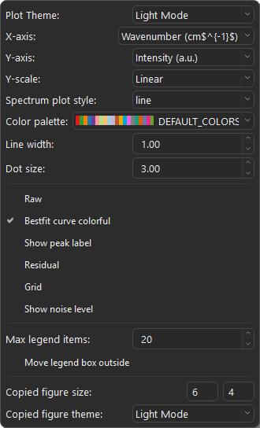 |
|  | **Kopieren**: Befindet sich ganz rechts in der Symbolleiste und kopiert das Diagramm als hochwertiges Bild in die Zwischenablage. Mit `Ctrl + Click` (bzw. `Cmd + Click` unter macOS) kopieren Sie stattdessen die numerischen Rohdaten des Plots in die Zwischenablage. |
|  | **Y-Skala (Linear / Log)** (Y-Scale): Befindet sich ganz oben in der rechten vertikalen Symbolleiste direkt über dem Entferner für kosmische Spitzen und schaltet die Y-Achse des Spektrums zwischen **Linear** (Standard, nicht gedrückt) und **Log** (gedrückt) um. Bleibt mit dem Auswahlfeld **Y-Skala** (Y-scale) unter **More Options** synchronisiert. |

#### **3.3. Stapel-Legenden-Editor** { #33-batch-legend-editor }

Blenden Sie die Legende über die Symbolleistenschaltfläche **Legend** ein und **doppelklicken Sie anschließend an einer beliebigen Stelle in das Legendenfeld**, um den Stapel-Editor zu öffnen. Dieser ersetzt den früheren Arbeitsablauf, bei dem für jede Beschriftung oder Farbe ein eigener Dialog geöffnet werden musste.

Im oberen Bereich des Dialogs befinden sich zwei plotweite Einstellungen:

- **Farbpalette** (Color palette): Wählen Sie eine Palette anhand ihrer visuellen Farbband-Vorschau aus. Zu den diskreten Paletten gehören die 20-farbige `DEFAULT_COLORS`, `tab20`, `tab20b`, `tab20c`, `Dark2`, `Paired` und `Accent`. Zu den Verlaufs-Paletten gehören `viridis`, `plasma`, `jet`, `cividis` und `magma`.
- **Max. Legendeneinträge** (Max legend items): Legt fest, wie viele Einträge in der Diagrammlegende angezeigt werden (Standard: 15). Diese Einstellung entfernt keine Spektren aus dem Plot.

Die Spektrentabelle enthält eine Zeile pro bearbeitbarem Spektrum:

- **Spektrum** (Spectrum) benennt das ursprüngliche Spektrum bzw. dessen Dateinamen.
- **Farbe** (Color) wählt ein Farbfeld aus der aktiven Palette. **Automatisch** (Automatic) belässt das Spektrum an die von der Palette zugewiesene Farbe gekoppelt; die Auswahl eines bestimmten Farbfelds erzeugt eine spektrumspezifische Überschreibung. Über **Weitere Farben…** (More colors…) wählen Sie eine Farbe außerhalb der Palette.
- **Beschriftung** (Label) ändert den in der Legende angezeigten Text. Durch Leeren einer benutzerdefinierten Beschriftung wird wieder der Dateiname des Spektrums angezeigt.

Ein Wechsel der Palette aktualisiert jede mit **Automatisch** markierte Farbvorschau, während manuell gewählte Farben erhalten bleiben. Klicken Sie auf **OK**, um alle Änderungen gemeinsam zu übernehmen, oder auf **Abbrechen**, um sämtliche Änderungen im Dialog zu verwerfen. Übernommene Beschriftungen und Farben werden in die zugrunde liegenden Spektrum-Objekte zurückgeschrieben, sodass Spektrenliste, Arbeitsbereich Spektren, Arbeitsbereich Karten und gespeicherte Arbeitsbereichsdaten konsistent bleiben.

!!! note "Bearbeitung in Paketen zu maximal 100 Spektren"

    Um die Oberfläche bei großen Auswahlen reaktionsschnell zu halten, erzeugt der Dialog sowohl im Arbeitsbereich Spektren als auch im Arbeitsbereich Karten Editoren für höchstens die ersten **100 geplotteten Spektren**. Bei einer größeren Auswahl meldet der Dialog **„100 von N angezeigt“** (**“showing 100 of N”**). Spektren außerhalb des angezeigten Pakets werden nicht verändert. Grenzen Sie Ihre Auswahl ein, um eine andere Gruppe zu bearbeiten.

#### **3.4. Heatmap-Visualisierungsmodus** { #34-heatmap-visualization-mode }

Das Werkzeug **Heatmap Plot** wandelt mehrere geplottete Spektren in eine kontinuierliche 2D-Intensitätskarte um. Dieser Modus eignet sich besonders für die Analyse von Messreihen wie In-situ-Temperaturprofilen, zeitaufgelösten Kinetiken, räumlichen Linienscans oder Konzentrationsgradienten.

  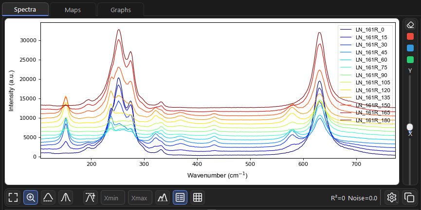 

  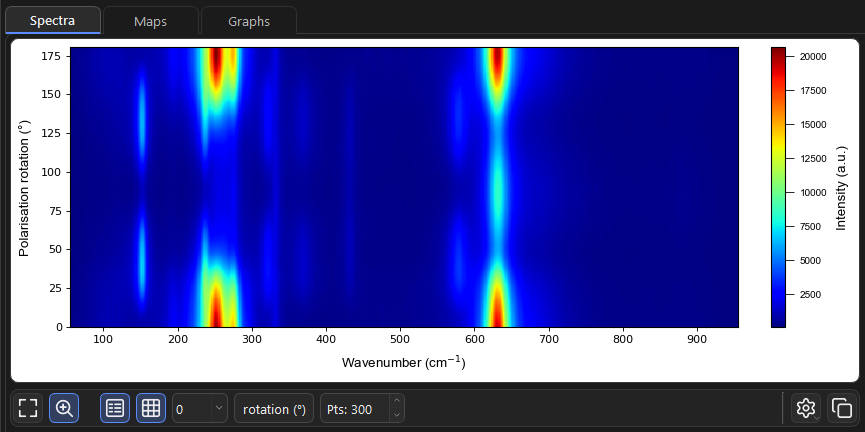 
  <i>Der <code>SpectraViewer</code> im Heatmap-Visualisierungsmodus mit einer kontinuierlichen 2D-Intensitätskarte einer In-situ-Temperaturreihe.</i>

##### **Zentrale Bedienelemente und Parameter** { #key-controls-and-parameters }

Sobald der Heatmap-Modus aktiv ist, erscheinen spezielle Konfigurationssteuerelemente direkt in der Haupt-Symbolleiste, während inkompatible 1D-Werkzeuge (z. B. Peak-Marker, Basislinien-Ankerpunkte, Werkzeug zur Entfernung kosmischer Spitzen und Normierungsfelder) automatisch ausgeblendet werden:

- **Heatmap-Umschalter** (): Aktiviert oder deaktiviert die 2D-Heatmap-Darstellung. Durch erneutes Deaktivieren dieser Schaltfläche werden sofort wieder die klassischen 1D-Spektralkurven und alle regulären Werkzeuge der Symbolleiste eingeblendet.
- **Auswahlfeld für den Y-Achsen-Parameter**:
  - **`Index`**: Stapelt die Spektren gleichmäßig entlang der vertikalen Achse gemäß der Auswahlreihenfolge (`0, 1, 2, ...`).
  - **Dateinamens-Segmente**: Extrahiert automatisch numerische Parameter aus Dateinamen, die durch Unterstriche getrennt sind (beispielsweise erzeugen `sample_25°C.txt`, `sample_100°C.txt` und `sample_200°C.txt` Segmente wie `25°C` und lesen die zugehörigen Zahlenwerte `25, 100, 200` als physikalische Y-Koordinaten aus).
- **Benutzerdefinierte Y-Achsenbeschriftung**: Textfeld zum Überschreiben des automatischen Titels der vertikalen Achse (z. B. `Temperature (°C)`, `Time (min)` oder `Position (µm)`).
- **Y-Achsen-Interpolationspunkte (`Pts:`)**: Legt die Anzahl der interpolierten vertikalen Schnitte fest (Standard: `300` Punkte) für eine glatte Darstellung. Der Wert `0` deaktiviert die Interpolation und stellt die unveränderten diskreten Zeilen dar.
- **Intensitäts-Farbpalette**: Übernimmt die unter **More Options** ausgewählte Farbpalette (z. B. `jet`, `viridis`, `plasma`).

#### **3.5. Interaktiver 3D-Visualisierungsmodus** { #35-interactive-3d-visualization-mode }

Die Schaltfläche **3D View** () rechts in der Symbolleiste zwischen **Plot Heatmap** und **More Options** stellt Ihre ausgewählten Spektren in einem interaktiven 3D-Raum dar (Spektralachse auf **X**, Serienindex oder Dateinamen-Parameter auf **Y** und Intensität auf **Z**):

- **Interaktive Kamerasteuerung**:
  - **Drehen**: Klicken und ziehen Sie mit der linken Maustaste an einer beliebigen Stelle des 3D-Plots, um Höhen- und Azimutwinkel frei zu drehen.
  - **Verschieben / Zoomen**: Ziehen Sie mit der mittleren Maustaste zum Verschieben; ziehen Sie mit der rechten Maustaste (oder nutzen Sie das Mausrad), um entlang der Intensitätsachse zu zoomen.
  - **Ansicht zurücksetzen**: Klicken Sie auf **Rescale** (`Ctrl + R`), um den Standard-Kamerawinkel wiederherzustellen und alle Datenbereiche einzupassen.
- **Gemeinsame Serienachsen-Steuerung**: Wählen Sie im Dropdown-Menü der Symbolleiste `Index` oder einen beliebigen aus den Dateinamen ausgelesenen numerischen Parameter (z. B. `25°C`, `100°C`) und vergeben Sie optional einen eigenen Y-Achsentitel.
- **Kompatible Optionen**: Funktioniert nahtlos mit **Normalization**, **Show Bestfit**, den Modi **Legend / Colorbar**, den Plot-Stilen **Linie / Punkt** (Line / Dot), der Überlagerung **Rohdaten** (Raw), **Gitter** (Grid), der Z-Skalierung **Linear / Log**, den Plot-Themes **Hell / Dunkel** (Light / Dark) sowie **Kopieren** in die Zwischenablage. Beim Umschalten zwischen Standardansicht, **Plot Heatmap** und **3D View** werden jeweils automatisch die passenden Werkzeuge der Symbolleiste wiederhergestellt.

#### **3.6. Interaktive Spektralbereichswähler & Live-Karten (Arbeitsbereiche Spektren & Karten)** { #36-interactive-spectral-range-selectors-live-maps-spectra-maps-workspaces }

Sowohl im Arbeitsbereich **Spektren** (Spectra) als auch im Arbeitsbereich **Karten** (Maps) können Sie bis zu drei Spektralbereiche interaktiv direkt im `SpectraViewer` eingrenzen und deren Verlauf in Echtzeit in der dafür vorgesehenen Registerkarte **Live-Karten** (Live Maps) verfolgen:

  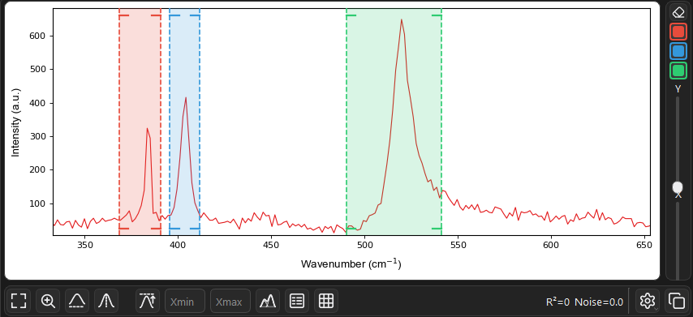 

- **Arbeitsbereich Spektren**: Stellt bis zu drei farbcodierte (Rot, Blau, Grün) **1D-Parameter-Verlaufsdiagramme** über die in der `SpectraList` **aktuell ausgewählten Spektren** dar und erlaubt so eine schnelle Prüfung, wie sich Peak-Intensität, -Position, -Höhe oder -Fläche über eine Spektrenreihe hinweg verändert.

  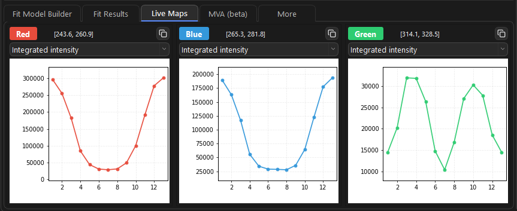 

- **Arbeitsbereich Karten**: Passt sich automatisch an die räumliche Dimensionalität der ausgewählten Karte an:
  - **2D-Karten**: Stellt bis zu drei **räumliche 2D-Heatmaps** in Echtzeit auf dem aktiven hyperspektralen Raster dar.
  - **1D-Karten (Profile / Linienscans)**: Erkennt automatisch kollineare Messkoordinaten und stellt die Kanäle Rot, Blau und Grün als **1D-Liniendiagramme** entlang der Raumachse (`X (mm)`, `Y (mm)` oder `Distance (mm)`) dar; beim Wechsel zwischen verschiedenen Karten schaltet die Ansicht nahtlos zwischen Heatmaps und Profillinien um.

  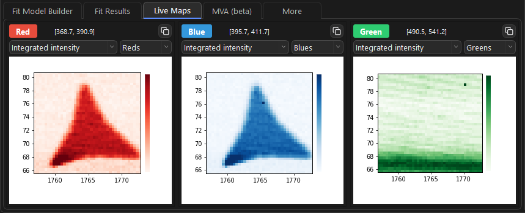 

##### **Bedienelemente der Bereichswähler (`SpectraViewer`)** { #range-selector-controls-spectra-viewer }

Eine vertikale Symbolleiste am rechten Rand des `SpectraViewer` bietet drei unabhängige, farbcodierte Umschalttasten:

- **Rot** (Red) (`R`)
- **Blau** (Blue) (`B`)
- **Grün** (Green) (`G`)

Jede Schaltfläche aktiviert ein zugehöriges Paar verschiebbarer vertikaler Markierungen (Begrenzungslinien mit schattiertem Intervall) direkt im Spektrumsplot und schaltet die untere Registerkartenleiste automatisch auf die Registerkarte **Live-Karten** um:

- **Interaktives Ziehen**: Klicken und ziehen Sie eine der beiden vertikalen Begrenzungslinien, um die untere oder obere Wellenzahl anzupassen. Klicken und ziehen Sie den schattierten Mittelbereich, um das gesamte Intervall ohne Veränderung seiner Breite zu verschieben.
- **Mehrere gleichzeitige Bereiche**: Jede beliebige Kombination der drei Bereichswähler kann gleichzeitig aktiv sein. Jeder Kanal verwaltet seine Farbe, sein Intervall und seine Sichtbarkeit unabhängig.
- **Erhalt der Autoskalierung**: Bereichswähler-Markierungen vergrößern oder verfälschen die automatischen Achsengrenzen des Spektrums nicht, sodass die Schaltfläche **Rescale** (`Ctrl+R`) stets passgenau auf die geladenen Spektraldaten zoomt.
- **Automatische Bereichsbegrenzung**: Beim Zuschneiden oder Laden neuer Spektraldaten werden die Bereichswähler automatisch innerhalb des sichtbaren Spektralbereichs begrenzt und neu positioniert.
- **Aktualisierung in Echtzeit**: Das Verschieben eines Bereichswählers oder das Ändern der ausgewählten Spektren/Karten berechnet und aktualisiert bei geöffneter Registerkarte **Live-Karten** sofort das zugehörige 1D-Verlaufsdiagramm (im **Arbeitsbereich Spektren**) bzw. die 2D-Heatmap oder das 1D-Profildiagramm (im **Arbeitsbereich Karten**), gepuffert durch ein adaptives Debounce-Intervall von 60–250 ms für flüssiges Ziehen auch bei großen Datensätzen. In der aktiven Karte oder Spektrenliste abgewählte Spektren werden automatisch ausgeblendet, sodass maskierte Ausreißer weder Farbskalen noch Profile verzerren.
- **Mehrfachauswahl und Kartenvergleich (Arbeitsbereich Karten)**: Nutzen Sie `Ctrl+Click` oder `Shift+Click` in der Liste **Karten**, um mehrere Karten gleichzeitig auszuwählen, während Ihre **Hauptkarte** (Primary Map) weiterhin für Vorverarbeitung, Fitting und den `MapViewer` aktiv bleibt:
  - **Mehrere 1D-Profile vergleichen**: Handelt es sich bei der Hauptkarte um einen 1D-Linienscan, werden alle ausgewählten 1D-Profile gemeinsam in jedem Kanal-Unterpanel mit einheitlicher Linienstärke überlagert (schalten Sie die Schaltfläche **Legend** ein, um die einzelnen Kurven auf der Zeichenfläche zuzuordnen).
  - **Zwischen ausgewählten 2D-Karten wechseln**: Ist die Hauptkarte eine 2D-Karte, erscheint in der Kopfzeile der Live-Karten ein kompakter Umschalter `◀ [2D Map Selector] ▶`, über den Sie durch die ausgewählten 2D-Heatmaps blättern können, ohne Ihre Auswahl zu verlieren.
  - **Stapellöschung**: Ein Klick auf **Löschen** (Delete) bei mehreren ausgewählten Karten bittet zunächst um Bestätigung, bevor alle markierten Karten gemeinsam entfernt werden.
  - **Stapel-Export**: Ein Klick auf die Schaltfläche **Save** bei einer oder mehreren ausgewählten Karten öffnet eine Ordnerauswahl und exportiert jede ausgewählte Karte als eigene `.csv`-Datei in diesen Ordner.

##### **Visualisierung und Unterpanels des Tabs Live-Karten** { #live-maps-tab-visualization-subpanels }

Die Registerkarte **Live-Karten** befindet sich in der unteren Tab-Leiste zwischen **Fit-Ergebnisse** (Fit Results) und **MVA** (wobei der Tab **Mehr** (More) am Ende der Tab-Leiste liegt).

- **Anzeige der Unterpanels**: Sind ein oder mehrere Bereichswähler aktiviert, werden die zugehörigen Panels (Rot, Blau, Grün) nebeneinander dargestellt. Ist aktuell kein Wähler aktiv, weist eine Hinweismeldung darauf hin, eine der Bereichswähler-Schaltflächen am rechten Rand des `SpectraViewer` zu aktivieren.
- **Unterstützte spektrale Parameter**: Für jedes Unterpanel lässt sich über das Auswahlfeld festlegen, welcher Parameter extrahiert und geplottet werden soll:

| Parameter | Typ | Beschreibung |
|---|---|---|
| **Integrierte Intensität** (Integrated intensity) | Direkt | Integral ($\sum Y \cdot \Delta x$) der Intensität über das gewählte Spektralintervall. |
| **Mittlere Intensität** (Mean intensity) | Direkt | Durchschnittliche Intensität innerhalb des gewählten Intervalls. |
| **Maximale Intensität** (Maximum intensity) | Direkt | Höchster im Intervall gemessener Intensitätswert. |
| **Peak-Position** (Peak position) | Direkt | Wellenzahl am Intensitätsmaximum innerhalb des Intervalls. |
| **Peak-Höhe** (Peak height) | Direkt | Maximale Intensität abzüglich der lokalen Basislinie zwischen den Intervallgrenzen. |
| **Peak-Position (Fit)** (Peak position (fit)) | Fit-basiert | Zentralwellenzahl ($x_0$) eines angepassten Peaks im Intervall (erfordert einen vorherigen Fit). |
| **Peak-Höhe (Fit)** (Peak height (fit)) | Fit-basiert | Angepasste Amplitude ($A$) des Peaks innerhalb des Intervalls (erfordert einen vorherigen Fit). |
| **Peak-Fläche (Fit)** (Peak area (fit)) | Fit-basiert | Analytisch integrierte Fläche des angepassten Peaks (erfordert einen vorherigen Fit). |
| **R/B-Verhältnis** (R/B ratio) *(nur Grün-Kanal)* | Abgeleitet | Pixelweises (2D-Karte) bzw. punktweises (1D-Profil / Spektrenserie) Verhältnis der integrierten Intensitäten $I_{\mathrm{Red}} / I_{\mathrm{Blue}}$. Aktualisiert sich automatisch, sobald die Rot- oder Blau-Begrenzungen verschoben oder in der Größe geändert werden; Blau-Intensitäten gleich oder nahe null werden sauber als `NaN` maskiert. Solange **R/B-Verhältnis** ausgewählt ist, wird die grüne Bereichsmarkierung im Spektrumsplot automatisch ausgeblendet, sodass ausschließlich die für das Verhältnis maßgeblichen Rot- und Blau-Bereiche sichtbar bleiben (beim Wechsel zurück zu einem anderen Parameter erscheint die grüne Markierung sofort wieder). |

*Hinweis*: Wird ein fit-basierter Parameter ausgewählt, obwohl noch keine Fit-Ergebnisse vorliegen, zeigt das Panel anstelle verfälschter Werte sauber einen entsprechenden Hinweisbanner an.

##### **Interaktive Spektrenauswahl aus den RGB-Live-Karten *(Arbeitsbereich Karten)*** { #interactive-spectrum-selection-from-rgb-live-maps-maps-workspace }

Bei der Arbeit mit 2D-Karten oder 1D-Profilkarten im Arbeitsbereich **Karten** (sofern die Werkzeuge **Pan** und **Zoom** deaktiviert sind) können Sie Spektren direkt aus jedem Rot-, Blau- oder Grün-Unterpanel auswählen, ohne die Registerkarte Live-Karten zu verlassen:

- **Einzelklick**: Wählt das Spektrum nächstgelegen zur angeklickten Koordinate aus und zeigt es unmittelbar im `SpectraViewer` an.
- **`Ctrl` + Klick**: Fügt der aktuellen Auswahl ein weiteres Spektrum hinzu (oder hebt die Auswahl eines bereits markierten Messpunkts wieder auf).
- **Klicken & Ziehen**: Zieht einen gestrichelten Auswahlrahmen auf, um alle Spektren innerhalb des Bereichs auszuwählen (`Ctrl` + Ziehen fügt die eingerahmten Spektren der bestehenden Auswahl hinzu).
- **Synchronisierte Markierungen & Kartenwechsel**: Ausgewählte Messpunkte werden auf allen aktiven RGB-Unterpanels rot umrandet und bleiben mit dem Haupt-`MapViewer` sowie schwebenden `VMapViewerDialog`-Fenstern synchronisiert. Haben Sie über das Steuerelement `◀ [2D Map] ▶` in der Kopfzeile zu einer anderen 2D-Karte gewechselt, wird diese Karte durch Anklicken eines Messpunkts automatisch zu Ihrer Hauptkarte und ihre Spektren werden geladen. Klicks innerhalb eines geöffneten Legendenfelds bleiben weiterhin dem Verschieben oder der Beschriftungsbearbeitung per Doppelklick vorbehalten.

##### **Bedienelemente der einzelnen Unterpanels** { #individual-subpanel-controls }

Jedes Unterpanel verfügt über eigene Bedienelemente:

- **Rescale / Pan / Zoom**: Unabhängige Navigationsschaltflächen in der Kopfzeile jedes Unterpanels erlauben das Hineinzoomen in interessante Bereiche, das Verschieben von Kurve oder Heatmap sowie das Zurücksetzen auf den gesamten Darstellungsbereich, ohne benachbarte Kanäle zu beeinflussen. Ein Doppelklick auf eine Legende öffnet weiterhin den Legendeneditor, statt den Zoom zurückzusetzen.
- **1D-Kurvennormierung** *(1D-Karten & 1D-Liniendiagramme)*: Aktivieren Sie in jedem RGB-Unterpanel die Normierungsschaltfläche neben dem Parameter-Auswahlfeld (mit optionalen Grenzen `Xmin` und `Xmax`), um jede angezeigte 1D-Kurve visuell unabhängig auf `1.0` bezüglich ihres globalen Maximums oder innerhalb von `[Xmin, Xmax]` zu normieren, ohne die zugrunde liegenden Daten zu verändern — ideal für den Formvergleich von Profilen zwischen Karten unterschiedlicher Signalamplitude.
- **Farbpalette** *(2D-Heatmaps im Arbeitsbereich Karten)*: Wählen Sie eine beliebige Standard-Farbpalette (z. B. `viridis`, `plasma`, `inferno`, `jet`, `turbo`, `coolwarm`, `cividis`, `magma`, `Reds`, `Blues`, `Greens`). Im **Arbeitsbereich Spektren** erhält jede 1D-Verlaufskurve automatisch die Farbe ihres zugehörigen Bereichswählers (Rot, Blau oder Grün).
- **Kopieren**: Kopiert die Abbildung des Unterpanels in der eingestellten **Kopierte Abbildungsgröße** (Copied figure size) und mit der Einstellung **Kopiertes Abbildungs-Theme** (Copied figure theme) in die Zwischenablage (unabhängig von der aktuellen Fenstergröße von SPECTROview). Halten Sie **`Ctrl` + Klick** (bzw. **`Cmd` + Klick** unter macOS) gedrückt, um stattdessen den zugrunde liegenden numerischen Datensatz dieses Plots als tabulatorgetrennte Spalten (`1D`-Verlaufsreihen, einzelne oder mehrere `1D`-Profiltabellen bzw. `2D`-Kartenpunkte `(X, Y, Value)`) in die Zwischenablage zu kopieren.
- **Bereichs- / Statusanzeige**: Zeigt das aktuelle Intervall $[x_{min}, x_{max}]$ oder den aktuellen Fit-Status an.

##### **Ansichtsoptionen der Live-Karten & Legendenanpassung** { #live-maps-view-options-legend-customization }

Sobald ein oder mehrere Bereichswähler aktiv sind, erscheinen oben rechts auf der Registerkarte **Live-Karten** zwei Schnellbedienelemente:

- **Legende ein-/ausblenden (`btn_legend`)**: Schaltet interaktive Zeichenflächen-Legenden in allen 1D-Unterpanels um. Legenden lassen sich direkt mit der Maus verschieben, und ein Doppelklick auf ein Legendenfeld öffnet die Bearbeitung von Beschriftungen und Farben.
- **Weitere Ansichtsoptionen (`⋯`)** (More View Options): Öffnet ein kompaktes zweispaltiges Menü im gleichen Aufbau wie beim `SpectraViewer` (alle Einstellungen werden zwischen den Arbeitsbereichen Spektren und Karten synchronisiert und automatisch für künftige Programmstarts gespeichert):
  - **Plot-Theme** (Plot Theme): Schaltet Live-Karten-Abbildungen unabhängig vom globalen Anwendungsdesign zwischen **Heller Modus** (Light Mode) (weißer Hintergrund, Standard) und **Dunkler Modus** (Dark Mode) um.
  - **Achsen- & Farbskalen**: Schaltet **X-Skala** (X-scale), **Y-Skala** (Y-scale) und **Farbskala (Z)** (Color (Z) scale) zwischen **Linear** und **Log** um (bei nicht ausschließlich positiven Wertebereichen greift automatisch ein sicherer Rückfall auf Linear).
  - **Plot-Stil & Größen**: Schaltet 1D-Kurven zwischen **Linie** (Standard), **Linie + Punkte** (Line + Dots) und **Punkt** um und regelt **Linienstärke** (Line width) (Standard `1.5`), **Punktgröße** (Dot size) (Standard `1.5`) sowie die **Textgröße** (Text size) (`6–24 pt`, skaliert Achsentitel, Beschriftungen, Teilstrichwerte und Farbskalen-Beschriftungen).
  - **Größe & Theme kopierter Abbildungen**: Legt feste Abmessungen in Zoll für die Zwischenablage fest (**Kopierte Abbildungsgröße**, Standard `5.5` × `4.0`) und bestimmt die Option **Kopiertes Abbildungs-Theme** (**Heller Modus** als Standard oder **Dunkler Modus**), damit kopierte Abbildungen unabhängig von der Fenstergröße konstante Proportionen und gut lesbare Schriftgrößen behalten.
  - **Einstellungen des Legendenrahmens**: Schaltet die Sichtbarkeit der Legende um, ändert **Legendenposition** (Legend location) (`best`, Ecken, `outside right`, `outside top`), **Legendenspalten** (Legend columns), **Schriftgröße Legende** (Legend font size) oder öffnet **Legendenbeschriftungen bearbeiten...** (Edit legend labels...), um Seriennamen umzubenennen und individuelle Farben direkt für das Legendenfeld auf der Zeichenfläche festzulegen.
  - **Anzeige- & Vergleichshilfen**: Blendet die Titelzeile **Abbildungstitel anzeigen** (Show figure label) über jedem RGB-Diagramm ein oder aus (Standard: Aus), schaltet **Gitter anzeigen** (Show grid) um (Standard: Aus), gleicht die Y-Grenzen über alle Panels mit **Y-Achse teilen (1D)** (Share Y-axis (1D)) ab, aktiviert bilineare **Heatmap-Glättung** (Heatmap smoothing), blendet **Colorbars** ein oder aus oder setzt alle Einstellungen mit **Ansichtsoptionen zurücksetzen** (Reset view options) zurück.

_______

### **4. `FitModelBuilder`** { #4-fitmodelbuilder }

In der Registerkarte `FitModelBuilder` konfigurieren Sie Ihre spektralen Fit-Modelle. Sie gliedert sich in drei Hauptbereiche: `Fitting`, `PeakTable` und `FitModelControl`, die in den folgenden Abschnitten einzeln erläutert werden.

Sie können globale Fit-Parameter verwenden oder die Fit-Einstellungen im `Settings Panel` anpassen (Einzelheiten finden Sie im Abschnitt „**Einstellungen**“ (Settings)).

  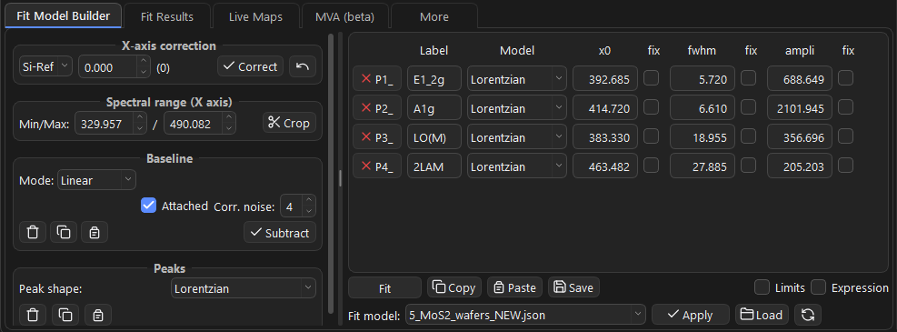 
  <i>Die Registerkarte <code>FitModelBuilder</code> mit: (1) dem Panel <code>Fitting</code> (links), (2) dem Panel <code>PeakTable</code> (oben rechts) und (3) dem Panel <code>FitModelControl</code> (unten rechts).</i>

#### **4.1. Panel `Fitting`** { #41-fitting-panel }

Das Panel `Fitting` führt Sie in vier logischen Schritten zum Aufbau eines robusten Modells:

**Schritt 1: X-Achsen-Korrektur (optional)**: Führen Sie eine empirische X-Achsen-Korrektur anhand einer bekannten Referenzprobe durch (z. B. eines Silizium-Peaks bei exakt 520,7 cm⁻¹). Fitten Sie hierzu Ihre Referenzmessung, geben Sie die theoretisch exakte Position ein und wenden Sie die Verschiebung an, um Kalibrierungsoffsets global zu korrigieren.

**Schritt 2: Fit-Bereich festlegen**: Begrenzen Sie die mathematische Kurvenanpassung auf einen bestimmten X-Achsen-Bereich von Interesse.

**Schritt 3: Basislinien-Definition**: **SPECTROview** bietet zwei unterschiedliche Modi zur Definition spektraler Basislinien (`Manual` oder `Auto`):

  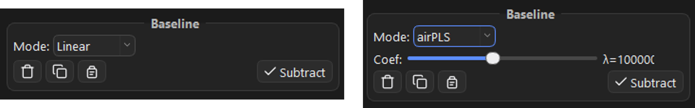 
  <i>Auswahl des Basislinien-Modus: manueller Modus (links) vs. automatischer Modus (rechts).</i>

- **Manueller Modus (`Linear` oder `Polynomial`)**: Setzen Sie Ankerpunkte für die Basislinie durch direktes Klicken im `SpectraViewer`. Aktivieren Sie **Angehängt** (Attached), damit angeklickte Punkte automatisch auf der nächstgelegenen Datenkurve einrasten. Aktivieren Sie *Correct noise*, um die Intensität des Punkts als lokalen Mittelwert benachbarter Datenpunkte zu berechnen — dies macht die Platzierung auch bei starkem Rauschen robust.
- **Auto-Modus**: Lassen Sie fortschrittliche Algorithmen die Basislinie automatisch bestimmen. Über den Schieberegler stellen Sie ein, wie stark der Algorithmus der Kontur folgt:
  - **`arPLS`**: Asymmetrically Reweighted Penalized Least Squares. Ein bewährter Standardalgorithmus für typische Raman- und IR-Basislinien.
  - **`airPLS`**: Ein sehr reaktionsstarker Algorithmus, hervorragend geeignet zum Entfernen starker, komplexer Fluoreszenzuntergründe. Besonders für Raman-Daten empfohlen und validiert.
  - **`AsLS`**: Ein sehr stabiler Algorithmus, der jedoch bei starkem Rauschen gelegentlich Schwierigkeiten hat, Rauschen von breiten Peaks zu unterscheiden. Am besten für vergleichsweise saubere Spektren geeignet.
  - **`ModPoly`**: Modifiziertes Polynom. Weit verbreitet und sehr effektiv bei einfachen polynomialen Fluoreszenzuntergründen.

**Schritt 4: Peak-Definition**:

- Fügen Sie Peaks direkt im `SpectraViewer` per Linksklick hinzu (stellen Sie sicher, dass die Umschalt-Schaltfläche **Peak** aktiv ist). Ihre Startwerte lassen sich anschließend interaktiv durch Ziehen mit der Maus anpassen.
- Jeder dem Plot hinzugefügte Peak erscheint sofort in der **`PeakTable`**.
- Unterstützte Peak-Profile umfassen: `Lorentzian`, `Gaussian`, `PseudoVoigt`, `LorentzianAsym`, `GaussianAsym`, `Fano`, `DecaySingleExp` und `DecayBiExp`.
- Verwenden Sie die Auswahlliste **Peak-Profil** (Peak profile:) in der Gruppe `Peaks`, um direkt zwischen den Voreinstellungen für globale Peak-Grenzen (z. B. Raman, PL (eV), PL (nm), XRD) zu wechseln, oder klicken Sie auf das Zahnrad-Symbol daneben, um direkt zum Abschnitt **Globale Peak-Grenzen** (Global Peak Limits) in den **Fit-Einstellungen** (Fit Settings) zu springen.

#### **4.2. Unterstützte Peak-Profile** { #42-supported-peak-profiles }

Die `VBF Engine` von **SPECTROview** bietet hochoptimierte Implementierungen der folgenden mathematischen Peak-Profile:

| Modell | Parameter | Formel |
|---|---|---|
| `Gaussian` | `ampli`, `fwhm`, `x0` | <i>a</i> &middot; exp(-4 ln(2) &middot; (x-x0)2 / w2) |
| `Lorentzian` | `ampli`, `fwhm`, `x0` | <i>a</i> / [1 + 4(x-x0)2 / w2] |
| `PseudoVoigt` | `ampli`, `fwhm`, `x0`, `alpha` | &alpha; &middot; G + (1-&alpha;) &middot; L |
| `GaussianAsym` | `ampli`, `fwhm_l`, `fwhm_r`, `x0` | Stückweise Gauß-Funktion mit linker/rechter `FWHM` |
| `LorentzianAsym` | `ampli`, `fwhm_l`, `fwhm_r`, `x0` | Stückweise Lorentz-Funktion mit linker/rechter `FWHM` |
| `Fano` | `ampli`, `fwhm`, `x0`, `q` | <i>a</i> &middot; (q + &epsilon;)2 / (1 + &epsilon;2), &epsilon; = 2(x-x0)/w |
| `DecaySingleExp` | `A`, `tau`, `B` | <i>A</i> &middot; e-t/&tau; + B |
| `DecayBiExp` | `A1`, `tau1`, `A2`, `tau2`, `B` | <i>A</i>1 &middot; e-t/&tau;1 + <i>A</i>2 &middot; e-t/&tau;2 + B |

#### **4.3. Panel `PeakTable`** { #43-peaktable-panel }

Die `PeakTable` listet alle mathematischen Parameter der von Ihnen definierten Peaks auf. Wenn Sie einen Peak im Viewer verschieben, aktualisieren sich diese Werte dynamisch.

**Dynamische Peak-Indizierung**: Jeder Peak erhält automatisch ein nummeriertes Suffix (z. B. `_1`, `_2`) entsprechend seiner Erstellungsreihenfolge. Wenn Sie Peaks hinzufügen, löschen oder neu anordnen, indiziert **SPECTROview** die Peaks automatisch neu, sodass die Nummerierung fortlaufend bleibt (wird beispielsweise Peak 2 gelöscht, wird Peak 3 zum neuen Peak 2). Dadurch bleiben Ihre Ausdrücke und Fit-Ergebnisse stets übersichtlich.

  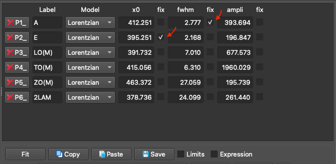 
  <i>Das Panel <code>PeakTable</code> mit den Peak-Parametern und ihren Nebenbedingungen.</i>

**Nebenbedingungen für das Fit-Modell hinzufügen**:

**Fixieren** (Fix): Aktivieren Sie das Kontrollkästchen „**fixieren**“ (fix), um den Parameterwert einzufrieren, sodass der Optimierer ihn während des Fits nicht verändert.

**Grenzen** (Limits): Geben Sie Minimal- und Maximalwerte als Grenzwerte ein, um einzuschränken, wie weit der Optimierer den Parameter verschieben darf.

  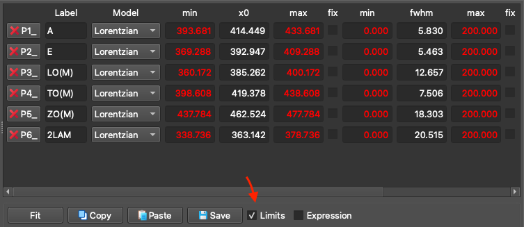 
  <i>Beispiel 1: Aktivieren Sie die Option „Grenzen“ unter der Peak-Tabelle und legen Sie „min“- und „max“-Werte für jeden Fit-Parameter fest.</i>

**Ausdruck** (Expression): Definieren Sie komplexe mathematische Beziehungen zwischen Parametern. Die `VBF Engine` von **SPECTROview** wertet diese Ausdrücke mathematisch präzise aus, bevor sie an den Optimierer übergeben werden. Werden Peaks nach dem Löschen neu indiziert, aktualisieren sich die entsprechenden Referenzen in Ihren mathematischen Ausdrücken automatisch, damit keine fehlerhaften Modelle entstehen.

  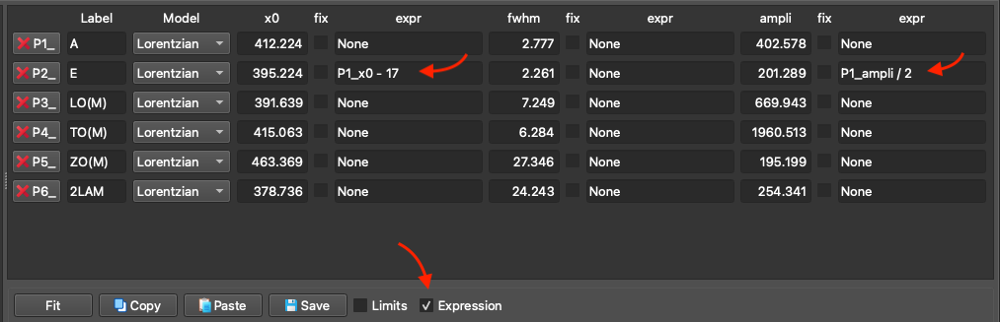 
  <i>Beispiel 2: Einsatz eines Ausdrucks als Nebenbedingung, sodass (1) die Peak-Position von Peak E (P2) um 17 kleiner ist als die von Peak A (P1) oder (2) die Amplitude von Peak E (P2) genau halb so groß ist wie die Amplitude von A (P1).</i>

#### **4.4. Panel `FitModelControl`** { #44-fitmodelcontrol-panel }

Sobald Ihr Modell vollständig eingerichtet ist, klicken Sie auf die Schaltfläche **Anpassen** (Fit), um die Optimierung zu starten.

  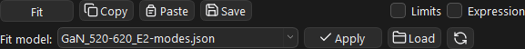 
  <i>Das Panel <code>FitModelControl</code>.</i>

**Fit-Modelle kopieren / einfügen**:
Ein vollständig konfiguriertes Fit-Modell lässt sich von einem Spektrum kopieren und auf ein anderes einfügen — ideal, um komplexe Konfigurationen auf einzelne Dateien zu übertragen.

>
> - Wenn Sie ein Modell mit **Einfügen** (Paste) übertragen, liest die Engine stets die *aktuell* im aktiven Einstellungs-Panel festgelegte Rauschschwelle aus. Sie können also ein Modell kopieren, die Rauschschwelle anpassen und es anschließend mit den aktualisierten Rauscheinstellungen einfügen.

**Fit-Modelle speichern / laden**:
Wenn Sie ein Modell häufiger einsetzen möchten, können Sie es als Vorlage speichern. Gespeicherte Modelle lassen sich über das Auswahlmenü jederzeit auf neue Datensätze anwenden.

- **Aus Dropdown-Menü auswählen**: Wählen Sie ein vorhandenes Modell aus dem Kombinationsfeld **Fit-Modell:** (`Fit model:`).
- **Per Schaltfläche laden**: Klicken Sie auf **Laden** (Load), um eine beliebige `.json`-Fit-Modellvorlage aus Ihrem Dateisystem auszuwählen und zu laden.
- **Drag & Drop**: Sie können eine `.json`-Fit-Modelldatei direkt auf das Panel **Fit-Modell-Editor** (`Fit Model Builder`) oder an eine beliebige Stelle im Arbeitsbereich **Spektren** oder **Karten** ziehen. Die Datei wird sofort zur Modellliste hinzugefügt, im Auswahlfeld markiert und steht zur Anwendung bereit.
- **Modell anwenden**: Klicken Sie auf **Anwenden** (Apply), um das geladene Modell dem aktuell ausgewählten Spektrum zuzuweisen (oder halten Sie **Strg** (Ctrl) gedrückt, während Sie auf **Anwenden** klicken, um es allen Spektren zuzuweisen).

> - Wenn Sie ein Modell mit **Speichern** (Save) als `.json`-Datei sichern, wird die *aktuelle* Rauschschwelle fest in dieser Datei gespeichert. Wenn Sie dieses Modell später mit **Anwenden (Laden)** verwenden, nutzt die Fit-Engine strikt die in der Datei gespeicherte Rauschschwelle und ignoriert den aktuell im Einstellungs-Panel eingestellten Wert.

_______

### **5. Fit-Ergebnisse sammeln und speichern** { #5-collect-and-save-fit-results }

Sobald das Fitting für alle Ihre Spektren oder Karten abgeschlossen ist, fassen Sie die optimalen Ergebnisse zusammen:

- Wechseln Sie zur Registerkarte **Fit-Ergebnisse**.
- Klicken Sie auf die Schaltfläche **Collect**. **SPECTROview** fasst daraufhin umgehend alle optimalen Fit-Parameter in einer einheitlichen Datentabelle zusammen. Die Fit-Güte jedes Spektrums (**R2**, das Bestimmtheitsmaß) ist als eigene Spalte enthalten, sodass Sie sie genau wie jeden gefitteten Parameter filtern oder plotten können (z. B. als R²-Heatmap im Arbeitsbereich `Maps`). Sie können auf jede Spaltenüberschrift klicken, um die gesamte Spalte auszuwählen, oder über mehrere Überschriften ziehen, um mehrere Spalten schnell in die Zwischenablage zu kopieren.

> **Dezimalgenauigkeit anpassen**: Die Anzahl der angezeigten Nachkommastellen für numerische Ergebnisse (x0, ampli, fwhm, area, R2, …) wird über das Zahlenfeld **Dezimalstellen (Ergebnisse)** (Fit results decimals) oben in der Registerkarte **Fit-Ergebnisse** direkt oberhalb der Schaltfläche **Collect** gesteuert (Standard: 3). Ändern Sie den Wert und klicken Sie erneut auf **Collect**, um die Tabelle mit der neuen Genauigkeit neu aufzubauen. Dies gilt auch für berechnete Spalten (siehe unten). Die X-/Y-Koordinatenspalten behalten stets ihre volle Genauigkeit.

  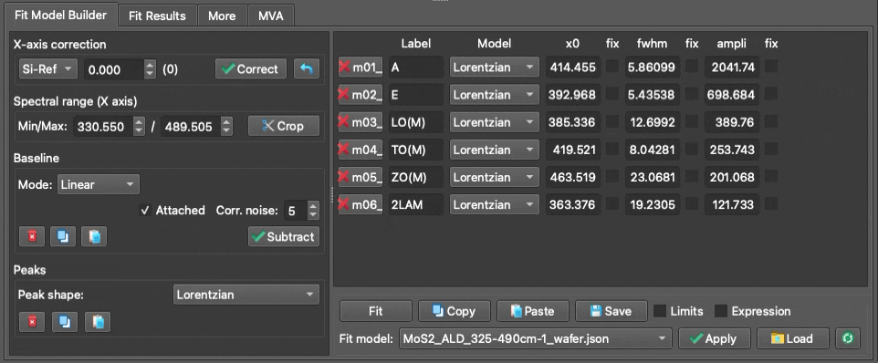 
  <i>Die Oberfläche zum Sammeln der Fit-Ergebnisse und die zusammengefasste Datentabelle.</i>

#### **5.1. Merkmale aus Dateinamen extrahieren** { #51-splitting-filename-features }

Dieses Werkzeug extrahiert automatisch Metadaten, die in Ihren Dateinamen kodiert sind. Heißt Ihre Datei beispielsweise `Sample1_ProcessA_Temp25`, zerlegt das Werkzeug den Dateinamen anhand der Unterstriche (`_`) und ordnet die extrahierten Werte neuen Spalten Ihres Datensatzes zu (siehe obiges Video).

#### **5.2. Neue Spalten berechnen und hinzufügen** { #52-compute-and-add-new-columns }

Sie können mühelos neue Spalten aus mathematischen Kombinationen vorhandener Fit-Parameter erzeugen (z. B. zur Berechnung einer Peak-Verschiebung über `x0_p1 - x0_p2`).
Unterstützte mathematische Operatoren sind: `+`, `-`, `*`, `/`, `**`, `%` und `()`. Die berechnete Spalte wird auf dieselbe Genauigkeit **Dezimalstellen (Ergebnisse)** gerundet, die oben in der Registerkarte eingestellt ist.

> **Wichtiger Hinweis**: Enthalten Ihre Spaltennamen Leerzeichen oder Sonderzeichen, müssen Sie diese in Backticks einschließen. Beispiel: `` `x0_LO(M)` ``

#### **5.3. Speichern und visualisieren** { #53-save-and-visualize }

Sobald Ihre Datentabelle fertiggestellt ist, können Sie:

- **die Tabelle unter einem aussagekräftigen Namen speichern** und anschließend **direkt in den Arbeitsbereich `Graphs` senden**, um sie unmittelbar zu plotten.

  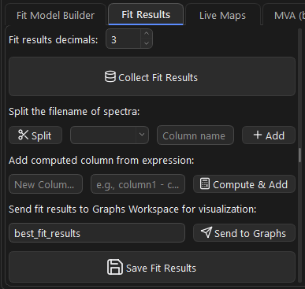 

 

- **die Tabelle in eine Excel-/CSV-Tabelle exportieren**, um sie extern weiterzuverarbeiten.

  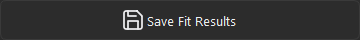 

### **6. Tab `More`** { #6-more-tab }

Die Registerkarte `More` bietet Zugriff auf ergänzende Werkzeuge und Metadaten, unterteilt in drei Bereiche:

  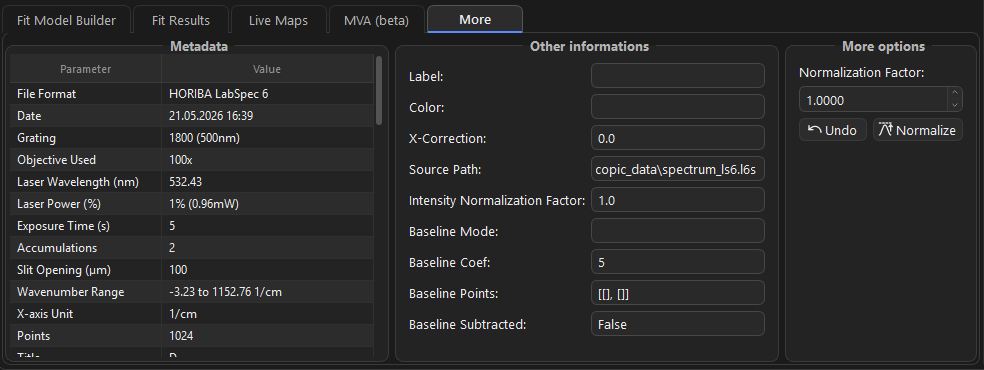 

- **Links**: Zeigt umfassende Metadaten an, die direkt aus geladenen `.wdf`-, `.spc`-, `.l6s`-, `.l6m`-, `.ngs`- oder `.ngc`-Dateien ausgelesen wurden, einschließlich der exakten Geräteeinstellungen bei der Messung.
- **Mitte**: Zeigt detaillierte Eigenschaften und statistische Kenngrößen zum aktuell ausgewählten Spektrum an.
- **Rechts**: Stellt Zugriff auf zusätzliche Vorverarbeitungswerkzeuge bereit, etwa globale Intensitätsnormierungs-Algorithmen und die Erkennung von Artefakten durch kosmische Strahlung.
