## **Espaces de travail : Spectra et Maps**

Les espaces **`Maps`** et **`Spectra`** partagent une conception unifiée et de nombreuses fonctionnalités centrales. Toutefois, l'espace **`Maps`** intègre des outils spécialisés conçus pour exploiter de vastes jeux de données hyperspectraux.

  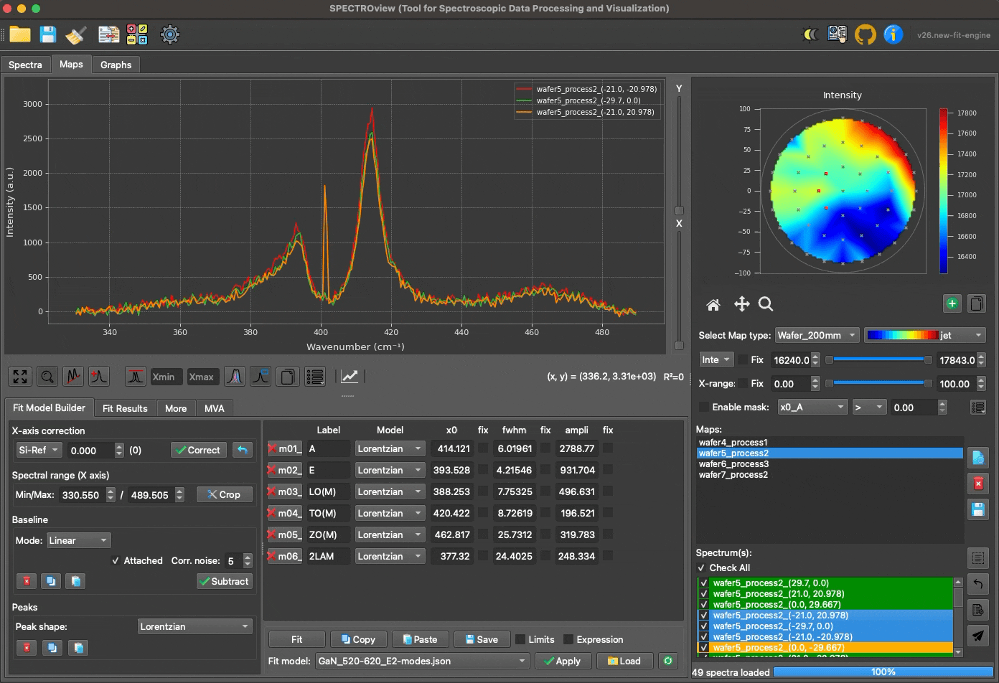 
  <i>Vue d'ensemble des espaces de travail <code>Spectra</code> et <code>Maps</code>. Les deux interfaces sont organisées en trois zones principales : en haut à gauche (<code>SpectraViewer</code>), en bas à gauche (<code>FitModelBuilder</code>) et à droite (<code>SpectraList</code> / <code>MapList</code>).</i>

_______

### **1. `MapList` et `MapViewer`**

`MapList` et `MapViewer` sont des composants dédiés à la navigation et à la gestion efficaces de vos jeux de données hyperspectraux. `MapList` affiche tous les fichiers de cartes chargés, y compris les cartographies de plaquettes (*wafer maps*) et les cartes 2D standard.

Les boutons d'action situés à côté de `MapList` vous permettent de : (1) afficher les données de la carte sélectionnée, (2) supprimer la carte sélectionnée de l'espace de travail, ou (3) exporter directement la carte sélectionnée vers un fichier Excel.

Vous pouvez facilement naviguer entre les cartes 2D chargées via `MapList`, sélectionner plusieurs cartes avec `Ctrl+Click` ou `Shift+Click`, et **glisser-déposer** une ou plusieurs cartes sélectionnées dans la liste pour les réordonner (ce qui met à jour l'ordre de comparaison dans **Live Maps** tout en conservant inchangée votre carte principale active). La carte principale sélectionnée (*Primary*) est affichée dans `MapViewer`. Lors de l'ouverture ou de la sélection d'une carte, **le premier spectre de la carte est automatiquement sélectionné** et mis en évidence sur la carte thermique ; sa courbe s'affiche immédiatement dans `SpectraViewer` et la ligne de base, le tableau des pics ainsi que les métadonnées sont synchronisés. Par défaut, `MapViewer` affiche une carte thermique du signal « Intensity » ou « Area ». Si la carte a été ajustée, vous pouvez sélectionner et visualiser la carte thermique de n'importe quel paramètre ajusté.

  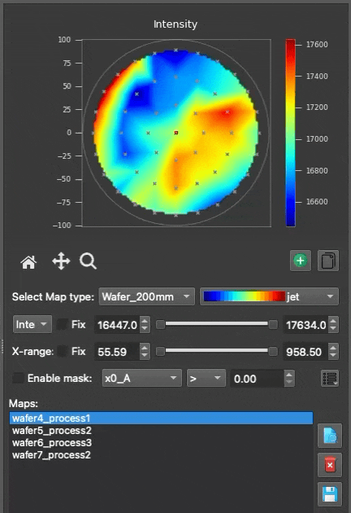 

- Deux curseurs permettent d'ajuster rapidement la plage spectrale et la plage de valeurs de la carte thermique.
- Les contrôles de la barre d'outils (**Home / Rescale**, **Pan / Drag** et **Zoom**) vous permettent de naviguer, déplacer et zoomer interactivement dans les régions de la carte grâce aux boutons vectoriels unifiés de SPECTROview.
- Vous pouvez ouvrir simultanément plusieurs fenêtres `MapViewer` afin de comparer différents paramètres ajustés.
- Le menu d'options (`…`) inclut un sélecteur **Color scale** permettant de basculer la normalisation de la carte thermique entre **Linear** et **Log**. L'échelle logarithmique est utile lorsque les valeurs couvrent plusieurs ordres de grandeur ; elle bascule automatiquement en mode linéaire si la plage de données n'est pas strictement positive.

  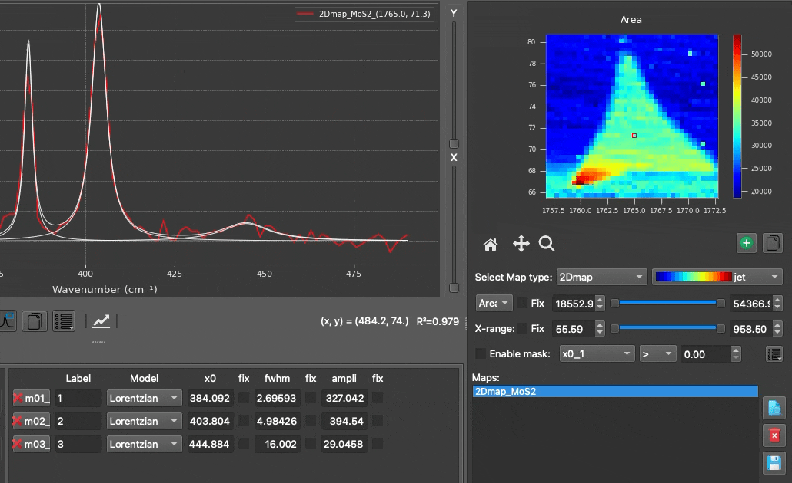 

**Fonctionnalité de masque (`Mask`)** : Isolez des régions spécifiques de la carte thermique en définissant des filtres numériques personnalisés sur les paramètres.

  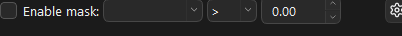

  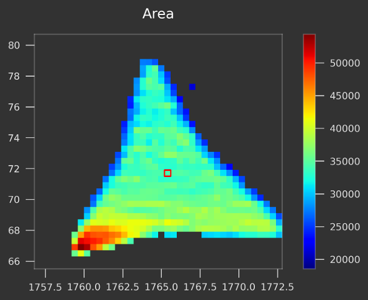 
  <i>Exemple de masquage pour les cartes 2D : un feuillet de MoS2 est isolé en appliquant un masque (intensité du pic A1g &gt; 40 u.a.) afin d'écarter le substrat environnant.</i>

_________

### **2. `SpectraList`**

`SpectraList` affiche l'ensemble des spectres discrets chargés (dans l'espace `Spectra`) ou tous les spectres de la carte actuellement sélectionnée (dans l'espace `Maps`) (voir figure ci-dessous).

Vous pouvez sélectionner un ou plusieurs spectres simultanément ; les spectres sélectionnés sont immédiatement visualisés dans `SpectraViewer`. Des boutons dédiés vous permettent de tout sélectionner, réinitialiser les spectres, enregistrer les données sélectionnées au format TXT ou envoyer les spectres sélectionnés vers l'espace `Spectra` pour une analyse isolée.

  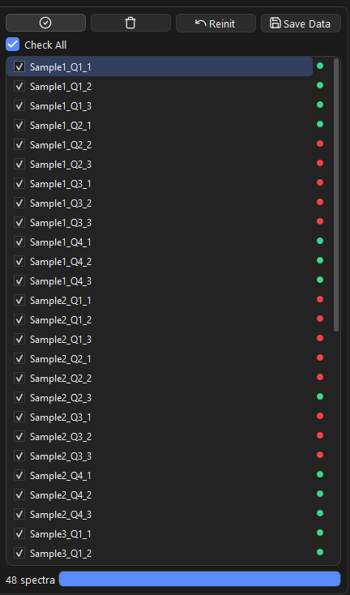 
  <i>Le composant <code>SpectraList</code> accompagné de la barre de progression dans l'espace <code>Maps</code>.</i>

**Indicateurs d'état de traitement** : Une pastille circulaire placée à droite de chaque élément indique son état d'avancement en un coup d'œil (vert pour un ajustement convergé, rouge pour un ajustement non convergé, bleu pour une ligne de base soustraite, gris pour un spectre recadré et transparent/sans pastille pour les spectres non modifiés).

La **barre de progression** sous `SpectraList` affiche en temps réel l'avancement de l'ajustement (%), le nombre de spectres convergés et le temps écoulé (s). Un bouton **Stop** permet d'interrompre proprement un ajustement en cours.

#### **2.1. Transfert entre espaces de travail**

Lors de l'envoi de spectres sélectionnés depuis l'espace `Maps` vers l'espace `Spectra`, le système utilise des dictionnaires copiés en profondeur (*deep copy*). Cela garantit que :

- Les tableaux bruts d'intensité et de coordonnées sont intégralement préservés.
- Le paramètre `baseline_config` (y compris les points d'ancrage et les modes de calcul) est transféré à l'identique.
- L'intégralité de votre `fit_model` (bornes des pics, expressions et valeurs initiales) est conservée.
- Les bornes actives de recadrage spectral et l'état de soustraction de la ligne de base restent identiques.

Les spectres transférés conservent ainsi tout leur état interactif et analytique dans le nouvel onglet sans affecter la carte d'origine.

_______

### **3. `SpectraViewer`**

`SpectraViewer` est le composant graphique central où s'affichent tous les spectres sélectionnés depuis `SpectraList` (ainsi que leurs courbes d'ajustement optimal).

#### **3.1. Contrôles souris interactifs de `SpectraViewer`**

  

- **Afficher les paramètres des pics** : Survolez un pic ajusté avec le curseur pour afficher une infobulle contenant ses paramètres précis.
- **Ajouter / supprimer des pics** : Lorsque le bouton **Peak** est activé dans la barre d'outils, faites un clic gauche pour déposer un nouveau pic initial, ou un clic droit près d'un pic existant pour le supprimer.
- **Ajuster les valeurs initiales des pics** : Cliquez et faites glisser le centre ou la largeur d'un pic initial pour l'ajuster manuellement avant le calcul.
- **Zoom rapide sur l'axe Y** : Utilisez la molette de la souris pour dilater ou comprimer rapidement l'échelle verticale.

#### **3.2. Boutons de la barre d'outils et options d'affichage**

| Bouton | Fonction |
|--------|----------|
|  | **Rescale** : Recadre automatiquement les axes du graphique sur les données affichées. Raccourci : `Ctrl + R`. |
|  | **Zoom** : Lorsqu'il est activé, permet de tracer un rectangle de zoom par cliquer-glisser avec le bouton gauche de la souris. |
|  | **Baseline** : Lorsqu'il est activé, permet de définir manuellement les points d'ancrage de la ligne de base (`baseline`) en cliquant directement sur le spectre. |
| 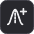 | **Peaks** : Lorsqu'il est activé, permet d'ajouter manuellement des pics initiaux en cliquant directement sur le spectre. |
| 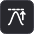 | **Normalization** : Affiche les spectres sélectionnés normalisés par rapport à leur intensité maximale. Saisissez des valeurs dans les champs « min » et « max » pour normaliser sur une plage spectrale spécifique. 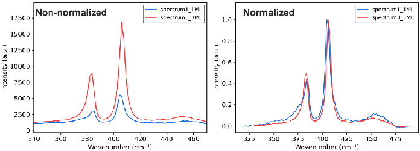 *Spectres bruts (à gauche) vs spectres normalisés (à droite) — très utile pour observer de faibles décalages de pics.* |
|  | **Show Bestfit** : Active ou désactive l'affichage des courbes d'ajustement optimal. |
|  | **Legend** : Active ou désactive l'affichage de la boîte de légende (ou de la barre de couleurs lorsque *Show colorbar instead of legend* est coché). Lorsqu'elle est affichée à l'intérieur du canevas, la légende est ancrée dans le coin supérieur droit (`upper right`) pour éviter de masquer les spectres de plus faible intensité (elle peut aussi être placée à l'extérieur via *Move legend box outside* dans More Options). Double-cliquez n'importe où dans la légende pour modifier la palette, le nombre maximal d'entrées affichées ainsi que les couleurs et libellés des spectres dans une fenêtre unique. Validez avec **OK** ou annulez avec **Cancel**. Pour préserver la réactivité, les sélections des espaces Spectra et Maps sont éditées par lots de 100 spectres maximum ; réduisez votre sélection pour éditer d'autres spectres. |
|  | **Plot Heatmap** : Situé à droite de la barre d'outils juste à gauche de **More Options** et **Copy**, bascule vers le mode de visualisation en carte thermique 2D d'intensité pour plusieurs spectres sélectionnés. Affiche l'évolution continue de l'intensité spectrale avec sélection dédiée de l'axe Y, libellé personnalisé et contrôle de résolution directement sur la barre d'outils. |
|  | **3D View** : Situé entre **Plot Heatmap** et **More Options** sur le côté droit de la barre d'outils, bascule vers le mode de visualisation 3D interactive des spectres sélectionnés. Maintenez le clic gauche et faites glisser pour orienter la vue, le bouton central pour déplacer, le clic droit ou la molette pour zoomer, et cliquez sur **Rescale** (`Ctrl + R`) pour réinitialiser la caméra et les limites des axes. |
|  | **More Options** : Situé à droite de la barre d'outils (avant Copy), ouvre un panneau compact de configuration à 2 colonnes permettant d'ajuster les unités X/Y, basculer les échelles logarithmiques, modifier le style de tracé, choisir des palettes discrètes ou continues à partir d'aperçus visuels, fixer le nombre maximal d'éléments de légende (15 par défaut), activer **Move legend box outside** pour placer la légende à côté du graphique sans masquer les spectres, activer **Show colorbar instead of legend** (affichant dynamiquement **Colorbar parameter** pour choisir `Index` ou un jeton numérique du nom de fichier ainsi que **Colorbar label**) pour afficher une barre de couleur à droite pour les séries ordonnées, afficher ou masquer les courbes Raw/Residual, activer les grilles, régler les épaisseurs de ligne et définir des dimensions de figure précises. 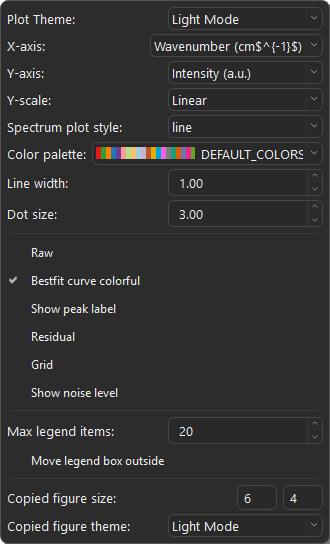 |
|  | **Copy** : Situé à l'extrême droite de la barre d'outils, copie le graphique dans le presse-papiers sous forme d'image haute qualité. Utilisez `Ctrl + Click` (ou `Cmd + Click` sous macOS) pour copier à la place les données numériques brutes du graphique dans votre presse-papiers. |

#### **3.3. Éditeur de légende par lots**

Affichez la légende avec le bouton **Legend** de la barre d'outils, puis **double-cliquez n'importe où à l'intérieur de la boîte de légende** pour ouvrir l'éditeur par lots. Cet outil remplace l'ancien fonctionnement qui nécessitait une fenêtre distincte pour chaque libellé ou couleur.

La partie supérieure de la fenêtre contient deux contrôles globaux :

- **Color palette** : Sélectionnez une palette grâce à son aperçu visuel en bande colorée. Les palettes discrètes comprennent les 20 couleurs `DEFAULT_COLORS`, `tab20`, `tab20b`, `tab20c`, `Dark2`, `Paired` et `Accent`. Les palettes en dégradé comprennent `viridis`, `plasma`, `jet`, `cividis` et `magma`.
- **Max legend items** : Définissez le nombre maximal d'entrées affichées dans la légende du graphique (15 par défaut). Ce paramètre ne supprime aucun spectre du tracé.

Le tableau des spectres comporte une ligne par spectre éditable :

- **Spectrum** indique le spectre d'origine ou son nom de fichier.
- **Color** permet de choisir une nuance dans la palette active. **Automatic** maintient le spectre lié à la couleur attribuée par la palette ; sélectionner une nuance crée une surcharge spécifique au spectre. Utilisez **More colors…** pour choisir une couleur hors palette.
- **Label** modifie le texte affiché dans la légende. Effacer un libellé personnalisé restaure le nom de fichier du spectre.

Un changement de palette met à jour chaque aperçu **Automatic** tout en préservant les couleurs choisies manuellement. Cliquez sur **OK** pour appliquer l'ensemble des modifications, ou sur **Cancel** pour les annuler. Les libellés et couleurs validés sont répercutés dans les objets spectres sous-jacents afin que la liste des spectres, l'espace `Spectra`, l'espace `Maps` et les fichiers de travail sauvegardés restent synchronisés.

!!! note "Lots d'édition limités à 100 spectres"
    Pour préserver la fluidité de l'interface lors de grandes sélections, la boîte de dialogue n'instancie des éditeurs que pour les **100 premiers spectres tracés** dans les espaces `Spectra` et `Maps`. Lorsque la sélection dépasse ce seuil, la fenêtre affiche **“showing 100 of N”**. Les spectres hors du lot affiché restent inchangés. Réduisez la sélection courante pour modifier un autre groupe.

#### **3.4. Mode de visualisation en carte thermique (`Heatmap`)**

L'outil **Heatmap Plot** transforme plusieurs spectres tracés en une carte d'intensité 2D continue. Ce mode est particulièrement adapté à l'analyse de séries : profils en température in situ, cinétiques temporelles, balayages linéaires spatiaux ou gradients de composition.

  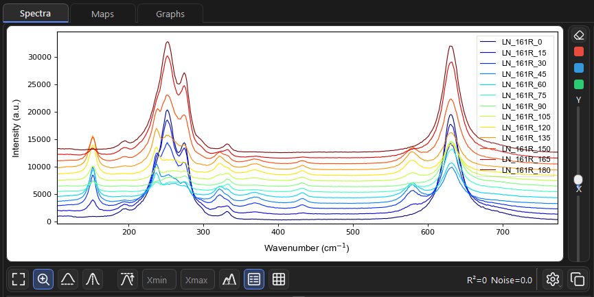 

  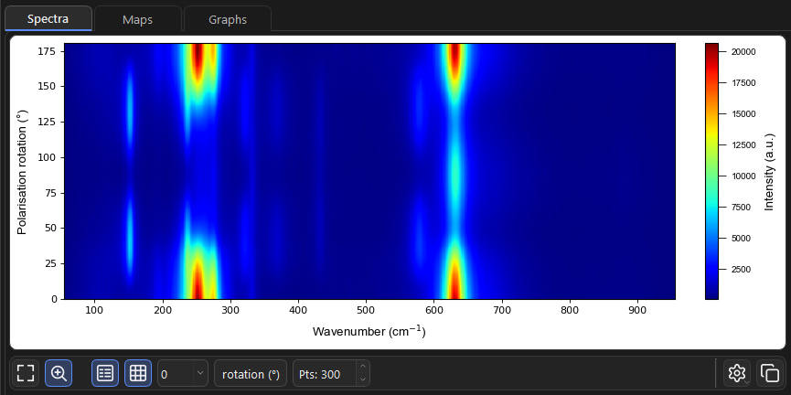 
  <i><code>SpectraViewer</code> en mode carte thermique, affichant une carte 2D continue d'intensité sur une série en température in situ.</i>

##### **Contrôles et paramètres clés**

Lorsque le mode Heatmap est activé, des contrôles dédiés apparaissent directement sur la barre d'outils principale, tandis que les outils 1D incompatibles (marqueurs de pics, points d'ancrage de ligne de base, gomme à rayons cosmiques et champs de normalisation) sont automatiquement masqués :

- **Bouton Heatmap** () : Active ou désactive le rendu en carte thermique 2D. Décocher ce bouton restaure instantanément les courbes 1D classiques ainsi que tous les outils standard de la barre.
- **Sélecteur du paramètre de l'axe Y** :
  - **`Index`** : Empile les spectres uniformément le long de l'axe vertical selon leur ordre de sélection (`0, 1, 2, ...`).
  - **Jeton de nom de fichier** : Extrait automatiquement les paramètres numériques intégrés dans les noms de fichiers séparés par des tirets bas (`_`) (par exemple, `sample_25°C.txt`, `sample_100°C.txt`, `sample_200°C.txt` génèrent des jetons tels que `25°C` et extraient les valeurs numériques `25, 100, 200` comme coordonnées physiques en Y).
- **Libellé personnalisé de l'axe Y** : Champ texte permettant de remplacer le titre automatique de l'axe vertical (par exemple, `Temperature (°C)`, `Time (min)` ou `Position (µm)`).
- **Points d'interpolation en Y (`Pts:`)** : Définit le nombre de tranches verticales interpolées (`300` points par défaut) par interpolation lissée. Régler cette valeur sur `0` désactive l'interpolation et affiche les lignes discrètes brutes.
- **Palette d'intensité** : Suit la palette active choisie dans **More Options** (par exemple `jet`, `viridis`, `plasma`).

#### **3.5. Mode de visualisation 3D interactive (`3D View`)**

Le bouton **3D View** (), situé à droite de la barre d'outils entre **Plot Heatmap** et **More Options**, affiche vos spectres sélectionnés dans un espace 3D interactif (axe spectral en **X**, indice de série ou paramètre issu du nom de fichier en **Y**, et intensité en **Z**) :

- **Navigation caméra interactive** :
  - **Rotation** : Maintenez le clic gauche et faites glisser n'importe où sur le tracé 3D pour modifier librement l'élévation et l'azimut.
  - **Déplacement / Zoom** : Maintenez le bouton central et faites glisser pour déplacer ; faites un clic droit glissé (ou utilisez la molette) pour zoomer selon l'axe d'intensité.
  - **Réinitialiser la vue** : Cliquez sur **Rescale** (`Ctrl + R`) pour restaurer l'angle de caméra par défaut et recadrer toutes les données.
- **Contrôles partagés de l'axe des séries** : Choisissez `Index` ou tout paramètre numérique extrait des noms de fichiers (par exemple `25°C`, `100°C`) dans la liste déroulante de la barre d'outils et renseignez éventuellement un titre d'axe Y personnalisé.
- **Options compatibles** : Fonctionne de manière transparente avec **Normalization**, **Show Bestfit**, les modes **Legend / Colorbar**, les styles **Line / Dot**, la superposition **Raw**, **Grid**, l'échelle Z **Linear / Log**, les thèmes graphiques **Light / Dark** et **Copy** vers le presse-papiers. Basculer entre les modes Standard, **Plot Heatmap** et **3D View** restaure automatiquement les outils adaptés.

#### **3.6. Sélecteurs de plages spectrales interactifs et `Live Maps` (espaces `Spectra` et `Maps`)**

Dans les espaces **`Spectra`** et **`Maps`**, vous pouvez encadrer interactivement jusqu'à trois domaines spectraux dans `SpectraViewer` et observer leurs variations en temps réel dans l'onglet dédié **Live Maps** :

  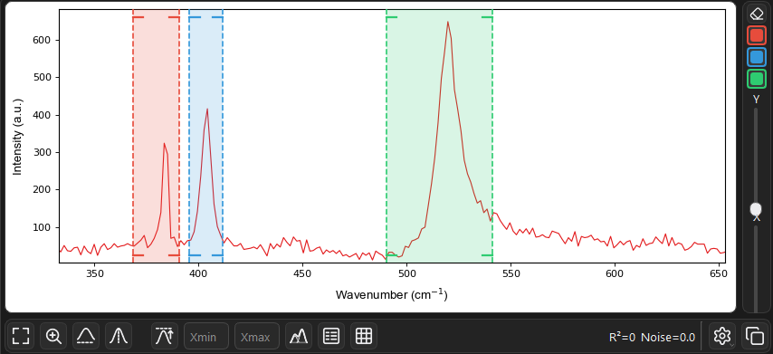 

- **Espace `Spectra`** : Affiche jusqu'à trois **courbes 1D d'évolution paramétrique** codées par couleur (Rouge, Bleu, Vert) sur l'ensemble des **spectres actuellement sélectionnés** dans `SpectraList`, permettant d'évaluer rapidement l'évolution de l'intensité, de la position, de la hauteur ou de l'aire d'un pic à travers une série.

  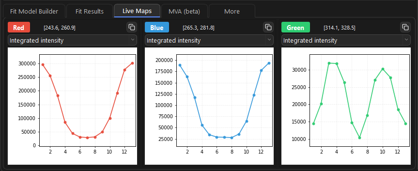 

- **Espace `Maps`** : S'adapte automatiquement à la dimensionnalité spatiale de la carte sélectionnée :
  - **Cartes 2D** : Affiche jusqu'à trois **cartes thermiques spatiales 2D** en temps réel sur la grille hyperspectrale active.
  - **Cartes 1D (profils / balayages linéaires)** : Détecte automatiquement les coordonnées colinéaires et affiche les canaux Rouge, Bleu et Vert sous forme de **courbes 1D** le long de l'axe spatial (`X (mm)`, `Y (mm)` ou `Distance (mm)`), en basculant automatiquement entre cartes thermiques et courbes de profil lorsque vous changez de carte.

  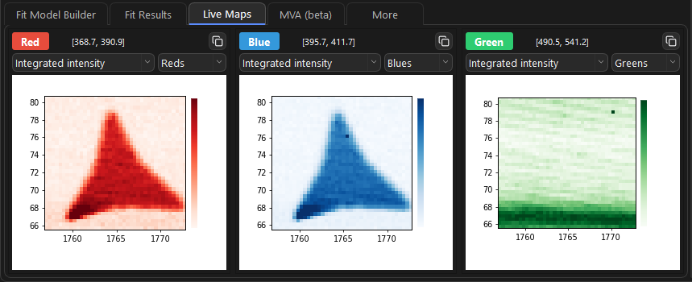 

##### **Contrôles des sélecteurs de plage (`SpectraViewer`)**

Une barre d'outils verticale placée sur le bord droit de `SpectraViewer` propose trois boutons à bascule indépendants et colorés :

- **Red** (`R`)
- **Blue** (`B`)
- **Green** (`G`)

Chaque bouton active une paire de curseurs verticaux déplaçables (crochets et zone ombrée) directement sur le tracé du spectre et bascule automatiquement la barre d'onglets inférieure vers l'onglet **Live Maps** :

- **Déplacement interactif** : Cliquez et faites glisser l'une des deux bornes verticales pour modifier le nombre d'onde minimal ou maximal. Cliquez et faites glisser la zone centrale ombrée pour translater l'intervalle complet sans en changer la largeur.
- **Plusieurs plages simultanées** : Toute combinaison des trois sélecteurs peut être activée en même temps. Chaque canal conserve indépendamment sa couleur, son intervalle et sa visibilité.
- **Intégrité du recadrage** : Les marqueurs de sélection de plage n'étendent pas les bornes automatiques du spectre ; le bouton **Rescale** (`Ctrl+R`) zoome ainsi toujours exactement sur les données spectrales chargées.
- **Bornage automatique** : Lors d'un recadrage spectral ou du chargement de nouvelles données, les sélecteurs se recadrent automatiquement à l'intérieur du domaine spectral visible.
- **Mise à jour en temps réel** : Déplacer un sélecteur ou modifier les spectres/cartes sélectionnés recalcule et rafraîchit immédiatement le graphique de variation 1D (dans l'espace **Spectra**) ou la carte thermique 2D / courbe de profil 1D (dans l'espace **Maps**) dès que l'onglet **Live Maps** est ouvert (avec un délai adaptatif de 60 à 250 ms afin de préserver la fluidité lors du glissement sur de grands jeux de données). Les spectres décochés dans la carte ou la liste active sont automatiquement masqués afin que des points aberrants exclus ne faussent pas les échelles de couleur ou les profils.
- **Sélection multiple et comparaison de cartes (espace `Maps`)** : Utilisez `Ctrl+Click` ou `Shift+Click` dans la liste **Maps** pour sélectionner plusieurs cartes simultanément tout en conservant votre **carte principale (*Primary Map*)** active pour le prétraitement, l'ajustement et `MapViewer` :
  - **Comparer plusieurs profils 1D** : Lorsque la carte principale est un profil linéaire 1D, tous les profils 1D sélectionnés sont superposés ensemble dans chaque sous-panneau de canal avec une épaisseur de trait uniforme (basculez le bouton **Legend** pour identifier chaque courbe sur le canevas).
  - **Basculer entre plusieurs cartes 2D sélectionnées** : Lorsque la carte principale est une carte 2D, un sélecteur compact `◀ [2D Map Selector] ▶` apparaît dans l'en-tête de Live Maps pour parcourir les cartes thermiques 2D sélectionnées sans perdre votre sélection.
  - **Suppression par lots** : Appuyer sur **Delete** alors que plusieurs cartes sont sélectionnées demande confirmation avant de supprimer l'ensemble des cartes sélectionnées.

##### **Visualisation et sous-panneaux de l'onglet Live Maps**

L'onglet **Live Maps** est situé dans la barre d'onglets inférieure entre **Fit Results** et **MVA** (avec l'onglet **More** placé en fin de liste).

- **Affichage des sous-panneaux** : Lorsqu'un ou plusieurs sélecteurs de plage sont actifs, leurs panneaux correspondants (Rouge, Bleu, Vert) s'affichent côte à côte. Si aucun sélecteur n'est actif, un message d'accueil vous invite à activer un bouton sur le bord droit de `SpectraViewer`.
- **Paramètres spectraux pris en charge** : Pour chaque sous-panneau, la liste déroulante permet de choisir le paramètre extrait et tracé :

| Paramètre | Type | Description |
|-----------|------|-------------|
| **Integrated intensity** | Direct | Intégrale ($\sum Y \cdot \Delta x$) de l'intensité sur l'intervalle spectral sélectionné. |
| **Mean intensity** | Direct | Intensité moyenne au sein de l'intervalle sélectionné. |
| **Maximum intensity** | Direct | Intensité maximale mesurée dans l'intervalle. |
| **Peak position** | Direct | Nombre d'onde correspondant au maximum d'intensité dans l'intervalle. |
| **Peak height** | Direct | Intensité maximale diminuée de la ligne de base locale reliant les extrémités de l'intervalle. |
| **Peak position (fit)** | Issu de l'ajustement | Nombre d'onde central ($x_0$) d'un pic ajusté dans l'intervalle (nécessite un ajustement préalable). |
| **Peak height (fit)** | Issu de l'ajustement | Amplitude ajustée ($A$) du pic dans l'intervalle (nécessite un ajustement préalable). |
| **Peak area (fit)** | Issu de l'ajustement | Aire intégrée analytique du pic ajusté (nécessite un ajustement préalable). |
| **R/B ratio** *(canal Vert uniquement)* | Dérivé | Rapport pixel par pixel (carte 2D) ou point par point (profil 1D / série spectrale) des intensités intégrées $I_{\mathrm{Red}} / I_{\mathrm{Blue}}$. Se met à jour automatiquement dès que les bornes Rouge ou Bleu sont déplacées ou redimensionnées ; les intensités Bleues nulles ou quasi nulles sont masquées sans erreur en `NaN`. Tant que **R/B ratio** est sélectionné, le crochet Vert est automatiquement masqué sur le tracé du spectre afin de n'afficher que les bornes Rouge et Bleu pilotant le rapport (revenir à tout autre paramètre restaure immédiatement le crochet Vert). |

*Remarque* : Si un paramètre issu de l'ajustement est choisi alors que les résultats ne sont pas encore disponibles, le panneau affiche proprement un bandeau d'information plutôt que des valeurs erronées.

##### **Sélection interactive de spectres depuis RGB Live Maps *(espace Maps)***

Lorsque vous exploitez des cartes 2D ou des cartes de profil 1D dans l'espace **Maps** (dès que les outils **Pan** et **Zoom** sont désactivés), vous pouvez sélectionner des spectres directement depuis n'importe quel sous-panneau Rouge, Bleu ou Vert sans quitter l'onglet Live Maps :

- **Clic simple** : Sélectionne le spectre le plus proche de la coordonnée cliquée et l'affiche immédiatement dans `SpectraViewer`.
- **`Ctrl` + Clic** : Ajoute un autre spectre à la sélection courante (ou retire un site déjà sélectionné).
- **Cliquer-glisser** : Trace un cadre de sélection en pointillés pour sélectionner tous les spectres contenus dans la zone (`Ctrl` + glisser ajoute les spectres encadrés à la sélection existante).
- **Surlignage synchronisé et changement de carte** : Les sites sélectionnés sont encadrés en rouge sur tous les sous-panneaux RVB actifs et restent synchronisés avec le `MapViewer` principal et les fenêtres détachables `VMapViewerDialog`. Si vous avez basculé vers une autre carte 2D via le contrôle d'en-tête `◀ [2D Map] ▶`, cliquer sur un site de cette carte la définit automatiquement comme carte principale et charge ses spectres. Les clics effectués à l'intérieur d'une légende ouverte restent réservés au déplacement ou à l'édition des libellés par double-clic.

##### **Contrôles propres à chaque sous-panneau**

Chaque sous-panneau propose des contrôles dédiés :

- **Rescale / Pan / Zoom** : Des boutons de navigation indépendants dans l'en-tête de chaque sous-panneau permettent de zoomer dans une zone d'intérêt, de déplacer la vue et de revenir à l'échelle complète sans affecter les canaux voisins. Double-cliquer sur une légende ouvre toujours l'éditeur de légende au lieu de réinitialiser le zoom.
- **Normalisation des courbes 1D** *(cartes 1D et tracés linéaires 1D)* : Activez le bouton de normalisation à côté de la liste déroulante des paramètres (avec bornes optionnelles `Xmin` et `Xmax`) dans chaque sous-panneau RVB pour normaliser visuellement et indépendamment chaque courbe 1D affichée à `1.0` sur son maximum global ou sur `[Xmin, Xmax]`, sans modifier les données sous-jacentes — idéal pour comparer la forme de profils entre des cartes d'amplitudes différentes.
- **Palette** *(cartes thermiques 2D dans l'espace Maps)* : Choisissez n'importe quelle palette standard (`viridis`, `plasma`, `inferno`, `jet`, `turbo`, `coolwarm`, `cividis`, `magma`, `Reds`, `Blues`, `Greens`). Dans l'espace **Spectra**, chaque courbe de variation 1D adopte automatiquement la couleur du sélecteur correspondant (Rouge, Bleu ou Vert).
- **Copy** : Copie la figure du sous-panneau dans le presse-papiers selon **Copied figure size** et **Copied figure theme** (indépendamment de la taille actuelle de la fenêtre SPECTROview). Maintenez **`Ctrl` + Clic** (ou **`Cmd` + Clic** sous macOS) pour copier à la place le jeu de données numériques sous-jacent au format colonnes séparées par des tabulations (série de variation 1D, tableaux de profils 1D simples ou multiples, ou points 2D `(X, Y, Value)` de la carte).
- **Badge d'intervalle / état** : Affiche l'intervalle courant $[x_{min}, x_{max}]$ ou l'état de l'ajustement.

##### **Options d'affichage Live Maps et personnalisation de la légende**

Dès qu'un ou plusieurs sélecteurs sont actifs, deux commandes rapides apparaissent en haut à droite de l'onglet **Live Maps** :

- **Show / Hide Legend (`btn_legend`)** : Affiche ou masque les légendes interactives sur les sous-panneaux 1D. Vous pouvez faire glisser les légendes directement à la souris ou double-cliquer sur une boîte de légende pour personnaliser ses libellés et couleurs.
- **More View Options (`⋯`)** : Ouvre un menu compact à 2 colonnes reprenant l'espacement de `SpectraViewer` (tous les choix sont synchronisés entre les espaces Spectra et Maps et enregistrés automatiquement pour les sessions suivantes) :
  - **Plot Theme** : Bascule les figures Live Maps entre **Light Mode** (fond blanc par défaut) et **Dark Mode**, indépendamment du thème global de l'interface.
  - **Échelles des axes et des couleurs** : Bascule **X-scale**, **Y-scale** et **Color (Z) scale** entre **Linear** et **Log** (les plages non strictement positives retombent automatiquement et proprement sur l'échelle linéaire).
  - **Style et dimensions de tracé** : Bascule les courbes 1D entre **Line** (par défaut), **Line + Dots** et **Dot**, et ajuste **Line width** (`1.5` par défaut), **Dot size** (`1.5` par défaut) ainsi que **Text size** (`6–24 pt`, dimensionnant titres d'axes, libellés, graduations et étiquettes de barre de couleur).
  - **Taille et thème de figure copiée** : Fixe les dimensions de sortie presse-papiers en pouces (**Copied figure size**, `5.5` × `4.0` par défaut) et le **Copied figure theme** (**Light Mode** par défaut ou **Dark Mode**) afin que les figures copiées conservent des proportions constantes et des polices lisibles quel que soit le redimensionnement de la fenêtre.
  - **Paramètres de la boîte de légende** : Active/désactive la légende, modifie **Legend location** (`best`, coins, `outside right`, `outside top`), **Legend columns**, **Legend font size**, ou ouvre **Edit legend labels...** pour renommer les séries et choisir des couleurs personnalisées directement sur la légende du canevas.
  - **Aides à l'affichage et à la comparaison** : Affiche ou masque **Show figure label** au-dessus de chaque canevas RVB (désactivé par défaut), bascule **Show grid** (désactivé par défaut), synchronise les limites Y entre panneaux via **Share Y-axis (1D)**, active le lissage bilinéaire **Heatmap smoothing**, affiche ou masque **Colorbars**, ou restaure les réglages via **Reset view options**.

_______

### **4. `FitModelBuilder`**

L'onglet `FitModelBuilder` est le panneau où vous configurez vos modèles d'ajustement spectral. Il est divisé en trois sections principales : `Fitting`, `PeakTable` et `FitModelControl`, détaillées ci-après.

Vous pouvez utiliser les paramètres d'ajustement globaux ou les adapter dans le panneau `Settings Panel` (voir la section « Paramètres »).

  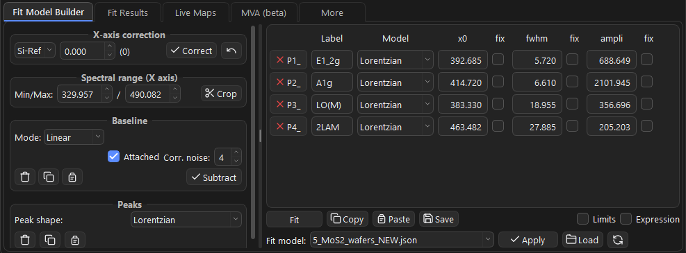 
  <i>L'onglet <code>FitModelBuilder</code> regroupant : (1) le panneau <code>Fitting</code> (à gauche), (2) le panneau <code>PeakTable</code> (en haut à droite) et (3) le panneau <code>FitModelControl</code> (en bas à droite).</i>

#### **4.1. Panneau `Fitting`**

Le panneau `Fitting` vous guide pour bâtir un modèle robuste en quatre étapes logiques :

**Étape 1 : Correction de l'axe X (facultatif)** : Effectuez un recalage empirique de l'axe X à partir de la mesure d'un échantillon de référence connu (par exemple un pic du silicium à exactement 520,7 cm⁻¹). Ajustez simplement votre spectre de référence, saisissez la position théorique exacte et appliquez le décalage pour corriger globalement la calibration.

**Étape 2 : Définir la plage d'ajustement** : Restreignez le calcul mathématique à une région spectrale d'intérêt précise sur l'axe X.

**Étape 3 : Définition de la ligne de base (`Baseline`)** : **SPECTROview** propose deux modes distincts pour définir les lignes de base spectrales (`Manual` ou `Auto`) :

  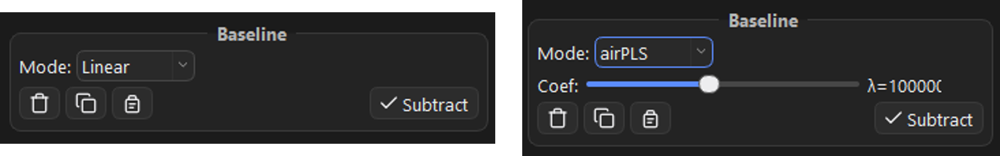 
   <i>Choix du mode de ligne de base : mode Manual (à gauche) vs mode Auto (à droite).</i>

- **Mode Manual (`Linear` ou `Polynomial`)** : Définissez les points d'ancrage de la ligne de base en cliquant directement dans `SpectraViewer`. Cochez *Attached* pour aimanter automatiquement vos clics sur la courbe de données la plus proche. Cochez *Correct noise* pour calculer l'intensité du point comme une moyenne locale des points voisins, rendant le placement robuste face au bruit.
- **Mode Auto** : Laissez des algorithmes avancés estimer automatiquement la courbe de ligne de base. Utilisez le curseur pour ajuster l'agressivité de l'algorithme :
  - **`arPLS`** : *Asymmetrically Reweighted Penalized Least Squares*. Un algorithme de référence pour les lignes de base Raman et infrarouges classiques.
  - **`airPLS`** : Un algorithme très réactif, excellent pour soustraire des fonds de fluorescence intenses et complexes. Fortement recommandé et validé pour les données Raman.
  - **`AsLS`** : Un algorithme très stable, mais qui peut parfois confondre bruit et pics larges. Idéal pour des spectres relativement propres.
  - **`ModPoly`** : Polynôme modifié. Très répandu et efficace pour les fonds de fluorescence polynomiaux simples.

**Étape 4 : Définition des pics** :

- Ajoutez des pics directement dans `SpectraViewer` par clic gauche (assurez-vous que le bouton **Peak** est activé). Vous pouvez ajuster interactivement leurs paramètres initiaux en les faisant glisser à la souris.
- Chaque pic ajouté au graphique est immédiatement répertorié dans **`PeakTable`**.
- Les profils de pics pris en charge comprennent : `Lorentzian`, `Gaussian`, `PseudoVoigt`, `LorentzianAsym`, `GaussianAsym`, `Fano`, `DecaySingleExp` et `DecayBiExp`.

#### **4.2. Profils de pics pris en charge**

Le moteur `VBF Engine` de **SPECTROview** fournit des implémentations hautement optimisées pour les profils mathématiques suivants :

| Modèle | Paramètres | Formule |
|-------|-----------|---------|
| `Gaussian` | `ampli`, `fwhm`, `x0` | <i>a</i> &middot; exp(-4 ln(2) &middot; (x-x0)2 / w2) |
| `Lorentzian` | `ampli`, `fwhm`, `x0` | <i>a</i> / [1 + 4(x-x0)2 / w2] |
| `PseudoVoigt` | `ampli`, `fwhm`, `x0`, `alpha` | &alpha; &middot; G + (1-&alpha;) &middot; L |
| `GaussianAsym` | `ampli`, `fwhm_l`, `fwhm_r`, `x0` | Gaussienne par morceaux avec `FWHM` gauche/droite |
| `LorentzianAsym` | `ampli`, `fwhm_l`, `fwhm_r`, `x0` | Lorentzienne par morceaux avec `FWHM` gauche/droite |
| `Fano` | `ampli`, `fwhm`, `x0`, `q` | <i>a</i> &middot; (q + &epsilon;)2 / (1 + &epsilon;2), &epsilon; = 2(x-x0)/w |
| `DecaySingleExp` | `A`, `tau`, `B` | <i>A</i> &middot; e-t/&tau; + B |
| `DecayBiExp` | `A1`, `tau1`, `A2`, `tau2`, `B` | <i>A</i>1 &middot; e-t/&tau;1 + <i>A</i>2 &middot; e-t/&tau;2 + B |

#### **4.3. Panneau `PeakTable`**

`PeakTable` affiche l'ensemble des paramètres mathématiques des pics définis. Lorsque vous déplacez un pic dans le visualiseur, ces propriétés se mettent à jour dynamiquement.

**Indexation dynamique des pics** : Chaque pic reçoit automatiquement un suffixe indexé (par exemple `_1`, `_2`) correspondant à son ordre de création. Lorsque vous ajoutez, supprimez ou réordonnez des pics, **SPECTROview** réindexe automatiquement la numérotation pour qu'elle reste consécutive (si vous supprimez le pic 2, le pic 3 devient le nouveau pic 2). Vos expressions et résultats d'ajustement restent ainsi toujours cohérents.

  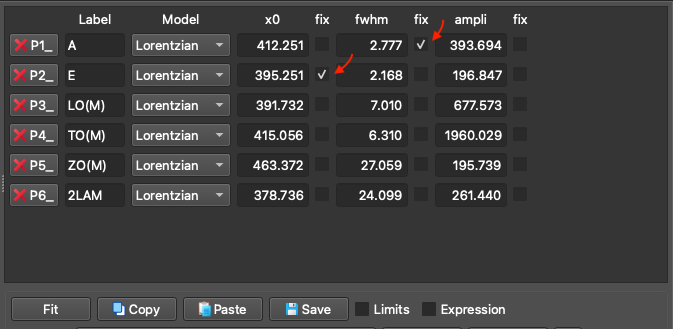 
   <i>Le panneau <code>PeakTable</code> affichant les paramètres des pics et leurs contraintes.</i>

**Ajouter des contraintes au modèle d'ajustement** :

**Fix** : Cochez la case « fix » pour geler la valeur du paramètre et empêcher l'optimiseur de la modifier durant l'ajustement.

**Limits** : Saisissez des bornes minimale et maximale pour restreindre l'intervalle dans lequel l'optimiseur peut faire varier le paramètre.

  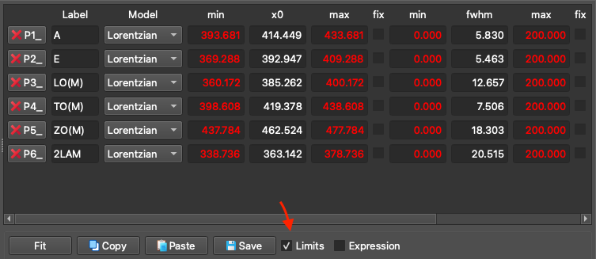 
   <i>Exemple 1 : Activez l'option « Limits » sous le tableau des pics et définissez les valeurs « min » et « max » pour chaque paramètre d'ajustement.</i>

**Expression** : Définissez des relations mathématiques complexes entre paramètres. Le moteur `VBF Engine` de **SPECTROview** évalue ces expressions mathématiquement avant de les transmettre à l'optimiseur. Si des pics sont réindexés suite à des suppressions, leurs références dans vos expressions mathématiques sont automatiquement mises à jour afin d'éviter toute erreur de modèle.

  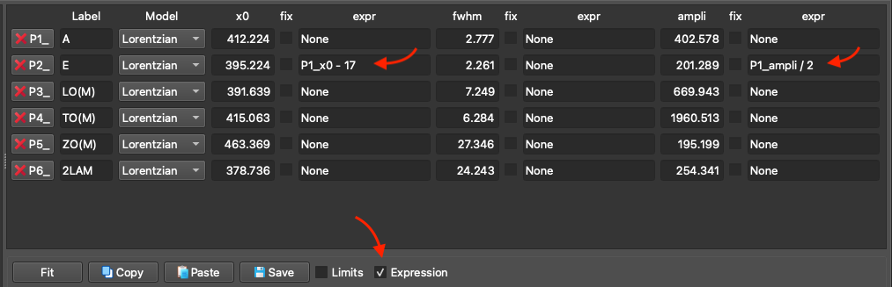 
   <i>Exemple 2 : Utilisation d'une expression pour contraindre (1) la position du pic E (P2) à être inférieure de 17 à celle du pic A (P1) ou (2) l'amplitude du pic E (P2) à valoir exactement la moitié de celle de A (P1).</i>

#### **4.4. Panneau `FitModelControl`**

Une fois votre modèle entièrement configuré, cliquez sur le bouton **Fit** pour lancer l'optimisation.

  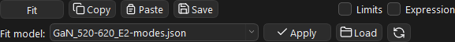 
   <i>Le panneau <code>FitModelControl</code>.</i>

**Copier / coller des modèles d'ajustement** :
Un modèle entièrement configuré peut être copié depuis un spectre et collé sur un autre, ce qui facilite la réplication de configurations complexes sur des fichiers distincts.
>
> - Lorsque vous utilisez **Paste** pour coller un modèle, le moteur récupère toujours le seuil de bruit (*Noise Threshold*) *actuel* défini dans votre panneau Settings actif. Vous pouvez ainsi copier un modèle, modifier le seuil de bruit puis le coller pour appliquer le modèle avec le nouveau seuil.

**Enregistrer / charger des modèles d'ajustement** :
Si vous prévoyez d'utiliser fréquemment un modèle, enregistrez-le comme modèle réutilisable. Les modèles enregistrés sont facilement accessibles et applicables à de nouveaux jeux de données depuis le menu déroulant.

- **Sélectionner depuis la liste déroulante** : Choisissez n'importe quel modèle existant dans la liste `Fit model:`.
- **Charger via le bouton** : Cliquez sur **Load** pour parcourir vos dossiers et charger n'importe quel modèle `.json` depuis votre disque.
- **Glisser-déposer** : Vous pouvez glisser-déposer directement un fichier modèle `.json` sur le panneau `Fit Model Builder` ou n'importe où dans l'espace **Spectra** ou **Maps**. Le fichier est immédiatement ajouté à la liste des modèles, sélectionné dans le menu déroulant et prêt à être appliqué.
- **Appliquer le modèle** : Cliquez sur **Apply** pour affecter le modèle chargé au spectre actuellement sélectionné (ou maintenez **Ctrl** en cliquant sur **Apply** pour l'affecter à tous les spectres).
> - Lorsque vous cliquez sur **Save** pour enregistrer un modèle dans un fichier `.json`, le seuil de bruit *actuel* est définitivement enregistré dans ce fichier. Plus tard, lorsque vous utilisez **Apply (Load)** avec ce modèle, le moteur d'ajustement utilise strictement le seuil de bruit sauvegardé dans le fichier, indépendamment du réglage courant dans votre panneau Settings.

_______

### **5. Collecter et enregistrer les résultats d'ajustement**

Une fois l'ajustement terminé sur vos spectres ou vos cartes, il convient d'agréger les meilleurs résultats :

- Rendez-vous dans l'onglet **Fit Results**.
- Cliquez sur le bouton **Collect**. **SPECTROview** compile instantanément tous les paramètres optimisés dans un tableau unifié. La qualité d'ajustement de chaque spectre (**R2**, le coefficient de détermination) est incluse sous forme de colonne, ce qui vous permet de la filtrer ou de la tracer (par exemple une carte thermique R² dans l'espace `Maps`) exactement comme n'importe quel paramètre ajusté. Cliquez sur n'importe quel en-tête de colonne pour la sélectionner en entier, ou faites glisser sur plusieurs en-têtes pour copier rapidement plusieurs colonnes.

> **Ajuster la précision décimale** : le nombre de décimales affichées pour les résultats numériques (x0, ampli, fwhm, area, R2, …) est contrôlé par le sélecteur **Fit results decimals** en haut de l'onglet **Fit Results**, juste au-dessus du bouton **Collect** (3 par défaut). Modifiez-le puis cliquez de nouveau sur **Collect** pour reconstruire le tableau avec la nouvelle précision. Ce réglage s'applique également aux colonnes calculées (voir ci-dessous). Les colonnes de coordonnées X/Y conservent toujours leur précision maximale.

  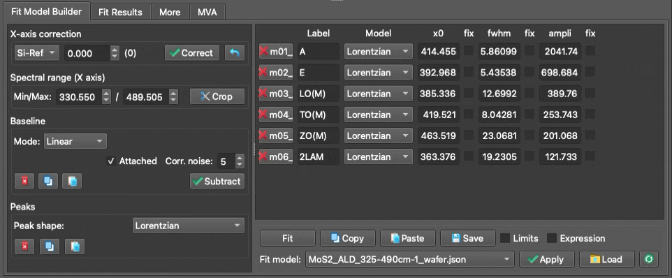 
   <i>Interface Collect Fit Results et tableau agrégé des résultats.</i>

#### **5.1. Extraction de champs depuis les noms de fichiers**

Cet outil extrait automatiquement les métadonnées encodées dans vos noms de fichiers. Par exemple, si vos fichiers se nomment `Sample1_ProcessA_Temp25`, l'outil découpe le nom selon les tirets bas (`_`) et affecte les valeurs extraites dans de nouvelles colonnes distinctes de votre jeu de données (voir la vidéo ci-dessus).

#### **5.2. Calculer et ajouter de nouvelles colonnes**

Vous pouvez créer facilement de nouvelles colonnes dérivées de combinaisons mathématiques de paramètres ajustés existants (par exemple, calculer un écart de pic avec `x0_p1 - x0_p2`).
Les opérateurs mathématiques pris en charge sont : `+`, `-`, `*`, `/`, `**`, `%` et `()`. La colonne calculée est arrondie selon la même précision **Fit results decimals** définie en haut de l'onglet.
> **Remarque importante** : Si vos noms de colonnes contiennent des espaces ou des caractères spéciaux, vous devez les encadrer par des accents graves (*backticks*). Exemple : `` `x0_LO(M)` ``

#### **5.3. Enregistrer et visualiser**

Une fois votre tableau de données finalisé, vous pouvez :

- **L'enregistrer sous un nom explicite**, puis **l'envoyer directement vers l'espace `Graphs`** pour le tracer immédiatement.

  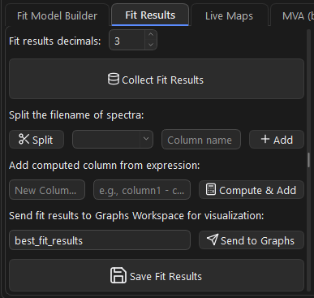 

 

- **L'exporter vers un fichier tableur Excel/CSV** pour une exploitation externe.

  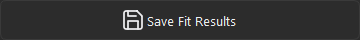 

### **6. Onglet `More`**

L'onglet `More` rassemble des outils auxiliaires et des métadonnées, répartis en trois zones :

  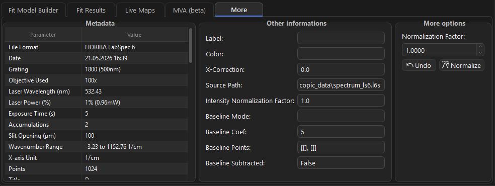 

- **À gauche** : Affiche l'ensemble des métadonnées extraites directement des fichiers `.wdf`, `.spc`, `.l6s`, `.l6m`, `.ngs` ou `.ngc`, montrant les paramètres instrumentaux exacts utilisés lors de l'acquisition.
- **Au centre** : Affiche les propriétés détaillées et les statistiques du spectre actuellement sélectionné.
- **À droite** : Donne accès à des outils de prétraitement complémentaires, tels que la normalisation globale d'intensité et la détection des pics parasites dus aux rayons cosmiques.
