## **Рабочие области: Спектры и Карты** { #workspace-spectra-and-maps }

Рабочие области `Maps` и `Spectra` имеют единую архитектуру и множество общих базовых функций. Однако рабочая область `Maps` дополнительно оснащена специализированными инструментами для обработки больших гиперспектральных наборов данных.

  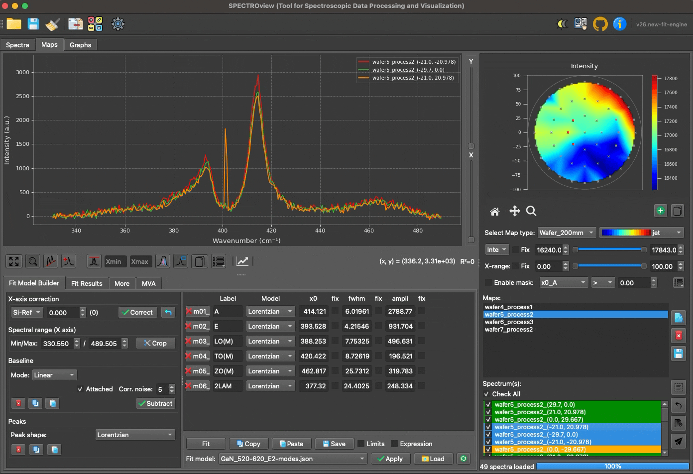 
  <i>Обзор интерфейса рабочих областей <code>Spectra</code> и <code>Maps</code>. Обе области разделены на три основные секции: верхняя левая (<code>SpectraViewer</code>), нижняя левая (<code>FitModelBuilder</code>) и правая (<code>SpectraList</code> / <code>MapList</code>).</i>

_______

### **1. `MapList` и `MapViewer`** { #1-maplist-and-mapviewer }

`MapList` и `MapViewer` — это виджеты, предназначенные для удобной навигации и управления гиперспектральными наборами данных. В `MapList` отображаются все загруженные файлы карт, включая карты пластин (*wafer maps*) и стандартные 2D-карты.

Кнопки действий, расположенные рядом с `MapList`, позволяют: (1) просмотреть данные выбранной карты, (2) удалить выбранную карту (или несколько карт) из рабочей области или (3) сохранить все выбранные карты в виде файлов CSV в выбранную папку.

Вы можете легко переключаться между загруженными 2D-картами с помощью `MapList`, выбирать несколько карт с помощью `Ctrl+Click` или `Shift+Click`, а также **перетаскивать** одну или несколько выбранных карт внутри списка для изменения их порядка (это обновляет порядок сравнения во вкладке **Live-карты** (Live Maps), оставляя вашу активную основную карту неизменной). Основная выбранная карта (*Primary*) отображается в `MapViewer`. При открытии или выборе карты **автоматически выбирается первый спектр карты** и подсвечивается на тепловой карте: его кривая сразу же отображается в `SpectraViewer`, а базовая линия, таблица пиков и метаданные синхронизируются. По умолчанию `MapViewer` отображает тепловую карту сигнала «**Интенсивность**» (Intensity) или «**Площадь**» (Area). Если для карты уже выполнена аппроксимация, вы можете выбрать и визуализировать тепловую карту любого подогнанного параметра.

  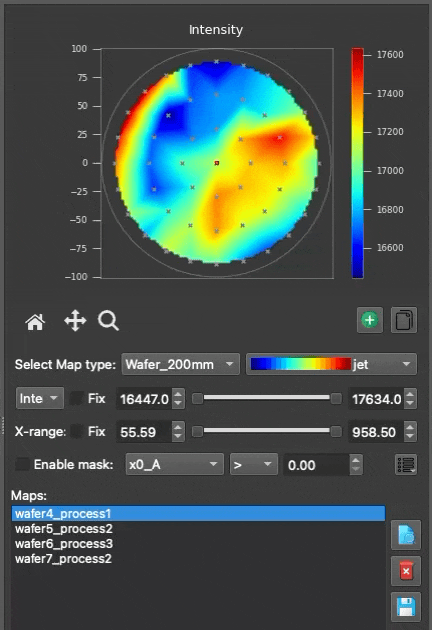 

- Двойные ползунки позволяют быстро настроить спектральный диапазон и диапазон значений данных тепловой карты.
- Элементы управления панели навигации (**Home / Rescale**, **Pan / Drag** и **Масштаб** (Zoom)) позволяют интерактивно перемещаться по карте, панорамировать и приближать отдельные области с помощью единых векторных кнопок SPECTROview.
- Вы можете одновременно открыть несколько экземпляров `MapViewer` для сравнения различных подогнанных параметров.
- Меню параметров (`…`) включает переключатель **Цветовая шкала** (Color scale) для переключения нормализации тепловой карты между режимами **Линейный** (Linear) и **Log**. Логарифмическая шкала полезна, когда значения охватывают несколько порядков; если диапазон данных не является строго положительным, происходит автоматический возврат к линейной шкале.

  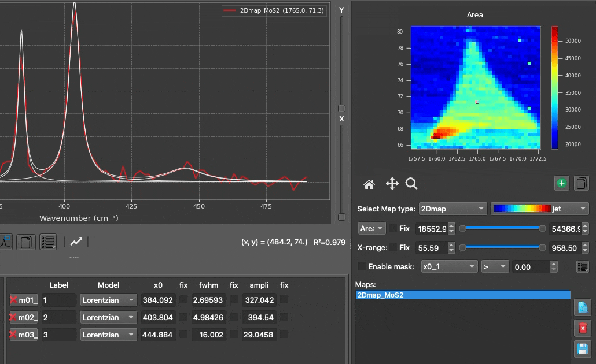 

**Функция маскирования (`Mask`)**: позволяет выделить отдельные области тепловой карты с помощью пользовательских числовых фильтров на основе параметров.

  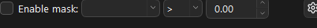

  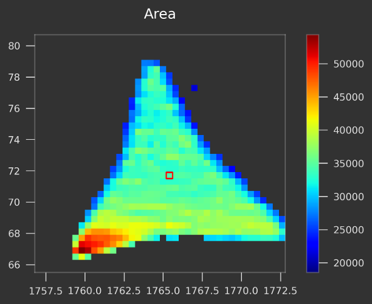 
  <i>Пример функции маскирования для 2D-карт: чешуйка MoS2 выделяется с помощью маски (интенсивность пика A1g &gt; 40 a.u.) для отсечения окружающей подложки.</i>

_________

### **2. `SpectraList`** { #2-spectralist }

`SpectraList` отображает все загруженные дискретные спектры (в рабочей области `Spectra`) или все спектры текущей выбранной карты (в рабочей области `Maps`) (см. рисунок ниже).

Вы можете выбрать один или несколько спектров одновременно; выбранные спектры сразу же визуализируются в `SpectraViewer`. Специальные кнопки позволяют выделить все спектры, повторно инициализировать (сбросить) спектры, сохранить выбранные данные в формат TXT или отправить выбранные спектры в рабочую область `Spectra` для отдельного анализа.

  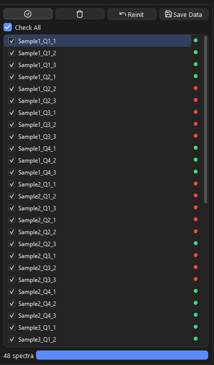 
  <i>Виджет <code>SpectraList</code> вместе со строкой прогресса в рабочей области <code>Maps</code>.</i>

**Индикаторы состояния обработки**: аккуратная круглая цветовая точка справа от каждого элемента наглядно показывает его текущее состояние обработки (зелёная — аппроксимация сошлась, красная — аппроксимация не сошлась, синяя — вычтена базовая линия, серая — спектр обрезан, прозрачная / без точки — необработанные спектры).

**Индикатор выполнения** (Progress Bar) под `SpectraList` в реальном времени отображает прогресс аппроксимации (%), количество сошедшихся спектров и затраченное время (s). Кнопка **Стоп** (Stop) позволяет безопасно прервать выполняемый процесс аппроксимации.

#### **2.1. Перенос между рабочими областями** { #21-cross-workspace-transfer }

При отправке выбранных спектров из рабочей области `Maps` в рабочую область `Spectra` система использует словари с глубоким копированием (*deep copy*). Это гарантирует, что:

- Исходные массивы интенсивности и координат полностью сохраняются.
- Конфигурация `baseline_config` (включая опорные точки и режимы вычисления) переносится именно так, как вы её настроили.
- Вся ваша модель `fit_model` (включая все пределы пиков, выражения и начальные приближения) полностью сохраняется.
- Активные границы спектральной обрезки и состояния вычитания базовой линии остаются неизменными.

Благодаря этому перенесённые спектры сохраняют своё полное интерактивное и аналитическое состояние на новой вкладке рабочей области, не затрагивая исходную карту.

_______

### **3. `SpectraViewer`** { #3-spectraviewer }

`SpectraViewer` — это центральный виджет построения графиков, в котором отображаются все спектры, выбранные в `SpectraList` (вместе с их аппроксимирующими кривыми).

#### **3.1. Интерактивное управление мышью в `SpectraViewer`** { #31-spectraviewer-with-interactive-mouse-controls }

  

- **Показать параметры пиков**: наведите курсор на любой подогнанный пик, чтобы отобразить всплывающую подсказку с его точными параметрами.
- **Добавить / удалить пики**: когда на панели инструментов включена кнопка **Пик** (Peak), щёлкните левой кнопкой мыши, чтобы задать новое начальное приближение пика, или щёлкните правой кнопкой мыши рядом с существующим пиком, чтобы удалить его.
- **Настройка начальных приближений пиков**: нажмите и перетащите центр или ширину начального пика для ручной корректировки перед запуском аппроксимации.
- **Быстрое масштабирование оси Y**: используйте колесо прокрутки мыши для быстрого увеличения или уменьшения масштаба по оси Y.

#### **3.2. Кнопки панели инструментов и параметры отображения** { #32-toolbar-buttons-and-view-options }

| Кнопка | Функция |
|--------|----------|
|  | **Rescale**: автоматически масштабирует оси графика под текущие данные. Горячая клавиша: `Ctrl + R`. |
|  | **Масштаб**: при включении активирует выделение прямоугольной области для приближения перетаскиванием левой кнопки мыши. |
|  | **Базовая линия** (Baseline): при включении позволяет вручную задавать опорные точки `baseline` (базовой линии), щёлкая непосредственно по спектрам. |
| 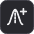 | **Пики** (Peaks): при включении позволяет вручную добавлять начальные приближения пиков, щёлкая непосредственно по спектрам. |
| 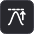 | **Normalization**: отображает выбранные спектры, нормированные на интенсивность их максимального пика. Введите значения в поля «min» и «max», чтобы выполнить нормировку по конкретному спектральному диапазону. 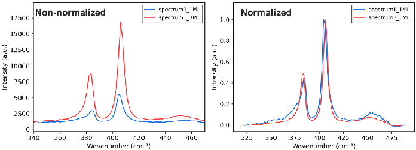 *Исходные спектры (слева) и нормированные спектры (справа) — крайне полезно для выявления тонких сдвигов пиков.* |
|  | **Show Bestfit**: включает или отключает отображение аппроксимирующей кривой (кривых). |
|  | **Legend**: включает или отключает отображение блока легенды (или цветовой шкалы, если включён параметр **Цветовая шкала вместо легенды** (Show colorbar instead of legend)). При отображении внутри холста блок легенды закрепляется в правом верхнем углу (`upper right`), чтобы не перекрывать спектры с меньшей интенсивностью (либо может быть вынесен за пределы холста рядом с ним через параметр **Вынести легенду наружу** (Move legend box outside) в меню **Доп. настройки** (More Options)). Дважды щёлкните в любом месте внутри легенды, чтобы в одном диалоговом окне изменить палитру, максимальное число отображаемых записей, а также цвета и подписи спектров. Изменения применяются кнопкой **OK** или отменяются кнопкой **Отмена** (Cancel). Для сохранения отзывчивости интерфейса выборки в рабочих областях **Спектры** (Spectra) и **Карты** (Maps) редактируются пакетами до 100 спектров; сузьте выборку, чтобы отредактировать спектры вне текущего пакета. |
|  | **Plot Heatmap**: расположена в правой части панели инструментов непосредственно слева от кнопок **Доп. настройки** и **Копировать** (Copy); переключает режим визуализации в виде 2D-тепловой карты интенсивности для нескольких выбранных спектров. Отображает непрерывную эволюцию спектральной интенсивности с отдельным выбором оси Y, пользовательской подписью и настройкой разрешения прямо на панели инструментов. |
|  | **3D View**: расположена между кнопками **Plot Heatmap** и **Доп. настройки** в правой части панели инструментов; включает интерактивный режим 3D-визуализации для выбранных спектров. Зажмите левую кнопку мыши и перетаскивайте курсор для вращения углов обзора, среднюю кнопку — для панорамирования, правую кнопку или колесо прокрутки — для масштабирования, а нажатие **Rescale** (`Ctrl + R`) сбрасывает угол камеры и пределы осей. |
|  | **Доп. настройки**: расположена в правой части панели инструментов (перед кнопкой **Копировать**); открывает компактную двухколоночную панель конфигурации, позволяющую настраивать единицы X/Y, переключать логарифмические шкалы, менять стили построения, выбирать дискретные или градиентные цветовые палитры спектров по наглядным цветовым полосам-превью, задавать максимальное число элементов легенды (15 по умолчанию), включать **Вынести легенду наружу** для размещения легенды рядом с холстом без перекрытия спектров, включать **Цветовая шкала вместо легенды** (при установке флажка динамически появляются поля **Параметр шкалы** (Colorbar parameter) для выбора `Index` или числового токена из имени файла и **Подпись шкалы** (Colorbar label)), чтобы отобразить справа цветовую шкалу для упорядоченной серии спектров, переключать видимость кривых **Исходные** (Raw) / **Невязка** (Residual), включать сетку, регулировать толщину линий и задавать точные размеры рисунка. 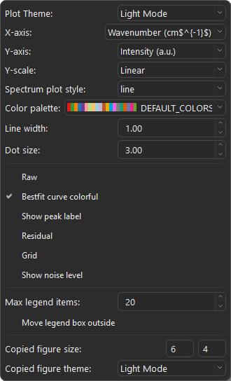 |
|  | **Копировать**: расположена на правом краю панели инструментов; копирует график в буфер обмена в виде высококачественного изображения. Используйте `Ctrl + Click` (или `Cmd + Click` в macOS), чтобы вместо изображения скопировать в буфер обмена исходные числовые данные графика. |
|  | **Масштаб Y (Линейный / Log)** (Y-Scale): расположена в верхней части правой вертикальной панели инструментов прямо над кнопкой удаления космических выбросов; переключает ось Y спектра между **Линейный** (по умолчанию, отжата) и **Log** (нажата). Синхронизируется со списком **Масштаб Y** (Y-scale) в меню **Доп. настройки** (More Options). |

#### **3.3. Пакетный редактор легенды** { #33-batch-legend-editor }

Отобразите легенду кнопкой **Legend** на панели инструментов, затем **дважды щёлкните в любом месте внутри блока легенды**, чтобы открыть пакетный редактор. Это заменяет прежний процесс работы, в котором приходилось открывать отдельное окно для каждой подписи или цвета.

В верхней части диалогового окна расположены два элемента управления для всего графика:

- **Цветовая палитра** (Color palette): выберите палитру по её визуальному превью в виде цветовой полосы. Среди дискретных вариантов доступны 20-цветная `DEFAULT_COLORS`, `tab20`, `tab20b`, `tab20c`, `Dark2`, `Paired` и `Accent`. Среди градиентных вариантов доступны `viridis`, `plasma`, `jet`, `cividis` и `magma`.
- **Макс. элементов легенды** (Max legend items): задаёт число записей, отображаемых в легенде графика. Значение по умолчанию — 15. Этот параметр не удаляет спектры с графика.

Таблица спектров содержит по одной строке для каждого редактируемого спектра:

- **Спектр** (Spectrum) указывает исходный спектр или имя файла.
- **Цвет** (Color) выбирает образец цвета из активной палитры. **Автоматически** (Automatic) сохраняет привязку спектра к цвету, назначенному палитрой; выбор конкретного оттенка создаёт индивидуальное переопределение для этого спектра. Используйте **Больше цветов…** (More colors…), чтобы выбрать цвет вне палитры.
- **Подпись** (Label) изменяет текст, отображаемый в легенде. Очистка пользовательской подписи восстанавливает имя файла спектра.

Смена палитры обновляет все превью цвета со значением **Автоматически**, сохраняя цвета, выбранные вручную. Нажмите **OK**, чтобы применить все изменения сразу, или **Отмена**, чтобы отменить все правки, внесённые в диалоге. Принятые подписи и цвета записываются обратно в базовые объекты спектров, благодаря чему список спектров, рабочая область **Спектры**, рабочая область **Карты** и сохранённые данные рабочей области остаются синхронизированными.

!!! note "Пакеты редактирования по 100 спектров"
    Для сохранения отзывчивости интерфейса при больших выборках диалоговое окно создаёт редакторы максимум для первых **100 отображаемых спектров** как в рабочей области **Спектры**, так и в рабочей области **Карты**. Если выборка больше, диалог сообщает **«показано 100 из N»** («showing 100 of N»). Спектры за пределами отображаемого пакета не изменяются. Сузьте текущую выборку, чтобы отредактировать другую группу.

#### **3.4. Режим визуализации тепловой карты** { #34-heatmap-visualization-mode }

Инструмент **Heatmap Plot** преобразует несколько построенных на графике спектров в непрерывную 2D-карту интенсивности. Этот режим особенно эффективен при анализе серий данных, таких как температурные профили *in situ*, временна́я кинетика, пространственные линейные сканы или градиенты состава.

  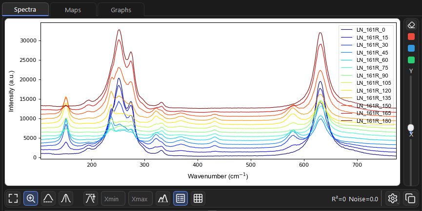 

  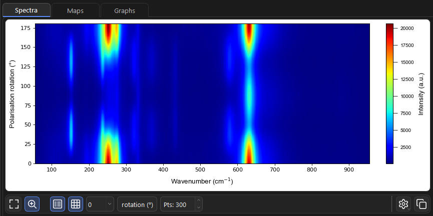 
  <i><code>SpectraViewer</code> в режиме визуализации тепловой карты, отображающий непрерывную 2D-карту интенсивности по температурной серии in situ.</i>

##### **Основные элементы управления и параметры** { #key-controls-and-parameters }

Когда режим тепловой карты активирован, специализированные элементы управления появляются непосредственно на главной панели инструментов, а несовместимые 1D-инструменты (такие как маркеры пиков, опорные точки базовой линии, инструмент удаления космических выбросов и поля нормировки) автоматически скрываются:

- **Переключатель тепловой карты** (): включает или отключает построение 2D-тепловой карты. Отключение этой кнопки мгновенно восстанавливает стандартные 1D-кривые спектров и возвращает все стандартные инструменты панели.
- **Выпадающий список параметра оси Y**:
  - **`Index`**: равномерно укладывает спектры вдоль вертикальной оси в соответствии с порядком выбора (`0, 1, 2, ...`).
  - **Токены имён файлов**: автоматически извлекает числовые параметры, встроенные в имена файлов и разделённые подчёркиваниями (`_`) (например, файлы `sample_25°C.txt`, `sample_100°C.txt`, `sample_200°C.txt` автоматически формируют токены вроде `25°C`, извлекая соответствующие числовые значения `25, 100, 200` в качестве физических координат Y).
- **Пользовательская подпись оси Y**: текстовое поле для переопределения автоматического заголовка вертикальной оси (например, `Temperature (°C)`, `Time (min)` или `Position (µm)`).
- **Число точек интерполяции по оси Y (`Pts:`)**: задаёт количество интерполированных вертикальных срезов (по умолчанию `300` точек) с использованием гладкой интерполяции. Установка значения `0` отключает интерполяцию и отображает исходные дискретные строки.
- **Цветовая палитра интенсивности**: использует активную цветовую палитру, выбранную в разделе **Доп. настройки** (например, `jet`, `viridis`, `plasma`).

#### **3.5. Интерактивный режим 3D-визуализации** { #35-interactive-3d-visualization-mode }

Кнопка **3D View** (), расположенная в правой части панели инструментов между **Plot Heatmap** и **Доп. настройки**, отображает выбранные спектры в интерактивном 3D-пространстве (спектральная ось по **X**, индекс серии или параметр из имени файла по **Y** и интенсивность по **Z**):

- **Интерактивное управление камерой**:
  - **Вращение**: зажмите левую кнопку мыши и перетаскивайте в любом месте 3D-графика для свободного изменения углов возвышения и азимута.
  - **Панорамирование / Масштабирование**: зажмите среднюю кнопку мыши и перетащите для сдвига; зажмите правую кнопку мыши и перетащите (или используйте колесо прокрутки мыши) для масштабирования вдоль оси интенсивности.
  - **Сбросить вид**: нажмите **Rescale** (`Ctrl + R`), чтобы восстановить угол камеры по умолчанию и подогнать пределы по всем данным.
- **Общие элементы управления осью серий**: выберите `Index` или любой числовой параметр, извлечённый из имён файлов (например, `25°C`, `100°C`), в выпадающем списке на панели инструментов и при необходимости задайте пользовательскую подпись оси Y.
- **Совместимые параметры**: без проблем работает с **Normalization**, **Show Bestfit**, режимами **Legend / Colorbar**, стилями **Линия** (Line) / **Точка** (Dot), наложением **Исходные**, **Сетка** (Grid), шкалой Z **Линейный** / **Log**, темами графика **Светлая** (Light) / **Тёмная** (Dark) и **Копировать** в буфер обмена. Переключение между обычным режимом, **Plot Heatmap** и **3D View** автоматически восстанавливает соответствующие инструменты панели.

#### **3.6. Интерактивные селекторы спектральных диапазонов и Live-карты (рабочие области `Spectra` и `Maps`)** { #36-interactive-spectral-range-selectors-live-maps-spectra-maps-workspaces }

В обеих рабочих областях — **Спектры** и **Карты** — можно интерактивно выделить рамками до трёх спектральных областей в `SpectraViewer` и наблюдать за их изменением в реальном времени на специализированной вкладке **Live-карты**:

  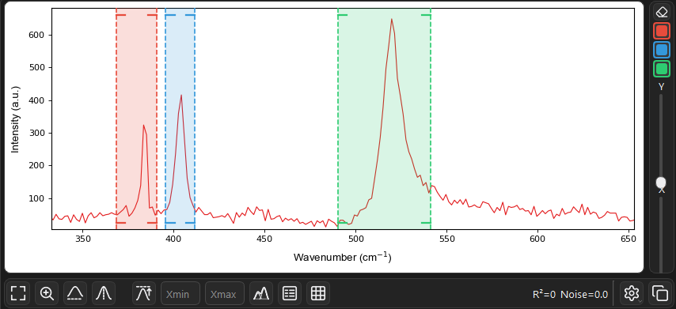 

- **Рабочая область `Spectra`**: отображает до трёх **1D-графиков изменения параметров** с цветовым кодированием (Красный, Синий, Зелёный) по **текущим выбранным спектрам** в `SpectraList`, позволяя быстро оценить, как интенсивность, положение, высота или площадь пика меняются по серии выбранных спектров.

  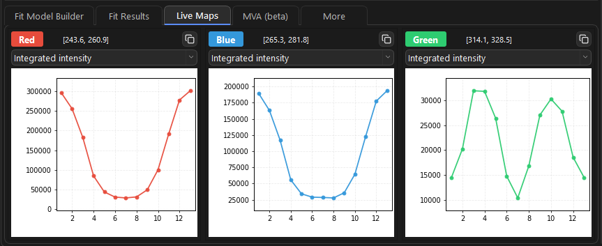 

- **Рабочая область `Maps`**: автоматически адаптируется к пространственной размерности выбранной карты:
  - **2D-карты**: отображает до трёх **пространственных 2D-тепловых карт** в реальном времени по активной гиперспектральной сетке.
  - **1D-карты (профили / линейные сканы)**: автоматически распознаёт коллинеарные координаты измерений и отображает Красный, Синий и Зелёный каналы в виде **1D-линейных графиков** вдоль пространственной оси (`X (mm)`, `Y (mm)` или `Distance (mm)`), плавно переключаясь между тепловыми картами и графиками профилей при выборе разных карт.

  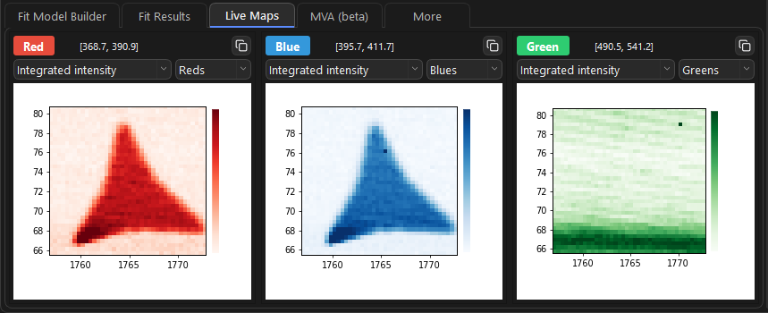 

##### **Управление селекторами диапазонов (`SpectraViewer`)** { #range-selector-controls-spectra-viewer }

Вертикальная панель инструментов на правом краю `SpectraViewer` предоставляет три независимые цветные кнопки-переключателя:

- **Красный** (Red) (`R`)
- **Синий** (Blue) (`B`)
- **Зелёный** (Green) (`G`)

Каждая кнопка активирует соответствующую пару перетаскиваемых вертикальных маркеров (границы и затенённый интервал) непосредственно на графике спектра и автоматически переключает нижнюю панель вкладок на вкладку **Live-карты**:

- **Интерактивное перетаскивание**: нажмите и перетащите любую из двух вертикальных ограничительных линий, чтобы изменить минимальное или максимальное волновое число. Нажмите и перетащите затенённую центральную область, чтобы сдвинуть весь интервал целиком без изменения его ширины.
- **Несколько диапазонов одновременно**: можно одновременно активировать любую комбинацию из трёх селекторов. Каждый из них независимо сохраняет свой цвет, интервал и видимость.
- **Корректность автомасштабирования**: маркеры селекторов диапазона не расширяют и не засоряют границы автоматического масштабирования спектра, поэтому кнопка **Rescale** (`Ctrl+R`) всегда масштабирует график точно по загруженным спектральным данным.
- **Автоматическое ограничение диапазона**: при обрезке спектра или загрузке новых спектральных данных селекторы диапазонов автоматически ограничиваются и перемещаются в пределы видимой области спектра.
- **Обновление в реальном времени**: перемещение любого селектора или изменение выбранных спектров/карт мгновенно пересчитывает и обновляет соответствующий 1D-график изменения параметра (в **рабочей области «Спектры»**) либо 2D-тепловую карту / 1D-график профиля (в **рабочей области «Карты»**) всякий раз, когда открыта вкладка **Live-карты** (с адаптивной задержкой 60–250 ms для плавного перетаскивания на больших наборах данных). Снятые с отметки спектры в текущей карте или списке спектров автоматически маскируются, чтобы исключённые выбросы не искажали цветовые шкалы или профили.
- **Множественный выбор и сравнение карт (рабочая область `Maps`)**: используйте `Ctrl+Click` или `Shift+Click` в списке **Карты**, чтобы выбрать несколько карт одновременно, сохраняя вашу **Основную карту** (*Primary Map*) активной для предобработки, аппроксимации и просмотра в `MapViewer`:
  - **Сравнение нескольких 1D-профилей**: когда основная карта представляет собой 1D-линейный скан, все выбранные 1D-профили накладываются друг на друга в каждой подпанели канала с одинаковой толщиной линий (переключите кнопку **Legend**, чтобы различать отдельные кривые на холсте).
  - **Переключение между выбранными 2D-картами**: когда основная карта является 2D-картой, в заголовке **Live-карт** появляется компактный переключатель `◀ [2D Map Selector] ▶`, позволяющий пролистывать выбранные 2D-тепловые карты без потери выделения.
  - **Пакетное удаление**: нажатие клавиши **Delete** (или кнопки **Удалить** (Delete)) при выборе нескольких карт запрашивает подтверждение перед совместным удалением всех выбранных карт.
  - **Пакетный экспорт**: нажатие кнопки **Save** при выборе одной или нескольких карт открывает окно выбора папки и экспортирует каждую выбранную карту в отдельный файл `.csv` в этой папке.

##### **Визуализация и подпанели вкладки Live-карты** { #live-maps-tab-visualization-subpanels }

Вкладка **Live-карты** расположена на нижней панели вкладок между **Результаты аппроксимации** (Fit Results) и **MVA** (а вкладка **Ещё** (More) размещена в конце списка вкладок).

- **Отображение подпанелей**: когда активен один или несколько селекторов диапазона, соответствующие им панели (**Красный**, **Синий**, **Зелёный**) отображаются рядом друг с другом. Если ни один селектор не включён, информационное сообщение подсказывает активировать кнопку селектора на правом краю `SpectraViewer`.
- **Поддерживаемые спектральные параметры**: для каждой подпанели в выпадающем списке можно выбрать, какой параметр извлекается и строится на графике:

| Параметр | Тип | Описание |
|----------|-----|----------|
| **Интегральная интенсивность** (Integrated intensity) | Прямой | Интеграл ($\sum Y \cdot \Delta x$) интенсивности по выбранному спектральному интервалу. |
| **Средняя интенсивность** (Mean intensity) | Прямой | Средняя интенсивность в пределах выбранного интервала. |
| **Максимальная интенсивность** (Maximum intensity) | Прямой | Наибольшее измеренное значение интенсивности в интервале. |
| **Положение пика** (Peak position) | Прямой | Волновое число, соответствующее максимальной интенсивности в интервале. |
| **Высота пика** (Peak height) | Прямой | Максимальная интенсивность за вычетом локальной базовой линии на границах интервала. |
| **Положение пика (аппрокс.)** (Peak position (fit)) | По аппроксимации | Центральное волновое число ($x_0$) подогнанного пика в интервале (требуется предварительная аппроксимация). |
| **Высота пика (аппрокс.)** (Peak height (fit)) | По аппроксимации | Подогнанная амплитуда ($A$) пика в интервале (требуется предварительная аппроксимация). |
| **Площадь пика (аппрокс.)** (Peak area (fit)) | По аппроксимации | Аналитически проинтегрированная площадь подогнанного пика (требуется предварительная аппроксимация). |
| **Отношение R/B** (R/B ratio) *(только Зелёный канал)* | Производный | Попиксельное (2D-карта) или поточечное (1D-профиль / серия спектров) отношение интегральных интенсивностей $I_{\mathrm{Red}} / I_{\mathrm{Blue}}$. Обновляется автоматически при перемещении или изменении размера красных или синих границ; нулевые или околонулевые значения синей интенсивности безопасно маскируются как `NaN`. Пока выбрано **Отношение R/B**, зелёная рамка автоматически скрывается на графике спектра, чтобы отображались только красная и синяя рамки, определяющие отношение (переключение обратно на любой другой параметр сразу восстанавливает зелёную рамку). |

*Примечание*: если выбран параметр по аппроксимации, но результаты аппроксимации ещё недоступны, панель аккуратно отображает информационный баннер вместо вводящих в заблуждение или некорректных значений.

##### **Интерактивный выбор спектров с RGB Live-карт *(рабочая область Maps)*** { #interactive-spectrum-selection-from-rgb-live-maps-maps-workspace }

При работе с 2D-картами или картами 1D-профилей в рабочей области **Карты** (когда инструменты **Pan** и **Масштаб** выключены) вы можете выбирать спектры прямо с любой подпанели (**Красный**, **Синий** или **Зелёный**), не покидая вкладку **Live-карты**:

- **Одиночный клик**: выбирает спектр, ближайший к точке щелчка, и сразу отображает его в `SpectraViewer`.
- **`Ctrl` + клик**: добавляет ещё один спектр к текущей выборке (или снимает выделение с уже выбранной точки).
- **Нажатие и перетаскивание**: рисует пунктирную рамку выделения, выбирая все спектры внутри области (`Ctrl` + перетаскивание добавляет спектры из рамки к существующей выборке).
- **Синхронизированная подсветка и переключение карт**: выбранные точки обводятся красным контуром на всех активных подпанелях RGB и синхронизируются с основным `MapViewer` и плавающими окнами `VMapViewerDialog`. Если вы переключились на другую 2D-карту с помощью элемента управления `◀ [2D Map] ▶` в заголовке, щелчок по точке на ней автоматически делает эту карту вашей основной картой и загружает её спектры. Щелчки внутри открытого блока легенды по-прежнему предназначены для перетаскивания легенды или редактирования подписей двойным щелчком.

##### **Элементы управления отдельных подпанелей** { #individual-subpanel-controls }

Каждая подпанель оснащена собственными элементами управления:

- **Rescale / Pan / Масштаб**: независимые кнопки навигации в заголовке каждой подпанели позволяют приближать области интереса, панорамировать по кривой или тепловой карте и возвращаться к полному диапазону графика, не затрагивая соседние каналы. Двойной щелчок по легенде по-прежнему открывает редактор легенды вместо сброса масштаба.
- **Нормировка 1D-кривых** *(1D-карты и 1D-линейные графики)*: включите кнопку нормировки рядом с выпадающим списком параметров (с необязательными границами `Xmin` и `Xmax`) в каждой RGB-подпанели, чтобы визуально нормировать каждую отображаемую 1D-кривую независимо к `1.0` по её глобальному максимуму или на интервале `[Xmin, Xmax]` без изменения исходных данных — идеальное решение для сравнения формы профилей на картах с разной амплитудой сигнала.
- **Palette** *(2D-тепловые карты в рабочей области «Карты»)*: выберите любую стандартную цветовую палитру (например, `viridis`, `plasma`, `inferno`, `jet`, `turbo`, `coolwarm`, `cividis`, `magma`, `Reds`, `Blues`, `Greens`). В **рабочей области «Спектры»** каждая 1D-кривая изменения параметра автоматически оформляется в цвете соответствующего селектора (Красный, Синий или Зелёный).
- **Копировать**: копирует рисунок подпанели в буфер обмена с настроенными параметрами **Размер копируемого рисунка** (Copied figure size) и **Тема копируемого рисунка** (Copied figure theme) (независимо от текущего размера окна SPECTROview). Удерживайте **`Ctrl` + клик** (или **`Cmd` + клик** в macOS), чтобы вместо изображения скопировать в буфер обмена исходный числовой набор данных этого графика в виде столбцов с разделителем-табуляцией (1D-серия изменений, таблицы одиночных/нескольких 1D-профилей или точки 2D-карты `(X, Y, Value)`).
- **Значок диапазона / состояния**: отображает текущий интервал $[x_{min}, x_{max}]$ или статус аппроксимации.

##### **Параметры отображения Live-карт и настройка легенды** { #live-maps-view-options-legend-customization }

Когда активен один или несколько селекторов, в правом верхнем углу вкладки **Live-карты** появляются два быстрых элемента управления:

- **Show / Hide Legend (`btn_legend`)**: включает или скрывает интерактивные легенды холста на 1D-подпанелях. Легенды можно перетаскивать мышью прямо на графике, а двойной щелчок по блоку легенды позволяет настроить её подписи и цвета.
- **Дополнительные настройки вида** (`⋯`, More View Options): открывает компактное двухколоночное меню с интервалами, аналогичными `SpectraViewer` (все настройки синхронизируются между рабочими областями **Спектры** и **Карты** и автоматически сохраняются для последующих запусков):
  - **Тема графика** (Plot Theme): переключает рисунки Live-карт между режимами **Светлый режим** (Light Mode) (белый холст, по умолчанию) и **Тёмный режим** (Dark Mode) независимо от глобальной темы оформления приложения.
  - **Шкалы осей и цвета**: переключает **Масштаб X** (X-scale), **Масштаб Y** (Y-scale) и **Цветовая шкала (Z)** (Color (Z) scale) между **Линейный** и **Log** (для неположительных областей выполняется безопасный автоматический возврат к линейной шкале).
  - **Стиль построения и размеры**: переключает 1D-кривые между стилями **Линия**, **Линия + точки** (Line + Dots) и **Точка**, а также настраивает **Толщина** (Line width) (по умолчанию `1.5`), **Размер точки** (Dot size) (по умолчанию `1.5`) и **Размер текста** (Text size) графика (`6–24 pt`, масштабирующий заголовки осей, подписи, деления и подписи цветовой шкалы).
  - **Размер и тема копируемого рисунка**: задаёт фиксированные размеры рисунка для буфера обмена в дюймах (**Размер копируемого рисунка**, по умолчанию `5.5` × `4.0`) и выбирает **Тема копируемого рисунка** (**Светлый режим** по умолчанию или **Тёмный режим**), чтобы скопированные рисунки сохраняли постоянные пропорции и читаемый размер текста независимо от изменения размера окна.
  - **Параметры блока легенды**: включает/отключает видимость легенды, изменяет **Положение легенды** (Legend location) (`best`, углы, `outside right`, `outside top`), **Столбцов легенды** (Legend columns), **Шрифт легенды** (Legend font size) или открывает **Изменить подписи легенды...** (Edit legend labels...) для переименования серий и выбора пользовательских цветов прямо на легенде холста.
  - **Средства отображения и сравнения**: показывает или скрывает заголовок **Показывать заголовок рисунка** (Show figure label) над каждым RGB-холстом (по умолчанию выкл.), переключает **Сетка** (Show grid) (по умолчанию выкл.), синхронизирует пределы по оси Y между панелями через **Общая ось Y (1D)** (Share Y-axis (1D)), включает билинейное **Сглаживание карты** (Heatmap smoothing), показывает/скрывает **Показывать цветовые шкалы** (Colorbars) или сбрасывает настройки с помощью **Сбросить параметры вида** (Reset view options).

_______

### **4. `FitModelBuilder`** { #4-fitmodelbuilder }

На вкладке `FitModelBuilder` выполняется настройка моделей спектральной аппроксимации. Она разделена на три основные панели: `Fitting`, `PeakTable` и `FitModelControl`, каждая из которых подробно описана в следующих разделах.

Вы можете использовать глобальные параметры аппроксимации или настроить параметры аппроксимации в панели `Settings Panel` (подробнее см. в разделе «Настройки»).

  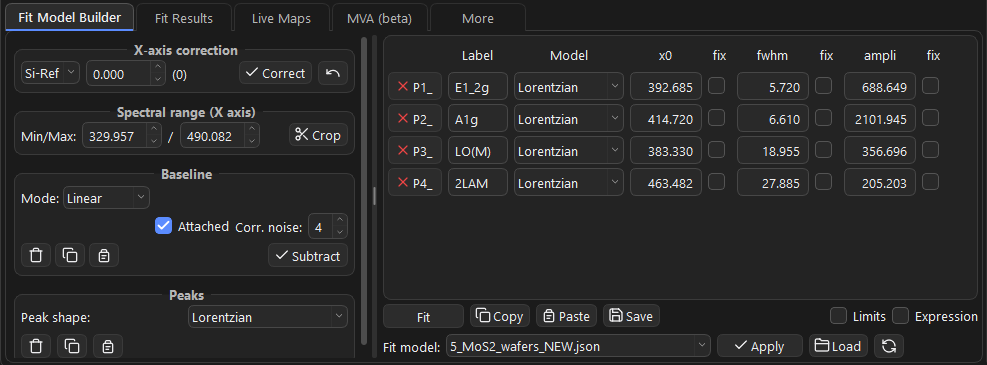 
  <i>Вкладка <code>FitModelBuilder</code>: (1) панель <code>Fitting</code> (слева), (2) панель <code>PeakTable</code> (справа вверху) и (3) панель <code>FitModelControl</code> (справа внизу).</i>

#### **4.1. Панель `Fitting`** { #41-fitting-panel }

Панель `Fitting` последовательно проводит вас через процесс построения надёжной модели в четыре логических шага:

**Шаг 1: Коррекция оси X (необязательно)**: выполните эмпирическую коррекцию оси X на основе измерений известного эталонного образца (например, пика кремния ровно на 520.7 cm⁻¹). Просто аппроксимируйте эталонный спектр, введите теоретически точное положение и примените сдвиг для глобальной коррекции калибровочного смещения.

**Шаг 2: Определение диапазона аппроксимации**: ограничьте математический процесс аппроксимации конкретной областью интереса по оси X.

**Шаг 3: Задание базовой линии**: **SPECTROview** предлагает два различных режима задания спектральной базовой линии (`Manual` или `Auto`):

  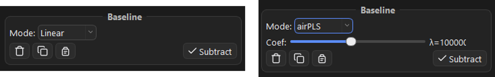 
   <i>Выбор режима базовой линии: режим Manual (слева) и режим Auto (справа).</i>

- **Режим Manual (`Linear` или `Polynomial`)**: задавайте опорные точки базовой линии, щёлкая непосредственно в `SpectraViewer`. Установите флажок **Привязка** (Attached), чтобы автоматически привязывать поставленные точки к ближайшей кривой данных. Установите флажок *Correct noise*, чтобы вычислять интенсивность точки как локальное среднее соседних точек данных — это делает расстановку опорных точек устойчивой к высокому уровню шума.
- **Режим Auto**: автоматическое построение кривой базовой линии с помощью передовых алгоритмов. Используйте ползунок для тонкой настройки агрессивности алгоритма:
  - **`arPLS`**: Asymmetrically Reweighted PLS. Эталонный алгоритм для типичных рамановских и ИК-базовых линий.
  - **`airPLS`**: высокоагрессивный алгоритм, отлично подходящий для удаления сильного и сложного фона флуоресценции. Настоятельно рекомендуется и проверен для данных рамановской спектроскопии.
  - **`AsLS`**: очень стабильный алгоритм, хотя иногда он может затрудняться в различении шума и широких пиков. Лучше всего подходит для относительно чистых спектров.
  - **`ModPoly`**: модифицированный полином (Modified Polynomial). Чрезвычайно популярен и эффективен для простого полиномиального фона флуоресценции.

**Шаг 4: Задание пиков**:

- Добавляйте пики непосредственно в `SpectraViewer` щелчком левой кнопки мыши (убедитесь, что кнопка-переключатель **Пик** активна). Вы можете интерактивно корректировать их начальные приближения, перетаскивая их мышью.
- Каждый добавленный на график пик сразу же заносится в таблицу **`PeakTable`**.
- Поддерживаются следующие профили пиков: `Lorentzian`, `Gaussian`, `PseudoVoigt`, `LorentzianAsym`, `GaussianAsym`, `Fano`, `DecaySingleExp` и `DecayBiExp`.
- Используйте выпадающий список **Профиль пиков** (Peak profile:) в группе `Peaks`, чтобы напрямую переключаться между предустановками глобальных ограничений пиков (Raman, PL (eV), PL (nm), XRD и т. д.), или нажмите кнопку с шестерёнкой рядом с ним, чтобы сразу перейти к разделу **Глобальные ограничения пиков** (Global Peak Limits) в **Настройках фитинга** (Fit Settings).

#### **4.2. Поддерживаемые профили пиков** { #42-supported-peak-profiles }

Движок `VBF Engine` в **SPECTROview** предоставляет высокооптимизированные реализации следующих математических профилей пиков:

| Модель | Параметры | Формула |
|--------|-----------|---------|
| `Gaussian` | `ampli`, `fwhm`, `x0` | <i>a</i> &middot; exp(-4 ln(2) &middot; (x-x0)2 / w2) |
| `Lorentzian` | `ampli`, `fwhm`, `x0` | <i>a</i> / [1 + 4(x-x0)2 / w2] |
| `PseudoVoigt` | `ampli`, `fwhm`, `x0`, `alpha` | &alpha; &middot; G + (1-&alpha;) &middot; L |
| `GaussianAsym` | `ampli`, `fwhm_l`, `fwhm_r`, `x0` | Кусочно-заданная функция Гаусса с левой/правой `FWHM` |
| `LorentzianAsym` | `ampli`, `fwhm_l`, `fwhm_r`, `x0` | Кусочно-заданная функция Лоренца с левой/правой `FWHM` |
| `Fano` | `ampli`, `fwhm`, `x0`, `q` | <i>a</i> &middot; (q + &epsilon;)2 / (1 + &epsilon;2), &epsilon; = 2(x-x0)/w |
| `DecaySingleExp` | `A`, `tau`, `B` | <i>A</i> &middot; e-t/&tau; + B |
| `DecayBiExp` | `A1`, `tau1`, `A2`, `tau2`, `B` | <i>A</i>1 &middot; e-t/&tau;1 + <i>A</i>2 &middot; e-t/&tau;2 + B |

#### **4.3. Панель `PeakTable`** { #43-peaktable-panel }

`PeakTable` отображает все математические параметры заданных вами пиков. Когда вы перетаскиваете пик в области просмотра, эти свойства обновляются динамически.

**Динамическая индексация пиков**: каждый пик автоматически получает индексный суффикс (например, `_1`, `_2`), указывающий на порядок его создания. Когда вы добавляете, удаляете или переупорядочиваете пики, **SPECTROview** автоматически переиндексирует их для сохранения последовательной нумерации (например, при удалении пика 2 пик 3 становится новым пиком 2). Это гарантирует упорядоченность ваших выражений и результатов аппроксимации.

  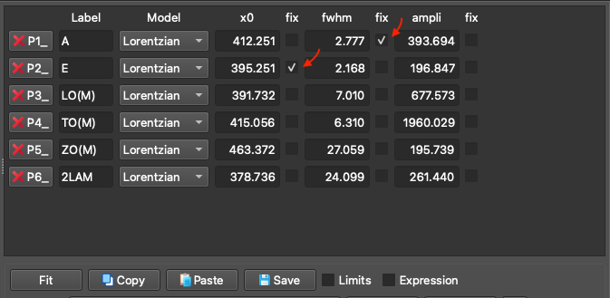 
   <i>Панель <code>PeakTable</code>, отображающая параметры пиков и ограничения.</i>

**Добавление ограничений для модели аппроксимации**:

**Фиксировать** (Fix): установите флажок «**фикс.**» (fix), чтобы заморозить значение параметра и запретить оптимизатору изменять его в процессе аппроксимации.

**Пределы** (Limits): введите минимальное и максимальное граничные значения, чтобы ограничить диапазон изменения параметра оптимизатором.

  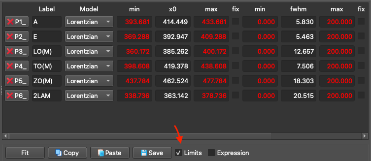 
   <i>Пример 1: Включите опцию «Пределы» (Limits) под таблицей пиков и задайте значения «min» и «max» для каждого параметра аппроксимации.</i>

**Выражение** (Expression): задайте сложные математические зависимости между параметрами. Движок `VBF Engine` в **SPECTROview** надёжно вычисляет эти выражения математически перед их передачей оптимизатору. Если пики переиндексируются вследствие удаления, ссылки на них в ваших математических выражениях обновляются автоматически, чтобы предотвратить поломку моделей.

  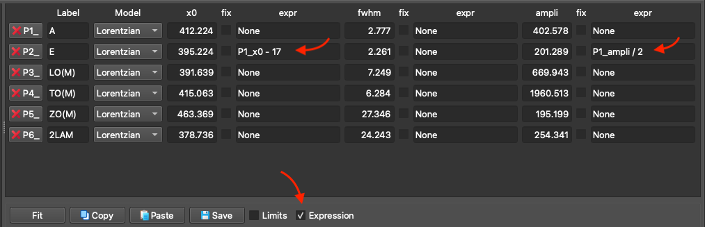 
   <i>Пример 2: Использование выражения для задания ограничения, при котором (1) положение пика E (P2) на 17 меньше положения пика A (P1), либо (2) амплитуда пика E (P2) составляет ровно половину амплитуды A (P1).</i>

#### **4.4. Панель `FitModelControl`** { #44-fitmodelcontrol-panel }

Когда модель полностью настроена, нажмите кнопку **Подгонка** (Fit), чтобы запустить оптимизацию.

  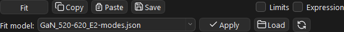 
   <i>Панель <code>FitModelControl</code>.</i>

**Копирование / вставка моделей аппроксимации**:
Полностью настроенную модель аппроксимации можно скопировать с одного спектра и вставить в другой, что упрощает перенос сложных конфигураций между отдельными файлами.

> - При выполнении действия **Вставить** (Paste) для модели движок всегда считывает *текущее* значение порога шума (Noise Threshold) из активной панели настроек. Это означает, что вы можете скопировать модель, скорректировать порог шума, а затем вставить её, применив модель с обновлёнными параметрами шума.

**Сохранение / загрузка моделей аппроксимации**:
Если вы планируете часто использовать модель, её можно сохранить как шаблон. Сохранённые модели легко выбирать и применять к новым наборам данных из выпадающего меню.

- **Выбор из выпадающего списка**: выберите любую существующую модель в выпадающем списке **Модель:** (`Fit model:`).
- **Загрузка с помощью кнопки**: нажмите кнопку **Загрузить** (Load), чтобы выбрать и загрузить любой файл шаблона модели аппроксимации `.json` из вашей файловой системы.
- **Перетаскивание (Drag & Drop)**: вы можете перетащить файл модели аппроксимации `.json` прямо на панель **Модель аппроксимации** (Fit Model Builder) или в любое место рабочей области **Спектры** или **Карты**. Файл мгновенно добавится в список моделей, будет выбран в выпадающем списке и готов к применению.
- **Применение модели**: нажмите **Применить** (Apply), чтобы назначить загруженную модель текущему выбранному спектру (или удерживайте **Ctrl** при нажатии **Применить**, чтобы назначить её всем спектрам).

> - Когда вы нажимаете **Сохранить** (Save), чтобы записать модель в файл `.json`, *текущий* порог шума (Noise Threshold) жёстко фиксируется в этом файле. Позже, когда вы используете **Применить** (**Загрузить**) для этой модели, движок аппроксимации строго использует именно тот порог шума, который сохранён в файле, игнорируя текущее значение в панели настроек.

_______

### **5. Сбор и сохранение результатов аппроксимации** { #5-collect-and-save-fit-results }

После завершения аппроксимации по всем спектрам или картам необходимо собрать наилучшие результаты:

- Перейдите на вкладку **Результаты аппроксимации**.
- Нажмите кнопку **Собрать результаты** (Collect). **SPECTROview** мгновенно объединит все оптимальные параметры аппроксимации в единую таблицу данных. Качество аппроксимации каждого спектра (**R2**, коэффициент детерминации) включается в виде столбца, поэтому его можно фильтровать или строить на графике (например, в виде тепловой карты R² в рабочей области `Maps`) так же, как любой подогнанный параметр. Вы можете щёлкнуть по заголовку любого столбца, чтобы выделить весь столбец, или протянуть курсор по нескольким заголовкам, чтобы выделить несколько столбцов для быстрого копирования в буфер обмена.

> **Настройка числа десятичных знаков**: количество знаков после запятой, отображаемых для числовых результатов (`x0`, `ampli`, `fwhm`, `area`, `R2`, …), задаётся счётчиком **Знаков после запятой** (Fit results decimals) в верхней части вкладки **Результаты аппроксимации**, непосредственно над кнопкой **Собрать результаты** (по умолчанию 3). Измените значение, а затем снова нажмите **Собрать результаты**, чтобы пересобрать таблицу с новой точностью. Эта настройка также применяется к вычисляемым столбцам (см. ниже). Столбцы координат X/Y всегда сохраняют полную точность.

  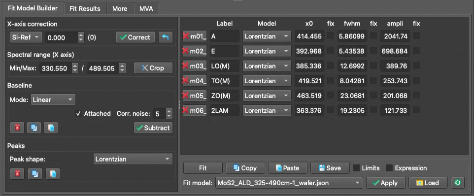 
   <i>Интерфейс сбора результатов аппроксимации и сводная таблица данных.</i>

#### **5.1. Извлечение полей из имён файлов** { #51-splitting-filename-features }

Этот инструмент позволяет автоматически извлекать метаданные, встроенные в имена файлов. Например, если ваши файлы названы `Sample1_ProcessA_Temp25`, инструмент может разбить имя файла по символам подчёркивания (`_`) и поместить извлечённые значения в отдельные новые столбцы вашего набора данных (см. видео выше).

#### **5.2. Вычисление и добавление новых столбцов** { #52-compute-and-add-new-columns }

Вы можете легко создавать новые столбцы на основе математических комбинаций существующих параметров аппроксимации (например, рассчитать сдвиг пика с помощью выражения `x0_p1 - x0_p2`).
Поддерживаемые математические операции: `+`, `-`, `*`, `/`, `**`, `%` и `()`. Вычисляемый столбец округляется до того же числа знаков **Знаков после запятой**, которое задано в верхней части вкладки.

> **Важное примечание**: если имена столбцов содержат пробелы или специальные символы, их необходимо заключить в обратные кавычки. Пример: `` `x0_LO(M)` ``

#### **5.3. Сохранение и визуализация** { #53-save-and-visualize }

После формирования итоговой таблицы данных вы можете:

- **Сохранить её под понятным именем**, а затем **отправить напрямую** в рабочую область **Графики** (Graphs) для немедленного построения графиков.

  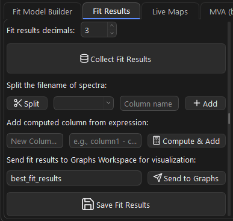 

 

- **Экспортировать её в таблицу Excel/CSV** для внешнего использования.

  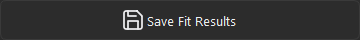 

### **6. Вкладка `More`** { #6-more-tab }

Вкладка `More` (**Ещё**) предоставляет доступ к вспомогательным инструментам и метаданным и разделена на три секции:

  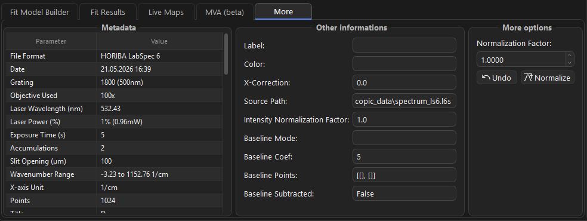 

- **Слева**: отображает подробные метаданные, извлечённые напрямую из загруженных файлов `.wdf`, `.spc`, `.l6s`, `.l6m`, `.ngs` или `.ngc`, показывая точные настройки прибора, использованные при регистрации спектра.
- **По центру**: отображает подробные свойства и статистическую информацию о текущем выбранном спектре.
- **Справа**: предоставляет доступ к дополнительным инструментам предобработки, таким как алгоритмы глобальной нормировки интенсивности и обнаружение артефактов космических лучей.
