## **工作区：光谱与二维图谱** { #workspace-spectra-and-maps }

`Maps` 与 `Spectra` 工作区采用统一的设计理念并共享众多核心功能。不过，`Maps` 工作区还专门针对大规模高光谱数据集的处理配备了专用工具。

  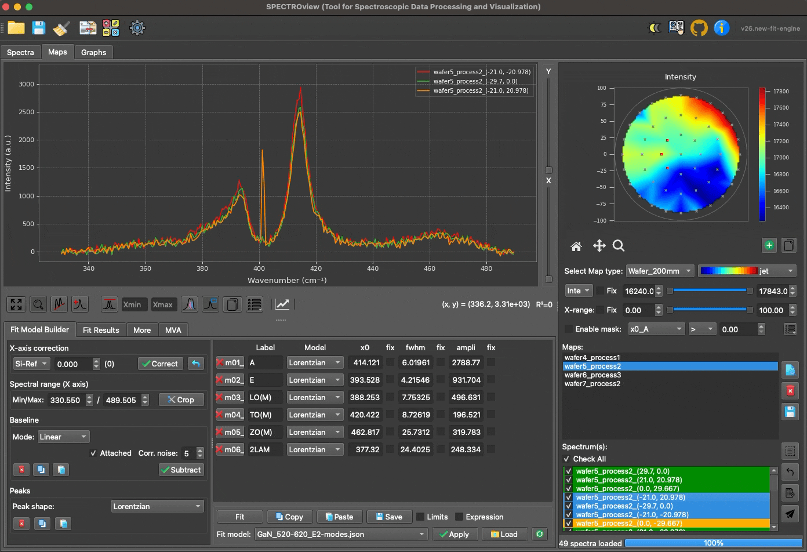 
  <i><code>Spectra</code> 和 <code>Maps</code> 工作区界面概览。两个界面均划分为三个主要区域：左上方的光谱视图（<code>SpectraViewer</code>）、左下方的拟合模型构建器（<code>FitModelBuilder</code>）以及右侧列表区（<code>SpectraList</code> / <code>MapList</code>）。</i>

_______

### **1. `MapList` 与 `MapViewer`** { #1-maplist-and-mapviewer }

`MapList` 与 `MapViewer` 是专为高效浏览与管理高光谱数据集而设计的组件。`MapList` 会列出所有已加载的二维图谱文件，包括晶圆图（wafer maps）与常规二维图谱。

`MapList` 旁边的操作按钮可用于：(1) 查看所选图谱的数据，(2) 从工作区中删除所选图谱，或 (3) 将所选图谱直接导出为 Excel 文件。

您可以通过 `MapList` 轻松在已加载的二维图谱之间切换，使用 `Ctrl+Click` 或 `Shift+Click` 多选图谱，并在列表中**拖放**一个或多个所选图谱来调整其排列顺序（这会更新**实时图谱** (Live Maps) 中的对比顺序，同时保持当前活动的主图谱不变）。选中的主图谱（Primary）会渲染在 `MapViewer` 中。打开或选中一幅图谱时，**系统会自动选中该图谱中的第一条光谱**并在热图上高亮标记，同时立即在 `SpectraViewer` 中绘制其光谱曲线，并同步基线、峰表与元数据。默认情况下，`MapViewer` 显示信号的**强度** (Intensity) 或**面积** (Area) 热图；如果该图谱已完成拟合，您还可以选择并可视化任意拟合参数的热图。

  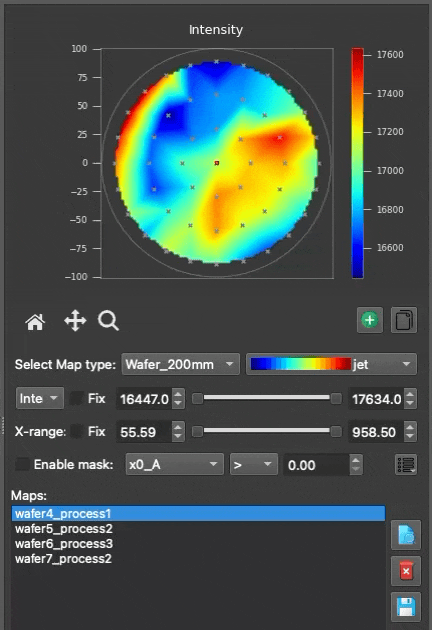 

- 双滑块可用于快速调节热图的光谱范围与数据数值范围。
- 导航工具栏控件（**Home / Rescale**、**Pan / Drag** 与**缩放** (Zoom)）配备了统一的 SPECTROview 矢量图标按钮，支持交互式浏览、平移以及局部放大图谱区域。
- 您可以同时打开多个 `MapViewer` 实例，以便对比不同的拟合参数。
- 选项菜单（`…`）中包含**色标刻度** (Color scale) 选择器，可将热图归一化方式在**线性** (Linear) 与**对数** (Log) 之间切换。当数值跨越多个数量级时，对数刻度尤为实用；若数据范围并非严格大于零，系统会自动回退至线性刻度。

  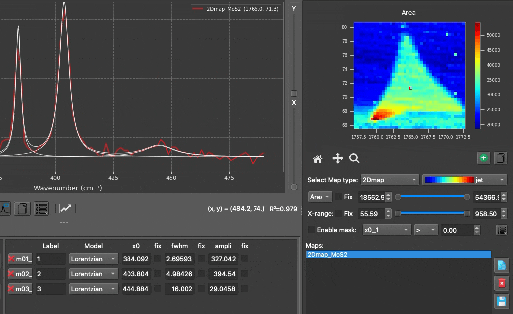 

**掩膜功能**：通过定义基于参数的自定义数值筛选条件，从热图中隔离提取特定目标区域。

  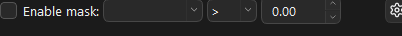

  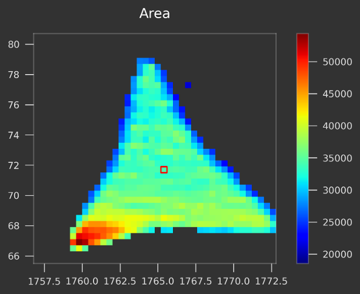 
  <i>二维图谱掩膜功能示例：通过设置掩膜条件（峰 A1g 强度 &gt; 40 a.u.），可将 MoS2 薄片从周围衬底背景中分离出来。</i>

_________

### **2. `SpectraList`** { #2-spectralist }

`SpectraList` 用于显示所有已加载的离散光谱（在 `Spectra` 工作区中），或当前所选图谱包含的全部光谱（在 `Maps` 工作区中）（如下图所示）。

您可以单选或多选光谱，所选光谱会立即在 `SpectraViewer` 中同步显示。专用按钮支持全选光谱、重置光谱、将所选数据保存为 TXT 文件，或将当前所选光谱发送至 `Spectra` 工作区进行独立分析。

  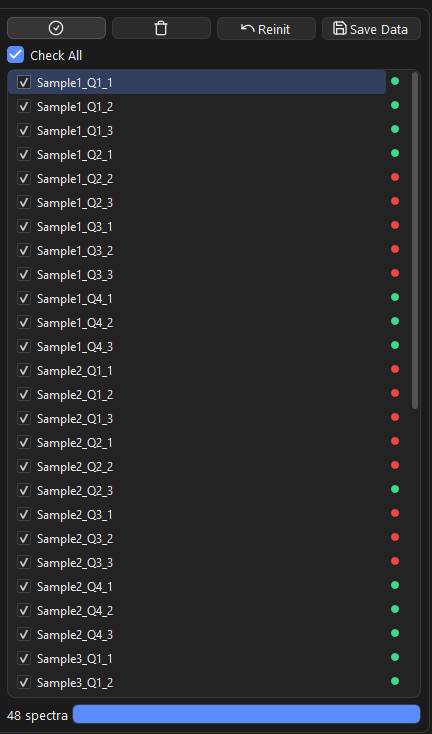 
  <i><code>Maps</code> 工作区中的 <code>SpectraList</code> 与进度条。</i>

**处理状态指示器**：每个条目右侧的小圆点指示灯直观展示了其当前处理状态（绿色表示拟合已收敛，红色表示拟合未收敛，蓝色表示已扣除基线，灰色表示已裁剪，透明/无圆点表示尚未修改的原始光谱）。

`SpectraList` 下方的**进度条**实时显示拟合进度（%）、已收敛光谱数量以及已用时间（s），并配有**停止** (Stop) 按钮，可随时安全中止正在进行的拟合任务。

#### **2.1. 跨工作区传输** { #21-cross-workspace-transfer }

当将所选光谱从 `Maps` 工作区发送至 `Spectra` 工作区时，系统会采用深拷贝（deep-copied）数据结构字典来传递数据，从而确保：

- 原始强度数组与坐标数组完好无损。
- `baseline_config`（包括锚点位置与计算模式）按当前配置原样传输。
- 完整的 `fit_model`（包括所有峰约束范围、表达式与初始猜测值）均得以保留。
- 当前生效的光谱裁剪边界与基线扣除状态保持一致。

这保证了传输后的光谱在新工作区标签页中保留完整的交互与分析状态，同时不会影响原始二维图谱。

_______

### **3. `SpectraViewer`** { #3-spectraviewer }

`SpectraViewer` 是核心绘图组件，用于可视化通过 `SpectraList` 选中的所有光谱（及其最佳拟合曲线）。

#### **3.1. `SpectraViewer` 鼠标交互控制** { #31-spectraviewer-with-interactive-mouse-controls }

  

- **显示峰参数**：将鼠标悬停在任意已拟合峰上，即可弹出工具提示，显示该峰的精确参数。
- **添加/删除峰**：启用工具栏中的**峰** (Peak) 按钮后，在谱图上左键点击可放置新的峰初始猜测，右键点击已有峰附近则可将其删除。
- **调整峰初始猜测**：在拟合前，可直接点击并拖动初始峰猜测的中心位置或峰宽以手动微调。
- **快速缩放 Y 轴**：滚动鼠标滚轮可快速放大或缩小 Y 轴显示范围。

#### **3.2. 工具栏按钮与视图选项** { #32-toolbar-buttons-and-view-options }

| 按钮 | 功能 |
|--------|----------|
|  | **Rescale**：自动调整坐标轴范围以适配当前数据。快捷键：`Ctrl + R`。 |
|  | **缩放**：开启后，可使用鼠标左键框选区域进行局部放大。 |
|  | **基线** (Baseline)：开启后，可直接点击光谱曲线手动设置 `baseline` 锚点。 |
|  | **峰** (Peaks)：开启后，可直接点击光谱曲线手动添加峰初始猜测。 |
|  | **Normalization**：将所选光谱按其最大峰强归一化后显示。在 “min” 和 “max” 输入框中填入数值，即可指定在特定光谱波段范围内进行归一化。 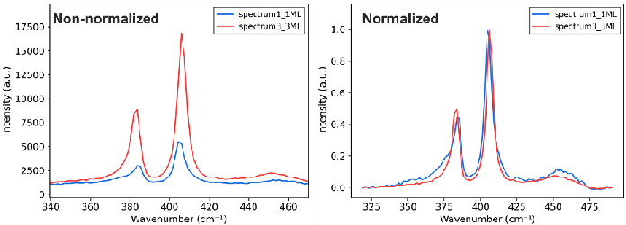 *原始光谱（左）与归一化光谱（右）对比 —— 非常适合用于观察细微的峰位偏移。* |
|  | **Show Bestfit**：开启或关闭最佳拟合曲线的显示。 |
|  | **Legend**：切换图例框的显示（若勾选了**显示色标代替图例** (Show colorbar instead of legend)，则切换色标显示）。当图例显示在画布内部时，默认固定在右上角（`upper right`）以避免遮挡低强度光谱（也可通过 **More Options** 中的**将图例移至图外** (Move legend box outside) 将其放置到画布外侧相邻位置）。在图例框内任意位置双击，即可在同一对话框中统一编辑调色板、最大显示条目数以及各光谱的颜色和标签。点击 **OK** 应用更改，或点击**取消** (Cancel) 放弃更改。为保证界面响应流畅，光谱与二维图谱工作区的选中光谱每次最多按 100 条分批编辑；如需编辑当前批次之外的光谱，请缩小选择范围。 |
|  | **Plot Heatmap**：位于工具栏右侧、紧邻 **More Options** 与**复制** (Copy) 左侧，用于将多条选中的光谱切换为二维强度热图模式。该模式可展现光谱强度的连续演变过程，并直接在工具栏提供 Y 轴参数选择、自定义轴标题以及分辨率控制。 |
|  | **3D View**：位于工具栏右侧 **Plot Heatmap** 与 **More Options** 之间，可将所选光谱切换为交互式三维可视化模式。按住左键拖动可旋转视角，按住中键拖动可平移视图，右键拖动或滚动滚轮可缩放，点击 **Rescale**（`Ctrl + R`）可重置相机视角与坐标轴范围。 |
|  | **More Options**：位于工具栏右侧（**复制**按钮之前），打开紧凑的双栏配置面板，可调整 X/Y 轴单位、切换对数刻度、更改绘图样式、通过直观的色带预览选择离散或渐变光谱调色板、设置图例最大条目数（默认 15）、勾选**将图例移至图外**使图例紧邻画布放置而不遮挡光谱、勾选**显示色标代替图例**（勾选后将动态显示**色标参数** (Colorbar parameter) 下拉框用于选择光谱 `Index` 或文件名中的数值字段，以及**色标标题** (Colorbar label) 输入框）以便为有序光谱系列在右侧显示色标、切换原始数据/残差 (Raw/Residual) 曲线的可见性、开启网格、调节线宽，以及设定精确的图像尺寸。 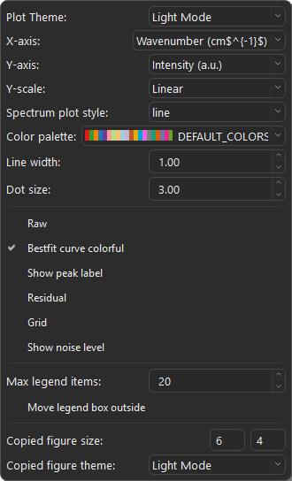 |
|  | **复制**：位于工具栏最右侧，可将当前图表以高质量图像形式复制到剪贴板。使用 `Ctrl + Click`（macOS 上为 `Cmd + Click`）则可将图表的原始数值数据复制到剪贴板。 |

#### **3.3. 批量图例编辑器** { #33-batch-legend-editor }

使用工具栏上的 **Legend** 按钮显示图例后，**在图例框内任意位置双击**即可打开批量图例编辑器。该工作流取代了以往需要为每个标签或颜色逐一打开独立对话框的繁琐操作。

对话框顶部包含两项作用于整张图表的全局控件：

- **调色板** (Color palette)：通过可视化色带预览选择调色板。离散调色板包括 20 色的 `DEFAULT_COLORS`、`tab20`、`tab20b`、`tab20c`、`Dark2`、`Paired` 与 `Accent`；渐变调色板包括 `viridis`、`plasma`、`jet`、`cividis` 与 `magma`。
- **图例最大条目数** (Max legend items)：设置图例中最多显示的条目数量（默认为 15）。该设置不会从图表中移除任何光谱。

光谱列表中每条可编辑光谱占一行：

- **光谱** (Spectrum) 显示原始光谱名称或文件名。
- **颜色** (Color) 可从当前调色板中挑选色块。选择**自动** (Automatic) 时，光谱颜色保持与调色板分配联动；选择具体色块则会为该光谱创建独立覆盖颜色。点击**更多颜色…** (More colors…) 可挑选调色板之外的自定义颜色。
- **标签** (Label) 用于修改图例中显示的文字。清空自定义标签即可恢复为光谱原始文件名。

切换调色板时，所有设为**自动**的颜色预览会自动更新，而手动指定的颜色则会保持不变。点击 **OK** 统一应用全部修改，或点击**取消**放弃对话框中的所有更改。确认后的标签与颜色会写回底层光谱对象，使光谱列表、光谱工作区、二维图谱工作区以及保存的工作区文件始终保持同步。

!!! note "每次最多编辑 100 条光谱"
    为确保大批量选中光谱时的界面流畅度，光谱与二维图谱工作区中的对话框最多仅为前 **100 条已绘光谱**创建编辑行。当所选数量超过此限制时，对话框会提示 **“显示 100 / N”** (**“showing 100 of N”**)。当前批次之外的光谱不会被修改；若需编辑其余光谱，请缩小当前选择范围。

#### **3.4. 热图可视化模式** { #34-heatmap-visualization-mode }

**Heatmap Plot** 工具可将多条已绘光谱转换为连续的二维强度分布图。该模式特别适合分析系列演化数据，例如原位变温实验谱图、时间分辨动力学过程、空间线扫描或组分梯度测试。

  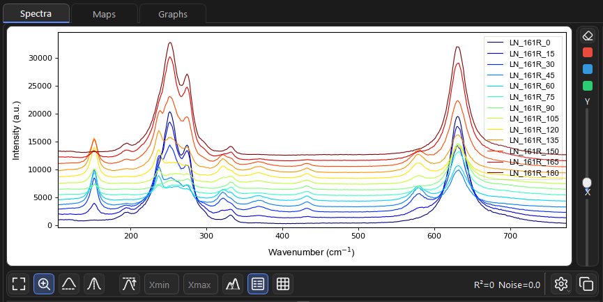 

  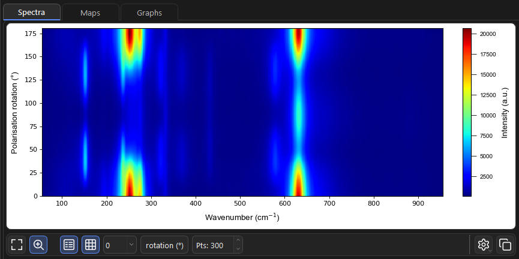 
  <i>处于热图可视化模式下的 <code>SpectraViewer</code>，展示了原位变温系列测试的连续二维强度分布图。</i>

##### **主要控件与参数** { #key-controls-and-parameters }

启用热图模式后，专用配置控件会直接出现在主工具栏上，同时不适用于该模式的一维工具（如峰标记、基线锚点、宇宙射线消除器以及归一化输入框）会自动隐藏：

- **热图切换开关** ()：启用或关闭二维热图渲染。取消勾选此按钮可立即恢复标准一维光谱曲线并重新显示所有常规工具栏工具。
- **Y 轴参数下拉框**：
  - **`Index`**：按照光谱选择顺序（`0, 1, 2, ...`）沿纵轴均匀堆叠光谱。
  - **文件名字段（Tokens）**：自动解析文件名中以下划线分隔的数值参数（例如 `sample_25°C.txt`、`sample_100°C.txt`、`sample_200°C.txt` 会自动提取 `25°C` 等字段，并解析出对应数值 `25, 100, 200` 作为物理 Y 轴坐标）。
- **自定义 Y 轴标题**：用于覆盖自动生成的纵轴标题（例如 `Temperature (°C)`、`Time (min)` 或 `Position (µm)`）。
- **Y 轴插值点数（`Pts:`）**：指定用于平滑插值渲染的纵向插值切片数（默认 `300` 点）。将该值设为 `0` 可禁用插值，直接显示原始离散光谱行。
- **强度色标**：遵循在 **More Options** 中所选的当前调色板（例如 `jet`、`viridis`、`plasma`）。

#### **3.5. 交互式 3D 可视化模式** { #35-interactive-3d-visualization-mode }

位于工具栏右侧 **Plot Heatmap** 与 **More Options** 之间的 **3D View** 按钮 () 可在交互式三维空间中展示所选光谱（**X** 轴为光谱轴，**Y** 轴为序列索引或文件名参数，**Z** 轴为强度）：

- **交互式相机导航**：
  - **旋转**：在 3D 图表任意位置按住鼠标左键拖动，即可自由旋转俯仰角与方位角。
  - **平移 / 缩放**：按住鼠标中键拖动可平移视图；按住鼠标右键拖动（或滚动鼠标滚轮）可沿强度轴方向缩放。
  - **重置视角**：点击 **Rescale**（`Ctrl + R`）可恢复默认相机角度并自适应全部数据边界。
- **共享序列轴控件**：从工具栏下拉菜单中选择 `Index` 或从文件名解析出的任意数值参数（如 `25°C`、`100°C`），并可按需设置自定义 Y 轴标题。
- **兼容选项**：可与 **Normalization**、**Show Bestfit**、**Legend / Colorbar** 模式、**折线图 / 点** (Line / Dot) 绘图样式、**原始数据** (Raw) 叠加显示、**网格** (Grid)、Z 轴**线性 / 对数**刻度、**浅色 / 深色** (Light / Dark) 主题以及**复制**到剪贴板等功能无缝配合。在标准视图、**Plot Heatmap** 与 **3D View** 之间切换时，系统会自动恢复对应的工具栏工具。

#### **3.6. 交互式光谱波段选择器与实时图谱（光谱与二维图谱工作区）** { #36-interactive-spectral-range-selectors-live-maps-spectra-maps-workspaces }

在**光谱** (Spectra) 和**二维图谱** (Maps) 两个工作区中，您均可在 `SpectraViewer` 内交互式框选最多三个光谱特征波段，并在专属的**实时图谱**标签页中实时观察它们的变化趋势：

  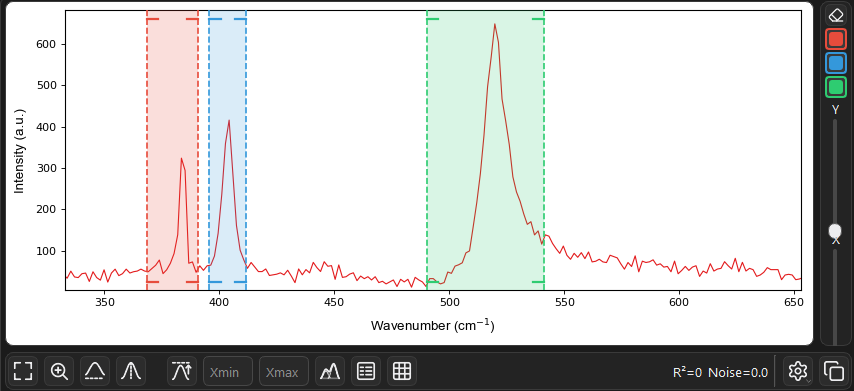 

- **光谱工作区**：针对 `SpectraList` 中**当前选中的光谱**，绘制最多三条颜色编码（红、蓝、绿）的**一维参数变化曲线**，便于快速对比不同光谱间峰强、峰位、峰高或峰面积的演变规律。

  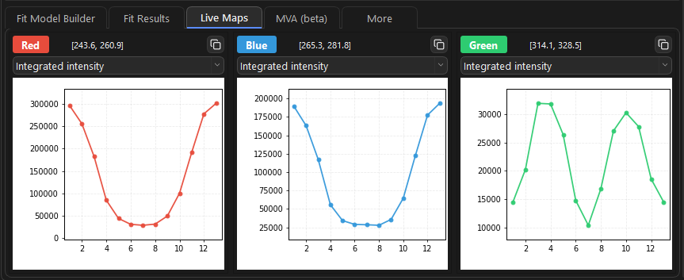 

- **二维图谱工作区**：自动适应当前所选图谱的空间维度：
  - **二维图谱**：在当前激活的高光谱网格上实时显示最多三幅**二维空间热图**。
  - **一维图谱（剖面 / 线扫描）**：自动检测共线测量坐标，并将红、蓝、绿通道沿空间坐标轴（`X (mm)`、`Y (mm)` 或 `Distance (mm)`）绘制为**一维折线图**；切换不同图谱时，界面会在热图与剖面折线图之间无缝切换。

  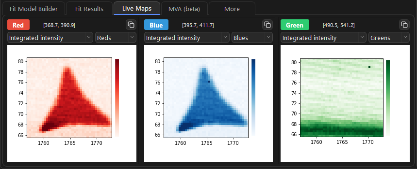 

##### **波段选择器控件 (`SpectraViewer`)** { #range-selector-controls-spectra-viewer }

位于 `SpectraViewer` 右侧边缘的垂直工具栏提供了三个独立的彩色开关按钮：

- **红区** (Red) (`R`)
- **蓝区** (Blue) (`B`)
- **绿区** (Green) (`G`)

每个按钮都会在光谱图上激活一对可拖动的垂直边界标记（括号边界及阴影区间），并自动将底部标签栏切换至**实时图谱**标签页：

- **交互式拖动**：点击并拖动任一侧的垂直边界线即可调节最小或最大波数；点击并拖动中间的阴影区域可在保持宽度不变的前提下整体平移波段区间。
- **多波段同时启用**：三个选择器可任意组合并同时启用，每个通道独立维护各自的颜色、区间与可见性。
- **自动缩放完整性**：波段选择器标记不会撑大或干扰光谱自动缩放边界，确保 **Rescale** 按钮（`Ctrl+R`）始终精准缩放到已加载的光谱数据范围。
- **自动限幅**：裁剪光谱或加载新数据时，波段选择器会自动限幅并重新定位到当前可见的光谱域内。
- **实时刷新**：在**实时图谱**标签页打开时，拖动任意选择器或更改选中的光谱/图谱都会立即重新计算并更新相应的一维变化曲线（在**光谱**工作区中）或二维空间热图 / 一维剖面曲线（在**二维图谱**工作区中），同时通过 60–250 ms 的自适应防抖（debounce）机制保证在大数据集上拖动依然顺滑流畅。在当前图谱或光谱列表中取消勾选的光谱会自动被屏蔽，从而防止异常离群点拉偏色标或剖面曲线。
- **多图谱选择与对比（二维图谱工作区）**：在**二维图谱**列表中按住 `Ctrl+Click` 或 `Shift+Click` 可同时选中多幅图谱，同时保持您的**主图谱** (Primary Map) 继续用于预处理、拟合以及 `MapViewer` 显示：
  - **多条一维剖面对比**：当主图谱为一维线扫描时，所有选中的一维剖面会以统一的线宽共同叠加显示在各通道子面板中（切换 **Legend** 按钮可在画布上识别每条曲线）。
  - **在所选二维图谱间切换**：当主图谱为二维图谱时，实时图谱顶部栏会出现紧凑的 `◀ [2D Map Selector] ▶` 切换器，让您在不丢失多选状态的前提下依次浏览所选二维热图。
  - **批量删除**：当选中多幅图谱时按下**删除** (Delete) 键，系统会弹出确认提示后再统一移除所有选中的图谱。

##### **实时图谱标签页可视化与子面板** { #live-maps-tab-visualization-subpanels }

**实时图谱**标签页位于底部标签栏的**拟合结果** (Fit Results) 与 **MVA** 之间，而**更多** (More) 标签页位于标签栏末尾。

- **子面板显示**：当启用一个或多个波段选择器时，对应的子面板（红、蓝、绿）会并排显示；若当前未启用任何选择器，面板会显示引导提示，指导您在 `SpectraViewer` 右侧边缘激活波段选择器按钮。
- **支持的光谱参数**：每个子面板均可通过下拉列表选择要提取并绘制的光谱参数：

| 参数 | 类型 | 说明 |
|-----------|------|-------------|
| **积分强度** (Integrated intensity) | 直接提取 | 所选光谱区间内的强度积分（$\sum Y \cdot \Delta x$）。 |
| **平均强度** (Mean intensity) | 直接提取 | 所选区间内的平均强度。 |
| **最大强度** (Maximum intensity) | 直接提取 | 所选区间内测得的最大强度值。 |
| **峰位** (Peak position) | 直接提取 | 区间内最大强度所对应的波数。 |
| **峰高** (Peak height) | 直接提取 | 最大强度减去区间两端点连线构成的局部基线值。 |
| **峰位（拟合）** (Peak position (fit)) | 基于拟合 | 区间内已拟合峰的中心波数（$x_0$）（需先完成拟合）。 |
| **峰高（拟合）** (Peak height (fit)) | 基于拟合 | 区间内已拟合峰的拟合振幅（$A$）（需先完成拟合）。 |
| **峰面积（拟合）** (Peak area (fit)) | 基于拟合 | 已拟合峰的解析积分面积（需先完成拟合）。 |
| **R/B 比值** (R/B ratio) *（仅限绿区通道）* | 派生计算 | 逐像素（二维图谱）或逐点（一维剖面 / 光谱系列）计算的积分强度比值 $I_{\mathrm{Red}} / I_{\mathrm{Blue}}$。移动或调整红区、蓝区边界时会自动同步更新；蓝区强度为零或接近零的点会安全屏蔽为 `NaN`。选择 **R/B 比值**期间，光谱图上的绿区选框会自动隐藏，仅保留决定比值的红区与蓝区选框（切换回其他任意参数后绿区选框会立即恢复）。 |

*注*：如果选择了基于拟合的参数但当前尚未生成拟合结果，子面板会友好地显示提示横幅，而不会展示误导性或错误数值。

##### **从 RGB 实时图谱交互式选取光谱 *(二维图谱工作区)*** { #interactive-spectrum-selection-from-rgb-live-maps-maps-workspace }

在**二维图谱**工作区中处理二维图谱或一维剖面图谱时（只要 **Pan** 与**缩放**工具未勾选），您无需离开实时图谱标签页即可直接从任意红区、蓝区或绿区子面板中选取光谱：

- **单击**：选中距离点击坐标最近的光谱，并立即在 `SpectraViewer` 中显示。
- **`Ctrl` + 点击**：将另一个光谱添加到当前选区（或取消已选测点的选中状态）。
- **点击并拖动**：绘制虚线选框以选中矩形区域内的全部光谱（`Ctrl` + 拖动可将框选光谱追加到当前选区中）。
- **同步高亮与图谱切换**：选中的测点会在所有激活的 RGB 子面板中以红色轮廓标出，并与主 `MapViewer` 及浮动 `VMapViewerDialog` 窗口保持同步。如果您此前通过顶部 `◀ [2D Map] ▶` 控件切换到了另一幅二维图谱，点击其上的任意测点会自动将该图谱设为主图谱并加载其光谱。点击处于打开状态的图例框内部时，仍保留用于拖动图例或双击编辑图例标签。

##### **各子面板独立控件** { #individual-subpanel-controls }

每个子面板均配有专属控件：

- **Rescale / Pan / 缩放**：每个子面板顶部均设有独立的导航按钮，可在不影响相邻通道的情况下局部放大感兴趣区域、平移曲线或热图，以及恢复完整绘图范围。双击图例依然会打开图例编辑器，而不会触发缩放重置。
- **一维曲线归一化** *（一维图谱与一维折线图）*：开启各 RGB 子面板参数下拉框旁的归一化按钮（可配合可选的 `Xmin` 与 `Xmax` 边界），即可在不修改底层原始数据的前提下，将每条显示的一维曲线独立按其全局最大值或 `[Xmin, Xmax]` 区间内最大值归一化为 `1.0` —— 非常适合对比信号振幅各异的不同图谱之间的剖面形态。
- **Palette** *（二维图谱工作区中的二维热图）*：可选择任意标准色标（如 `viridis`、`plasma`、`inferno`、`jet`、`turbo`、`coolwarm`、`cividis`、`magma`、`Reds`、`Blues`、`Greens`）。在**光谱**工作区中，每条一维变化曲线会自动采用与其对应选择器相同的颜色（红、蓝或绿）。
- **复制**：按照已配置的**复制图像尺寸** (Copied figure size) 与**复制图像主题** (Copied figure theme) 将子面板图像复制到剪贴板（独立于当前 SPECTROview 窗口大小）。按住 **`Ctrl` + 点击**（macOS 上为 **`Cmd` + 点击**）则可将当前图表的底层数值数据集以制表符分隔列的形式复制到剪贴板（一维参数变化序列、单条/多条一维剖面表，或二维 `(X, Y, Value)` 图谱数据点）。
- **范围 / 状态徽章**：显示当前波段区间 $[x_{min}, x_{max}]$ 或拟合状态。

##### **实时图谱视图选项与图例自定义** { #live-maps-view-options-legend-customization }

当激活一个或多个选择器时，**实时图谱**标签页右上角会出现两个快捷控件：

- **Show / Hide Legend (`btn_legend`)**：切换一维子面板中的交互式画布图例显示。您可以直接用鼠标拖动图例位置，或双击画布图例框来编辑其标签与颜色。
- **更多视图选项 (`⋯`)** (More View Options)：打开与 `SpectraViewer` 布局一致的紧凑双栏菜单（所有设置均在光谱与二维图谱工作区之间同步，并自动保存以供下次启动使用）：
  - **图表主题** (Plot Theme)：独立于全局应用界面主题，将实时图谱图像在**浅色模式** (Light Mode)（白色画布，默认）与**深色模式** (Dark Mode) 之间切换。
  - **坐标轴与色标刻度**：将 **X 轴刻度** (X-scale)、**Y 轴刻度** (Y-scale) 与**色标 (Z) 刻度** (Color (Z) scale) 在**线性**与**对数**之间切换（非严格正值区间会自动安全回退）。
  - **绘图样式与尺寸**：将一维曲线在**折线图**（默认）、**线 + 点** (Line + Dots) 与**点**之间切换，并调整**线宽** (Line width)（默认 `1.5`）、**点大小** (Dot size)（默认 `1.5`）及图表**文本大小** (Text size)（`6–24 pt`，同步缩放坐标轴标题、标签、刻度与色标标签）。
  - **复制图像尺寸与主题**：以英寸为单位设置剪贴板输出图像的固定尺寸（**复制图像尺寸**，默认 `5.5` × `4.0`），并选择**复制图像主题**（默认**浅色模式**，或**深色模式**），使复制出的图像无论窗口如何缩放都能保持固定比例与清晰可读的字号。
  - **图例框设置**：切换图例可见性、更改**图例位置** (Legend location)（`best`、各角落、`outside right`、`outside top`）、**图例列数** (Legend columns)、**图例字号** (Legend font size)，或打开**编辑图例标签...** (Edit legend labels...) 直接重命名画布图例系列名称并挑选自定义颜色。
  - **显示与对比辅助选项**：显示或隐藏各 RGB 画布上方的**显示图像标签** (Show figure label) 标题（默认关闭）、切换**显示网格** (Show grid)（默认关闭）、通过**共享 Y 轴 (1D)** (Share Y-axis (1D)) 同步各面板的 Y 轴范围、开启双线性**热图平滑** (Heatmap smoothing)、显示/隐藏 **Colorbars**，或点击**重置视图选项** (Reset view options) 恢复默认设置。

_______

### **4. `FitModelBuilder`** { #4-fitmodelbuilder }

在 `FitModelBuilder` 标签页中，您可以配置光谱拟合模型。该标签页分为三个主要面板：`Fitting`、`PeakTable` 和 `FitModelControl`，下文将逐一介绍。

您可以使用全局拟合参数，或在 `Settings Panel` 中调整拟合参数（详情请参阅“设置”章节）。

  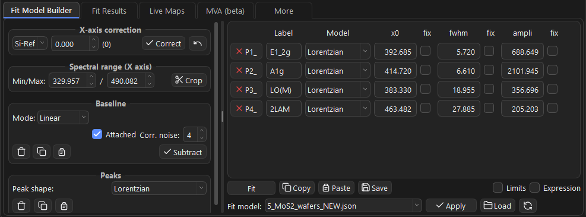 
  <i><code>FitModelBuilder</code> 标签页布局：(1) <code>Fitting</code> 面板（左侧），(2) <code>PeakTable</code> 面板（右上），以及 (3) <code>FitModelControl</code> 面板（右下）。</i>

#### **4.1. `Fitting` 面板** { #41-fitting-panel }

`Fitting` 面板通过以下四个逻辑步骤引导您构建稳健的拟合模型：

**第 1 步：X 轴校正（可选）**：根据已知标准参考样品的实测结果（例如位于精确 520.7 cm⁻¹ 处的硅峰）执行经验 X 轴校正。只需先拟合参考数据，输入其理论精确峰位并应用平移，即可全局校正校准偏差。

**第 2 步：定义拟合范围**：将数学拟合计算限制在 X 轴上特定的感兴趣光谱区域内。

**第 3 步：基线定义**：**SPECTROview** 提供两种不同的光谱基线定义模式（`Manual` 或 `Auto`）：

  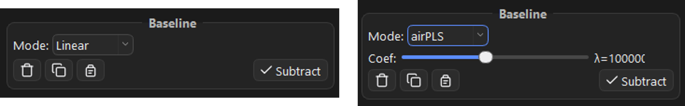 
   <i>基线模式选择：Manual 模式（左）与 Auto 模式（右）。</i>

- **Manual 模式（`Linear` 或 `Polynomial`）**：直接在 `SpectraViewer` 中点击以设置基线锚点。勾选**已附加** (Attached) 可自动将点击点吸附到最接近的数据曲线上；勾选 *Correct noise* 则会取相邻数据点的局部平均值作为锚点强度，从而在高噪声条件下也能稳健定位锚点。
- **Auto 模式**：由高级算法自动生成基线曲线，并通过滑块微调算法的拟合贴合程度：
  - **`arPLS`**：非对称重加权惩罚最小二乘法（Asymmetrically Reweighted PLS），是典型拉曼与红外光谱基线扣除的基准算法。
  - **`airPLS`**：高灵敏度算法，非常适合去除强而复杂的荧光背景，在拉曼光谱数据中经过充分验证并广受推荐。
  - **`AsLS`**：稳定性极高的算法，但有时难以区分高噪声与宽峰，最适用于相对干净的光谱。
  - **`ModPoly`**：改进多项式算法（Modified Polynomial），在简单多项式型荧光背景扣除中十分常用且高效。

**第 4 步：峰定义**：

- 在确保**峰**切换按钮开启的前提下，直接在 `SpectraViewer` 中左键点击添加峰，并可通过鼠标拖动交互式调整峰的初始猜测参数。
- 添加到图中的每个峰都会立即显示在 **`PeakTable`** 中。
- 支持的峰型轮廓包括：`Lorentzian`、`Gaussian`、`PseudoVoigt`、`LorentzianAsym`、`GaussianAsym`、`Fano`、`DecaySingleExp` 和 `DecayBiExp`。
- 使用 `Peaks` 分组中的**峰位配置方案** (Peak profile:) 下拉框可直接切换全局峰限制预设（如 Raman、PL (eV)、PL (nm)、XRD），或点击其旁的齿轮按钮直接跳转到**拟合设置** (Fit Settings) 中的**全局峰限制** (Global Peak Limits) 区域。

#### **4.2. 支持的峰型轮廓** { #42-supported-peak-profiles }

**SPECTROview** 的 `VBF Engine` 为以下数学峰型轮廓提供了高度优化的实现：

| 模型 | 参数 | 公式 |
|-------|-----------|---------|
| `Gaussian` | `ampli`, `fwhm`, `x0` | <i>a</i> &middot; exp(-4 ln(2) &middot; (x-x0)2 / w2) |
| `Lorentzian` | `ampli`, `fwhm`, `x0` | <i>a</i> / [1 + 4(x-x0)2 / w2] |
| `PseudoVoigt` | `ampli`, `fwhm`, `x0`, `alpha` | &alpha; &middot; G + (1-&alpha;) &middot; L |
| `GaussianAsym` | `ampli`, `fwhm_l`, `fwhm_r`, `x0` | 含左/右 `FWHM` 的分段高斯函数 |
| `LorentzianAsym` | `ampli`, `fwhm_l`, `fwhm_r`, `x0` | 含左/右 `FWHM` 的分段洛伦兹函数 |
| `Fano` | `ampli`, `fwhm`, `x0`, `q` | <i>a</i> &middot; (q + &epsilon;)2 / (1 + &epsilon;2), &epsilon; = 2(x-x0)/w |
| `DecaySingleExp` | `A`, `tau`, `B` | <i>A</i> &middot; e-t/&tau; + B |
| `DecayBiExp` | `A1`, `tau1`, `A2`, `tau2`, `B` | <i>A</i>1 &middot; e-t/&tau;1 + <i>A</i>2 &middot; e-t/&tau;2 + B |

#### **4.3. `PeakTable` 面板** { #43-peaktable-panel }

`PeakTable` 列出了您所定义各峰的全部数学参数；当您在视图中拖动峰时，这些属性会同步动态更新。

**动态峰索引**：每个峰都会按创建顺序自动附上索引后缀（例如 `_1`、`_2`）。当您添加、删除或重排峰时，**SPECTROview** 会自动重新编排索引以保持编号连续（例如删除峰 2 后，原峰 3 会自动成为新的峰 2），从而确保数学表达式与拟合结果始终井然有序。

  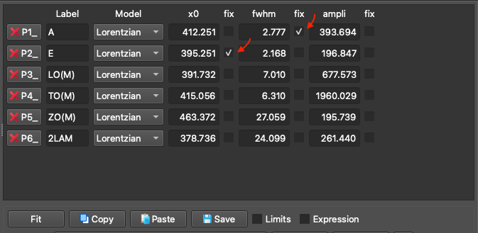 
   <i>显示峰参数与约束条件的 <code>PeakTable</code> 面板。</i>

**为拟合模型添加约束条件**：

**固定** (Fix)：勾选“**固定** (fix)”复选框可锁定参数值，使优化器在拟合过程中不再改动该参数。

**限制范围** (Limits)：输入最小与最大边界值，以限制优化器调节该参数的允许范围。

  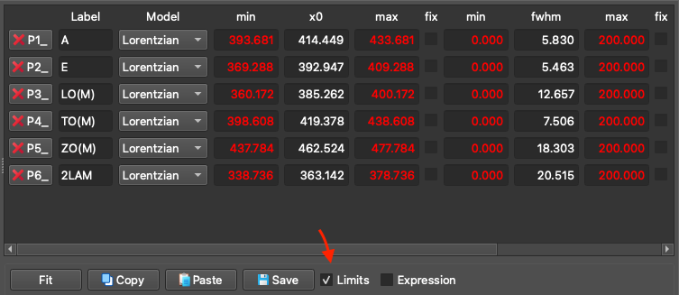 
   <i>示例 1：激活峰表下方的“限制范围”选项，并为每个拟合参数设定“min”和“max”值。</i>

**表达式** (Expression)：定义参数之间的复杂数学关系。**SPECTROview** 的 `VBF Engine` 会在将约束映射给优化器之前，对这些表达式进行严谨的数学求值。若因删除操作导致峰被重新编号，数学表达式中的相应峰引用也会自动更新，避免模型失效。

  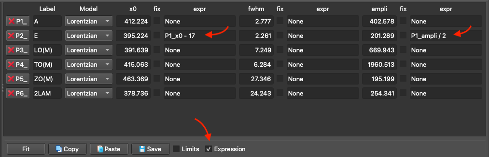 
   <i>示例 2：利用表达式约束 (1) 峰 E (P2) 的峰位比峰 A (P1) 小 17，或 (2) 峰 E (P2) 的振幅恰好为峰 A (P1) 振幅的一半。</i>

#### **4.4. `FitModelControl` 面板** { #44-fitmodelcontrol-panel }

完整定义模型后，点击**拟合** (Fit) 按钮即可执行优化计算。

  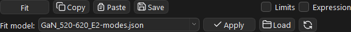 
   <i><code>FitModelControl</code> 面板。</i>

**复制 / 粘贴拟合模型**：
您可以将一条光谱上已配置完整的拟合模型复制到另一条光谱上，从而轻松将复杂设置复用到各个独立文件中。

> - 当您**粘贴** (Paste) 模型时，拟合引擎始终会从当前激活的设置面板中读取*实时*的噪声阈值（Noise Threshold）设定。这意味着您可以先复制模型，再调整噪声阈值，随后粘贴即可按新噪声配置应用模型。

**保存 / 加载拟合模型**：
如果您打算频繁使用某套模型，可将其保存为模板。已保存的模型可通过下拉菜单轻松读取并应用到新数据集中。

- **从下拉列表选择**：在**拟合模型：** (`Fit model:`) 组合框中挑选任意预设模型。
- **通过按钮加载**：点击**加载** (Load) 按钮浏览本地文件系统并加载任意 `.json` 拟合模型模板。
- **拖放加载**：您可以将 `.json` 拟合模型文件直接拖放到**拟合模型构建器** (`Fit Model Builder`) 面板上，或拖放到**光谱** / **二维图谱**工作区的任意位置。文件会立即添加到模型列表中并在下拉框中自动选中，随时可供应用。
- **应用模型**：点击**应用** (Apply) 将所加载的模型分配给当前选中的光谱（或在点击**应用**时按住 **Ctrl** 键将其批量分配给所有光谱）。

> - 当您点击**保存** (Save) 将模型写入 `.json` 文件时，*当前*的噪声阈值会永久保存进该文件中。此后当您**应用**（**加载**）该模型时，拟合引擎将严格采用文件中保存的噪声阈值，而忽略设置面板中的当前设置。

_______

### **5. 汇总与保存拟合结果** { #5-collect-and-save-fit-results }

当光谱或二维图谱拟合完成后，您需要将最佳拟合结果汇总整理：

- 切换到**拟合结果**标签页。
- 点击 **Collect** 按钮。**SPECTROview** 会立即将全部最佳拟合参数汇总到一张统一的数据表中。每条光谱的拟合优度（**R2**，即决定系数）也会作为单独一列包含其中，因此您可以像对待任意拟合参数一样对其进行筛选或绘图（例如在 `Maps` 工作区绘制 R² 热图）。点击任意列标题即可选中整列，跨多个列标题拖动则可多选列并快速复制到剪贴板。

> **调整小数精度**：数值结果（`x0`、`ampli`、`fwhm`、`area`、`R2` 等）显示的小数位数由**拟合结果**标签页顶部、紧邻 **Collect** 按钮上方的**结果小数位数** (Fit results decimals) 微调框控制（默认为 3）。修改数值后再次点击 **Collect**，即可按新精度重建结果表。该精度设置同样适用于计算列（见下文）；X/Y 坐标列始终保留完整精度。

  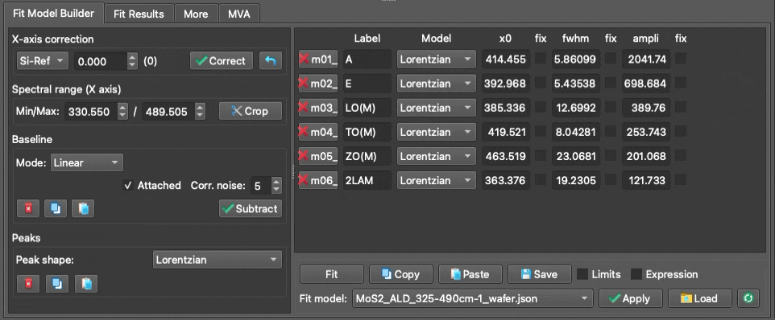 
   <i>汇总拟合结果界面与汇总后的数据表。</i>

#### **5.1. 拆分文件名特征** { #51-splitting-filename-features }

此工具可自动提取嵌入在文件名中的元数据信息。例如，若您的文件命名为 `Sample1_ProcessA_Temp25`，该工具可按下划线（`_`）拆分文件名，并将提取出的字段分别填入数据集的新增列中（参见上方演示视频）。

#### **5.2. 计算并添加新列** { #52-compute-and-add-new-columns }

您可以基于已有拟合参数的数学组合轻松创建新列（例如通过 `x0_p1 - x0_p2` 计算峰位偏移量）。
支持的数学运算符包括：`+`、`-`、`*`、`/`、`**`、`%` 以及 `()`。计算生成的新列同样会按标签页顶部设定的**结果小数位数**进行四舍五入。

> **重要提示**：如果列名包含空格或特殊字符，必须使用反引号将其括起来。例如：`` `x0_LO(M)` ``

#### **5.3. 保存与可视化** { #53-save-and-visualize }

完成数据表整理后，您可以：

- **使用清晰的名称保存数据表**，然后**直接发送至 `Graphs` 工作区**进行即时绘图。

  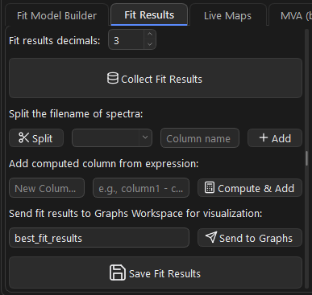 

 

- **将其导出为 Excel/CSV 电子表格**以供外部软件分析处理。

   

### **6. `More` 标签页** { #6-more-tab }

`More`（**更多**）标签页汇集了辅助工具与元数据查看功能，共分为三个区域：

  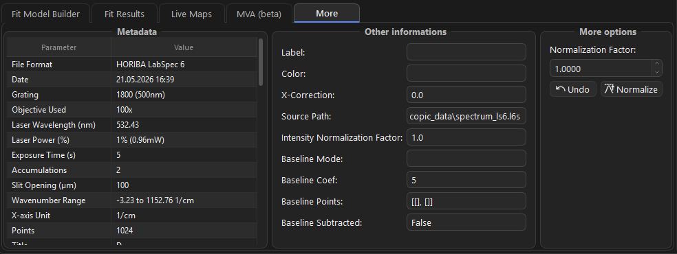 

- **左侧**：直接显示从已加载的 `.wdf`、`.spc`、`.l6s`、`.l6m`、`.ngs` 或 `.ngc` 文件中提取的完整元数据，展示采集时使用的精确仪器参数设置。
- **中间**：显示当前所选光谱的详细属性与统计信息。
- **右侧**：提供额外的预处理实用工具，例如全局强度归一化算法以及宇宙射线伪峰检测与去除工具。
