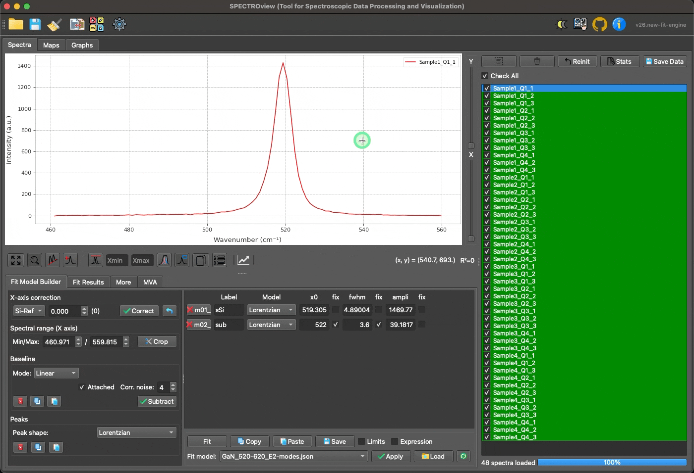

## **Überblick über die Benutzeroberfläche** { #user-interface-overview }

### **1. Arbeitsbereiche** { #1-workspaces }

**SPECTROview** wurde sorgfältig darauf ausgelegt, die Verarbeitung spektroskopischer Daten sowie die Visualisierung von Fit-Ergebnissen effizient zu gestalten. Die Benutzeroberfläche gliedert sich in drei zentrale Arbeitsbereiche, die jeweils auf einen spezifischen Arbeitsablauf zugeschnitten sind:

- **Spektren** (Spectra): Ausgelegt auf die Verarbeitung einzelner oder mehrerer diskreter Spektren.
- **Karten** (Maps): Optimiert für die Handhabung hyperspektraler Datensätze, einschließlich umfangreicher Wafer-Daten und 2D-Karten.
- **Diagramme** (Graphs): Konzipiert für leistungsfähige statistische Plots und eine umfassende Datenvisualisierung.

   
   <i>Navigation zwischen den drei zentralen Arbeitsbereichen.</i>

_____

### **2. Tooltips** { #2-tooltips }

Die meisten Elemente der Benutzeroberfläche in **SPECTROview** (z. B. Schaltflächen, Textfelder, Dropdown-Listen) verfügen über integrierte Tooltips. Halten Sie den Mauszeiger einfach kurz über ein Element, um eine kurze Erläuterung seiner Funktion anzuzeigen.

   
  <i>Demonstration der interaktiven Tooltips.</i>

