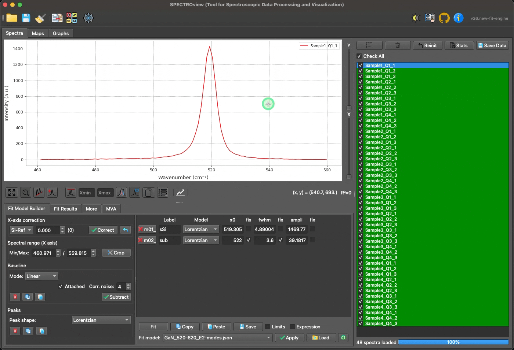

## **Aperçu de l'interface utilisateur**

### **1. Espaces de travail**

**SPECTROview** a été conçu pour fluidifier le traitement des données spectroscopiques et la visualisation des résultats d'ajustement. L'interface s'articule autour de trois espaces de travail principaux, chacun dédié à un flux d'analyse spécifique :

- **`Spectra`** : Dédié au traitement de spectres discrets, individuels ou multiples.
- **`Maps`** : Optimisé pour l'exploitation de jeux de données hyperspectraux, notamment les cartographies de plaquettes (*wafers*) et les cartes 2D de grande taille.
- **`Graphs`** : Conçu pour le tracé statistique avancé et la génération de graphiques de synthèse.

   
   <i>Navigation entre les trois espaces de travail principaux.</i>

_____

### **2. Infobulles**

La plupart des éléments de l'interface graphique de **SPECTROview** (boutons, zones de saisie, listes déroulantes) disposent d'infobulles intégrées. Survolez simplement un élément avec le curseur pendant un instant pour afficher une brève explication de sa fonction.

   
  <i>Démonstration des infobulles interactives.</i>

