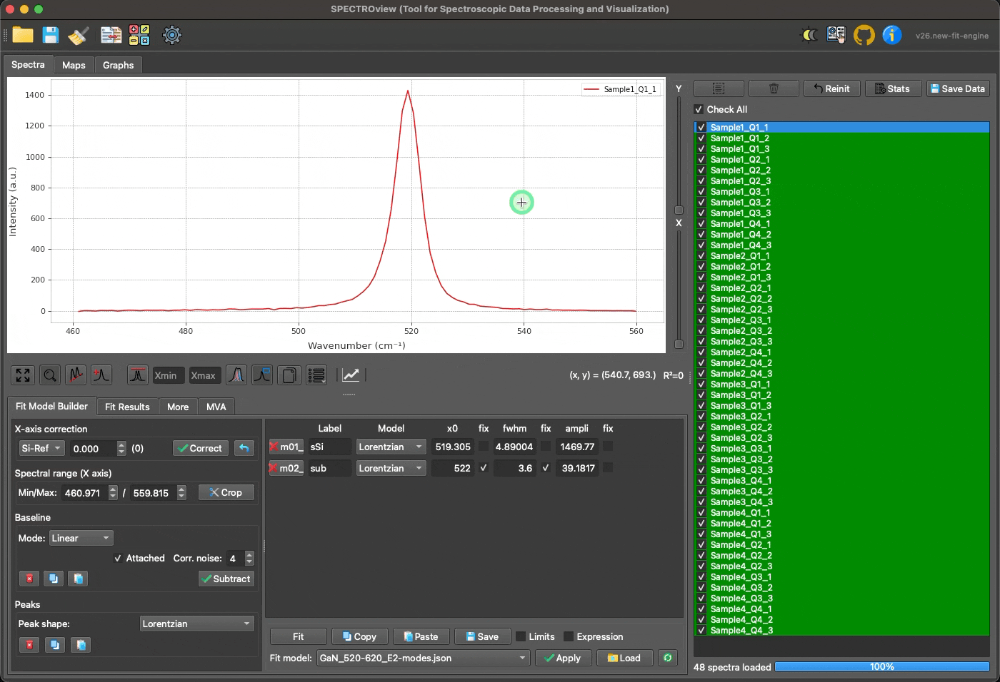

## **Обзор пользовательского интерфейса** { #user-interface-overview }

### **1. Рабочие области** { #1-workspaces }

**SPECTROview** тщательно спроектирован для эффективной обработки спектроскопических данных и визуализации результатов аппроксимации. Интерфейс построен вокруг трёх основных рабочих областей, каждая из которых ориентирована на конкретный рабочий процесс:

- **Спектры** (Spectra): Предназначена для обработки одного или нескольких дискретных спектров.
- **Карты** (Maps): Оптимизирована для работы с гиперспектральными наборами данных, включая обширные данные пластин и 2D-карты.
- **Графики** (Graphs): Разработана для эффективного построения статистических графиков и комплексной визуализации данных.

   
   <i>Переключение между тремя основными рабочими областями.</i>

_____

### **2. Всплывающие подсказки** { #2-tooltips }

Большинство элементов графического интерфейса **SPECTROview** (например, кнопки, текстовые поля, выпадающие списки) оснащены встроенными всплывающими подсказками. Просто ненадолго наведите курсор мыши на элемент, чтобы увидеть краткое пояснение его функции.

   
  <i>Демонстрация интерактивных всплывающих подсказок.</i>

