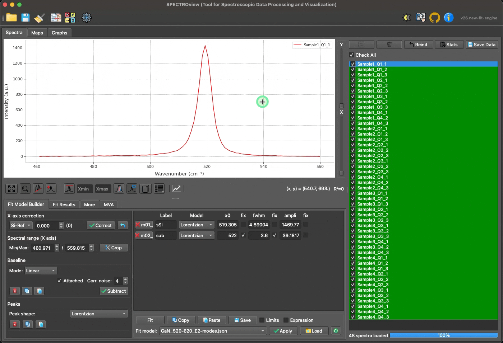

## **用户界面概览** { #user-interface-overview }

### **1. 工作区** { #1-workspaces }

**SPECTROview** 经过精心设计，旨在简化光谱数据处理并实现拟合结果的高效可视化。界面围绕三个主要工作区构建，每个工作区均针对特定工作流量身定制：

- **光谱** (Spectra)：专用于处理单条或多条离散光谱。
- **二维图谱** (Maps)：针对高光谱数据集的处理进行了优化，包括大规模晶圆数据与二维图谱。
- **图表** (Graphs)：专为强大的统计绘图与全面的数据可视化而设计。

   
   <i>在三个主要工作区之间切换。</i>

_____

### **2. 工具提示** { #2-tooltips }

**SPECTROview** 中的大多数图形界面元素（例如按钮、文本框、下拉列表）均内置了工具提示。只需将鼠标指针在元素上悬停片刻，即可查看其功能的简要说明。

   
  <i>交互式工具提示演示。</i>

